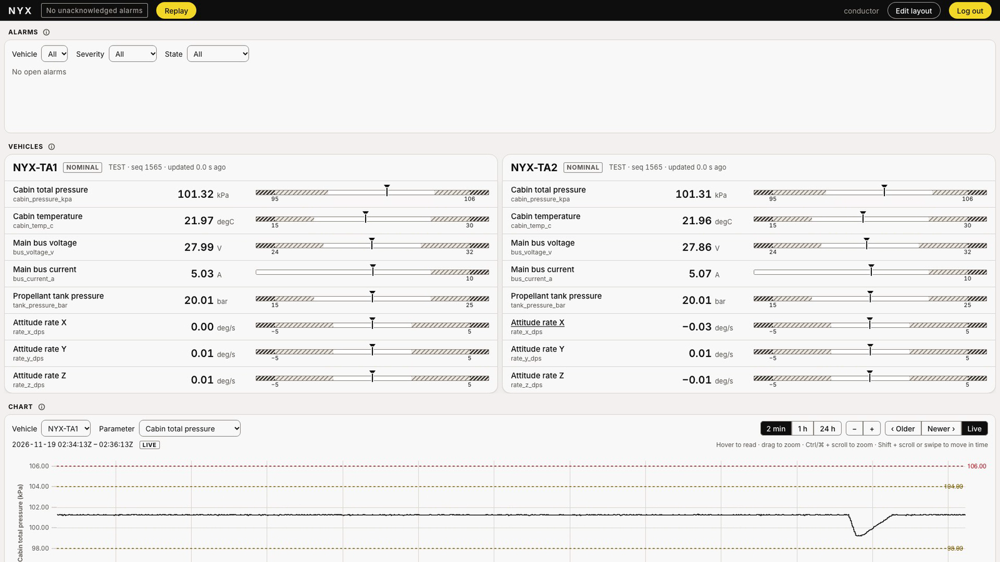

# Nyx Ground Segment



## What it is
A ground segment for a test campaign: it ingests telemetry from two simulated test articles (NYX-TA1 and NYX-TA2, 10 Hz each, with fault injection), stores every frame once, classifies each value against limits with hysteresis and persistence, raises and tracks alarms with acknowledgement, sends commands with a confirmation and a 2 s interlock, runs test sessions with a frozen report, archives finished hours to verified Parquet files and replays them. Python backend, React + TypeScript console, everything in Docker Compose. Requirements are in [docs/requirements.md](docs/requirements.md), the design in [docs/design.md](docs/design.md).

Status: Gate 4, test readiness. In: the archiver, replay, session re-freeze, alarm-quality metrics and test hooks. Run P and the scaling analysis are in; their commands are documented in the ATP procedures. [CHANGELOG.md](CHANGELOG.md) says what is in per gate.

## Run
Needs only Docker and make.
```
git clone https://github.com/khannoussi-malek/nyx-ground-segment
cd nyx-ground-segment
make up
```
`make up` creates `.env`, `users.yaml` and the Redis ACL on the first run and prints the three demo users (`conductor`, `fc1`, `fc2`) and their passwords once; they stay in `.env` as `DEMO_PW_<USER>`. Open http://127.0.0.1:8000 and log in. `make down` stops the stack and keeps the data; `make reset` deletes everything (database, archive, secrets).

## What to try first
1. Log in as `conductor`. Two vehicle tables update ten times a second; every time is UTC and ends in `Z`.
2. Inject a cabin leak on NYX-TA1 (the simulator listens on port 8081):
   `curl -X POST http://127.0.0.1:8081/sim/fault -H 'Content-Type: application/json' -d '{"vehicle":"NYX-TA1","fault":"leak"}'`.
   The pressure falls at 0.4 kPa/s: a YELLOW rate alarm first, then RED LOW, with the reason in words and the limits-file hash. Press **ACK**, type a note, confirm. Clear the fault with `curl -X DELETE http://127.0.0.1:8081/sim/fault -H 'Content-Type: application/json' -d '{"vehicle":"NYX-TA1","fault":"leak"}'`.
3. Cut NYX-TA2 for 10 s: `curl -X POST http://127.0.0.1:8081/sim/fault -H 'Content-Type: application/json' -d '{"vehicle":"NYX-TA2","fault":"dropout","params":{"duration_s":10}}'`. The console shows **LOSS OF SIGNAL**, then one gap event with about 100 lost frames when it returns. A dropout ends by itself; no DELETE is needed.
4. Send a hazardous command and read the confirmation dialog; start and stop a test session and download its report (the [operator guide](docs/operator-guide.md) walks through each).
5. Archive and replay: a backfilled NYX-TA9 history is archived within one loop and can be replayed from the Replay toggle in the top bar; the manual steps are in [docs/atp/ATP-07.md](docs/atp/ATP-07.md) and the replay screen is described in the [operator guide](docs/operator-guide.md#run-a-replay).

## Architecture
```
simulator --XADD--> Redis streams --XREADGROUP--> ingest x2 --commit--> TimescaleDB
   ^                      |  ^                        |                      |
   | commands (tc)        |  | acks (tcack)           | UI events            v
   +---- API <------------+  +------------------------+--> API --SSE/REST--> console
                                                          archiver --Parquet + .sha256--> MinIO
```
Compose services: `db`, `redis`, `minio` (+ `minio-init`, `migrate`), `simulator`, `ingest-1`, `ingest-2`, `api` (REST, SSE and the console files on one origin), `archiver`. The diagram and the one-paragraph story are in [design §1](docs/design.md#1-system-in-one-picture).

### How order is kept
One reader per vehicle: each vehicle has exactly one owner among the ingest workers, enforced by a Postgres advisory lock. The other worker blocks on that lock and continues the moment the owner's session ends. The owner stores the frame, runs the alarm engine, commits, only then acknowledges the Redis entry, so a killed worker loses nothing. A fenced owner (one whose lock was taken) exits before it reads again.

### Add a check type
A new alarm check is one new module in `src/gs/alarms/checks/` with `@register`; the worker is not edited. Steps in the [developer guide](docs/dev-guide.md#add-a-limit-check-type).

## Decisions and why
All decisions have IDs in [docs/design.md](docs/design.md) and map to requirements in [docs/requirements.md](docs/requirements.md). The main ones:
- **Redis Streams, not Kafka**: the load is 20 frames/s; switch triggers are in design R3.
- **Commit, then acknowledge** (D-ING-02): redelivery is harmless because the store key is `(vehicle, t_onboard, seq)` and inserts are idempotent.
- **Alarms are evaluated in the frame transaction** (D-ALM-10): the engine state is saved with the frame, so a takeover continues exactly.
- **Hysteresis and persistence N = 3**: noise around a limit gives one alarm; the tuning analysis is [docs/perf/alarm-tuning.md](docs/perf/alarm-tuning.md).
- **One TimescaleDB** for frames, events, alarms, commands, sessions and audit (D-DB-01).
- **Archive: hash, re-read, compare rows, then delete** (D-ARC-02..05): a hot row is deleted only after a verified Parquet object matches it in count and time range.
- **Replay shows the recorded truth** (D-REP-01): archived frames merged with the alarms recorded live; nothing is recomputed.
- **Everything built ships with its test** (D-ENG-14); CI fails under 80 % coverage.

## Limitations
From [design §4](docs/design.md#4-deliberately-not-built):
- **A single copy of the archive.** After `HOT_RETENTION_H` the one MinIO object is the only copy. A rolling scrub finds corruption (an `ARCHIVE_CORRUPT` event, `degraded` health, replay of that hour refused with 409); nothing repairs it. The MinIO image is a frozen `bitnamilegacy` build.
- **Non-telemetry history is lost back to the last snapshot** (≤ `SNAPSHOT_EVERY_H`, default 24 h): alarms, events, commands and the audit log are snapshotted daily to the same MinIO as the archive (D-ARC-12), so losing both loses everything.
- Not production-ready: no roles or second-person approval for hazardous commands, no TLS (ports are bound to 127.0.0.1), secrets live in `.env`, Redis and Postgres are single nodes, the audit log is append-only by role and trigger but not tamper-evident.
- **Command timeouts wait for ground processing.** A command's 5 s / 15 s timeouts start only once ground processing has caught up with its backlog (D-CMD-05). While it is behind, a command can stay SENT or RECEIVED past its limit with no note on screen; the GROUND PROCESSING banner and the `/healthz` backlog say why.
- No flood control, shelving or suppression; no CCSDS/PUS decoding; no report sign-off in the tool.
- Stream interfaces are not versioned: after any change to a stream schema, restart all services together.
- No in-place schema migrations of a long-lived database; a schema change during development means `make reset`.
- Measurements run on one laptop with the load driver on the same machine; numbers are in `docs/perf/`.
- ING-10 holds only on a host that is not CPU-oversubscribed ([NCR-01](docs/ncr/NCR-01.md)); at 10 vehicles × 100 Hz a restarted ingest worker does not catch up ([scaling](docs/perf/scaling.md)).

## Next steps
Identity and roles; TLS and a secret store; tamper-evident audit; replicated Redis and Postgres; a maintained S3 store with a second copy; a real decoder for the bench interface; the scaling fixes in `docs/perf/scaling.md`; shelving, latching and flood handling; versioned stream interfaces once a second producer exists. The ordered list is [design §4](docs/design.md#not-production-ready-in-the-order-we-would-fix-it-review-q14).
