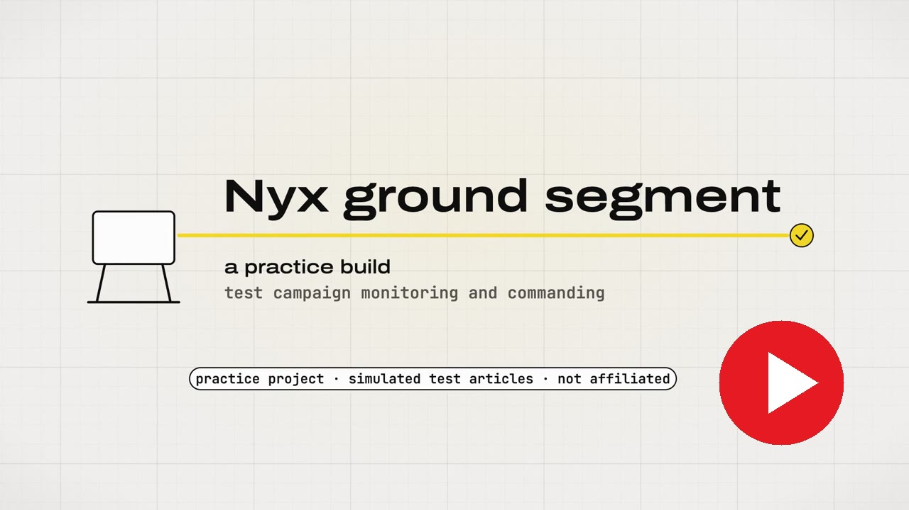
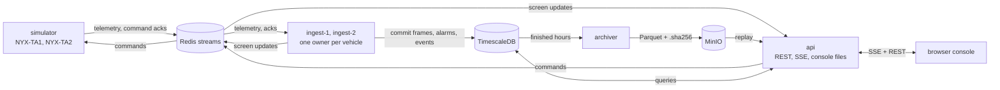

# Nyx Ground Segment

Ground software for a spacecraft test campaign. It takes live telemetry from two simulated test articles, raises and tracks limit alarms, sends commands with a safety interlock, runs test sessions with a frozen report, and archives every finished hour to verified files you can replay later. It was written test-first against 47 requirements and accepted from a fresh clone.

[](https://youtu.be/SmON-rX1CMs)

**[Watch the walkthrough on YouTube](https://youtu.be/SmON-rX1CMs)** (29 min). It covers the problem, the design, a live demo, the tests, the measurements and the known gaps. Chapter links are in the [guided tour](#video-chapters).


*A cabin leak injected on NYX-TA1, 1.5x speed. The longer scenario runs at [11:29 in the video](https://youtu.be/SmON-rX1CMs?t=689).*

**Contents:** [Guided tour](#guided-tour) · [What it is](#what-it-is) · [Run](#run) · [What to try first](#what-to-try-first) · [Architecture](#architecture) · [Where things are](#where-things-are) · [Decisions and why](#decisions-and-why) · [Results](#results) · [Limitations](#limitations) · [Next steps](#next-steps)

## Guided tour

Pick the route that fits the time you have.

| Time | Route |
| --- | --- |
| 5 minutes | Watch [the architecture](https://youtu.be/SmON-rX1CMs?t=388) and [the live demo](https://youtu.be/SmON-rX1CMs?t=689) chapters, or the silent 3.5-minute [demo recording](docs/demo/README.md). Then skim [Architecture](#architecture). |
| 30 minutes | Start the stack with [Run](#run) and follow [What to try first](#what-to-try-first). Then read the [acceptance report](docs/atp-report.md): every acceptance test with its result and evidence. |
| A review | Read the [requirements](docs/requirements.md), then the [design](docs/design.md), where every decision has an ID and points back to a requirement. Check the evidence in the [acceptance report](docs/atp-report.md) and the [non-conformance reports](docs/ncr/). Then use [Where things are](#where-things-are) to open the code behind any decision. |

### Video chapters

| Start | Chapter |
| --- | --- |
| [0:00](https://youtu.be/SmON-rX1CMs) | Who I am and why I built this |
| [0:34](https://youtu.be/SmON-rX1CMs?t=34) | The problem, and what is simulated or assumed |
| [1:19](https://youtu.be/SmON-rX1CMs?t=79) | The users: test conductor, flight controller, engineers |
| [2:39](https://youtu.be/SmON-rX1CMs?t=159) | How acceptance works: musts, shoulds, evidence, non-conformances |
| [4:13](https://youtu.be/SmON-rX1CMs?t=253) | Reliability: commit then acknowledge, one owner per vehicle |
| [6:28](https://youtu.be/SmON-rX1CMs?t=388) | Architecture, service by service |
| [11:29](https://youtu.be/SmON-rX1CMs?t=689) | Live demo: a test session and a cabin leak |
| [13:10](https://youtu.be/SmON-rX1CMs?t=790) | Live demo: loss of signal and ground failures |
| [15:58](https://youtu.be/SmON-rX1CMs?t=958) | Commands and the audit log, then archive and replay |
| [16:45](https://youtu.be/SmON-rX1CMs?t=1005) | Testing: about 2,250 tests at four levels |
| [20:11](https://youtu.be/SmON-rX1CMs?t=1211) | Measurements |
| [23:32](https://youtu.be/SmON-rX1CMs?t=1412) | How it was built, including the use of AI |
| [25:15](https://youtu.be/SmON-rX1CMs?t=1515) | Gate 5 acceptance from a fresh clone |
| [26:43](https://youtu.be/SmON-rX1CMs?t=1603) | Limitations and the review board's questions |
| [28:30](https://youtu.be/SmON-rX1CMs?t=1710) | Wrap-up |

## What it is
A ground segment for a test campaign: it ingests telemetry from two simulated test articles (NYX-TA1 and NYX-TA2, 10 Hz each, with fault injection), stores every frame once, classifies each value against limits with hysteresis and persistence, raises and tracks alarms with acknowledgement, sends commands with a confirmation and a 2 s interlock, runs test sessions with a frozen report, archives finished hours to verified Parquet files and replays them. Python backend, React + TypeScript console, everything in Docker Compose. Requirements are in [docs/requirements.md](docs/requirements.md), the design in [docs/design.md](docs/design.md).

Status: v1.0.1. v1.0 was accepted at Gate 5 from a fresh clone: the [acceptance report](docs/atp-report.md) gives each ATP's result, evidence and numbers; the non-conformances are in [docs/ncr/](docs/ncr/); a 3.5-minute [demo](docs/demo/README.md) shows ATP-02, ATP-04 and ATP-07 in the console. v1.0.1 fixes a false loss of signal after a broker outage ([NCR-04](docs/ncr/NCR-04.md)). [CHANGELOG.md](CHANGELOG.md) says what is in each release.

The test articles are simulated and the project is not affiliated with any company. Every assumption about how a real team works is written down in [docs/assumptions.md](docs/assumptions.md).


## Run
Needs only Docker and make.
```
git clone https://github.com/khannoussi-malek/nyx-ground-segment
cd nyx-ground-segment
make up
```
`make up` creates `.env`, `users.yaml` and the Redis ACL on the first run and prints the three demo users (`conductor`, `fc1`, `fc2`) and their passwords once; they stay in `.env` as `DEMO_PW_<USER>`. Open http://127.0.0.1:8000 and log in. `make down` stops the stack and keeps the data; `make reset` deletes everything (database, archive, secrets).

To run the tests or work on the code you also need [uv](https://docs.astral.sh/uv/) and Node.js; the [developer guide](docs/dev-guide.md#run-the-tests) has the commands.

## What to try first
1. Log in as `conductor`. Two vehicle tables update ten times a second; every time is UTC and ends in `Z`.
2. Inject a cabin leak on NYX-TA1 (the simulator listens on port 8081):
   `curl -X POST http://127.0.0.1:8081/sim/fault -H 'Content-Type: application/json' -d '{"vehicle":"NYX-TA1","fault":"leak"}'`.
   The pressure falls at 0.4 kPa/s: a YELLOW rate alarm first, then RED LOW, with the reason in words and the limits-file hash. Press **ACK**, type a note, confirm. Clear the fault with `curl -X DELETE http://127.0.0.1:8081/sim/fault -H 'Content-Type: application/json' -d '{"vehicle":"NYX-TA1","fault":"leak"}'`.
3. Cut NYX-TA2 for 10 s: `curl -X POST http://127.0.0.1:8081/sim/fault -H 'Content-Type: application/json' -d '{"vehicle":"NYX-TA2","fault":"dropout","params":{"duration_s":10}}'`. The console shows **LOSS OF SIGNAL**, then one gap event with about 100 lost frames when it returns. A dropout ends by itself; no DELETE is needed.
4. Send a hazardous command and read the confirmation dialog; start and stop a test session and download its report (the [operator guide](docs/operator-guide.md) walks through each).
5. Archive and replay: a backfilled NYX-TA9 history is archived within one loop and can be replayed from the Replay toggle in the top bar; the manual steps are in [docs/atp/ATP-07.md](docs/atp/ATP-07.md) and the replay screen is described in the [operator guide](docs/operator-guide.md#run-a-replay).

## Architecture



Redis is the only link between the simulator, the ingest workers and the API: they never call each other, so each part can be read and tested on its own. Compose services: `db`, `redis`, `minio` (+ `minio-init`, `migrate`), `simulator`, `ingest-1`, `ingest-2`, `api` (REST, SSE and the console files on one origin), `archiver`. Each service connects to Redis as its own user, limited by ACL to the keys it needs. The one-paragraph story is in [design §1](docs/design.md#1-system-in-one-picture).

### How order is kept
One reader per vehicle: each vehicle has exactly one owner among the ingest workers, enforced by a Postgres advisory lock. The other worker blocks on that lock and continues the moment the owner's session ends. The owner stores the frame, runs the alarm engine, commits, only then acknowledges the Redis entry, so a killed worker loses nothing. A fenced owner (one whose lock was taken) exits before it reads again.

### Add a check type
A new alarm check is one new module in `src/gs/alarms/checks/` with `@register`; the worker is not edited. Steps in the [developer guide](docs/dev-guide.md#add-a-limit-check-type).

## Where things are

The code, by part of the system. Each Python service is one package in `src/gs/` and one command in [pyproject.toml](pyproject.toml).

| Part | Code | What it does |
| --- | --- | --- |
| Simulator | `src/gs/simulator/` | Plays the test articles: a frame per tick per vehicle, answers commands, takes fault injections on `/sim/fault`. |
| Ingest workers | `src/gs/ingest/` | Read the telemetry streams, check each frame, store it, track sequence gaps and loss of signal, and publish screen updates. |
| Alarm engine | `src/gs/alarms/` | Limit checks, the alarm state machine and data-quality figures. Runs inside the ingest transaction. |
| Commanding | `src/gs/commanding/` | Argument checks against the mission database, and tracking each command from queued to verified, failed or timed out. |
| API | `src/gs/api/` | FastAPI: login, commands, alarm ACK, charts, sessions and reports, replays, and the live SSE stream. |
| Archiver | `src/gs/archiver/` | Hourly Parquet export to MinIO, a rolling hash check, the hot-data delete and daily snapshots. |
| Replay | `src/gs/replay/` | Rebuilds a past window from the archive and the recorded alarms. |
| Shared code | `src/gs/common/` | Config, logging, health, the mission database loader, and `interfaces/`, the message formats every service shares. |
| Console | [ui/src/](ui/src/) | React + TypeScript: `components/`, `server/` (API and SSE client), `state/`, `tools/`. |
| Mission definition | `mission/` | Parameters, limits and commands. Ingest and the API reload it when the files change. |
| Database schema | [migrations/](migrations/) | Tables, roles and grants, applied on first start. |

The documents, by question.

| Question | Document |
| --- | --- |
| What must it do? | [docs/requirements.md](docs/requirements.md): the 47 requirements with their evidence |
| Why is it built this way? | [docs/design.md](docs/design.md): every decision with an ID, the alternatives and the requirement it serves |
| What was assumed? | [docs/assumptions.md](docs/assumptions.md) |
| Did it pass? | [docs/atp-report.md](docs/atp-report.md), the procedures in [docs/atp/](docs/atp/), the non-conformances in [docs/ncr/](docs/ncr/) |
| How fast is it? | [docs/perf/](docs/perf/): raw samples and summaries for every measured run |
| How do I operate it? | [docs/operator-guide.md](docs/operator-guide.md) |
| How do I change it? | [docs/dev-guide.md](docs/dev-guide.md): add a parameter, a check type or a command, run the tests |
| What does the research say? | [docs/research/](docs/research/): the notes behind the design choices |
| What went wrong along the way? | [docs/bug-log.md](docs/bug-log.md) |

## Decisions and why
All decisions have IDs in [docs/design.md](docs/design.md) and map to requirements in [docs/requirements.md](docs/requirements.md). The main ones:
- **Redis Streams, not Kafka**: the load is 20 frames/s; switch triggers are in design R3.
- **Commit, then acknowledge** (D-ING-02): redelivery is harmless because the store key is `(vehicle, t_onboard, seq)` and inserts are idempotent.
- **Alarms are evaluated in the frame transaction** (D-ALM-10): the engine state is saved with the frame, so a takeover continues exactly.
- **Hysteresis and persistence N = 3**: noise around a limit gives one alarm; the tuning analysis is [docs/perf/alarm-tuning.md](docs/perf/alarm-tuning.md).
- **One TimescaleDB** for frames, events, alarms, commands, sessions and audit (D-DB-01).
- **Archive: hash, re-read, compare rows, then delete** (D-ARC-02..05): a hot row is deleted only after a verified Parquet object matches it in count and time range.
- **Replay shows the recorded truth** (D-REP-01): archived frames merged with the alarms recorded live; nothing is recomputed.
- **Everything built ships with its test** (D-ENG-14); CI fails under 80 % coverage.

## Results

Measured on one laptop (Apple M4 Pro) with the load generator on the same machine, as the [acceptance report](docs/atp-report.md) states for every number.

| What | Requirement | Measured | Limit |
| --- | --- | --- | --- |
| Frame to stored, p95, 2 vehicles at 10 Hz | ING-09 | 16.6 ms | 200 ms |
| Limit breach to alarm, p95 | ALM-05 | 19.9 ms | 300 ms |
| Frame to screen, p95 | UI-01 | 94.4 ms | 1 s |
| One-hour range query | DAT-03 | 23.3 ms | 300 ms |
| Ingest lag, 2 vehicles at 100 Hz for 5 min | ING-10 | 0.648 s max | 1 s |
| Two-hour soak, both vehicles | ATP-01 | 144,000 frames, 0 lost | 0 lost |

Acceptance: 40 of 40 musts and 6 of 7 shoulds pass; the one partial and every other finding has a [non-conformance report](docs/ncr/). The v1.0.1 release passed 1,748 unit and integration tests (98.5 % coverage), 54 system tests against the running stack and 30 browser tests.

## Limitations
From [design §4](docs/design.md#4-deliberately-not-built):
- **A single copy of the archive.** After `HOT_RETENTION_H` the one MinIO object is the only copy. A rolling scrub finds corruption (an `ARCHIVE_CORRUPT` event, `degraded` health, replay of that hour refused with 409); nothing repairs it. The MinIO image is a frozen `bitnamilegacy` build.
- **Non-telemetry history is lost back to the last snapshot** (≤ `SNAPSHOT_EVERY_H`, default 24 h): alarms, events, commands and the audit log are snapshotted daily to the same MinIO as the archive (D-ARC-12), so losing both loses everything.
- Not production-ready: no roles or second-person approval for hazardous commands, no TLS (ports are bound to 127.0.0.1), secrets live in `.env`, Redis and Postgres are single nodes, the audit log is append-only by role and trigger but not tamper-evident.
- **Command timeouts wait for ground processing.** A command's 5 s / 15 s timeouts start only once ground processing has caught up with its backlog (D-CMD-05). While it is behind, a command can stay SENT or RECEIVED past its limit with no note on screen; the GROUND PROCESSING banner and the `/healthz` backlog say why.
- No flood control, shelving or suppression; no CCSDS/PUS decoding; no report sign-off in the tool.
- Stream interfaces are not versioned: after any change to a stream schema, restart all services together.
- No in-place schema migrations of a long-lived database; a schema change during development means `make reset`.
- Measurements run on one laptop with the load driver on the same machine; numbers are in `docs/perf/`.
- ING-10 holds only on a host that is not CPU-oversubscribed ([NCR-01](docs/ncr/NCR-01.md)): run P 2026-11-18 had a max lag of 0.648 s at 2 × 100 Hz (load 3.81, `docs/perf/run-p-2026-11-18`), and 19.56 s at load 28; at 10 vehicles × 100 Hz a restarted ingest worker does not catch up ([scaling](docs/perf/scaling.md)).

## Next steps
Identity and roles; TLS and a secret store; tamper-evident audit; replicated Redis and Postgres; a maintained S3 store with a second copy; a real decoder for the bench interface; the scaling fixes in `docs/perf/scaling.md`; shelving, latching and flood handling; versioned stream interfaces once a second producer exists. The ordered list is [design §4](docs/design.md#not-production-ready-in-the-order-we-would-fix-it-review-q14).
