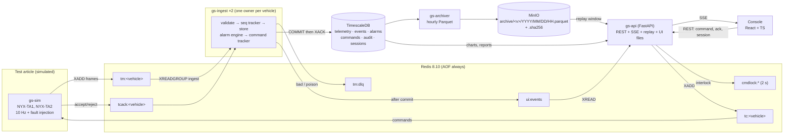

# Nyx Ground Segment – What We Build

Design and decision register · draft for Gate 2 · 2026-11-13

This file is the single answer to "what do we build, and why that way". Design review 1 fixes are listed in §7. Gate 1 gap review (same day) added D-SIM-10/11, D-ING-24/25, D-DB-10/11, D-ARC-10, D-UI-15..17, D-ENG-12/13, §3.1–3.4 and §5.1–5.2. Every decision has an ID, the choice, the reason, the alternative it beat, the requirements it serves (spec §4, `GS-` prefix dropped) and the research note it comes from. Open choices and their defaults live in [assumptions.md](assumptions.md); the evidence lives in [research/](research/).

**Build levels.** **v1** = build first; required to pass a must-requirement. **v1+** = only if time remains after the v1 slice for every gate. If a v1+ item is not built, it gets an NCR (non-conformance report) in `docs/ncr/`, not a silent gap.

**Status tags.** `lead` = decided at the Gate 1 review, not by a research note. `default` = operator-visible choice the owner may still flip (see assumptions.md).

---

## 1. System in one picture



**One-paragraph story.** The simulator writes one JSON frame per tick into `tm:<vehicle>`. Two ingest workers share the vehicles; each vehicle has exactly one owner, enforced by a Postgres advisory lock. The owner validates the frame, classifies its sequence number, stores it idempotently, runs the alarm engine and the command tracker, commits, then acknowledges the Redis entry and publishes a UI event. The API streams UI events to the console over SSE and takes commands, acks and session actions over REST. The archiver turns each finished vehicle-hour into a verified Parquet object in MinIO and only then deletes the hot rows. Replay reads archived (or still hot) frames and pushes them through the same alarm code with the limits that applied at the time.

---

## 2. Decisions by component

Columns: **ID** · **We build** · **Why** · **Instead of** (rejected, and why not) · **Reqs** · **Src**.

### 2.1 Simulator `gs-sim` (consolidated spec — new, gathered from six notes)

The simulator is ours, so its behaviour is a design decision. Downstream code must not depend on anything a real bench would not send (spec §3).

| ID | We build | Why | Instead of | Reqs | Src |
| --- | --- | --- | --- | --- | --- |
| D-SIM-01 | 10 Hz per vehicle on an **absolute schedule** (next tick = start + n·period), `t_onboard` stamped **before** `XADD` | Open-loop producer → latency samples need no coordinated-omission correction | Sleep-after-send loop (drifts, hides stalls) | ING-09, ALM-05 | [R10](research/R10-latency-measurement.md) |
| D-SIM-02 | `t_onboard` as ISO 8601 UTC with **µs** and `Z` | ING-09 is unmeasurable with whole seconds | ms or s precision | ING-09, UI-08 | R10 (A-R10-8) |
| D-SIM-03 | `seq` uint32, +1 per frame, reset to 0 on restart; `t_onboard` = wall clock, stays monotonic across restarts | Lets the tracker tell reset from duplicate with data only | Adding `boot_id` to the frame (spec §3 forbids downstream reliance on new fields) | ING-05 | [R5](research/R5-idempotency-gaps-resets.md) (A-R5-3/5) |
| D-SIM-04 | Each stream entry carries **one field `data`** = JSON frame | Types survive the trip; "unparsable JSON" (`malformed`) has a meaning | Flat string fields (strict validation cannot type them) | ING-02 | [R11](research/R11-stack-and-delivery.md) (A-R11-1) |
| D-SIM-05 | **Buffer frames in order while Redis is down**: bounded deque of 6000 frames (5 min at 2 × 10 Hz), reconnect backoff capped at 1 s; any overflow is counted, logged and shows downstream as a GAP | From the producer's side the "stop Redis 10 s" outage is ~15 s (restart + AOF load + reconnect); 200 frames had no margin (RV-10) | Dropping frames; a 200-frame buffer | ENG-02, ING-01 | R3 (A-R3-1), RV-10 |
| D-SIM-06 | Reads `tc:<vehicle>`, executes **≤ 1 command per tick**, writes `{cmd_id, accepted, code, reason, t_onboard}` to **`tcack:<vehicle>`**, then reports `last_cmd_id` in the next frame | RECEIVED needs a source (the §3 frame has none); one-per-tick keeps `last_cmd_id` from skipping a command | Inferring receipt from the simulator's XACK (proves a process read it, not that the vehicle accepted it) | CMD-01, 02 | [R2](research/R2-standards-and-command-safety.md) (A-R2-1 `default`, A-R2-6) |
| D-SIM-07 | Faults: `leak` (−0.4 kPa/s), `overheat`, `dropout N` (**on-board counter keeps running**), `freeze` (**seq and time advance, values repeat**), `seq_jump`, `duplicate` (**byte-identical resend**), `malformed`, **`pause N`** (frames keep flowing; commands neither acknowledged nor executed for N s, then processed), **`hold_exec N`** (commands acknowledged at once, executed N s later), **`step {param, value, duration_s}`** (forces a value; alarm-latency runs) | Each fault's semantics decides which detector must catch it. ATP-03: `pause 6` → FAILED NOT_RECEIVED, then LATE_VERIFICATION; `hold_exec 16` → RECEIVED → FAILED NOT_VERIFIED, then LATE_VERIFICATION, so both CMD-02 cases are reachable (RV-02). `step` gives 120 alarms in a 10 min run (RV-19) | One `pause` for both cases (only ever produces NOT_RECEIVED) | ING-02..05, UI-02, CMD-02, ALM-05 | R5, R9, RV-02, RV-19 |
| D-SIM-08 | Cabin pressure noise **σ ≤ 0.027 kPa** | The 0.15 kPa/s rate-of-change limit false-alarms with more noise | Arbitrary noise | ALM-04 | [R8](research/R8-alarm-logic.md) |
| D-SIM-09 | Small HTTP control on the health port: `GET /healthz`, `POST /sim/fault` | Playwright and ATP scripts inject faults the same way every time | Manual fault injection | ENG-03, ENG-05 | R9, R11 |
| D-SIM-10 | **Command effects**: `isolate_valve {valve}` stops an active `leak` and repressurises the cabin at +0.5 kPa/s back to 101.3; `vent_cabin {duration_s}` drops cabin pressure 2 kPa/s for `duration_s`; unknown command or bad args → `tcack accepted=false, code=INVALID_ARGS` | OPS-2/ATP-02 need the alarm to clear after `isolate_valve`; the REJECTED path is needed to test FAILED / NOT_EXECUTED | Commands without effect (the alarm would never clear) | CMD-01, 02, ALM-06 | `lead` |
| D-SIM-11 | Nominal values, noise and fault rates per parameter **exactly as in §3.4**, the same numbers as `limits.yaml` | If simulator and limits disagree, ATP timings are random and tests flake | Separately chosen numbers | ALM-01..04 | `lead`, R8 |

### 2.2 Ingest worker `gs-ingest` (×2)

| ID | We build | Why | Instead of | Reqs | Src |
| --- | --- | --- | --- | --- | --- |
| D-ING-01 | Redis **Streams**, one stream per vehicle `tm:<vehicle>`, one group named `ingest` on each, fixed consumer names `ingest-1/2` | Already in the stack; ~1000× headroom; COSMOS runs the same layout in production | Kafka (new JVM service, no DLQ, more durability than a bench tool needs); NATS JetStream (new service, no DLQ) | ING-01, 06 | R3, [R1](research/R1-prior-art-mission-control.md) |
| D-ING-02 | **XACK only after the DB COMMIT** | At-least-once delivery; a crash before ack leaves the entry pending, never lost | Ack on read (loses frames on crash) | ING-07 | R3 |
| D-ING-03 | On start **and after every reconnect**, read own pending entries (`XREADGROUP … 0`) before new ones (`>`) | Frames read before a crash come back to the same consumer | Reading only `>` (stranded pending entries) | ING-07 | R3 |
| D-ING-04 | **Poison handling, one rule on every read path** (new, own-PEL, takeover claim, 30 s claim): before processing an entry, read its `times_delivered` (`XPENDING`); **> 3 → DLQ + `POISON` event**. A failing batch is rolled back and re-run one frame per transaction to isolate the bad frame; that frame is retried 3× in-process, then DLQ'd; the rest commit | A frame that crashes the worker every time reaches the DLQ after 3 deliveries instead of crashing both workers in turn (RV-06); one bad statement can't roll back good frames (RV-27) | Stalling the vehicle ~90 s; different thresholds per note (≥ 3 vs > 3) | ING-08 | R3, R4, RV-06, RV-27 |
| D-ING-05 | DLQ write and XACK in **one `MULTI`**; DLQ record `{reason, detail, raw, stream, entry_id, deliveries, first_seen, dlq_at}`, reason ∈ `json_invalid · schema · vehicle_mismatch · t_onboard_range · poison` | A frame is never both acked-and-lost or DLQ'd twice; the reason is inspectable | Separate calls (crash window) | ING-02, 08 | R3, R11 (R13) |
| D-ING-06 | Trim with `XADD … ACKED MAXLEN ~ 360000` (~10 h at 10 Hz, ~40 MB per vehicle) | `ACKED` never deletes un-acked entries; default trimming silently does | Default trimming (frame loss); no trimming (RAM) | ING-07 | R3 (A-R3-3/5) |
| D-ING-07 | Redis config: AOF `appendfsync always` + RDB + `noeviction`, image pinned `redis:8.10.3` | PEL and entries survived graceful restart and `kill -9` in the R3 test; `everysec` loses up to 1 s | `everysec` (breaks "0 frames lost") | ENG-02, ING-07 | R3 |
| D-ING-08 | Worker loop: `BLOCK 1000`, catch `ConnectionError`/`TimeoutError`, back off 0.5 s doubling to 5 s, set `backlog=True` | redis-py gives up after ~5 s; `BLOCK` ≥ socket timeout fails after 62 s | Default client settings (worker crashes on the Redis stop test) | ENG-02 | R3 |
| D-ING-09 | **Vehicle ownership = Postgres session advisory lock** `pg_try_advisory_lock(hashtext('tm:'‖vehicle))` on the same connection that writes that vehicle's data | Lock and writes share one session, so a dead owner can't commit after takeover (lease + fence in one primitive); survives Redis restart | Redis lease (lost on Redis restart, needs a DB check anyway); stateless CAS workers (can't tell lost from in-flight frames); split stateful stage (needs single owner anyway) | ING-06, 07 | R4 |
| D-ING-10 | **Static preference + takeover**: `ingest-1` prefers NYX-TA1, `ingest-2` prefers NYX-TA2 (config). A worker locks its preferred vehicles, takes over any vehicle whose lock has been free > 2 s, and releases a non-preferred vehicle (after acking its current batch) once that vehicle's preferred worker heartbeats again | 2 workers share load and order is kept in ~10 lines, with a release rule (RV-21) and no `pg_stat_activity` counting (RV-23e) | Fair share `ceil(V / live_workers)` (needs a release rule anyway, more code) | ING-06 | R4 (a0 + a2), RV-21 |
| D-ING-11 | **Takeover protocol**: lock → load `seq_state`, open alarms, last K frames → warm checks → `XAUTOCLAIM … 0` until cursor `0-0` → process in ID order → then new entries | Pending before new keeps per-vehicle order; no false GAP after a kill | Reading new entries first | ING-06, 07, ALM-02/03 | R4, R8 |
| D-ING-12 | **Steal path (v1)**: a worker that sees an entry on a vehicle it does not own pending > 30 s looks up the lock holder in `pg_locks`, calls `pg_terminate_backend`, then runs the takeover protocol; all workers share one DB role | A hung-but-connected owner (SIGSTOP, deadlock) would otherwise block its vehicle and fail ING-08 (RV-03) | v1+ / cut list (it hits a must) | ING-08 | R4 (A-R4-4), RV-03 |
| D-ING-13 | **Storage key `(vehicle, t_onboard, seq)`**, `INSERT … ON CONFLICT DO NOTHING RETURNING` | Timescale requires the time column in unique keys; CCSDS recommends counter + time; a wrong classification can raise a wrong event but never drop or double a frame | `(vehicle, seq)` (drops frames after every restart); `(vehicle, epoch, seq)` (a misdetected epoch loses data) | ING-03, 05, 07 | R5 (A-X-1) |
| D-ING-14 | **Pure sequence tracker** `step(state, seq, t) → (state, events)` with wrap-safe compare (mod 2³²) and the 7-rule table: IN_ORDER, GAP, SEQ_JUMP, DUP_OR_LATE, SEQ_RESET (seq ≤ 50 and time forward), SEQ_ANOMALY | Uses `t_onboard` to split duplicate from reset and dropout from jump; deterministic, so replay and reclaim give the same events | RTP fixed misorder window (calls a quick restart a duplicate) | ING-03, 04, 05 | R5 |
| D-ING-15 | Epoch = `t_onboard` of the first frame after a reset; kept in `seq_state` (updated **in the same transaction** as the frames) and on event rows | Derived from data only → any worker or replay computes the same value | Worker-local boot counter (non-deterministic) | ING-04, 05 | R5 |
| D-ING-16 | `SEQ_JUMP` is its own event, not a GAP; a `SEQ_RESET` shows in the session report as a gap of unknown size | Counter jump ≠ lost frames; the report stays honest (review Q5) | Counting a jump as lost frames | ING-04, DAT-02 | R5 (A-R5-4/6, `lead`) |
| D-ING-17 | Event keys: GAP/SEQ_JUMP `(vehicle, epoch, from_seq)`, SEQ_RESET `(vehicle, epoch)`; only frames classed **new** reach the alarm engine | A redelivered frame raises nothing twice (OPS-4 "no alarm duplicated") | Relying on the frame insert alone | ING-07, ALM-06 | R5 |
| D-ING-18 | **Strict pydantic frame model**: `strict=True`, `allow_inf_nan=False`, uint32 bounds, UTC-only aware time, UUID, `vehicle` = stream suffix, `t_onboard` within [now − 7 d, now + 5 min]; parameter fields generated from the registry with `create_model` | Rejects NaN, `"5"`, naive times, wrong vehicle; adding a parameter needs no code | Lax parsing (hides simulator bugs) | ING-02, ENG-06 | R11 (R13) |
| D-ING-19 | Unknown frame field → kept in `model_extra`, **counted, warned once, not stored** | Simulator ahead of config must not DLQ every frame | `extra="forbid"` | ING-02, ENG-06 | R6, R11 (A-R6-3) |
| D-ING-20 | Registered parameter missing from a frame → **stored as NULL, counted, warned** | Adding a parameter to config before the simulator sends it must not quarantine every frame | DLQ (breaks the add-a-parameter guide) | ING-02, ENG-06 | R11 (A-R11-3 `default`) |
| D-ING-21 | **FROZEN detector**: all parameters flagged `frozen_check: true` in the registry (analog only, enums excluded) bit-identical for ≥ 2 s of `t_onboard` → `acq=FROZEN`, shown like STALE. Cut candidate #6 | `freeze` keeps frames arriving, so arrival-based staleness never fires; time-based so 100 Hz doesn't trip it after 0.2 s; quantized sensors can opt out (RV-24) | 20 frames (0.2 s at 100 Hz) | UI-02, OPS-3 | R9, RV-24 |
| D-ING-22 | One DB transaction per `XREADGROUP` batch: psycopg 3 `executemany` (pipeline mode) + `ON CONFLICT`, then **COMMIT → `XADD ui:events` → XACK** | Publishing before XACK means a crash before the publish leaves the frame pending; the takeover then resyncs the console (D-UI-18) | COPY + staging table; asyncpg; publishing after XACK (lost alarm messages, RV-05) | ING-07, 09, UI-05 | R6, R5, RV-05 |
| D-ING-23 | `t_received DEFAULT clock_timestamp()` (not `now()`) | `now()` is transaction start → batched inserts understate latency | `now()` | ING-09 | R10 (A-R10-1) |
| D-ING-24 | **Postgres outage**: on any DB error the worker rolls back, drops all vehicle ownership, does **not** XACK, backs off 0.5 → 5 s, reconnects, re-locks and runs the takeover protocol | Frames wait safely in Redis (`ACKED` trimming keeps them); never write on a connection that doesn't hold the lock (R4 rule 4) | Retrying on a fresh connection without re-locking (breaks the fence) | ENG-02, ING-07 | R4, `lead` |
| D-ING-25 | Each worker sets `hb:ingest:<consumer>` = `{owned: [...], db_ok}` in Redis with `EX 3` every second | Lets the API decide per vehicle whether a healthy owner exists (RV-16) | A bare "alive" flag | UI-02, ENG-05 | `lead`, RV-16 |
| D-ING-26 | **30 s reclaim loop (v1)**: every 5 s the owner runs `XAUTOCLAIM tm:<v> ingest <me> 30000` on each stream it owns, collecting entries left pending under any other consumer name (then the D-ING-04 delivery-count rule); the test creates the idle entry with a `ghost` consumer that reads without acking | Gives ING-08's "entry idle > 30 s is reclaimed" an actor in v1 (RV-03) | Reclaim only at takeover (min-idle 0, never 30 s) | ING-08 | R3, RV-03 |

### 2.3 Alarm engine (library used by ingest and replay)

| ID | We build | Why | Instead of | Reqs | Src |
| --- | --- | --- | --- | --- | --- |
| D-ALM-01 | **On a limit = the more severe band** (`v ≤ low`, `v ≥ high`); load-time check `red_low < yellow_low < yellow_high < red_high` | EPICS and COSMOS precedent; gives ALM-01's "exactly on" test a defined answer | Yamcs/XTCE default (on-limit = nominal) | ALM-01 | R8, R1 |
| D-ALM-02 | **Hysteresis = % of span** (`red_high − red_low`) → absolute deadband `d`; only delays moves to a less severe band; `hysteresis_abs` for one-sided limits. Cabin pressure uses **10 %** (d = 1.1 kPa) so ALM-02 passes under **both** readings of "±1 %": of span (±0.11 kPa) and of the limit value (±0.98 kPa). "1 alarm" = one RAISE transition | % of limit value is 0 at a limit of 0; the customer hasn't confirmed which reading the spec means, so the test must not depend on it (RV-12) | % of limit value; a 2 % deadband that passes only one reading | ALM-02 | R8, RV-12 |
| D-ALM-03 | **Persistence**: ring of the last N raw levels; escalate when all N ≥ L, de-escalate when all N ≤ L; red needs no own N | On-delay + off-delay over the deadband (series design in the literature); a 1-frame spike never alarms | Persistence on raise only | ALM-03 | R8 (A-R8-3) |
| D-ALM-04 | GAP, SEQ_RESET and **data-STALE** (`t_onboard` gap > 2 s between consecutive frames) reset counters and the ROC window but **never clear an alarm**. The browser STALE clock (D-UI-05) is display-only | A value can be RED and STALE; the engine's STALE comes from data only, so live and replay compute the same thing (RV-07) | Clearing on loss of data; using wall-clock STALE in the engine | ALM-03, UI-02, DAT-06 | R8, RV-07 |
| D-ALM-05 | **Rate of change = least-squares slope** (`statistics.linear_regression`) over the last `window_s` = 1 s of `t_onboard`; needs ≥ 80 % of expected samples; optional `direction: rising·falling·both` (default both) | ~1.4× less noisy than end-point difference, 13× less than frame-to-frame; alarms the 0.4 kPa/s leak ~7.5 s before yellow; vehicle time, not arrival time | Frame-to-frame difference; arrival-time slope | ALM-04 | R8 (A-R8-8 `default`) |
| D-ALM-06 | **One alarm per (vehicle, param)**; severity = max of its checks; `trigger_check` recorded | A leak gives one escalating alarm, not three | One alarm per check | ALM-06, UI-05 | R8 |
| D-ALM-07 | Life cycle **UNACK → ACKED → CLEARED**, plus **RTN_UNACK** ("cleared – not acked"); ACK requires a note; who/when/why stored on every transition | Matches the spec's ACTIVE→ACKED→CLEARED and ISA-18.2; RTN before ack must stay visible | Auto-clear on return to normal | ALM-06 | R8 (A-R8-7), R1 |
| D-ALM-08 | **Acked yellow that escalates to red becomes UNACK and alerts once**; red→yellow→red after an ack does not alert again (`acked_sev` kept) | Answers review Q2 ("I acked and it got worse"); Yamcs keeps the ack here, we deliberately don't | Keeping the ack (Yamcs) | ALM-06, UI-05 | R8 (A-R8-5 `default`) |
| D-ALM-09 | Only **RED** alerts audibly (`alert` column on the transition row); yellow is visual | OPS-2 "an alarm sounds once" | Sounding on every transition | UI-05 | R8 (A-R8-6) |
| D-ALM-10 | **Pure checks**: `Check` Protocol with `kind`, pydantic `Config`, `initial()`, `step(state, sample, current) → (state, level)`; `@register` into `CHECKS`; package auto-imports every module | "New class + registration only" = add one file, no worker edit | Plugin framework; if/else in the worker | ALM-07 | R8, R1 |
| D-ALM-11 | Every per-check debounced level change logged as a **`LEVEL` event**; rebuild after takeover or for replay = seed from LEVEL events, then warm up the last K frames | Hysteresis has memory; re-feeding from NOMINAL can differ from live | Re-feeding frames from NOMINAL | DAT-06, ING-06 | R8, R7 |
| D-ALM-12 | **Limits reload**: poll `limits.yaml` every 1 s (`stat`, then sha256 of bytes), validate with pydantic (`extra="forbid"`), store in `limits_versions`, emit `LIMITS_APPLIED(first_seq, sha)`; an invalid file keeps the old set + `LIMITS_REJECTED` banner. **At worker start an invalid file falls back to the newest valid `limits_versions` row** (+ LIMITS_REJECTED); refuse to start only if no valid version exists | New limit active < 5 s; replay switches at the same frame as live (Q6); one typo plus one crash must not stop ingest for both vehicles (RV-17) | inotify dependency; refusing to start on any invalid file | ALM-08 | R8, RV-17 |
| D-ALM-13 | Out of scope: shelving, latching, suppression, re-alarm timers, limit sets, 5 severity levels | Not in the spec; each adds UI + audit paths | — | — | R8 (A-R8-9), R1 |
| D-ALM-14 | **ACK path; the owner worker is the only writer of alarm state.** The API validates the ACK (alarm open, note not empty), inserts `alarm_ack_request(request_id PK, alarm_id, vehicle, user, note, requested_at, applied_at)`, writes audit `ALARM_ACK`, returns **202**. The owner reads pending requests for its vehicles every loop pass (≤ 1 s), applies them in its batch transaction (ACK row in `alarm_events` with `after_seq` = **last seq the owner had processed**), sets `applied_at`, and the ACKED transition goes out over SSE | ACK then RTN must give CLEARED, not RTN_UNACK; a second writer would be overwritten by the engine's in-memory state; `after_seq` matches R7 so replay applies the ack at the same frame (RV-01) | API updating `alarms` directly | ALM-06, UI-05, DAT-06 | R7, R8, RV-01 |

### 2.4 Commanding (API + vehicle owner)

| ID | We build | Why | Instead of | Reqs | Src |
| --- | --- | --- | --- | --- | --- |
| D-CMD-01 | States **QUEUED → SENT → RECEIVED → VERIFIED**, or **FAILED**; RECEIVED from `tcack` (accepted), VERIFIED when `last_cmd_id == cmd_id` (a telemetry-based verifier, like XTCE Complete / Yamcs algorithm verifier) | Spec names kept; maps cleanly to PUS service 1 acceptance/completion | Extra start/progress states (no source in our frame) | CMD-01 | R2, R1 |
| D-CMD-02 | FAILED carries `failure_reason` (SEND_ERROR · REJECTED · NOT_RECEIVED · NOT_VERIFIED) and **`outcome`** (NOT_SENT · NOT_EXECUTED · **UNKNOWN**); UI text says which | Answers review Q3 "did the vehicle do it?"; PUS: silence is not failure; never blind-resend a hazardous command after UNKNOWN | A bare FAILED | CMD-02, UI-06 | R2 |
| D-CMD-03 | **Both windows from SENT**: not received in 5 s, not verified in 15 s; per-command overrides in `commands.yaml` | Simple to explain; worst case is 15 s, not 20 s | Yamcs chaining from previous stage | CMD-02 | R2, R1 (A-R1-1) |
| D-CMD-04 | **FAILED is terminal**; a later echo writes `LATE_VERIFICATION` + `late_verified_at` | History is append-only; investigators need to know the operator saw FAILED; ATP-03's 16 s pause must expect FAILED **then** LATE_VERIFICATION | Overwriting to VERIFIED (Yamcs) | CMD-02, 04 | R2 (A-R1-2) |
| D-CMD-05 | **Command tracking runs in the vehicle's owner worker**: it reads `tcack:<v>` alongside `tm:<v>`, matches `last_cmd_id`, and checks timeouts every loop pass (≤ 1 s resolution because `BLOCK 1000` returns even when the vehicle is silent); timers keep running during LOS | The owner already sees frames in order and is the single writer for that vehicle; no extra service or scheduler | A separate tracker service; timers in the API process | CMD-01, 02 | `lead` (A-R2-7) |
| D-CMD-06 | **Hazardous two-step enforced by the API**: first POST rejected with `HAZARDOUS_CONFIRMATION_REQUIRED`, hazard text and `args_hash` = sha256 of canonical `{vehicle, name, args}`; re-POST must carry matching `confirm_args_hash` + `reason` (≥ 10 chars) | curl, scripts and UI all hit the same rule; you can't confirm A and send B | Client-only dialog (fails "cannot be sent without both"); server-stored tokens (more state, no extra protection) | CMD-03 | R2, R1 |
| D-CMD-07 | **Double-command interlock**: `SET cmdlock:{vehicle}:{key} {cmd_id}\|{user} NX PX 2000` as the last check; `key` = `name` for **hazardous** commands, `name:args_hash` otherwise; user excluded | Two operators can't each send `vent_cabin` with different durations within 2 s (RV-26); ordinary commands with different args still pass; a double-click is stopped | Args-hash key for every command | CMD-05 | R2, RV-26 (A-R2-4) |
| D-CMD-08 | **Append-only `audit_log`**: actions `LOGIN · CMD_REQUESTED · CMD_CONFIRM_REQUIRED · CMD_REJECTED · CMD_STATE · CMD_LATE_VERIFICATION · ALARM_ACK · LIMITS_RELOADED · SESSION_START · SESSION_STOP · REPORT_SIGNED`; app role `INSERT, SELECT` only + triggers that raise on UPDATE/DELETE/TRUNCATE; **completeness** tested (N commands + M acks → exactly the expected rows) | Two independent layers; CMD-04 needs both immutability and "every command and ack" (RV-14, RV-20) | Hash chain / WORM (out of scope) | CMD-04, UI-06 | R2, R6, RV-14, RV-20 |
| D-CMD-09 | `commands.yaml` validated with pydantic at load; per command `description`, `hazardous`, `hazard` text, typed `args`; file sha256 stored on each command row | Same versioning idea as limits; typed args catch bad input at the API | XTCE (XML schema with ~100 element types) | CMD-03, ENG-06 | R2 |
| D-CMD-10 | **No roles**: any logged-in user may command and run sessions; identity always from the session cookie, never the request body | A simple login is in scope, roles are not; second-person approval is the documented upgrade | Conductor/controller roles; second-user approval (COSMOS Enterprise) | CMD-03, 04 | R11 (A-R11-5 `default`), R2 |
| D-CMD-11 | **Command row concurrency**: every state change is `UPDATE … WHERE state IN (<earlier states>)` (monotonic: a late SENT can't overwrite RECEIVED); the API sets SENT + `sent_at` **before** `XADD tc:`, and on XADD error sets FAILED SEND_ERROR / NOT_SENT; a command QUEUED > 5 s is failed SEND_ERROR by the owner; `tcack:<v>` is read with the `ingest` group and XACKed after commit; takeover loads open commands | API and worker both write command rows; without guards an executed command can end FAILED (RV-09) | Unguarded updates | CMD-01, 02 | RV-09 |

### 2.5 Storage (TimescaleDB)

| ID | We build | Why | Instead of | Reqs | Src |
| --- | --- | --- | --- | --- | --- |
| D-DB-01 | **One TimescaleDB** (`timescale/timescaledb:2.32.0-pg17`) for telemetry, events, alarms, commands, sessions, audit | One store, one backup, reports join in one query; 5–100× margin on measured targets | InfluxDB 3 / QuestDB / ClickHouse (second store, no verified row delete) | DAT-03 | [R6](research/R6-timeseries-store.md) |
| D-DB-02 | **Wide hypertable**: one row per frame, one typed column per parameter, 1 h chunks aligned with the hourly archive | Measured: 1 h of one param 2–24 ms (target 300 ms), 24 h band 58–424 ms (target 2 s) | JSONB (24 h band 2.3–6.1 s, fails UI-04); narrow rows (4.75× disk, 2–4× slower) | DAT-03, UI-04 | R6 |
| D-DB-03 | Parameter columns created **by `gs-migrate`** from the registry (D-DB-11): `ADD COLUMN IF NOT EXISTS` (name checked `^[a-z][a-z0-9_]{0,62}$`) | Adding a parameter = one YAML entry; 2 ms in the spike | Hand-written migrations per parameter | ENG-06 | R6 |
| D-DB-04 | Downsampling with `time_bucket` min/max/avg/count, bucket = max(window / 1500, 100 ms); empty buckets absent (chart shows a gap) | Server-side band for any window; gaps stay visible | Continuous aggregates (non-Apache licence, not needed at 0.45 GB/day) | UI-04 | R6 |
| D-DB-05 | **Apache-2 features only** (no compression, no continuous aggregates) | Keeps plain Postgres (`date_bin`) as a fallback | TSL features | DAT-03 | R6 (A-R6-6) |
| D-DB-06 | Session report = one SQL query over the session window (min/max/avg per param, count vs expected, GAP events, alarms, commands) + CSV export | 15–31 ms for 6 h in the spike; answers review Q5 | Precomputed rollups | DAT-02 | R6, R1 |
| D-DB-07 | `test_session(vehicle, name, conductor, started_at, ended_at, ended_by)`; **partial unique index: one active session per vehicle**; frames always stored, linked to sessions by time window | Clear 409 on double start; out-of-session frames are not lost | FK from telemetry to session (breaks storing out-of-session frames); exclusion constraint (more than needed) | DAT-01 | R11 (R13) |
| D-DB-08 | `events` table with `severity ∈ {INFO, LOW, MEDIUM, HIGH}` and `source ∈ {GROUND, ONBOARD}` (PUS service 5 vocabulary) | A future CCSDS decoder maps on-board events into the same table | Separate tables per event type | ING-04, CMD-04 | R2 |
| D-DB-09 | **`events` and `alarm_events` are never pruned** (LEVEL, SEQ_RESET, LIMITS_APPLIED, GAP …), nor is `limits_versions` | Replay needs them to rebuild state; they are small | Pruning with telemetry | DAT-06, ALM-08 | R7 (A-R7-5), RV-14 |
| D-DB-10 | Report **frozen** when the vehicle watermark `seq_state.last_t ≥ ended_at` (or after 30 s, marked "incomplete: n of m frames"); until then `GET …/report` returns 409 `REPORT_PENDING` with frame count vs expected. Stored in `session_report(session_id, report, csv, sha256)`. **Sign-off** (`POST …/sign-off {note}`, audit `REPORT_SIGNED` + sha256) is cut candidate #1 | Freezing at stop could miss in-flight frames and show a false gap, Q5's exact worry (RV-15); the signature points at exact bytes | Freezing at stop; recomputing on every view | DAT-02, CMD-04 | R6 (A-R6-4), RV-15 |
| D-DB-11 | **Parameter registry = the `parameters:` section of `limits.yaml`** (name, unit, optional checks). `gs-migrate` (owner role) adds missing columns; workers refuse to start if a registered parameter has no column; a hot reload that adds an unknown parameter is rejected with `LIMITS_REJECTED: run make migrate` | The app role can't `ALTER TABLE` (role design of D-CMD-08); one file is the one place to add a parameter | A separate `parameters.yaml`; `ALTER` from the app role | ENG-06, ALM-08 | R6, R8, `lead` |

### 2.6 Archive and replay

| ID | We build | Why | Instead of | Reqs | Src |
| --- | --- | --- | --- | --- | --- |
| D-ARC-01 | One **Parquet** object per vehicle-hour, pyarrow, zstd, one row group, schema from the hot table, footer metadata (`limits_sha256`, row count, seq range, schema version) | ~0.91 MB per vehicle-hour, ~10× smaller than hot rows | snappy (1.13 MB); CSV | DAT-04 | [R7](research/R7-archive-replay.md) |
| D-ARC-02 | **Hash the uploaded bytes** (sha256 recorded in Postgres **before** upload) | Parquet bytes are only reproducible with the same pyarrow version | Byte-reproducible files as the integrity basis | DAT-05 | R7 |
| D-ARC-03 | **Single PUT** with `x-amz-checksum-sha256` (MinIO rejects a mismatch); then **full re-read** against the recorded hash; then sidecar `<HH>.parquet.sha256` in `sha256sum` format | Three independent checks before any delete; a killed upload leaves no visible object (shown in the R7 spike) | Multipart (objects are below the 5 MB part minimum; leaves parts behind); ETag as hash (not MD5 for multipart) | DAT-04, 05 | R7 (A-R7-1) |
| D-ARC-04 | Job state in **`archive_object`**: WRITTEN → UPLOADED → VERIFIED → HOT_DELETED (PENDING computed from eligible hours); every state safely re-runnable | Kill mid-upload → re-run finishes the job, nothing lost, no manual cleanup | Stateless cron | DAT-05 | R7 |
| D-ARC-05 | Eligible = vehicle-time watermark + 2 min (or wall clock + 30 min if silent); **hot delete only when hour_end ≤ now − 25 h**, per (vehicle, hour), in one transaction, commits only if deleted rows = `archive_object.hot_rows` | The 24 h chart is always hot; the row-count check catches late frames | `add_retention_policy` / TTL (deletes unverified data) | DAT-05, UI-04 | R7, R6 (A-R7-4) |
| D-ARC-06 | **v1: late frames** into an archived hour stay hot and raise an alert (the delete check refuses). **v1+:** write an immutable `<HH>.v<N>.parquet`; readers take the latest verified version | Nothing is lost in v1; versioning is extra code for a rare case | Overwriting `<HH>.parquet` (data/sidecar disagree for a window); separate `late/` objects every reader must merge | DAT-04, 05 | R7 (A-R7-2), `lead` |
| D-ARC-07 | Scheduler: plain **asyncio loop every 5 min** in `gs-archiver` | One loop does not justify a dependency | APScheduler (4.x still alpha) | DAT-04 | R7 |
| D-ARC-08 | S3 client: **minio-py** | Ships type hints (mypy strict) | boto3 (needs stubs) | ENG-09 | R7 |
| D-ARC-09 | MinIO image **`bitnamilegacy/minio:2025.5.24` pinned by digest**; listed in README limitations | Upstream stopped publishing images (repo archived 2026-04-25); this one is built from official source and passed the R7 spike | `pgsty/minio` (current but third party, contents unverified); building from source | DAT-04, ENG-01 | R7, R11 (A-X-3 `default`) |
| D-ARC-10 | Archiver `/healthz` reports `oldest_unarchived_hour` and Redis/DB reachability; older than 72 h (config) → `degraded`; the **ARCHIVE_BACKLOG console banner** is cut candidate #2; MinIO unreachable → retry with backoff, never delete | Hot data grows while MinIO is down and DAT-05 forbids deleting it, so someone has to find out | Silent growth until the disk fills | DAT-05, ENG-05 | R6 (A-R6-5) |
| D-REP-01 | **Replay** reads the verified objects (hash checked) or the hot table for hours not yet archived, seeds state from `alarm_events`, runs the **same pure `step()`** as live, switches limits at the recorded `LIMITS_APPLIED` frame | Same function + same inputs ⇒ same alarms (spec: "same alarms as live"); Yamcs replays with current limits, we use the recorded ones | DuckDB over S3 (downloads an extension at runtime, skips our hash check); shadow tables | DAT-06 | R7, R8, R1 |
| D-REP-02 | Pacing by `t_onboard` deltas at 1× or 10× | Replays vehicle time; a live backlog burst is not replayed as a burst | `t_received` pacing | DAT-06 | R7 (A-R7-8) |
| D-REP-03 | **Overlay live ACKs** at their `after_seq` (read-only); replay never sounds and never accepts acks | Re-alarm-on-escalation depends on ack state; without ACKs replay alarms would differ from live | No overlay (R9's first proposal) | DAT-06 | R7, R9 (A-X-4) |
| D-REP-04 | Replay runs as an **async generator inside the API process** feeding `GET /api/replays/{id}/events` (same message shapes, `replay: true`) into a separate store in the UI; purple **REPLAY** banner that can't be dismissed; never writes live tables | Replay task and its SSE handler live in one process, so a Redis stream adds nothing (RV-23a) | `ui:replay:<id>` Redis stream; WebSocket; writing to tables | DAT-06 | R9, R7, RV-23 |
| D-REP-05 | Equality test: alarm transition keys from a live run = keys from replaying the same window | Turns "same alarms as live" into one list comparison | Visual comparison | DAT-06 | R7 |
| D-REP-06 | STALE is display-only in replay; its keyed equivalent (GAP) is in the equality test | The STALE clock lives in the browser | Making STALE a stored event | DAT-06 | R7 (A-R7-7, `lead`) |

### 2.7 Operator console (React + TypeScript)

| ID | We build | Why | Instead of | Reqs | Src |
| --- | --- | --- | --- | --- | --- |
| D-UI-01 | **SSE** from FastAPI fed by Redis stream **`ui:events`** (worker `XADD` after commit, `MAXLEN ~ 3000`; API reads with plain `XREAD`, no group) | Built-in reconnect + resume; one-way is enough (commands go over REST); a stream loses no alarm/command event across restarts; no consumer group, so `ACKED` trimming of `tm:*` is unaffected | WebSocket (hand-written reconnect/resume/heartbeat); Redis pub/sub (at-most-once); reading `tm:*` (UI would duplicate alarm logic) | UI-01, 07 | R9 (A-R9-1) |
| D-UI-02 | On connect: resume from `Last-Event-ID` / `?since=` if still in the stream, else **snapshot** then deltas; `retry: 1000`; per-client bounded queue, overflow → reconnect + snapshot; SSE generators close on shutdown (`timeout_graceful_shutdown` ≈ 1 s) so `restart api` doesn't stall | Measured 0.87 s from API back to data (budget 5 s); uvicorn otherwise waits on open streams (RV-11) | Always full reload | UI-07 | R9, RV-11 |
| D-UI-03 | **Client watchdog** that opens a new EventSource with `?since=<lastId>` | A proxy 502 during restart closes EventSource for good; a new object doesn't send `Last-Event-ID` | Trusting built-in reconnect only | UI-07 | R9 |
| D-UI-04 | **Heartbeat every 1 s**; banners: **NO LIVE CONNECTION** from the **first EventSource `error`** or 3 s without any message, until the next message; **LOSS OF SIGNAL** = no frame for 2 s while a healthy owner exists; UI-07 measured from the `restart` command to data flowing again | A 0.9 s restart must still show the banner ("banner while disconnected", RV-11) | 3 s silence only | UI-02, 07 | R9, RV-11 |
| D-UI-05 | **Freshness clock in the browser** (`performance.now()` seeded with server `age_ms`, 100 ms tick, STALE at 2.0 s), with `age_ms = max(api_now − t_received, api_now − t_onboard − bench_offset)`; `bench_offset` = 0 for the simulator (one clock), configurable for real hardware | Frames that waited in a buffer or in Redis during an outage arrive with a fresh `t_received` but an old `t_onboard`; they must show STALE, not current (OPS-3, RV-08) | Receipt-time age only | UI-02 | R9, RV-08 |
| D-UI-06 | Each value has **two fields**: acquisition (`OK · STALE · FROZEN · NO_DATA`) × limit (`NOMINAL · YELLOW · RED` + LOW/HIGH); a STALE row keeps its last limit as an outline "was RED LOW" badge, value in italic + clock glyph | A value can be RED and STALE; COSMOS's STALE-as-colour loses the last limit during LOS | One merged enum | UI-02, 03 | R1, R9 (A-R1-3, A-R9-5) |
| D-UI-07 | **Grey when nominal, colour only for abnormal**, every state also as text + glyph; palette verified WCAG AA (e.g. red `#B3141B` with white 6.92:1; yellow with `#7A5C00` border 5.25:1); REPLAY = purple, used for nothing else; light theme only | ISA-101 high-performance HMI; no state by colour alone | Green-for-nominal (COSMOS) | UI-03 | R9, R1 (A-R9-9) |
| D-UI-08 | Audio armed by the login click (`AudioContext.resume()`); **one beep per `alert:true` transition key**; visible SOUND OFF badge if audio isn't running | Browser autoplay policy needs a gesture; "sounds once" | Beeping per frame | UI-05 | R9 (A-R9-7) |
| D-UI-09 | Alarm list sticky until acked, filters by vehicle/severity/state, ACK dialog with required note | Spec UI-05 + COSMOS Limits Monitor pattern | — | UI-05 | R1, R9 |
| D-UI-10 | Command timeline with all four state times in UTC, read from the **`commands` row** (`queued_at … verified_at`, `failed_at`, `late_verified_at`) | The times are already there; the audit log stays the history (RV-23b) | Reading the audit log | UI-06 | R2, RV-23 |
| D-UI-11 | Charts with **uPlot** (23.5 KB gz, canvas, native min/max bands), windows 2 min · 1 h · 24 h, server downsampling | Fast and small | ECharts (~198 KB), Recharts/visx (SVG, slow when streaming) | UI-04 | R9 |
| D-UI-12 | **No UI kit**; plain store with `useSyncExternalStore` (per-row subscriptions); native `<dialog>`; hooks shaped like Open MCT (`useTelemetry`, `useStaleness`) | 10 Hz updates without re-rendering the table; fewer dependencies | Redux; Open MCT itself (Vue, contradicts ENG-10) | UI-01, ENG-10 | R9, R1 |
| D-UI-13 | Times formatted with `toISOString()` (always `Z`) | UTC everywhere without a date library | moment/dayjs | UI-08 | R9 |
| D-UI-14 | Latency probe: each rendered value exposes `data-seq`/`data-t-onboard`; a stamp in the second `requestAnimationFrame` after commit; Playwright collects with `page.evaluate` | Every frame gets a sample, including ones superseded before paint | Playwright polling the DOM | UI-01 | R10, R9 |
| D-UI-15 | **GROUND PROCESSING DOWN** per vehicle when no heartbeat lists it as owned with `db_ok`; **FRAMES REJECTED (reason)** when the vehicle's DLQ count rose in the last 5 s; both replace LOS for that vehicle. Cut candidate #3 | A dead or blocked worker, or rejected frames, must not look like loss of signal (Q1, OPS-4, RV-16) | One global `ingest_ok` | UI-02, 07 | `lead`, RV-16 |
| D-UI-16 | **Replay page**: vehicle, from/to as `<input type="datetime-local">` labelled and interpreted as **UTC**, speed 1× / 10×, start/stop, progress (current replay `t_onboard`); purple frame + banner; separate store. Cut candidate #4 (replay then started via API) | OPS-6 needs a way to pick "14:00–14:20 last Tuesday" | Date-picker library | DAT-06, UI-08 | `lead` |
| D-UI-17 | **Session panel**: start (vehicle + name), stop, report view (or "pending"), CSV download, sign-off with note (if not cut) | The conductor's whole job in OPS-1 | — | DAT-01, 02 | `lead` |
| D-UI-18 | **Console resync**: a worker publishes `resync{vehicle}` into `ui:events` after start and after every takeover; the API sends a fresh `snapshot` (open alarms with their latest transition key and `alert` flag, recent commands, last values) to all clients on `resync` and whenever its own Redis reader reconnects; the client deduplicates transition keys and beeps once for any RED `alert` key it hasn't beeped yet | A crash between COMMIT and `XADD ui:events` can't leave a RED alarm, or its beep, missing from an open console (RV-05) | Transactional outbox table + publisher (more code for the same guarantee) | UI-05, UI-07, ING-07 | RV-05 |

### 2.8 Delivery and engineering

| ID | We build | Why | Instead of | Reqs | Src |
| --- | --- | --- | --- | --- | --- |
| D-ENG-01 | **One Python package `gs`** (`src/gs/{common,simulator,ingest,archiver,api}`), entry points `gs-sim · gs-ingest · gs-archiver · gs-api · gs-migrate` | All services share dependencies | uv workspace (N× config for nothing) | ENG-10 | R11 |
| D-ENG-02 | **One Dockerfile**, two stages (Node builds `ui/dist`, Python 3.14-slim + uv runs everything); FastAPI serves the built UI | One image, one origin, no CORS, no nginx | nginx container | ENG-01 | R11 |
| D-ENG-03 | **docker compose**: `restart: unless-stopped`, healthchecks, `depends_on` conditions, one-shot `migrate` and `minio-init`; `make up` creates `.env` with a random session secret, then `docker compose up -d --build --wait` | Fresh clone → `make up` → demo works first try | Manual setup steps | ENG-01, 02 | R11 |
| D-ENG-04 | Config from **env only** into a frozen dataclass (fails fast); `.env.example` committed; no hard-coded hosts | Spec ENG-09; ~10 lines | pydantic-settings | ENG-09 | R11 |
| D-ENG-05 | **Tests at 3 levels**: unit (pure functions: tracker, checks, state machines), integration against the **same compose** Redis + Postgres, E2E with **Playwright in TypeScript** | One set of image pins for local, CI and E2E | testcontainers / GitHub `services:` (duplicate pins) | ENG-03 | R11 |
| D-ENG-06 | **CI** (one workflow): `lint` (ruff check + format, `mypy --strict`, `tsc --noEmit`) ∥ `test` (unit + integration) → `e2e`; same workflow green on the `v*` tag = release evidence | Spec ENG-04 + §6 "green run on the release tag" | Separate workflows | ENG-04 | R11 |
| D-ENG-07 | `/healthz` on every service (small asyncio HTTP server in workers); **stdlib logging with a JSON formatter**, every line with `vehicle` and `seq` where relevant | Spec ENG-05 with no new dependency | structlog | ENG-05 | R11 |
| D-ENG-08 | **Login**: fixed users in `users.yaml` with stdlib scrypt hashes; Starlette signed session cookie (`SameSite=strict`, 12 h); CSRF = required header `X-GS-Client: console` + JSON-only writes | "A simple login is enough" (spec §1), done safely | JWT; SSO (out of scope) | CMD-04 | R11 |
| D-ENG-09 | Versions pinned as in [R11's pin table](research/R11-stack-and-delivery.md) (Python 3.14, React 19, Vite 8, **TypeScript 6.0.3**, FastAPI 0.162, pydantic 2.14, redis-py 8.1, psycopg 3.3, Playwright 1.65) | Reproducible builds; TS 7 breaks typescript-eslint | Floating versions | ENG-01, 09 | R11 |
| D-ENG-10 | **Conventional commits**, small commits from the first day (research is the first commits) | Spec ENG-07 | One giant first commit | ENG-07 | — |
| D-ENG-11 | Kill-a-worker tests: `docker compose kill ingest-1` proves **takeover** by the other worker; `kill -9 1` inside the container proves **self-restart** | `docker kill` does not trigger the restart policy; a crash inside the container does | Assuming both behave the same | ING-07, ENG-02 | R11 (A-R11-6) |
| D-ENG-12 | **Migrations** = numbered `migrations/NNN_*.sql`, applied in order by `gs-migrate` as `gs_owner`, one transaction each, recorded in `schema_migrations(version, sha256, applied_at)`; refuses to run if an applied file changed; then adds registry columns (D-DB-11) | ~30 lines; with no ORM, Alembic adds nothing | Alembic; `CREATE IF NOT EXISTS` scattered across services | ENG-01, 09 | `lead` |
| D-ENG-13 | **Demo users**: `make up` copies `users.example.yaml` → `users.yaml` if missing (`conductor`, `fc1`, `fc2`), generates one password into `.env` and prints it once | CMD-05 needs two operators at once; ENG-01 "demo works first try" | Manual user setup | ENG-01, CMD-05 | `lead` |
| D-ENG-14 | **Definition of done: nothing is merged without a test.** Every new function, endpoint, state machine, migration, simulator fault/command and UI behaviour ships with its test in the same commit, at the lowest level that can prove it: pure logic → unit; anything touching Redis/Postgres/MinIO → integration against the compose services; operator flows → Playwright. Bug fixes start with a failing test that reproduces the bug. Test infrastructure (simulator, perf scripts, migrations runner) is tested too, because the ATPs trust it | The owner's rule for this project; untested code can't be accepted under §5 anyway, and tests written later get skipped when time runs out | "Tests at the end" (Gate 4) | ENG-03, all | owner rule |
| D-ENG-15 | **CI coverage gate**: `pytest --cov=gs --cov-fail-under=80` over unit + integration; Vitest coverage ≥ 80 % for `ui/src` logic (stores, formatters, palette, freshness clock); every E2E spec mapped to an ATP in [requirements.md](requirements.md). Coverage is a floor, not the goal: each requirement row still names the test that proves its pass condition | Makes "untested code" a red build instead of a review comment | Coverage as a report only | ENG-03, ENG-04 | owner rule |
| D-ENG-16 | **Test controls**: config `HOT_RETENTION_H`, `ARCHIVE_GRACE_S` and an injectable clock in the archiver; `gs-sim backfill --vehicle --from --to` writes past-hour frames through the normal stream path (within the 7-day validity window); `CRASH_AT=<point>` hooks in worker and archiver, active only when `GS_TEST_HOOKS=1` | Archive/delete tests, ATP-07 and the "three days later" replay must run in CI and in a same-day acceptance; crash points must be deterministic (RV-13) | Waiting real hours; random kills only | DAT-04, 05, 06, ING-07 | RV-13 |
| D-ENG-17 | **Redis ACL users** (passwords generated into `.env` by `make up`): `api` (write `tc:*`, `cmdlock:*`; read `ui:events`, `hb:*`), `sim` (read `tc:*`; write `tm:*`, `tcack:*`), `ingest` (read `tm:*`, `tcack:*`; write `tm:dlq`, `ui:events`, `hb:*`), `health` (`PING` only); default user off. The simulator rejects `tc` entries without `cmd_id` and `issued_by`; `commands.yaml` bounds every arg (`vent_cabin.duration_s` ≤ 10). Residual risk (a Redis admin can still write) in README | Command safety must not live only in the API: any local process could otherwise `XADD vent_cabin` with no confirmation and no audit row (RV-18) | No auth | CMD-03, 04 | RV-18 |
| D-ENG-18 | **One time formatter** `gs.common.time.iso_z()` (`YYYY-MM-DDTHH:MM:SS.ffffffZ`) for API JSON, CSV, report and logs; Postgres timestamps are never serialized raw; tests assert `Z` in CSV and API output | Postgres text output has no `T`/`Z`; UI-08 covers every output, not just the UI (RV-20) | Per-module formatting | UI-08 | RV-20 |
| D-ENG-19 | **Evidence logs**: `docs/bug-log.md` (date · failing test · what it caught · fix commit), appended whenever a test catches a real bug; `docs/ai-usage.md` (what AI did: research agents with source links, independent design review, code drafts; how each was checked: sources, spikes with raw numbers, tests, CI, reading every diff) | Review-board Q16 and Q17 need facts collected during the build, not memory afterwards | Reconstructing them at Gate 5 | ENG-08 | review Q16/Q17 |

### 2.9 Measurement (method A requirements)

| ID | We build | Why | Instead of | Reqs | Src |
| --- | --- | --- | --- | --- | --- |
| D-PERF-01 | All stamps except UI-01 in **one clock** (Docker VM kernel): `t_onboard`, Redis entry ID ms, `t_received`, `raised_at` (`clock_timestamp()`) | Containers share the kernel clock → no offset error; the entry ID splits onboard→Redis from Redis→stored | Comparing across clock domains | ING-09, ALM-05, ING-10 | R10 |
| D-PERF-02 | UI-01 corrected by a browser **min-RTT offset ping** before and after the run; run invalid if the offset moves > 5 ms | Only metric crossing VM → macOS clock | Ignoring offset | UI-01 | R10 |
| D-PERF-03 | **Raw samples to CSV** in `docs/perf/`, nearest-rank percentiles (stdlib), first 10 s excluded and reported | Spec §5 asks for raw numbers | HdrHistogram (not needed for ≤ 60 k samples) | all A-method reqs | R10 (A-R10-7) |
| D-PERF-04 | **ALM-05 on ≥ 60 alarms** (report 20 and 60): during run N the simulator `step`s `cabin_temp_c` to red for 1 s every 5 s (120 alarms in 10 min); latency from the N-th (triggering) frame; the alarm event stores `trigger_seq`, `trigger_t_onboard` | 20 samples can't bound a p95 (n ≥ 59); a leak cycle takes ~30 s, too slow for 60 alarms (RV-19) | 20 only; leak cycles | ALM-05 | R10, RV-19 |
| D-PERF-05 | **Run N** = 2 × 10 Hz, 10 min (pass/fail for ING-09, ALM-05, UI-01, DAT-03); **run P** = 2 × 100 Hz, 5 min (ING-10, others informative); optional **P′** with `appendfsync everysec` to price the fsync | Pass/fail at the specified rate; fsync cost measured, not guessed | Judging everything at 100 Hz | ING-09, 10, ALM-05, UI-01 | R10 (A-R10-6) |
| D-PERF-06 | ING-10 sampler at 1 Hz: `XINFO GROUPS` lag + pending and time lag (`clock_timestamp() − max(t_onboard)`); pass = max time lag < 1 s | Spec's "lag" read as time | Entry count only | ING-10 | R10 (A-R10-5) |
| D-PERF-07 | Takeover-window samples reported **separately**, never silently dropped | Honest p95 | Excluding them quietly | ING-09, ALM-05 | R4 (A-R4-3) |
| D-PERF-08 | Report: machine spec, image digests, load average before/after, raw CSV, `make perf` to reproduce | Spec §5 "on what machine, raw numbers" | Numbers without context | all A-method reqs | R10 |
| D-PERF-09 | **Scaling analysis** `docs/perf/scaling.md`: from run P, per-frame cost of each stage (validate, insert, alarm engine, SSE fan-out) and Redis memory per vehicle-hour, extrapolated to 10 vehicles × 100 Hz (1000 frames/s), naming the first bottleneck and its fix (engine per vehicle is single-threaded → split by parameter group; UI coalesces to 10 Hz renders; 1 min rollups at ~22 GB/day) | Review-board Q11 needs numbers, not opinions | "It scales" | ING-10 | R6, R10 |

---

## 3. Interfaces (consolidated; ★ = added to spec §3)

**Redis streams and keys**

| Name | Writer → reader | Content | Notes |
| --- | --- | --- | --- |
| `tm:<vehicle>` | sim → ingest (group `ingest`) | field `data` = JSON frame (§3 fields) | `ACKED MAXLEN ~ 360000` |
| `tc:<vehicle>` | api → sim | `cmd_id, name, args, issued_by, issued_at, reason` | §3 |
| ★ `tcack:<vehicle>` | sim → owner worker | `cmd_id, accepted, code, reason, t_onboard` | source of RECEIVED |
| `tm:dlq` | ingest → humans/tests | `reason, detail, raw, stream, entry_id, deliveries, first_seen, dlq_at` | one stream for malformed + poison |
| ★ `ui:events` | ingest → api | `tm · alarm · cmd · link` messages (R9 shapes) | `MAXLEN ~ 3000`, plain `XREAD` |
| ★ `cmdlock:{v}:{key}` | api | `cmd_id\|user`, `PX 2000`; key = `name` (hazardous) or `name:args_hash` | CMD-05 interlock |

**SSE** `GET /api/events` (live), `GET /api/replays/{id}/events` (replay, in-process); events `hello · snapshot · tm · alarm · cmd · link · hb` (shapes in [R9](research/R9-operator-console.md)).

**Postgres tables**: `telemetry` (hypertable) · `seq_state` · `events` · `alarms` + `alarm_events` + `alarm_ack_request` · `limits_versions` · `commands` · `audit_log` · `test_session` · `archive_object`. DDL drafts: R6 (telemetry, audit), R11 (test_session), R7 (archive_object), R5 (seq_state).

**Config files**: `limits.yaml` (schema in [R8](research/R8-alarm-logic.md)) · `commands.yaml` (schema in [R2](research/R2-standards-and-command-safety.md)) · `users.yaml` (scrypt hashes) · `.env`.

**Object store**: `archive/<vehicle>/<YYYY>/<MM>/<DD>/<HH>.parquet` + `<HH>.parquet.sha256`; v1+: `<HH>.v<N>.parquet`.

**Decoder plug point** (review Q13): `Decoder = Callable[[bytes], Frame]`, raises `DecodeError(reason)` → DLQ; registry `{"json": decode_json}`; a CCSDS decoder would map APID → vehicle, 14-bit count → `seq` (wrap at 2¹⁴), PUS secondary-header time → `t_onboard` ([R2](research/R2-standards-and-command-safety.md)).


### 3.1 HTTP API (`gs-api`, one origin with the UI)

All writes need the session cookie and header `X-GS-Client: console`, take JSON, and take the user from the session. Errors are `{"error": "<CODE>", "message": "<text for the operator>"}`.

| Method · path | Body / query | Success | Errors | Reqs |
| --- | --- | --- | --- | --- |
| `POST /api/login` · `POST /api/logout` · `GET /api/me` | `{user, password}` | 204 / `{user}` | 401 | CMD-04 |
| `GET /api/events` (SSE) | `?since=` / `Last-Event-ID` | `hello, snapshot, tm, alarm, cmd, link, hb` | — | UI-01, 02, 07 |
| `GET /api/vehicles` · `GET /api/limits` | — | vehicles + params · current limits + sha256 | — | ALM-08 |
| `GET /api/telemetry/{vehicle}/{param}` | `?from&to` (UTC `Z`) | `[{t, lo, hi, mean, n}]` | 400 unknown param, window > 24 h hot | UI-04, DAT-03 |
| `GET /api/commands/catalog` | — | `commands.yaml` view + sha256 | — | CMD-03 |
| `POST /api/commands` | `{vehicle, name, args, confirm_args_hash?, reason?}` | 202 `{cmd_id}` | 409 `HAZARDOUS_CONFIRMATION_REQUIRED` `{hazard, args_hash}` · 409 `CONFIRMATION_MISMATCH` · 409 `DUPLICATE_COMMAND` `{by, seconds_ago, cmd_id}` · 422 `INVALID_ARGS` · 503 `BROKER_DOWN` | CMD-01..05 |
| `GET /api/commands` | `?vehicle&since` | commands + state timeline | — | UI-06 |
| `GET /api/alarms` | `?vehicle&severity&state` | alarms | — | UI-05 |
| `POST /api/alarms/{alarm_id}/ack` | `{request_id, note}` | **202**, applied by the owner ≤ 1 s, ACKED pushed over SSE (idempotent on `request_id`) | 409 already cleared · 422 empty note | ALM-06 |
| `POST /api/sessions` · `POST /api/sessions/{id}/stop` | `{vehicle, name}` · — | 201 · 200 | 409 `SESSION_ACTIVE` · 409 already stopped | DAT-01 |
| `GET /api/sessions` · `GET /api/sessions/{id}/report` · `…/report.csv` | — | list · JSON · CSV | 409 session still running · 409 `REPORT_PENDING {frames, expected}` | DAT-02 |
| `POST /api/sessions/{id}/sign-off` | `{note}` | 200 | 409 not stopped | DAT-02 |
| `POST /api/replays` · `DELETE /api/replays/{id}` · `GET /api/replays/{id}/events` (SSE) | `{vehicle, from, to, speed: 1·10}` | 201 `{replay_id}` | 404 no data in window · 409 archive object failed hash check | DAT-06 |
| `GET /healthz` (every service) | — | `{status: ok·degraded, checks}` | 503 when down | ENG-05 |
| Simulator `POST /sim/fault` · `DELETE /sim/fault` (port 8081, compose-internal, bound to 127.0.0.1 for tests) | `{vehicle, fault, params}` | 204 | 422 | ATPs |

### 3.2 Remaining table drafts (others: R6 `telemetry`, `audit_log`; R11 `test_session`; R7 `archive_object`)

```sql
CREATE TABLE seq_state (vehicle text PRIMARY KEY, epoch timestamptz NOT NULL, last_seq bigint NOT NULL,
  last_t timestamptz NOT NULL, period_s double precision NOT NULL);                  -- R5, same txn as frames

CREATE TABLE events (            -- GAP SEQ_JUMP SEQ_RESET SEQ_ANOMALY POISON LOS AOS FROZEN LATE_VERIFICATION
  id bigint GENERATED ALWAYS AS IDENTITY PRIMARY KEY,   --  LIMITS_APPLIED LIMITS_REJECTED ARCHIVE_BACKLOG
  key text NOT NULL UNIQUE,                             -- deterministic, e.g. 'GAP/NYX-TA1/<epoch>/<from_seq>' (R5)
  vehicle text, kind text NOT NULL,
  severity text NOT NULL CHECK (severity IN ('INFO','LOW','MEDIUM','HIGH')),
  source text NOT NULL DEFAULT 'GROUND' CHECK (source IN ('GROUND','ONBOARD')),
  t_onboard timestamptz, created_at timestamptz NOT NULL DEFAULT clock_timestamp(),
  details jsonb NOT NULL DEFAULT '{}');                 -- epoch, from_seq, lost, lost_by_time, sha256, first_seq …

CREATE TABLE limits_versions (sha256 text PRIMARY KEY, content text NOT NULL,
  first_seen_at timestamptz NOT NULL DEFAULT clock_timestamp());

CREATE TABLE alarms (                                    -- current state; one open alarm per (vehicle, param)
  alarm_id uuid PRIMARY KEY, vehicle text NOT NULL, param text NOT NULL,
  state text NOT NULL CHECK (state IN ('UNACK','ACKED','RTN_UNACK','CLEARED')),
  severity text NOT NULL CHECK (severity IN ('YELLOW','RED')), acked_sev text,
  trigger_check text NOT NULL, limits_sha256 text NOT NULL,    -- of the latest transition (ALM-08)
  opened_at timestamptz NOT NULL, closed_at timestamptz);
CREATE UNIQUE INDEX alarms_one_open ON alarms (vehicle, param) WHERE state <> 'CLEARED';

CREATE TABLE alarm_events (                              -- history; never pruned (D-DB-09)
  id bigint GENERATED ALWAYS AS IDENTITY PRIMARY KEY,
  key text NOT NULL UNIQUE,                              -- vehicle/param/epoch/trigger_seq/transition, or ACK request_id
  alarm_id uuid REFERENCES alarms, vehicle text NOT NULL, param text NOT NULL,
  kind text NOT NULL CHECK (kind IN ('RAISE','ESCALATE','DEESCALATE','RTN','ACK','CLEAR','LEVEL')),
  check_kind text, level text, severity text,
  trigger_seq bigint, trigger_t_onboard timestamptz,     -- ALM-05 start stamp (R10)
  after_seq bigint,                                      -- on ACK: last seq the owner had processed when it applied the ack (R7, D-ALM-14)
  processed_at timestamptz NOT NULL DEFAULT clock_timestamp(),   -- ALM-05 end stamp
  by_user text NOT NULL DEFAULT 'system', note text, alert boolean NOT NULL DEFAULT false,
  limits_sha256 text NOT NULL REFERENCES limits_versions);

CREATE TABLE alarm_ack_request (                         -- D-ALM-14: API inserts, owner worker applies
  request_id uuid PRIMARY KEY, alarm_id uuid NOT NULL REFERENCES alarms, vehicle text NOT NULL,
  by_user text NOT NULL, note text NOT NULL CHECK (length(trim(note)) > 0),
  requested_at timestamptz NOT NULL DEFAULT clock_timestamp(), applied_at timestamptz);

CREATE TABLE commands (                                  -- current state; full history lives in audit_log
  cmd_id uuid PRIMARY KEY, vehicle text NOT NULL, name text NOT NULL, args jsonb NOT NULL,
  args_hash text NOT NULL, hazardous boolean NOT NULL, reason text, issued_by text NOT NULL,
  state text NOT NULL CHECK (state IN ('QUEUED','SENT','RECEIVED','VERIFIED','FAILED')),
  failure_reason text CHECK (failure_reason IN ('SEND_ERROR','REJECTED','NOT_RECEIVED','NOT_VERIFIED')),
  outcome text CHECK (outcome IN ('NOT_SENT','NOT_EXECUTED','UNKNOWN')),
  commands_sha256 text NOT NULL, queued_at timestamptz NOT NULL, sent_at timestamptz,
  received_at timestamptz, verified_at timestamptz, failed_at timestamptz, late_verified_at timestamptz);

CREATE TABLE session_report (session_id bigint PRIMARY KEY REFERENCES test_session,
  report jsonb NOT NULL, csv text NOT NULL, sha256 text NOT NULL,
  created_at timestamptz NOT NULL DEFAULT clock_timestamp());

-- Grant matrix (RV-14). gs_owner owns every table and runs migrations and drop_chunks; services connect as gs_app.
GRANT SELECT, INSERT          ON events, limits_versions, alarm_events, session_report, audit_log TO gs_app;  -- history
GRANT SELECT, INSERT, UPDATE  ON seq_state, alarms, commands, alarm_ack_request, archive_object TO gs_app;    -- current state
GRANT SELECT, INSERT, DELETE  ON telemetry TO gs_app;   -- DELETE only in the verified retention transaction (D-ARC-05)
GRANT SELECT, INSERT, UPDATE (ended_at, ended_by) ON test_session TO gs_app;                                  -- no DELETE
```

### 3.3 Parameter values (simulator **and** `limits.yaml` — one source, D-SIM-11)

Defaults: `hysteresis_pct: 2` (of span), `persistence: 3`. Noise is Gaussian σ per frame.

| Parameter | Unit | Nominal | σ | red_low | yellow_low | yellow_high | red_high | Extra | Faults / commands |
| --- | --- | --- | --- | --- | --- | --- | --- | --- | --- |
| `cabin_pressure_kpa` | kPa | 101.3 | 0.02 | 95 | 98 | 104 | 106 | `hysteresis_pct: 10` (d = 1.1 kPa, RV-12) · ROC 0.15 kPa/s, `direction: falling`, window 1 s, YELLOW | `leak` −0.4/s · `isolate_valve` +0.5/s to nominal · `vent_cabin` −2/s |
| `cabin_temp_c` | °C | 22.0 | 0.05 | 15 | 18 | 27 | 30 | — | `overheat` +0.5/s |
| `bus_voltage_v` | V | 28.0 | 0.05 | 24 | 26 | 30 | 32 | — | — |
| `bus_current_a` | A | 5.0 | 0.05 | — | — | 8 | 10 | one-sided, `hysteresis_abs: 0.2` (> p-p of ±1 % of the 8 A limit) | — |
| `tank_pressure_bar` | bar | 20.0 | 0.02 | 15 | 17 | 23 | 25 | — | — |
| `rate_x_dps` · `rate_y_dps` · `rate_z_dps` | deg/s | 0.0 | 0.01 | −5 | −2 | 2 | 5 | default 2 % (d = 0.2 > p-p of ±1 % of span noise) | — |

Checks on these numbers: σ 0.02 ≤ 0.027 kPa needed by the ROC limit (R8). ALM-02 on cabin pressure passes under **both** readings of "±1 %": noise of ±0.11 kPa (of span) or ±0.98 kPa (of the 98 kPa limit) stays inside the 1.1 kPa deadband, so the alarm is raised once and never clears on noise. ROC is falling-only, so repressurisation after `isolate_valve` doesn't re-alarm (closes A-R8-8 for this parameter).

### 3.4 ATP-02 expected timeline (10 Hz, `leak` injected at t = 0 from 101.3 kPa)

| t (s) | Pressure (kPa) | Expected |
| --- | --- | --- |
| ≈ 1.3 | ≈ 100.8 | ROC check: alarm **RAISE YELLOW LOW** (visual only, no sound) |
| 8.25 + 0.3 | 98.0 | absolute yellow joins the same alarm (no new alarm) |
| 15.75 + 0.3 | 95.0 | **ESCALATE RED**, one beep (`alert: true`) |
| operator | ~93 | ACK with note → 202, ACKED within ≤ 1 s (D-ALM-14); send `isolate_valve` → QUEUED → SENT → RECEIVED → VERIFIED within ~0.3 s |
| +≈ 6.5 after isolate | > 96.1 | DEESCALATE YELLOW (deadband 1.1) |
| +≈ 12.5 after isolate | > 99.1 | RTN → **CLEARED** (by system; the ACK was already applied by the owner) |

Playwright timeout for the whole flow: 60 s.


### 3.5 Bench-side interface requirements (what a real bench must also provide, RV-25)

The simulator keeps these promises and the ground side depends on them. Swapping in real hardware means the bench must keep them too; they go into the README as bench requirements.

| ID | Requirement on the bench | Ground decision that depends on it |
| --- | --- | --- |
| ICD-B-01 | Frames published in order; ≥ 5 min ordered buffering while the broker is unavailable | D-SIM-05, ING-01 "0 frames lost" |
| ICD-B-02 | `seq` +1 per frame; `t_onboard` UTC, µs precision, monotonic across reboots | D-SIM-02/03, D-ING-14 |
| ICD-B-03 | Command acceptance/rejection reported on `tcack:<vehicle>` with `cmd_id` | D-SIM-06, CMD-01 RECEIVED |
| ICD-B-04 | ≤ 1 command executed per frame; `last_cmd_id` in the next frame | D-SIM-06, CMD-01 VERIFIED |
| ICD-B-05 | Recommended, not required: a reset counter / `boot_id` field | A-R5-5 |

### 3.6 Where a frame or an alarm could be lost or doubled (review Q8)

| Point | What could go wrong | Why it can't | Proven by |
| --- | --- | --- | --- |
| Producer → Redis during an outage | frames dropped | ordered buffer ≥ 5 min; overflow counted and shown as GAP (D-SIM-05) | `test_redis_restart` |
| Redis restart | entries or pending list lost | AOF `always` + RDB (D-ING-07) | `test_redis_restart` |
| Stream trimming | un-acked entries deleted | `XADD … ACKED` (D-ING-06) | `test_trim_keeps_unacked` |
| Worker crash before COMMIT | frame lost | not acked → redelivered (D-ING-02/03) | `test_kill_owner_mid_stream[before_commit]` |
| Crash after COMMIT, before XACK | frame stored twice, alarm raised twice | storage key + DUP_OR_LATE + event keys (D-ING-13/17) | `[after_commit_before_ack]` |
| Crash after COMMIT, before the UI publish | console misses an alarm | resync on takeover (D-UI-18) | `test_resync_after_crash` |
| Two workers on one vehicle | reordering, double alarm | advisory lock on the writing session (D-ING-09) | `test_two_workers_share_and_keep_order` + negative control |
| Poison frame | crash loop across workers | delivery count > 3 → DLQ on every read path (D-ING-04) | `test_crash_every_time_frame_to_dlq` |
| Hung owner | entries stuck | 30 s claim + steal (D-ING-12/26) | `test_reclaim_idle_30s`, `test_hung_owner_is_stolen` |
| Archive upload killed | hot data deleted without archive | state machine + checksum re-read before delete (D-ARC-03..05) | `test_kill_mid_upload_then_resume` |
| Late frame after archive | never archived | delete refuses on row-count mismatch + alert (D-ARC-05/06) | `test_row_count_mismatch_rolls_back` |

---

## 4. Deliberately not built

| Not built | Why | Where it is written down |
| --- | --- | --- |
| Deploying Yamcs or COSMOS | The exercise is the core logic; a real programme would start with a make-or-buy trade (answer to review Q15 in [R1](research/R1-prior-art-mission-control.md)) | README, design |
| CCSDS / PUS decoding | Spec §1 out of scope; plug point only | §3 above |
| Shelving, latching, suppression, limit sets, 5 severities | Not in spec; each adds UI and audit paths | README next steps |
| Roles, second-person approval for hazardous commands | Simple login is in scope; roles are not | README next steps, Q14 |
| Tamper-evident audit (hash chain, WORM) | Table owner/superuser can still bypass role + trigger; out of scope | README limitations, Q14 |
| Compression, continuous aggregates | Non-Apache licence, not needed at 0.45 GB/day; a 1 min rollup becomes necessary at 10 vehicles × 100 Hz (Q11) | README scaling notes |
| Kafka / NATS | Redis meets the load; switch triggers in [R3](research/R3-redis-streams.md) | design, Q7 |
| Dark theme, cloud / Kubernetes | Not asked; no credible evidence in 25 h | README next steps |


### Not production-ready, in the order we would fix it (review Q14)

1. Identity: SSO, roles, second-person approval for hazardous commands (D-CMD-10).
2. Tamper evidence: hash-chained or WORM audit; separate Redis/Postgres admin from the app (D-CMD-08, D-ENG-17).
3. Availability: Redis and Postgres are single nodes; add replication and failover.
4. Object store: move off the frozen `bitnamilegacy/minio` image to a maintained S3 store (D-ARC-09).
5. Real decoder (CCSDS/PUS) and validation of the bench interface (§3.5).
6. The scaling fixes measured in `docs/perf/scaling.md` (D-PERF-09).
7. Alarm management: shelving, latching, suppression (D-ALM-13).

---

## 5. Effort, cut order and build order

### 5.1 Effort estimate (hours; fill **Actual** at each gate)

All estimates include writing the tests for that work (D-ENG-14). The spec's gates add up to ~27 h ("about 25"); after design review 1 this design estimates **≈ 31.75 h**. The cut list below recovers ~3 h without touching any pass condition; the rest is recorded as a schedule NCR (`docs/ncr/NCR-000-schedule.md`) rather than cutting a must. Gate 1's research hours are recorded as actuals, not hidden.

| Gate | Work | Est. | Actual |
| --- | --- | --- | --- |
| 1 – Requirements review | research (12 notes), assumptions, design, design review 1 | — | record |
| 2 – Design review | repo, compose, Makefile, migrations runner, Redis ACL users (1.75) · CI with coverage gate (0.5) · simulator v0 + buffer (1.0) · thin worker: validate, store, ack, `ui:events` (1.5) · API SSE + login + live table (1.0) · prove-early checks (0.5) | 6.25 | |
| 3 – day 2 | seq tracker, DLQ, poison isolation, 30 s reclaim (2.0) · ownership: preference, takeover, steal (1.5) · alarm engine (2.5) · limits reload + start fallback (0.5) · simulator faults incl. `pause`, `hold_exec`, `step` (0.5) | 7.0 | |
| 3 – day 3 | commanding: API, guarded transitions, tracker, interlock, audit (2.25) · simulator command effects (0.5) · ACK path (0.25) · console: alarm list, ack, timeline, STALE/LOS, banners, audio, resync (2.75) · sessions + report freeze (0.75) · Playwright ATP-02/03/04 (1.0) | 7.5 | |
| 4 – Test readiness | archiver + test controls (2.0) · replay generator + page (1.25) · charts (1.0) · perf runs + scaling note (1.25) · docs: README, operator guide, dev guide, CHANGELOG, `docs/atp/` (2.5) · start the 2 h ATP-01 soak unattended at the end | 8.0 | |
| 5 – Acceptance | fresh clone, all ATPs (soak already done), ATP report, NCRs, demo recording, review answers | 3.0 | |
| **Total** | | **31.75** | |

### 5.2 Cut order (cut from the top when a gate's actuals run over; each cut → one NCR)

None of cuts 1–6 touches a pass condition. Cuts 7–8 use the whole should budget (≥ 5 of 7 must pass), so ALM-04, CMD-05, ENG-05, ENG-06 and ENG-07 must then pass.

| # | Cut | Saves | What remains | Prio hit |
| --- | --- | --- | --- | --- |
| 1 | Report sign-off endpoint + `REPORT_SIGNED` (D-DB-10) | 0.5 | report still frozen, CSV still exported | none |
| 2 | ARCHIVE_BACKLOG console banner (D-ARC-10) | 0.25 | `/healthz` still shows `degraded` | none |
| 3 | GROUND PROCESSING DOWN / FRAMES REJECTED banners (D-UI-15) | 0.5 | LOS shown instead; README limitation (Q1 risk) | none |
| 4 | Replay page (D-UI-16) | 0.5 | replay started via API, console shows the stream with banner | none |
| 5 | Versioned late objects (D-ARC-06, already v1+, not in the estimate) | — | late rows stay hot + alert | none |
| 6 | FROZEN detector (D-ING-21) | 0.25 | `freeze` documented as a known limitation (OPS-3 risk) | none |
| 7 | Limits hot reload → reload on restart; hash still stored with every alarm (ALM-08) | 0.5 | Q6 still answerable | **S** 1 of 2 |
| 8 | ING-10 100 Hz run → run once, publish numbers, NCR if lag ≥ 1 s | 0.25 | ING-09 at 10 Hz unaffected | **S** 2 of 2 |

**Never cut**: anything on a must-requirement's pass condition, including D-ING-12/26 (ING-08) and D-REP-03 (DAT-06); D-ING-02/13 (frame loss); D-CMD-06 (hazardous commands); D-CMD-08 (audit); D-ALM-14 (ack path); D-UI-18 (resync).

### 5.3 Build order (gates from spec §8)

| Gate | Build | Proves early (open checks from research) |
| --- | --- | --- |
| **2 – Design review** (thin slice) | repo, compose (Redis with ACL users, TimescaleDB, MinIO), Makefile, migrations, CI with coverage gate, demo users; sim (2 vehicles, D-SIM-01..05) → one worker (D-ING-01..03, 13, 22) → `telemetry` → `ui:events` → SSE → live table | MinIO image contents and bucket init · `compose up --wait` with one-shot services · SSE reconnect through compose · Docker VM clock sync · cost of `appendfsync always` · Redis ACL + healthcheck |
| **3 – Implementation** day 2 | ingest depth (D-ING-04..26), alarm engine (D-ALM-*), limits reload, simulator faults (D-SIM-07/08/11) | ATP-04, ATP-05 pass |
| **3 – Implementation** day 3 | commanding (D-CMD-*, D-SIM-06/10), ACK path (D-ALM-14), console (D-UI-*), sessions + report (D-DB-06/07/10) | ATP-01 (short), 02, 03, 06 pass |
| **4 – Test readiness** | archiver + test controls (D-ARC-*, D-ENG-16), replay (D-REP-*), perf runs + scaling (D-PERF-*), all §6 docs, ATP-01 2 h soak | ATP-07, ATP-08; every requirement has a test or inspection note ([requirements.md](requirements.md)) |
| **5 – Acceptance** | fresh clone, all ATPs, `atp-report.md`, NCRs (incl. cuts taken and the schedule NCR), demo recording, review answers | acceptance rule met or gaps documented |

---

## 6. Requirement → decision index (all 47)

| Req | Decisions |
| --- | --- |
| ING-01 | D-ING-01, D-SIM-05 |
| ING-02 | D-ING-05, 18, 19, 20 · D-SIM-04, 07 |
| ING-03 | D-ING-13, 14 · D-SIM-07 |
| ING-04 | D-ING-14, 15, 16 · D-DB-08 · D-SIM-07 |
| ING-05 | D-ING-13, 14, 15 · D-SIM-03, 07 |
| ING-06 | D-ING-01, 09, 10, 11 |
| ING-07 | D-ING-02, 03, 06, 07, 09, 13, 17, 22 · D-ENG-11 · D-ING-24 · D-UI-18, D-ENG-16 |
| ING-08 | D-ING-04, 05, 12 · D-ING-26 |
| ING-09 | D-ING-22, 23 · D-PERF-01, 05, 07 · D-SIM-01, 02 |
| ING-10 | D-PERF-05, 06 · D-PERF-09 |
| ALM-01 | D-ALM-01 · D-SIM-11 |
| ALM-02 | D-ALM-02 · D-SIM-11 |
| ALM-03 | D-ALM-03, 04 · D-SIM-11 |
| ALM-04 | D-ALM-05 · D-SIM-08 · D-SIM-11 |
| ALM-05 | D-PERF-01, 04, 05 · D-SIM-07 |
| ALM-06 | D-ALM-06, 07, 08 · D-ING-17 · D-SIM-10 · D-ALM-14 |
| ALM-07 | D-ALM-10 |
| ALM-08 | D-ALM-12 · D-DB-09 · D-DB-11 |
| CMD-01 | D-CMD-01, 05 · D-SIM-06 · D-SIM-10 · D-CMD-11 |
| CMD-02 | D-CMD-02, 03, 04, 05 · D-SIM-06, 07 · D-SIM-10 · D-CMD-11 |
| CMD-03 | D-CMD-06, 09, 10 · D-ENG-17 |
| CMD-04 | D-CMD-08 · D-ENG-08 · D-DB-10 · D-ENG-17 |
| CMD-05 | D-CMD-07 · D-ENG-13 |
| UI-01 | D-UI-01, 12, 14 · D-PERF-02 |
| UI-02 | D-UI-04, 05, 06 · D-ING-21 · D-ALM-04 · D-SIM-07 · D-ING-25, D-UI-15 |
| UI-03 | D-UI-06, 07 |
| UI-04 | D-UI-11 · D-DB-02, 04 · D-ARC-05 |
| UI-05 | D-UI-08, 09 · D-ALM-06, 08, 09 · D-ALM-14, D-UI-18 |
| UI-06 | D-UI-10 · D-CMD-02, 08 |
| UI-07 | D-UI-01, 02, 03, 04 · D-UI-15 · D-UI-18 |
| UI-08 | D-UI-13 · D-SIM-02 · D-UI-16 · D-ENG-18 |
| DAT-01 | D-DB-07 · D-UI-17 |
| DAT-02 | D-DB-06 · D-ING-16 · D-UI-17, D-DB-10 |
| DAT-03 | D-DB-01, 02, 05 |
| DAT-04 | D-ARC-01, 03, 06, 07, 09 · D-ENG-16 |
| DAT-05 | D-ARC-02, 03, 04, 05 · D-ARC-10 · D-ENG-16 |
| DAT-06 | D-REP-01..06 · D-ALM-11 · D-DB-09 · D-UI-16 · D-ALM-14, D-ENG-16 |
| ENG-01 | D-ENG-02, 03, 09 · D-ENG-12, 13 |
| ENG-02 | D-ING-07, 08 · D-SIM-05 · D-ENG-03, 11 · D-ING-24 |
| ENG-03 | D-ENG-05 · D-SIM-09 · D-ENG-14, 15 |
| ENG-04 | D-ENG-06 · D-ENG-15 |
| ENG-05 | D-ENG-07 · D-ARC-10, D-ING-25 |
| ENG-06 | D-DB-03 · D-ING-18, 19, 20 · D-CMD-09 · D-DB-11 |
| ENG-07 | D-ENG-10 |
| ENG-08 | §6 deliverables: README, this file, requirements trace, ATP report, guides (no research needed) · D-ENG-19 |
| ENG-09 | D-ENG-04, 09 · D-ARC-08 · D-ENG-12 |
| ENG-10 | D-ENG-01 · D-UI-12 |

---

## 7. Design review 1 disposition

Review: [reviews/design-review-1.md](reviews/design-review-1.md) (PASS WITH CONDITIONS, 5 major · 16 minor · 6 obs). All 27 findings accepted.

| Finding | Sev | Closed by |
| --- | --- | --- |
| RV-01 no ACK path into the engine | MAJOR | D-ALM-14, §3.1, §3.2 `alarm_ack_request`, `after_seq` aligned with R7 |
| RV-02 ATP-03 can't reach NOT_VERIFIED | MAJOR | D-SIM-07 `pause` / `hold_exec`, A-RV-02 |
| RV-03 no v1 actor for 30 s reclaim; cut list hit musts | MAJOR | D-ING-26, D-ING-12 → v1, §5.2 rebuilt |
| RV-04 budget doesn't close | MAJOR | §5.1 re-estimate (docs 2.5 h, soak unattended), §5.2 cuts with no pass-condition impact, schedule NCR |
| RV-05 UI events lost on crash | MAJOR | D-ING-22 order, D-UI-18 resync |
| RV-06 poison crash cascade | MINOR | D-ING-04 (one rule, > 3, every read path) |
| RV-07 engine STALE not deterministic | MINOR | D-ALM-04 data-STALE |
| RV-08 old values shown current after backlog | MINOR | D-UI-05 `age_ms` uses `t_onboard` |
| RV-09 command row races | MINOR | D-CMD-11 |
| RV-10 producer buffer margin | MINOR | D-SIM-05 (6000 frames, 1 s backoff cap) |
| RV-11 banner hidden on fast restart | MINOR | D-UI-02, D-UI-04 |
| RV-12 ALM-02 reading unconfirmed | MINOR | D-ALM-02 + §3.3 (passes both readings) |
| RV-13 no time control or crash hooks | MINOR | D-ENG-16 |
| RV-14 DDL vs decisions | MINOR | D-DB-09, D-CMD-08, §3.2 (`limits_sha256` on alarms, grant matrix) |
| RV-15 report frozen too early | MINOR | D-DB-10 watermark freeze |
| RV-16 LOS shown for ground faults | MINOR | D-ING-25, D-UI-15 |
| RV-17 invalid limits at start stops ingest | MINOR | D-ALM-12 fallback |
| RV-18 command safety only in the API | MINOR | D-ENG-17 Redis ACL, arg bounds |
| RV-19 no workload for 60 alarms | MINOR | D-SIM-07 `step`, D-PERF-04 |
| RV-20 planned tests weaker than pass conditions | MINOR | requirements.md (CMD-04, ALM-08, ING-01, UI-08), D-ENG-18 |
| RV-21 fair share without release | MINOR | D-ING-10 static preference + release |
| RV-22 assumptions register stale | OBS | assumptions.md updated |
| RV-23 simpler options | OBS | D-REP-04, D-UI-10 simplified; (c)–(f) in §5.2 |
| RV-24 FROZEN counts frames | OBS | D-ING-21 time-based |
| RV-25 bench interface rationale | OBS | §3.5 |
| RV-26 hazardous interlock by args | OBS | D-CMD-07 name-only for hazardous |
| RV-27 retry inside one transaction | OBS | D-ING-04 isolate by re-running per frame |

## 8. Review-board questions (spec §7) → where the answer lives

| Q | Answer from |
| --- | --- |
| 1 current, not frozen? | D-UI-05, D-ING-21, D-UI-15 |
| 2 acked, then worse? | D-ALM-08 |
| 3 FAILED: did it happen, what do I do? | D-CMD-02/04; operator guide: on `UNKNOWN` check `mode`, `last_cmd_id` and the affected parameters, never blind-resend a hazardous command, tell the test conductor |
| 4 trust a replay? | D-REP-01..05, D-ALM-04, D-ALM-14 |
| 5 report correct after two dropouts? | D-ING-16, D-DB-06, D-DB-10 |
| 6 which limits applied? | D-ALM-12 |
| 7 why Redis, when Kafka? | D-ING-01, R3 switch triggers |
| 8 where could a frame be lost or doubled? | §3.6 |
| 9 per-vehicle order with two workers | D-ING-09/10/11 |
| 10 frame crashes the worker every time | D-ING-04 |
| 11 10 vehicles at 100 Hz | D-PERF-09 |
| 12 Parquet, hourly, delete after checksum | D-ARC-01..05 |
| 13 swap JSON for CCSDS | §3 decoder plug point, §3.5 |
| 14 not production-ready, in what order | §4 ordered list |
| 15 what was cut and why | §5.2 + NCRs |
| 16 which test caught a real bug | D-ENG-19 `docs/bug-log.md` |
| 17 how AI was used and checked | D-ENG-19 `docs/ai-usage.md` |
| 18 a junior adds a parameter | D-DB-11, `docs/dev-guide.md`, ENG-06 |
