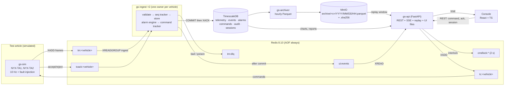

# Nyx Ground Segment – What We Build

Design and decision register · draft for Gate 2 · 2026-11-13 · enhancement round 1 applied (§9) · design review 2 applied (§10) · extensions added (§11, owner approved 2026-11-14) · extensions review applied (§12) · research rounds R14–R16 applied (§13)

This file is the single answer to "what do we build, and why that way". Design review 1 fixes are listed in §7. Enhancement round 1 (simplification review SR-01..09 and alternatives review ALT-A/B/C) is listed in §9. Design review 2 (closure of RV-xx, new findings R2-01..27) is listed in §10. The owner-approved extensions GS-EXT-01..04 (mission database, session compare and export, property and chaos testing, interface as code) and GS-EXT-05 (shift handover summary, from R18) are in §11; two of their parts are core from Gate 2 (the `mission/` database format and a subset of the interface models with their exported schemas, §11.2). The extensions review (EX-01..30) is listed in §12. The paper-evidence rounds R14 and R15 and the archive-integrity note R16 are listed in §13. Gate 1 gap review (same day) added D-SIM-10/11, D-ING-24/25, D-DB-10/11, D-ARC-10, D-UI-15..17, D-ENG-12/13, §3.1–3.4 and §5.1–5.2 (historic, §5.1/5.2 removed 2026-11-14). Every decision has an ID, the choice, the reason, the alternative it beat, the requirements it serves (spec §4, `GS-` prefix dropped) and the research note it comes from. Open choices and their defaults live in [assumptions.md](assumptions.md); the evidence lives in [research/](research/).

**Build levels.** **v1** = build first; required to pass a must-requirement. **v1+** = only if time remains after the v1 slice for every gate. If a v1+ item is not built, it gets an NCR (non-conformance report) in `docs/ncr/`, not a silent gap.

**Status tags.** `lead` = decided at the Gate 1 review, not by a research note. `default` = operator-visible choice the owner may still flip (see assumptions.md).

---

## 1. System in one picture



**One-paragraph story.** The simulator writes one JSON frame per tick into `tm:<vehicle>`. Two ingest workers share the vehicles; each vehicle has exactly one owner, enforced by a Postgres advisory lock, and the other worker waits on that lock to take over the moment the owner's session ends. The owner validates the frame, classifies its sequence number, stores it idempotently, runs the alarm engine, saves the engine state, commits, then publishes a UI event and acknowledges the Redis entry. Command tracking runs after that, in its own transaction, from stored evidence. The API streams UI events to the console over SSE and takes commands, acks and session actions over REST. The archiver turns each finished vehicle-hour into a verified Parquet object in MinIO and only then deletes the hot rows. Replay shows archived (or still hot) frames together with the alarm transitions recorded live.

---

## 2. Decisions by component

Columns: **ID** · **We build** · **Why** · **Instead of** (rejected, and why not) · **Reqs** · **Src**.

### 2.1 Simulator `gs-sim` (consolidated spec — new, gathered from six notes)

The simulator is ours, so its behaviour is a design decision. Downstream code must not depend on anything a real bench would not send (spec §3).

| ID | We build | Why | Instead of | Reqs | Src |
| --- | --- | --- | --- | --- | --- |
| D-SIM-01 | 10 Hz per vehicle on an **absolute schedule** (next tick = start + n·period), `t_onboard` stamped **before** `XADD` | Open-loop producer → latency samples need no coordinated-omission correction | Sleep-after-send loop (drifts, hides stalls) | ING-09, ALM-05 | [R10](research/R10-latency-measurement.md) |
| D-SIM-02 | `t_onboard` as ISO 8601 UTC with **µs** and `Z` | ING-09 is unmeasurable with whole seconds | ms or s precision | ING-09, UI-08 | R10 (A-R10-8) |
| D-SIM-03 | `seq` uint32, +1 per frame, reset to 0 on restart; `t_onboard` = wall clock, stays monotonic across restarts | Lets the tracker tell reset from duplicate with data only | Adding `boot_id` to the frame (spec §3 forbids downstream reliance on new fields) | ING-05 | [R5](research/R5-idempotency-gaps-resets.md) (A-R5-3/5) |
| D-SIM-04 | Each stream entry carries **one field `data`** = JSON frame (the same holds for `tc`, `tcack`, the DLQ record and `ui:events`, each with its feature from Gate 2, D-EXT-16) | Types survive the trip; "unparsable JSON" (`malformed`) has a meaning | Flat string fields (strict validation cannot type them) | ING-02 | [R11](research/R11-stack-and-delivery.md) (A-R11-1) |
| D-SIM-05 | **Buffer frames in order while Redis is down**: bounded deque of 6000 frames (5 min at 2 × 10 Hz), reconnect backoff capped at 1 s; any overflow is counted, logged and shows downstream as a GAP | From the producer's side the "stop Redis 10 s" outage is ~15 s (restart + AOF load + reconnect); 200 frames had no margin (RV-10) | Dropping frames; a 200-frame buffer | ENG-02, ING-01 | R3 (A-R3-1), RV-10 |
| D-SIM-06 | Reads `tc:<vehicle>`, executes **≤ 1 command per tick**, writes `{cmd_id, accepted, code, reason, t_onboard}` to **`tcack:<vehicle>`**, then reports `last_cmd_id` in the next frame. Gate 3b (Gate 3b plan; R-o, P-pf29): the simulator reads `commands.yaml` at start (a bound change reaches it at its next restart) and at every start moves its `tc` consumer group to the stream end (`XGROUP CREATE … $ MKSTREAM`, on BUSYGROUP `XGROUP SETID tc:<v> sim $`), so commands written while it was down are never executed or acked and the tracker's NOT_RECEIVED stays true. | RECEIVED needs a source (the §3 frame has none); one-per-tick keeps `last_cmd_id` from skipping a command | Inferring receipt from the simulator's XACK (proves a process read it, not that the vehicle accepted it) | CMD-01, 02 | [R2](research/R2-standards-and-command-safety.md) (A-R2-1 `default`, A-R2-6) |
| D-SIM-07 | Faults: `leak` (−0.4 kPa/s), `overheat`, `dropout N` (**on-board counter keeps running; the link is down both ways**: frames and `tcack` entries are lost, commands already on `tc:` are still executed, R2-26), `freeze` (**seq and time advance, values repeat**), `seq_jump`, `duplicate` (**byte-identical resend**), `malformed`, **`pause N`** (frames keep flowing; commands neither acknowledged nor executed for N s, then processed), **`hold_exec N`** (commands acknowledged at once, executed N s later), **`step {param, value, duration_s}`** (forces a value; alarm-latency runs). Noise comes from a seeded generator (`SIM_SEED`, R2-20). **Built on Gate 3a day 2**: `leak`, `overheat`, `dropout`, `freeze`, `seq_jump`, `duplicate`, `malformed`, `step`. **`pause` and `hold_exec` move to day 3**, with the command path they exercise (G2). | Each fault's semantics decides which detector must catch it. ATP-03: `pause 6` → FAILED NOT_RECEIVED, then LATE_VERIFICATION; `hold_exec 16` → RECEIVED → FAILED NOT_VERIFIED, then LATE_VERIFICATION, so both CMD-02 cases are reachable (RV-02). `step` gives 120 alarms in a 10 min run (RV-19). A command sent during the OPS-3 dropout ends FAILED NOT_RECEIVED → LATE_VERIFICATION after AOS, outcome EXECUTED_LATE (D-CMD-02, R2-26); a fixed seed makes ATP timings repeat run to run (R2-20) | One `pause` for both cases (only ever produces NOT_RECEIVED); a dropout that leaves the command path undefined | ING-02..05, UI-02, CMD-02, ALM-05 | R5, R9, RV-02, RV-19, R2-20, R2-26, G2 |
| D-SIM-08 | Cabin pressure noise **σ ≤ 0.027 kPa** | The 0.15 kPa/s rate-of-change limit false-alarms with more noise | Arbitrary noise | ALM-04 | [R8](research/R8-alarm-logic.md) |
| D-SIM-09 | Small HTTP control on the health port: `GET /healthz`, `POST /sim/fault` | Playwright and ATP scripts inject faults the same way every time | Manual fault injection | ENG-03, ENG-05 | R9, R11 |
| D-SIM-10 | **Test controls in the console**: with `GS_TEST_CONTROLS=1` on the api service, `GET /api/test-controls` and `POST`/`DELETE /api/test-controls/fault` forward a fault to the simulator's `POST`/`DELETE /sim/fault` (D-SIM-09) at `SIM_URL`, 3 s timeout. The API validates the body with the simulator's own `FaultRequest` / `FaultClear` and refuses a vehicle that is not in the API's live list (NYX-TA9 has no live display); every call is audited (`TEST_FAULT`, `TEST_FAULT_CLEAR`, with vehicle, fault, params) before it is forwarded. The local compose stack turns it on by default (ports are bound to 127.0.0.1); `GS_TEST_CONTROLS=0` removes it: the routes then answer 404 `NOT_FOUND`. Never a production feature | A presenter starts any scenario from the console without a shell; the browser never reaches the simulator, and the usual session, `X-GS-Client` header and audit rules still hold | The browser calling the simulator's port (no session, no audit); a new fault path inside the API | ENG-03, ENG-05 | owner |
| D-SIM-10 | **Command effects**: `isolate_valve {valve}` stops an active `leak` and repressurises the cabin at +0.5 kPa/s back to 101.3; `vent_cabin {duration_s}` drops cabin pressure 2 kPa/s for `duration_s`; unknown command or bad args → `tcack accepted=false, code=INVALID_ARGS`; a `tc` entry that fails the `Tc` model → `tcack accepted=false, code=SCHEMA` when its `cmd_id` is readable, XACKed either way (D-ING-27) | OPS-2/ATP-02 need the alarm to clear after `isolate_valve`; the REJECTED path is needed to test FAILED / NOT_EXECUTED | Commands without effect (the alarm would never clear) | CMD-01, 02, ALM-06 | `lead` |
| D-SIM-11 | Nominal values, noise and fault rates per parameter **exactly as in §3.3**, the same numbers as the checks in `mission/limits.yaml` (D-EXT-01); `unit/test_sim_matches_mission_db.py` asserts every simulator nominal lies inside the yellow band of the mission db. The simulator sends `mode: TEST` unless told otherwise (`set_mode`, D-EXT-06) | If simulator and limits disagree, ATP timings are random and tests flake | Separately chosen numbers | ALM-01..04 | `lead`, R8 |

### 2.2 Ingest worker `gs-ingest` (×2)

| ID | We build | Why | Instead of | Reqs | Src |
| --- | --- | --- | --- | --- | --- |
| D-ING-01 | Redis **Streams**, one stream per vehicle `tm:<vehicle>`, one group named `ingest` on each, fixed consumer names `ingest-1/2` | Already in the stack; ~1000× headroom; COSMOS runs the same layout in production | Kafka (new JVM service, more durability than a bench tool needs); NATS JetStream (new service, no DLQ) | ING-01, 06 | R3, [R1](research/R1-prior-art-mission-control.md) |
| D-ING-02 | **XACK only after the DB COMMIT** | At-least-once delivery; a crash before ack leaves the entry pending, never lost | Ack on read (loses frames on crash) | ING-07 | R3 |
| D-ING-03 | On start **and after every reconnect**, read own pending entries (`XREADGROUP … 0`) before new ones (`>`). Each such re-read increments the entry's `times_delivered`, like `XAUTOCLAIM` (measured, R15 E1), so a controlled exit on an operational error resets the counter of its in-flight batch first (D-ING-24). **Built as an `XAUTOCLAIM … <me> 0 0-0 COUNT 1` drain** (cursor until `0-0`) at start, takeover and after every Redis reconnect: it claims the own PEL (and any ghost consumer's) with min-idle 0, one entry per call, so every entry on the way passes the D-ING-04 count rule (G2, `5b06680`, `f772336`). | Frames read before a crash come back to the same consumer; without the reset an operational error that persists across restarts would push healthy frames past the D-ING-04 count (R15 E1) | Reading only `>` (stranded pending entries); a batched or JUSTID drain (R21: DLQs healthy neighbours, or crash-loops on a killer frame) | ING-07, ING-08 | R3, R15, G2, R21 |
| D-ING-04 | **Poison handling, one rule on every read path** (new, own-PEL, takeover claim, 30 s claim): before processing an entry, read its `times_delivered` (`XPENDING`); **> 3 → DLQ + `POISON` event**. A batch that fails with a **data error** (SQLSTATE class 22 or 23, or a Python processing exception) is rolled back and re-run one frame per transaction to isolate the bad frame; that frame is retried 3× in-process, then DLQ'd (`reason = poison`, `detail` = SQLSTATE + message); the rest commit and the worker does **not** exit. Any other Postgres error is operational and follows D-ING-24 (exit). A frame that kills the process on every delivery is the delivery-count case; tests reproduce it with `CRASH_AT=frame_seq:<n>` (D-ENG-16). **The count means "this frame kills us", not "the database failed while this frame was in flight"**: the controlled exit on an operational error resets the in-flight batch's counter to 0 (D-ING-24, R15 E1), so only real crashes (`os._exit`, segfault, OOM kill, `CRASH_AT`), which never reach that path, accumulate deliveries | A frame that crashes the worker every time reaches the DLQ after 3 deliveries instead of crashing both workers in turn (RV-06); one bad statement can't roll back good frames (RV-27); a data error is the frame's fault, so exiting would only hand the same frame to the peer (R2-01) | Stalling the vehicle ~90 s; different thresholds per note (≥ 3 vs > 3); exiting on every Postgres error (both workers crash in turn on one bad frame, R2-01); counting only in-process failures (loses the crash-every-time case RV-06 needs, R15); a separate retry-count key in Redis (a second source of truth for the counter, R15) | ING-08 | R3, R4, RV-06, RV-27, R2-01, R15 |
| D-ING-05 | DLQ write and XACK in **one `MULTI`**; DLQ record `{reason, detail, raw, stream, entry_id, deliveries, first_seen, dlq_at}`, reason ∈ `json_invalid · schema · vehicle_mismatch · t_onboard_range · poison` | A frame is never both acked-and-lost or DLQ'd twice; the reason is inspectable | Separate calls (crash window) | ING-02, 08 | R3, R11 (R13) |
| D-ING-06 | Trim with `XADD … ACKED MAXLEN ~ 108000` (3 h at 10 Hz, ~47 MB per vehicle measured 2026-11-17, ≈ 440 B/entry; holds the 2 h soak window) | `ACKED` never deletes un-acked entries; default trimming silently does | Default trimming (frame loss); no trimming (RAM) | ING-07 | R3 (A-R3-3/5) |
| D-ING-07 | Redis config: AOF `appendfsync always` + RDB + `noeviction` + **`maxmemory 512mb`** (R2-21), image pinned `redis:8.10.3`; ingest `/healthz` reports Redis `used_memory` and is degraded at ≥ 80 % of `maxmemory` | PEL and entries survived graceful restart and `kill -9` (R3); measured cost at 2 × 100 Hz paced (best of up to 3 batches of 1 000 on shared CI disks): XADD p50 1.2 ms, p99 4.7 ms (S1-S4), well inside ING-09; `everysec` loses up to 1 s. 512 MB is well above the ≈ 140 MB that D-ING-06's 3 h trim implies for the three streams (NYX-TA1, NYX-TA2, NYX-TA9; ≈ 47 MB each, measured 2026-11-17), so a long Postgres outage ends in a visible XADD error (the producer then buffers 5 min, D-SIM-05), not in the host running out of memory (A-R3-5). README caveat: whether fsync inside the Docker Desktop VM reaches the Mac's disk on host power loss is unverified | `everysec` (breaks "0 frames lost"); no `maxmemory` (unbounded growth) | ENG-02, ING-07, ENG-05 | R3, [S1](research/S1-gate2-spikes.md) S4, R2-21 |
| D-ING-08 | Worker loop: `BLOCK 1000`, catch `ConnectionError`/`TimeoutError`, back off 0.5 s doubling to 5 s, set `backlog=True`. v1.0.1 (NCR-04): after the first successful pass following an outage the LOS clock holds for `RESUME_GRACE_S` = 5 s (the simulator's worst resume after the broker is 3 s: 1 s send backoff + 2 s socket timeout), so a late source is not LOS; a source silent after the broker is back still gets its LOS about 7 s after ingest reconnects (`RESUME_GRACE_S` + `los_s`; up to 8 s with one blocked 1 s read). This is a UI-02 deviation limited to that post-outage window; outside it LOS stays at 2 s, and a value still turns STALE at 2 s because the console computes STALE from the value's age (`ui/src/states.ts:5,17`, `STALE_MS` = 2000), not from the LOS event. | redis-py gives up after ~5 s; `BLOCK` ≥ socket timeout fails after 62 s | Default client settings (worker crashes on the Redis stop test) | ENG-02 | R3 |
| D-ING-09 | **Vehicle ownership = Postgres session advisory lock** `pg_advisory_lock(hashtext('tm:'‖vehicle))` (blocking, D-ING-10) on the same connection that writes that vehicle's data | Lock and writes share one session, so a dead owner can't commit after takeover (lease + fence in one primitive); survives Redis restart | Redis lease (lost on Redis restart, needs a DB check anyway); stateless CAS workers (can't tell lost from in-flight frames); split stateful stage (needs single owner anyway) | ING-06, 07 | R4 |
| D-ING-10 | **Blocking standby lock + Postgres-only hand-back** (ALT-A): `ingest-1` has home vehicle NYX-TA1, `ingest-2` NYX-TA2 (config). Each worker runs one task per (worker, vehicle), each on its own connection (`application_name` = consumer name), calling the **blocking** `pg_advisory_lock`; the home vehicle is requested at once, the others after a 2 s start delay, so the home worker wins at startup. The waiting task's call returns the instant the owner's session ends. A task holding a **non-home** vehicle releases it (after acking its current batch) when `pg_locks` shows that vehicle's home worker waiting on the key (`granted = false`), checked every 5 s between reads inside that vehicle's read loop (D-ING-26); it then waits on the lock again. Homes come from env **`INGEST_HOMES`** (`ingest-1=NYX-TA1,ingest-2=NYX-TA2`, `parse_homes` rejects a malformed entry, a repeated vehicle or one not in `VEHICLES`); `ingest-2` is a normal service, not opt-in (G2). | 2 workers share load and order is kept; takeover happens when Postgres frees the lock, not on a poll; no ownership decision depends on Redis; a peer, not the restart policy, covers `docker kill` (A-R11-6) | Polled try-lock + "free > 2 s" timer + Redis-heartbeat release (four timers, two stores, A-F2); fixed vehicle per worker with no failover (SR-01: a `docker kill`ed worker is not restarted, so its vehicle stops until a manual `up`, failing OPS-4 / ATP-05) | ING-06, 07 | R4, ALT-A, A-E1-1/2, G2 |
| D-ING-11 | **Takeover protocol** (runs when the blocking lock call returns, at start and on takeover): load `seq_state`, open alarms and the **`engine_state` snapshot** (D-ALM-11) → `XAUTOCLAIM … 0` until cursor `0-0` → process in ID order → then new entries | Pending before new keeps per-vehicle order; no false GAP after a kill; alarm state is exact with no warm-up | Reading new entries first; warming checks up from the last K frames (ALT-C) | ING-06, 07, ALM-02/03 | R4, R8, ALT-C |
| D-ING-12 | **Steal path (v1)**: a separate 5 s worker tick checks, for each vehicle the worker does not own, the lock holder's consumer in `XINFO CONSUMERS tm:<v> ingest`; **`idle` > `STEAL_IDLE_MS`** (default 30 000, CI 3 000, D-ENG-16), i.e. no attempted read for 30 s (a healthy owner reads at least once per second, D-ING-08, and its reclaim runs inside the read loop, D-ING-26, so a hung loop's `idle` grows) → look up the holder's pid in `pg_locks`, `pg_terminate_backend`, and the waiting task takes over (D-ING-11). No steal within 30 s of the worker's own Redis reconnect, because `idle` keeps counting through an outage (R2-23, former cut candidate #7, built: §5 scope rule). **A stolen owner can't read again**: before every `XREADGROUP` the vehicle task runs `SELECT 1` on its lock connection (≈ 0.2 ms) and exits on error (D-ING-24), so a fenced owner that wakes never takes new entries into its PEL (R2-06). **Residual window (R14 E-5)**: the `SELECT 1` is a client-side check, so an owner stopped *between* `SELECT 1` and `XREADGROUP` still reads into its own PEL once after waking; those entries come back only through the 30 s reclaim (D-ING-26), late and possibly out of order, never lost or doubled (D-ING-13/17). Postgres writes stay fenced by the server (they run on the lock session); Redis reads are not. Tested at the hook `STOP_AT=after_fence_before_read` (D-ENG-16): 0 lost, 0 duplicates, out-of-order count reported. The frame transaction, the ACK application and the command tracker all use that lock connection. All workers share one DB role. **Two refinements from Gate 3a day 2.** (1) The hold-off after the worker's own Redis reconnect is `max(STEAL_IDLE_MS, backoff max 5 s + socket timeout 5 s + 2 × BLOCK)` = 12 s floor, because a healthy holder's own reconnect can take that long and CI's 3 s `STEAL_IDLE_MS` is shorter; the steal threshold itself stays `STEAL_IDLE_MS`, and the tick's own outage also starts the hold-off (G23, `a986b74`). (2) A steal needs the **same holder pid** over the threshold on **two consecutive ticks**, and the terminate statement only matches the pid that still holds the lock, so a holder that changed after a takeover or hand-back is never terminated (G24, `a986b74`, `c56a778`). | A hung-but-connected owner (SIGSTOP, deadlock) would otherwise block its vehicle and fail ING-08 (RV-03); the `idle` trigger also catches an owner that hangs between XACK and its next read with an empty PEL, which "an entry pending > 30 s" misses (A-F1); without the pre-read check a woken owner pulls entries into its own PEL, and they come back 30 s late, out of order and behind a false GAP (R2-06). The first good tick after an outage used to steal with no hold-off, so two workers could steal from each other (caught by review, `a986b74`); the cost of the two-tick rule is one more 5 s tick of steal latency. | v1+ / cut list (it hits a must); "an entry pending > 30 s" trigger (never fires with an empty PEL); letting a woken owner read and fail on its next write (R2-06); a Redis-side fence (`WATCH`/`MULTI` or Lua around the read: drops `BLOCK` and touches a must path, R14 E-5) | ING-06, ING-08 | R4 (A-R4-4), RV-03, ALT-A, A-E1-1, R2-05, R2-06, R2-23, R14 (Burrows 2006 p. 5), G23, G24 |
| D-ING-13 | **Storage key `(vehicle, t_onboard, seq)`**, `INSERT … ON CONFLICT DO NOTHING RETURNING` | Timescale requires the time column in unique keys; CCSDS recommends counter + time; a wrong classification can raise a wrong event but never drop or double a frame | `(vehicle, seq)` (drops frames after every restart); `(vehicle, epoch, seq)` (a misdetected epoch loses data) | ING-03, 05, 07 | R5 (A-X-1) |
| D-ING-14 | **Pure sequence tracker** `step(state, seq, t) → (state, events)` with wrap-safe compare (mod 2³²) and the 7-rule table: IN_ORDER, GAP, SEQ_JUMP, DUP_OR_LATE, SEQ_RESET (seq ≤ 50 and time forward), SEQ_ANOMALY | Uses `t_onboard` to split duplicate from reset and dropout from jump; deterministic, so replay and reclaim give the same events | RTP fixed misorder window (calls a quick restart a duplicate) | ING-03, 04, 05 | R5 |
| D-ING-15 | Epoch = `t_onboard` of the first frame after a reset; kept in `seq_state` (updated **in the same transaction** as the frames) and on event rows. A frame sent to the DLQ for a data error never reaches the tracker, so the next frame records a GAP of `lost` 1; that is correct, the frame is not stored (`test_dlq.py`, G2 note). | Derived from data only → any worker or replay computes the same value | Worker-local boot counter (non-deterministic) | ING-04, 05 | R5, G2 |
| D-ING-16 | `SEQ_JUMP` is its own event, not a GAP; a `SEQ_RESET` shows in the session report as a gap of unknown size. An AOS event's `lost_frames` comes from a GAP only; after a SEQ_JUMP or reset it is unknown (null), and 0 for an in-order stale frame (G13, `be5c06e`). | Counter jump ≠ lost frames; the report stays honest (review Q5) | Counting a jump as lost frames | ING-04, DAT-02 | R5 (A-R5-4/6, `lead`), G13 |
| D-ING-17 | Event keys: GAP/SEQ_JUMP `(vehicle, epoch, from_seq)`, SEQ_RESET `(vehicle, epoch)`; only frames classed **new** reach the alarm engine. **Formats (G2)**: LOS/AOS `<kind>/<vehicle>/<epoch Z>/<last_seq>` (an AOS shares its LOS's suffix), FROZEN `FROZEN/<vehicle>/<epoch Z>/<first_seq>`, POISON `POISON/<stream>/<entry id>`, transitions `<vehicle>/<param>/<epoch Z>/<trigger_seq>/<kind>`; `alarm_id` = uuid5 of the RAISE transition key (`gs.ingest.events`). LOS/AOS and FROZEN detector state is kept inside the `engine_state` snapshot (D-ALM-11). | A redelivered frame raises nothing twice (OPS-4 "no alarm duplicated") | Relying on the frame insert alone | ING-07, ALM-06 | R5, G2 |
| D-ING-18 | **Strict pydantic frame model**: `strict=True`, `allow_inf_nan=False`, uint32 bounds, UTC-only aware time, UUID, `vehicle` = stream suffix, `t_onboard` within [now − 7 d, now + 5 min]; parameter fields generated from `mission/parameters.yaml` (D-EXT-01) with `create_model` on the `FrameHeader` interface model (D-EXT-18, 19) | Rejects NaN, `"5"`, naive times, wrong vehicle; adding a parameter needs no code | Lax parsing (hides simulator bugs) | ING-02, ENG-06 | R11 (R13), D-EXT-18, D-EXT-19 |
| D-ING-19 | Unknown frame field → kept in `model_extra`, **counted, warned once, not stored** | Simulator ahead of config must not DLQ every frame | `extra="forbid"` | ING-02, ENG-06 | R6, R11 (A-R6-3) |
| D-ING-20 | Registered parameter missing from a frame → **stored as NULL, counted, warned** | Adding a parameter to config before the simulator sends it must not quarantine every frame | DLQ (breaks the add-a-parameter guide) | ING-02, ENG-06 | R11 (A-R11-3 `default`) |
| D-ING-21 | **FROZEN detector**: **all** analog parameters (enums excluded) bit-identical for ≥ 2 s of `t_onboard` → `acq=FROZEN`, shown like STALE; no per-parameter opt-out (SR-08). After the 47, the rule runs over the raw parameters of `mission/parameters.yaml` (the frame's values, before calibration); derived parameters are excluded by rule and there is no per-parameter flag (D-EXT-09, EX-23): a real freeze repeats every raw value, so UI-02 is not weakened. Former cut candidate #3, built (§5 scope rule). A SEQ_RESET or SEQ_ANOMALY restarts the detector (no FROZEN run spans two epochs, G11, `b639ac8`). **There is no FROZEN end event**: the event row marks the onset only; the day-3 console derives the end from the next changed value (A-G3-1). | `freeze` keeps frames arriving, so arrival-based staleness never fires; time-based so 100 Hz doesn't trip it after 0.2 s (RV-24); requiring every value to match makes a quantized sensor harmless, so no opt-out is needed | 20 frames (0.2 s at 100 Hz); a per-parameter flag that suppresses FROZEN for that parameter alone | UI-02, OPS-3 | R9, RV-24, SR-08, EX-23, G11 |
| D-ING-22 | **One frame transaction per `XREADGROUP` batch**, on the vehicle's lock connection: psycopg 3 `executemany` (pipeline mode) + `ON CONFLICT`. Order inside it: **pending ACK requests first**, each in its own `SAVEPOINT` with its audit row (D-ALM-14), then frames, `seq_state`, sequence and LOS/AOS events, alarm transitions and the `engine_state` upsert (D-ALM-11), **nothing else**; then **COMMIT → `XADD ui:events` → XACK**. Command tracking runs afterwards in its own transaction on the same connection (D-CMD-05) | Publishing before XACK means a crash before the publish leaves the frame pending; the takeover then resyncs the console (D-UI-18); keeping the tracker out means a tracker fault can never roll back frames or send them to the DLQ (B-F1); ACKs before the frames give replay and the determinism test one fixed position (R2-10); a SAVEPOINT per ACK means one bad request can't fail every batch (R2-01) | COPY + staging table; asyncpg; publishing after XACK (lost alarm messages, RV-05); command updates inside the frame transaction (ALT-B); ACKs after the batch's frames (position depends on batch size, R2-10) | ING-07, 09, UI-05 | R6, R5, RV-05, ALT-B, R2-01, R2-10 |
| D-ING-23 | `t_received DEFAULT clock_timestamp()` (not `now()`) | `now()` is transaction start → batched inserts understate latency | `now()` | ING-09 | R10 (A-R10-1) |
| D-ING-24 | **Postgres errors split by SQLSTATE class** (R2-01; SR-01's crash-only kept for operational errors only). One pure `classify(sqlstate)` serves every path. (1) **Operational** (connection, admin shutdown, lock loss: classes 08 and 57 incl. `57P01`, and any class not listed under (2), e.g. read-only `25006`, disk full `53100`, `statement_timeout` `57014`, deadlock `40P01`) in the frame path: roll back, do **not** XACK, **reset the delivery counter of the batch being rolled back with `XCLAIM tm:<v> ingest <me> 0 <ids…> RETRYCOUNT 0 JUSTID`** (skipped if Redis is down too; harmless if the peer has already claimed the entries, because XACK is per group; R15 E1), then exit non-zero (`sys.exit(1)`); its sessions end, so its locks free and the peer's waiting task takes those vehicles at once (D-ING-10); `restart: unless-stopped` brings the worker back through the normal startup path, and it gets its home vehicle back by hand-back. (2) **Data** (classes 22, 23) in the frame transaction → per-frame isolation and DLQ (D-ING-04), no exit. (3) **Any error in the tracker transaction** → roll back, log, count `cmd_tracker_errors`, carry on; never exit, never touch frame processing (D-CMD-05); a broken connection is found by the frame path's next pre-read `SELECT 1` (D-ING-12) and exits there. (4) An error while applying one ACK request → that SAVEPOINT rolls back, the request is marked `rejected` with the reason and audited, the batch continues (D-ALM-14). Redis errors keep the in-process reconnect (D-ING-08). Tested by `system/test_db_errors.py::test_operational_error_loop_keeps_frames` (R15 E1) | Frames wait safely in Redis (`ACKED` trimming keeps them); never write on a connection that doesn't hold the lock (R4 rule 4); one recovery path (startup) for a lost connection. Exiting on a data error would hand the same frame to the peer and crash both workers in turn until delivery 4 (RV-06 again), and exiting on a tracker error would loop for ever, because commands have no delivery count (R2-01). Without the counter reset, an operational error that persists while the connection stays up restarts the worker about three times in under a second (Docker's restart backoff); each restart re-reads its own PEL (D-ING-03) and raises `times_delivered`, so healthy frames reached `tm:dlq` as POISON, missing from `telemetry` and breaking chaos invariant I6 (R15 E1, reproduced on Redis); 92 % of catastrophic failures come from mishandled non-fatal errors (Yuan 2014 p. 3) | Crash-only on **any** Postgres error (R2-01); in-process re-lock and takeover after a DB error; retrying on a fresh connection without re-locking (breaks the fence); crash-only for Redis errors too (Docker's restart backoff could stretch a 15 s outage, SR "considered") | ENG-02, ING-07, ING-08, CMD-02 | R4, SR-01, A-E1-3, R2-01, A-R2R-1, R15 (A-R15-2, A-R15-3) |
| D-ING-25 | Each worker sets **`hb:veh:<v>` = 1 with `EX 3`** every second **from inside that vehicle's read loop** (D-ING-26) for each vehicle it owns | Lets the API decide per vehicle whether a healthy owner exists (RV-16); set from the loop, it stops when the loop hangs (R2-05); operational DB errors exit the worker (D-ING-24), so a live worker has a working DB and a `db_ok` field adds nothing (SR-02) | A bare "alive" flag; `hb:ingest:<consumer>` = `{owned, db_ok}`; a heartbeat side task (stays alive for a hung loop, R2-05) | UI-02, ENG-05 | `lead`, RV-16, SR-02, R2-05 |
| D-ING-26 | **30 s reclaim inside the read loop (v1)**: between reads, every 5 s, the vehicle's read loop runs `XAUTOCLAIM tm:<v> ingest <me> <RECLAIM_IDLE_MS>` (default 30 000, CI 3 000, D-ENG-16), collecting entries left pending under any other consumer name (then the D-ING-04 delivery-count rule), and the hand-back check (D-ING-10); the `hb:veh` heartbeat (D-ING-25) is set from the same loop. So a hung loop stops all three: its `idle` grows and the steal fires (D-ING-12), and its heartbeat stops, so the console shows GROUND PROCESSING DOWN (R2-05). **In-process watchdog**: `faulthandler.dump_traceback_later(30, exit=True)`, re-armed by a 5 s task only while every owned vehicle loop has completed a pass in the last 30 s; a hung loop or a blocked event loop dumps its stack and exits (crash-only restart, D-ING-24). The test creates the idle entry with a `ghost` consumer that reads without acking. The watchdog is armed with the **remaining budget of the oldest owned loop** (`dump_traceback_later(30 − age of the oldest owned loop)`), so a hung loop is killed 30 s after its last pass, not up to 60 s (G27, `a80f3fb`). The 30 s interval is fixed, not configurable (A-G3-3). | Gives ING-08's "entry idle > 30 s is reclaimed" an actor in v1 (RV-03); a side task that kept reclaiming or heartbeating would reset `idle` and keep `hb:veh` alive for a deadlocked loop, so it would never be stolen and the console would show LOS for a ground fault (R2-05) | Reclaim only at takeover (min-idle 0, never 30 s); reclaim and heartbeat on a separate 5 s tick (masks a hung loop, R2-05) | ING-08, UI-02 | R3, RV-03, R2-05, R11, G27 |
| D-ING-27 | **One rejection rule for every stream consumer** (R17 F1; core, Gate 3): an entry that fails its interface model (D-EXT-16/18, `extra="forbid"` kept) goes to `tm:dlq` with `reason = schema`, its `stream` and the validation message, is acknowledged so it is never retried, and raises one `INTERFACE_MISMATCH` event per stream kind and consumer schema version (key `INTERFACE_MISMATCH/<stream kind>/<first 12 hex of the consumer's exported schema sha256>`, written once with `ON CONFLICT DO NOTHING`); the consumer's `/healthz` reports `degraded` until it restarts; no console banner (A-R17-1). Per consumer: **`tcack:<v>` in the owner's tracker** — validation runs before the tracker transaction and is outside D-ING-24 (3), so a bad entry can't stay pending and fail on every pass: if the raw entry has a readable UUID `cmd_id` of an open command, the tracker transaction marks it FAILED `ACK_INVALID` (not NOT_RECEIVED: the vehicle did answer, D-CMD-02) and writes the event, commits, then `MULTI` DLQ + XACK (D-ING-05 order: commit, then ack); **`ui:events` in the API** (plain `XREAD`, no group, so "acknowledged" = skipped past): DLQ + event, the SSE stream carries on; **`tc:<v>` in the simulator** (no DB, and its ACL can't write `tm:dlq`, D-ENG-17): it XACKs, logs, and answers `tcack accepted=false, code=SCHEMA` when `cmd_id` is readable, so the tracker records REJECTED → NOT_EXECUTED and writes the `INTERFACE_MISMATCH` event for `tc` (A-R17-4). Frames keep D-ING-05's reasons; a bad frame is ING-02's case, not an interface mismatch. **Upgrade rule** (dev guide): a change to any stream model means restarting all services together (`make up`); the CI `lint` job prints "stream interface changed: restart all services together" when an exported stream schema (`frame`, `tc`, `tcack`, `dlq`, `ui-event`) differs from `main`, for information only (`scripts/stream_schema_notice.py`). Tests: `integration/test_cmd_tracker.py::test_invalid_tcack_dlq_not_retried` (DLQ `schema`, XACKed, one event, command FAILED `ACK_INVALID`, not seen again next pass), `integration/test_hub.py::test_invalid_ui_event_dlq` (DLQ + event, later events still delivered), `unit/test_sim_tc.py::test_invalid_tc_nacked_with_schema_code`, `unit/test_stream_schema_notice.py` (changed schema → notice; unchanged → silent). Gate 3b (Gate 3b plan; R-l, P-pf14, P-pf16): an invalid `tcack` marks any open command ACK_INVALID including RECEIVED, an ACK_INVALID seen in the same pass as an echo is late evidence (EXECUTED_LATE, "do NOT resend", the safe direction), and the `INTERFACE_MISMATCH/tc/<sha12>` key uses the ingest image's `Tc` schema hash. | Stream entries outlive the code that wrote them (in the stream or a PEL across a one-service rebuild or a restart), and every stream model but `FrameHeader` forbids extra fields, so even an optional new field makes the other version reject the entry. Without a rule a bad `tcack` hit the tracker's catch-all, was never XACKed, failed on every pass, and the acknowledged command timed out as NOT_RECEIVED (R17 F1). Strictness plus explicit extension points keeps protocols from decaying (RFC 9413), so the fix is a rejection rule, not tolerance; data compatibility between producer and consumer schemas is the general problem (Habib et al. 2021, abstract) | `extra="ignore"` on readers (hides typos, slow drift, RFC 9413, EX-07); a version field and readers for several versions (more code than restarting one host together); an automatic subschema classifier (`jsonsubschema`; only needed with a second producer, A-R17-2); Pact or a contract broker (one repository) | ING-02, CMD-01, CMD-02, UI-07, EXT-04 | R17 (A-R17-1, A-R17-2, A-R17-4) |

### 2.3 Alarm engine (library used by ingest and by the replay determinism test)

| ID | We build | Why | Instead of | Reqs | Src |
| --- | --- | --- | --- | --- | --- |
| D-ALM-01 | **On a limit = the more severe band** (`v ≤ low`, `v ≥ high`); load-time check `red_low < yellow_low < yellow_high < red_high` | EPICS and COSMOS precedent; gives ALM-01's "exactly on" test a defined answer | Yamcs/XTCE default (on-limit = nominal) | ALM-01 | R8, R1 |
| D-ALM-02 | **Hysteresis = % of span** (`red_high − red_low`) → absolute deadband `d`; only delays moves to a less severe band; `hysteresis_abs` for one-sided limits. **Floor rule, checked at load**: `d ≥ 1.5 × max(1 % of span, 1 % of \|limit\|)` over every limit of the parameter, in every check set (D-EXT-06); a `mission/limits.yaml` with a check below it rejects the whole set (`LIMITS_REJECTED`). §3.3 values: cabin pressure **15 %** (d = 1.65 kPa ≥ 1.5 × 1.06), cabin temp 3 %, bus voltage 6 %, tank pressure 4 %, rates 2 %, bus current `hysteresis_abs: 0.2`. So ALM-02 passes under **both** readings of "±1 %" (of span, of the limit value) on **every** limit. "1 alarm" = one RAISE transition. **Span when a red bound is missing** (two-sided `hysteresis_pct` check): the outermost configured bounds; the floor uses the same span, so it still protects (G10, `46dc27a`, `7f51f36`). **A rate-of-change check has no deadband** (A-G3-2). | % of limit value is 0 at a limit of 0; the customer hasn't confirmed which reading the spec means, so no test may depend on it (RV-12); the earlier 2 % default chattered under "% of limit" on bus voltage and tank pressure and sat on the edge for cabin temp (R2-17). A deadband removes false alarms from **small deviations** only (Gyasi & Wang 2022 p. 2) and is the least effective of the filtering techniques (Izadi 2009 p. 6); here it serves ALM-02's noise near a limit, and its cost (the 13.5 s clear after `isolate_valve`, §3.4) is reported by the tuning study (D-ALM-16, R14) | % of limit value; a deadband that passes only one reading, or only on one parameter | ALM-02 | R8, RV-12, R2-17, G10 |
| D-ALM-03 | **Persistence**: ring of the last N raw levels; escalate when all N ≥ L, de-escalate when all N ≤ L; red needs no own N; **N = 3** (`persistence: 3` default, §3.3) | **N = 3 is the spec's value** (ALM-03 pass condition "N = 3"; ALM-05's 300 ms budget leaves room for it), not a literature value: the literature's delays are far longer (EEMUA starting values 15 s for pressure, 60 s for temperature, Izadi 2009 p. 4; a 20 s default, Wang & Chen 2014 p. 4). The literature supports the **structure**: an m-sample on/off-delay timer after a deadband, in series, removes the short-duration false alarms the deadband can't (Gyasi & Wang 2022 p. 2; Wang & Chen 2014 p. 4). A 1-frame spike never alarms. Whether N = 3 sits on the false/missed/delay frontier for the simulator's noise is checked by D-ALM-16 (R14 E-2) | Persistence on raise only; a literature delay of 15–60 s (would break ALM-05) | ALM-03 | R8 (A-R8-3), R14 |
| D-ALM-04 | GAP, SEQ_RESET and **data-STALE** (`t_onboard` gap > 2 s between consecutive frames) reset counters and the ROC window but **never clear an alarm**. **A NULL sample** (a registered parameter missing from the frame, D-ING-20; after the 47 also a derived value that can't be computed, D-EXT-05, or a raw value outside its calibration table, D-EXT-04) is not classified: each check of that parameter keeps its debounced level, resets its persistence ring and ROC window, and never clears an alarm; the value shows NO_DATA (EX-03). The browser STALE clock (D-UI-05) is display-only. **The frame that reveals a GAP or SEQ_RESET is itself classified**: the engine clears the ring and check state first, then classifies that frame as the first fresh one. Without this, periodic frame loss (1 frame in 4) never lets the ring reach N = 3 and no alarm is ever raised (G15, `fdc155b`, `test_periodic_loss_still_raises`). **A parameter with `checks: []` is unchecked** and skipped by the engine (G16, `fdc155b`). A rebuild from `alarms` rows seeds only the alarm's trigger check, at the alarm's severity (G2). | A value can be RED and STALE; the engine's STALE comes from data only, so live and replay compute the same thing (RV-07); a NULL sample had no rule, so a missing value could have raised or cleared an alarm by accident (EX-03) | Clearing on loss of data; using wall-clock STALE in the engine; treating a NULL as 0 or as NOMINAL | ALM-01, ALM-03, UI-02, DAT-06 | R8, RV-07, EX-03, G15, G16 |
| D-ALM-05 | **Rate of change = least-squares slope** (`statistics.linear_regression`) over the last `window_s` = 1 s of `t_onboard`; needs ≥ 80 % of expected samples, spanning what that many span at the nominal rate (a backlog stamped ms apart after a stall is no rate; G4-28); optional `direction: rising·falling·both` (default both) | ~1.4× less noisy than end-point difference, 13× less than frame-to-frame; the ROC threshold, not N, carries the noise rejection (simulation: 3-in-a-row survives 39× more often than for a level check at equal exceedance); alarms the 0.4 kPa/s leak ~7.5 s before yellow; vehicle time, not arrival time | Frame-to-frame difference; arrival-time slope | ALM-04 | R8 (A-R8-8 `default`) |
| D-ALM-06 | **One alarm per (vehicle, param)**; severity = max of its checks; `trigger_check` recorded | A leak gives one escalating alarm, not three | One alarm per check | ALM-06, UI-05 | R8 |
| D-ALM-07 | Life cycle **UNACK → ACKED → CLEARED**, plus **RTN_UNACK** ("cleared – not acked"); ACK requires a note; who/when/why stored on every transition | Matches the spec's ACTIVE→ACKED→CLEARED and ISA-18.2; RTN before ack must stay visible | Auto-clear on return to normal | ALM-06 | R8 (A-R8-7), R1 |
| D-ALM-08 | **Acked yellow that escalates to red becomes UNACK and alerts once**; red→yellow→red after an ack does not alert again (`acked_sev` kept) | Answers review Q2 ("I acked and it got worse"); Yamcs keeps the ack here, we deliberately don't; OPC UA Part 9 §4.3 leaves ack reset on escalation to the server, so re-alarming is allowed | Keeping the ack (Yamcs) | ALM-06, UI-05 | R8 (A-R8-5 `default`) |
| D-ALM-09 | Among **limit alarms**, only **RED** alerts audibly (`alert` column on the transition row); yellow is visual. The separate, less urgent **loss-of-monitoring tone** (D-UI-21) is not an alarm transition and never uses the RED beep | OPS-2 "an alarm sounds once"; UI-05 "a new red alerts once" stays exactly true (R18 confirms RED-only for limit alarms) | Sounding on every transition | UI-05 | R8 (A-R8-6), R18 |
| D-ALM-10 | **Pure checks**: `Check` Protocol with `kind`, pydantic `Config`, a frozen JSON-serialisable `State` dataclass, `initial()`, `step(state, sample, current) → (state, level)`; `@register` into `CHECKS`; package auto-imports every module; one generic JSON (de)serializer for check states keyed by `kind` (ALT-C). Property test: serialize at every batch boundary, reload, continue → same transitions as the uninterrupted run | "New class + registration only" = add one file, no worker edit; serialisable state makes the takeover snapshot exact (D-ALM-11) | Plugin framework; if/else in the worker | ALM-07, ING-07 | R8, R1, ALT-C |
| D-ALM-11 | **Engine-state snapshot** (ALT-C): in every frame transaction (D-ING-22) the owner upserts `engine_state(vehicle, last_seq, epoch, set_sha256, schema_version, state)` (§3.2); takeover and restart load it (D-ING-11); no row → `initial()`. If `schema_version` differs (state shape changed by a code change): open alarms from `alarms`, checks from NOMINAL, plus an `ENGINE_STATE_RESET` event (known approximation, A-E1-5). No `LEVEL` events, no K-frame warm-up | Hysteresis has memory; the snapshot is committed with the frames it reflects, so the rebuilt state equals live by construction. The LEVEL + K-frame warm-up was measured to diverge from live in 0.48 % of takeovers (K too small, C-F1); re-feeding from NOMINAL in 28–29 % | LEVEL events + warm-up of the last K frames (C-F1); re-feeding frames from NOMINAL | ING-07, ALM-02/03, UI-05 | R8, ALT-C |
| D-ALM-12 | **Limits reload = mission-db reload** (D-EXT-02): hash the three files of `mission/` (sha256 of the bytes, a few KB each; the limits live in `mission/limits.yaml`) every 1 s; on a change wait until the three hashes are equal on **two consecutive polls** (a multi-file save or `git pull` is applied as one set, EX-09; still < 5 s: ≤ 1 s to see the change, 1 s to confirm it, ≤ 1 s to the owner's next batch), then validate them as one set with pydantic (`extra="forbid"`, cross-file references, D-EXT-01), store the set in `limits_versions` under its `set_sha256`, emit `LIMITS_APPLIED(first_seq, set_sha256, limits_sha256, commands_sha256, parameters_sha256)`; an invalid set keeps the old set + `LIMITS_REJECTED` banner (naming the file and the error). **At worker start an invalid set, including one that names a parameter with no `telemetry` column (D-DB-11), falls back to the newest valid `limits_versions` row** (+ LIMITS_REJECTED); refuse to start only if no valid version exists. A rejected set is re-validated every 10 s, so a later `make migrate` takes effect without touching the files (R2-18). The deadband floor (D-ALM-02) is part of validation | New limit active < 5 s; every alarm row and `LIMITS_APPLIED` say which limits applied from which frame (Q6), which the replay determinism test reuses (D-REP-05); one typo or one un-migrated parameter plus one crash must not stop ingest for both vehicles (RV-17, R2-18) | inotify dependency; a `stat` pre-check (SR-09); refusing to start on any invalid file | ALM-08, ENG-06 | R8, RV-17, SR-09, R2-18, EX-09 |
| D-ALM-13 | Out of scope: shelving, latching, suppression, re-alarm timers, operator-selected limit sets, 5 severity levels, **flood handling** (first-out ordering, consequence grouping, flood suppression, §4). Check sets selected by the frame's `mode` are extension D-EXT-06. **Nyx has no flood control**: deadband and persistence remove *false* alarms (Gyasi & Wang 2022 p. 2), while floods are mostly *correct* alarms from abnormality propagation (Wang et al. 2016 p. 7); D-ALM-15 measures the peak rate and time in flood as the trigger to build it | Not in the spec; each adds UI + audit paths; at 2 × 9 parameters a flood is unlikely, and the metric shows it if not | — | — | R8 (A-R8-9), R1, R14 |
| D-ALM-14 | **ACK path; the owner worker is the only writer of alarm state.** The API validates the ACK (alarm open, note not empty), inserts `alarm_ack_request` (§3.2) with `status = pending`, writes audit `ALARM_ACK`, returns **202**. The owner reads pending requests for its vehicles every loop pass (≤ 1 s) and applies them **at the start of its next frame transaction, before that batch's frames** (D-ING-22), each in a `SAVEPOINT`: ACK row in `alarm_events` with `after_epoch`, `after_seq`, `after_t_onboard` = the vehicle's last frame before this batch (`seq_state`), `status = applied`. An ACK for an alarm that is already ACKED (two operators) → `status = superseded`, no transition row. An error → SAVEPOINT rollback, `status = rejected` + reason, batch continues (R2-01). Each outcome is audited at apply time as `ALARM_ACK_APPLIED` with `result` = applied · superseded · rejected. The console shows **ACK PENDING (by fc1)** until the ACKED event, and **ACK NOT APPLIED – processing down** while `hb:veh:<v>` is missing. Gate 3b (Gate 3b plan; R-w, R-x, R-h, P-pf40, P-pf42, P-pf42b, P-pf43, P-pf43b): an ACK for an alarm that is no longer open is `superseded`, an ACK-only pass commits its own transaction, `AckRequest` carries an optional `seen_key` (migration `04a-ack-seen-key.sql`) and the owner applies a request only if that key equals the alarm's current last event key AND no RAISE/ESCALATE row has `processed_at` later than `requested_at` − 2 s (a key mismatch gives "alarm changed since you saw it", the margin "alarm changed since the request"), requests wait while the owner holds unsent `ui:events` messages, and an error inside one request's savepoint rejects only that request for SQLSTATE class 22, 23 or P0 while every other class exits the worker. | ACK then RTN must give CLEARED, not RTN_UNACK; a second writer would be overwritten by the engine's in-memory state; a fixed position (after the previous batch's last frame, with its epoch and `t_onboard`) makes replay ordering and the determinism test unambiguous, also across a SEQ_RESET (RV-01, R2-10); one bad request can't block frames (R2-01) | API updating `alarms` directly; applying ACKs after the batch's frames; an `after_seq` without epoch | ALM-06, UI-05, DAT-06 | R7, R8, RV-01, R2-01, R2-10 |
| D-ALM-15 | **Alarm-quality metrics** (R14 E-1, E-3): one pure function `gs.alarms.quality(alarm_events, fault_windows) → {raises, false_raises, psi, short_t1, short_t0, peak_10min, time_in_flood}` over recorded `alarm_events` rows. `false_raises` = RAISE on a parameter no injected fault affected, judged from the simulator ledger / `SIM_SEED` fault log (only where one exists: ATP-01 soak, chaos; `null` on a real bench); `psi` = chatter index Ψ per parameter from the run-length distribution (Kondaveeti 2010 p. 3), flagged at ≥ 0.05 alarms/s (Wang & Chen 2014 p. 3); `short_t1` / `short_t0` = alarms with duration or interval < 20 s (Rule 3a, Wang & Chen p. 3–4), because Ψ can miss chatter; `peak_10min` = peak new alarms in any 10 min, per vehicle and combined (one console serves both); `time_in_flood` = time from ≥ 10 alarms in 10 min until the rate drops below 5 (Wang et al. 2016 p. 7). The `step` alarms of D-PERF-04 are excluded by design (1 s on purpose). Reported in (a) the ATP-01 2 h soak result, expected 0 false raises; (b) a section of the session report (D-DB-06, DAT-02); (c) chaos invariant **I8** and the chaos `summary.md` (§11.5). Thresholds are literature defaults, not tuned values (A-R14-1): flood start/end per EEMUA 191 (via VanCamp); "< 1 % time in flood" and "≤ 10 per 10 min" via Siemens' ISA-18.2 table; "per operator" is unverified. Tests: `unit/test_alarm_quality.py` on hand-built transition lists (Ψ = 0 for < 2 alarms; Wang & Chen's 7-run-length example gives Ψ < 0.05 but Rule 3a fires; flood start at 10 in 10 min and end below 5; `step` alarms excluded), `integration/test_sessions.py::test_report_alarm_quality` | D-ALM-02/03 limit nuisance alarms by construction but nothing measured it; false alarms cost more than misses (Dixon 2007, abstract), train operators to ignore alarms (Bliss 1995, abstract) and make spacecraft engineers drop a tool after "even a couple false positives" (Hundman 2018 p. 8); floods are the trigger for the flood handling of §4 | Asserting that deadband + persistence work; Ψ alone (misses chatter of < 6 s alarms, Wang & Chen p. 3); building flood handling first | ALM-02, ALM-03, DAT-02, EXT-03 | R14 (A-R14-1) |
| D-ALM-16 | **Deadband / persistence tuning study** `perf/alarm_tuning.py` (R14 E-2; R14 named it `alarm_roc.py`): stdlib + the real `gs.alarms` engine, seeded `SIM_SEED`, offline. (1) Nominal runs at §3.3 σ: false RAISE per hour and Ψ (D-ALM-15). (2) `leak` −0.4 kPa/s and `overheat`: detection delay from the limit crossing to RAISE, and the ALM-04 ROC-before-yellow margin. (3) Cabin-pressure RTN delay after `isolate_valve`. Grid: N = 1..5 × deadband 2, 4, 6, 8, 10, 12, 15 % for cabin pressure; N = 1..5 × the ROC limit for the ROC check (the ROC limit, not N, carries its noise rejection, D-ALM-05; also tests R8's untested claim that persistence filters correlated ROC noise less). Output `docs/perf/alarm-tuning.md` (table + one ROC-style plot per parameter). Acceptance: N = 3 / 15 % is on or near the frontier with 0 false raises per hour, the ALM-03 spike rejected, the ALM-04 margin ≥ 5 s and an on-delay inside the ALM-05 budget; a dominated value raises an assumption entry, never a silent change. **Holds for simulator noise only** (i.i.d. Gaussian): re-run on recorded bench noise before the first real campaign (§3.5 ICD-B-06; non-i.i.d. signals, Wang et al. 2019). Tests (D-ENG-14, tooling is tested): `unit/test_alarm_tuning.py` (grid enumerated as specified; same seed → same table; the frontier/dominance function on hand-built points) **Gate 4 (T4-i, T4-j; R20):** the grid runs as specified, and the acceptance follows R20 F2 (noise margins; Monte Carlo only for ROC and fault profiles); the ROC grid is 0.05–0.25 kPa/s; the study bypasses the load-time floor on purpose. Details of D-ALM-15: duration = RAISE → RTN/CLEAR, interval = RTN/CLEAR → next RAISE, flood time combined, `step` alarms dropped via the step window, ATP-01 passes `fault_windows=[]` and the report `None`. | The ROC method needs normal **and** abnormal data and picks the smallest delay meeting the false/missed targets (Izadi 2009 p. 6; sweeps 2–10 samples, 2–20 %, pp. 5–6); deadband and timer are designed jointly (Gyasi & Wang 2022 p. 2); FAR/MAR fall and delay rises with m (Wang & Chen p. 4); a misplaced trip point makes a delay worse (Izadi p. 5) | Values from the spec and the floor rule with no check; a study on bench noise now (no bench yet) | ALM-02, ALM-03, ALM-04 | R14 (A-R14-2) |

### 2.4 Commanding (API + vehicle owner)

| ID | We build | Why | Instead of | Reqs | Src |
| --- | --- | --- | --- | --- | --- |
| D-CMD-01 | States **QUEUED → SENT → RECEIVED → VERIFIED**, or **FAILED**; RECEIVED from `tcack` (accepted), VERIFIED when `last_cmd_id == cmd_id` (a telemetry-based verifier, like XTCE Complete / Yamcs algorithm verifier) | Spec names kept; maps cleanly to PUS service 1 acceptance/completion | Extra start/progress states (no source in our frame) | CMD-01 | R2, R1 |
| D-CMD-02 | FAILED carries `failure_reason` (SEND_ERROR · REJECTED · NOT_RECEIVED · NOT_VERIFIED · **ACK_INVALID**: the vehicle's `tcack` failed its interface model, D-ING-27, R17 F1); **`outcome`** is **computed, not stored**, by one helper `outcome(failure_reason, late_verified_at, late_ack_accepted)` used by the API and the UI: SEND_ERROR→NOT_SENT, REJECTED→NOT_EXECUTED; for NOT_RECEIVED/NOT_VERIFIED/ACK_INVALID a late echo → **EXECUTED_LATE**, a late `tcack accepted=false` → **NOT_EXECUTED**, a late `tcack accepted=true` with no echo → **RECEIVED_LATE**, nothing late → **UNKNOWN**. UI text says which and what to do, e.g. "FAILED (no verification in 15 s) – vehicle executed it at 14:03:17Z – do NOT resend". Gate 3b (Gate 3b plan; R-i, R-j, P-pf14, P-pf16): late evidence is looked for 600 s after FAILED and `outcome()` checks it before `SEND_ERROR`, so a row with vehicle evidence is never reported NOT_SENT or "safe to retry" (a deliberate deviation from the order of the table above). | Answers review Q3 "did the vehicle do it?"; PUS: silence is not failure; never blind-resend a hazardous command after UNKNOWN; once the echo proves execution, "UNKNOWN" would invite a second `vent_cabin` that the 2 s interlock no longer covers (R2-04); `outcome` stays a pure function of stored evidence, so no column can disagree with it (SR-07) | A bare FAILED; a stored `outcome` column; `outcome` from `failure_reason` alone (loses LATE_VERIFICATION, R2-04) | CMD-02, UI-06 | R2, SR-07, R2-04, R17 (A-R17-5) |
| D-CMD-03 | **Both windows from SENT**: not received in 5 s, not verified in 15 s; per-command overrides in `mission/commands.yaml`, only shorter than these defaults (load check, D-EXT-07), so CMD-02 is never lengthened | Simple to explain; worst case is 15 s, not 20 s | Yamcs chaining from previous stage | CMD-02 | R2, R1 (A-R1-1) |
| D-CMD-04 | **FAILED is terminal**; a later echo writes `LATE_VERIFICATION` + `late_verified_at`; a later `tcack` after NOT_RECEIVED writes `late_ack_at` + `late_ack_accepted` (audit `CMD_LATE_ACK`) | History is append-only; investigators need to know the operator saw FAILED; ATP-03's 16 s pause must expect FAILED **then** LATE_VERIFICATION; the late ack answers Q3 for the `pause 6` case (R2-04) | Overwriting to VERIFIED (Yamcs); ignoring a late `tcack` | CMD-02, 04 | R2 (A-R1-2), R2-04 |
| D-CMD-05 | **Command tracking runs in the vehicle's owner, after the frame COMMIT, in its own transaction** (ALT-B), every loop pass (≤ 1 s resolution because `BLOCK 1000` returns even when the vehicle is silent). It decides from **stored evidence only**: the `commands` row, `tcack:<v>` entries (applied as guarded updates, then XACKed) and `telemetry.last_cmd_id` (one indexed query for open `cmd_id`s since `min(sent_at) − 1 s`; the first frame per id gives VERIFIED or LATE_VERIFICATION). The decision is a pure `decide(cmd, ack, first_verify_frame, now, caught_up)`; timeouts apply **only when the owner has caught up** on its backlog (last read was not a full batch and the takeover drain is done, D-ING-08/11), and evidence inside the window wins over a timeout in the same pass (A-E1-4). Timers keep running during LOS. The tracker runs on the vehicle's lock connection (D-ING-12). A tracker error (any SQLSTATE) is rolled back, logged and counted in `/healthz` as `cmd_tracker_errors`; it never exits the worker and never touches frame processing (D-ING-24, R2-01). Gate 3b (Gate 3b plan; P-pf2, R-j, R-z, P-pf14): `caught_up` means this pass did the `>` read and got fewer than COUNT entries, `decide()` judges the windows by evidence timestamps (an echo inside the receive window with no `tcack` gives VERIFIED with `received_at` NULL, which relies on the single-clock assumption A-G3b-R-j), the tracker claims `tcack` entries with `XAUTOCLAIM … 0` and then reads `>` on each pass, and one change may carry a timeout and late evidence together. | The owner already sees frames in order and inherits failover with no extra service; durable evidence means a crash between the frame and tracker commits loses nothing (B-F3) and a late or new owner reaches the same answer; caught-up timeouts stop a false FAILED after a takeover (B-F2); a separate transaction stops a tracker fault from sending every frame to the DLQ (B-F1); `decide()` makes every CMD-02 branch a table test | Tracking inside the frame transaction with in-memory command state; a tracker in the API; a separate `gs-cmdtrack` service (sixth service, no failover); the owner also sending commands | CMD-01, 02 | `lead` (A-R2-7), ALT-B, R2-01 |
| D-CMD-06 | **Hazardous two-step enforced by the API with a single-use server token**: the first POST is rejected 409 `HAZARDOUS_CONFIRMATION_REQUIRED` with the hazard text and a random `confirm_token`, stored as `SET confirm:{token} {user}\|{args_hash} NX PX 60000` (`args_hash` = sha256 of canonical `{vehicle, name, args}`), audit `CMD_CONFIRM_REQUIRED`. The confirm POST must carry `confirm_token` + `reason` (≥ 10 chars); the API consumes the token atomically with `GETDEL`, then checks that user and `args_hash` match. Missing, expired, used, other user or other args → 409 `CONFIRMATION_INVALID` + audit `CMD_REJECTED` (the token is consumed either way). The console's confirm dialog adds a typed target vehicle ID before Confirm is enabled (D-UI-20, R14 E-8); this API rule is unchanged. Gate 3b (Gate 3b plan; R-k, R-s): a confirm with too short a reason gets 422 `REASON_REQUIRED` and the token is not consumed, and every 409 of `POST /api/commands` carries one `CommandConflict` body. | curl, scripts and UI all hit the same rule; you can't confirm A and send B; a client can't skip step 1, because a token exists only after the server has shown the hazard and written `CMD_CONFIRM_REQUIRED` (R2-02); `GETDEL` makes it single-use | Client-only dialog (fails "cannot be sent without both"); a client-computable `confirm_args_hash` (one request with a computed hash skips step 1, R2-02) | CMD-03 | R2, R1, R2-02 |
| D-CMD-07 | **Double-command interlock**: `SET cmdlock:{vehicle}:{key} {cmd_id}\|{user} NX PX 2000` as the last check; `key` = `name` for **hazardous** commands, `name:args_hash` otherwise; user excluded; on SEND_ERROR the API releases its own lock (D-CMD-11, R2-25) | Two operators can't each send `vent_cabin` with different durations within 2 s (RV-26); ordinary commands with different args still pass; a double-click is stopped | Args-hash key for every command | CMD-05 | R2, RV-26 (A-R2-4), R2-25 |
| D-CMD-08 | **Append-only `audit_log`**: actions `LOGIN · LOGIN_FAILED · LOGOUT · CMD_REQUESTED · CMD_CONFIRM_REQUIRED · CMD_REJECTED · CMD_STATE · CMD_LATE_ACK · CMD_LATE_VERIFICATION · ALARM_ACK · ALARM_ACK_APPLIED · LIMITS_RELOADED · SESSION_START · SESSION_STOP · REPORT_REFROZEN`; app role `INSERT, SELECT` only + triggers that raise on UPDATE/DELETE/TRUNCATE; **completeness** tested (N commands + M acks → exactly the expected rows). Gate 3b (Gate 3b plan; P-pf37, P-pf15): `decide()` writes one CMD_STATE audit row per state change even when a single pass crosses several states, and the `ALARM_ACK` audit reason is the operator's note. | Two independent layers; CMD-04 needs both immutability and "every command and ack" (RV-14, RV-20) | Hash chain / WORM (out of scope) | CMD-04, UI-06 | R2, R6, RV-14, RV-20 |
| D-CMD-09 | Command definitions = `mission/commands.yaml`, the spec's command catalogue under its spec name (D-EXT-01, entry format D-EXT-07), validated with pydantic together with the other two mission-db files at load and on every reload; per command `description`, `hazardous`, `hazard` text, typed `args`; no hash on command rows (SR-07: no requirement versions command definitions; `commands_sha256` in `LIMITS_APPLIED` and `limits_versions` records which file was live, D-EXT-02); a hot reload that turns a command from `hazardous: true` to `false` is applied by ingest (start and reload give the same verdict, G31) and rejected by the API's own reload (day 3; the command definitions change only at the next api start), and `LIMITS_RELOADED` lists every command whose `hazardous` changed (D-EXT-02, EX-25) | Typed args catch bad input at the API; the spec's file name, loaded and versioned in one set with the parameters | XTCE (XML schema with ~100 element types); commands inside one combined mission file (renames the spec's file, A-EXT-1); `commands_sha256` on every command row | CMD-03, CMD-04, ENG-06 | R2, SR-07, D-EXT-01, EX-25 |
| D-CMD-10 | **No roles**: any logged-in user may command and run sessions; identity always from the session cookie, never the request body | A simple login is in scope, roles are not; second-person approval is the documented upgrade | Conductor/controller roles; second-user approval (COSMOS Enterprise) | CMD-03, 04 | R11 (A-R11-5 `default`), R2 |
| D-CMD-11 | **Command row concurrency**: every state change is `UPDATE … WHERE state IN (<earlier states>)` (monotonic: a late SENT can't overwrite RECEIVED); the API sets SENT + `sent_at` **before** `XADD tc:`, and on XADD error sets FAILED SEND_ERROR and releases its own `cmdlock` by compare-and-delete (`WATCH`, `GET` equals its own `cmd_id\|user`, then `MULTI DEL EXEC`), so the operator's retry isn't rejected as a duplicate of a command that was never sent (R2-25); the owner's single 5 s not-received timeout covers QUEUED too: `state IN ('QUEUED','SENT') AND coalesce(sent_at, queued_at) < now − 5 s` → FAILED NOT_RECEIVED (SR-07); `tcack:<v>` is read with the `ingest` group and XACKed after the tracker transaction commits (D-CMD-05). No in-memory command state, so nothing to load on takeover. Amended at Gate 3b (Gate 3b plan; P-pf12, P-pf38, P-pf39, owner may overrule): an `XADD` to `tc` that times out leaves the row SENT for the tracker to judge by evidence (a timed-out `XADD` can land, G30), only a definite pre-send failure (connection refused, ACL error, any Redis error reply) is SEND_ERROR "safe to retry", and the `XADD` runs under the interlock (`WATCH` the lock key, `GET` equals our owner value, `MULTI XADD EXEC`), so a lock that is no longer ours sends nothing. | API and worker both write command rows; without guards an executed command can end FAILED (RV-09); one timeout rule instead of a separate QUEUED sweep. If the API dies between QUEUED and SENT the command ends NOT_RECEIVED / UNKNOWN, which never falsely claims "not sent" | Unguarded updates; a separate "QUEUED > 5 s → SEND_ERROR" sweep | CMD-01, 02 | RV-09, SR-07, ALT-B, R2-25 |

### 2.5 Storage (TimescaleDB)

| ID | We build | Why | Instead of | Reqs | Src |
| --- | --- | --- | --- | --- | --- |
| D-DB-01 | **One TimescaleDB** (`timescale/timescaledb:2.32.0-pg17`) for telemetry, events, alarms, commands, sessions, audit | One store, one backup, reports join in one query; 5–100× margin on measured targets | InfluxDB 3 / QuestDB / ClickHouse (second store, no verified row delete) | DAT-03 | [R6](research/R6-timeseries-store.md) |
| D-DB-02 | **Wide hypertable**: one row per frame, one typed column per parameter, 1 h chunks aligned with the hourly archive | Measured: 1 h of one param 2–24 ms (target 300 ms), 24 h band 58–424 ms (target 2 s) | JSONB (24 h band 2.3–6.1 s, fails UI-04); narrow rows (4.75× disk, 2–4× slower) | DAT-03, UI-04 | R6 |
| D-DB-03 | Parameter columns created **by `gs-migrate`** from the registry (D-DB-11): `ADD COLUMN IF NOT EXISTS` (name checked `^[a-z][a-z0-9_]{0,62}$`); after the 47 also derived parameters and `<name>_raw` for calibrated ones (D-EXT-04/05) | Adding a parameter = one `mission/parameters.yaml` entry (+ its checks in `mission/limits.yaml`); 2 ms in the spike | Hand-written migrations per parameter | ENG-06 | R6 |
| D-DB-04 | Downsampling with `time_bucket` **min/max/avg/count plus `first(value, t)` / `last(value, t)`** (M4, R15 E2), bucket = max(window / `width`, 100 ms), where `width` = the chart's pixel width sent by the client (default 1500, accepted 100–4000, else 400; A-R15-4); empty buckets absent (chart shows a gap). `first`/`last` are TimescaleDB built-ins; the plain-Postgres fallback of D-DB-05 is `(array_agg(v ORDER BY t))[1]`. Tests: `integration/test_downsample.py::test_first_last_per_bucket` (ramp + spike: each bucket's first/last equal its first/last stored rows), `::test_bucket_count_from_width`, `::test_24h_window_is_valid_and_fast` with the two extra columns | Server-side band for any window; gaps stay visible; one bucket per pixel column with min, max, **first and last** draws an error-free line, while plain min/max "ignores the important first and last tuples" (Jugel et al. 2014 M4, p. 5, full text) | Continuous aggregates (non-Apache licence, not needed at 0.45 GB/day); a fixed 1500 buckets; min/max/avg only (line through the mean, not the data); MinMaxLTTB (fewer points, not needed at 24 h × 10 Hz) | UI-04 | R6, R15 (A-R15-4) |
| D-DB-05 | **Apache-2 features only** (no compression, no continuous aggregates) | Keeps plain Postgres (`date_bin`) as a fallback | TSL features | DAT-03 | R6 (A-R6-6) |
| D-DB-06 | Session report = one SQL query over the session window (min/max/avg per param, count vs expected, GAP events, alarms, commands) + CSV export; plus an **alarm-quality section** from D-ALM-15 over the session's `alarm_events` (raises, Ψ, short alarms, peak per 10 min, time in flood; false raises only where a fault log exists) | 15–31 ms for 6 h in the spike; answers review Q5 | Precomputed rollups | DAT-02 | R6, R1 |
| D-DB-07 | `test_session(vehicle, name, conductor, started_at, ended_at, ended_by)`; **partial unique index: one active session per vehicle**; frames always stored, linked to sessions by time window | Clear 409 on double start; out-of-session frames are not lost | FK from telemetry to session (breaks storing out-of-session frames); exclusion constraint (more than needed) | DAT-01 | R11 (R13) |
| D-DB-08 | One `events` table for ground events (GAP, SEQ_*, POISON, LOS/AOS, FROZEN, LATE_VERIFICATION, LIMITS_*, ENGINE_STATE_RESET, ARCHIVE_CORRUPT from the scrub, D-ARC-11) with a deterministic `key`, `kind` and `details jsonb`; no `severity` / `source` columns (SR-09: PUS vocabulary with no reader and no requirement). LOS/AOS are written by the vehicle's owner in its frame transaction: LOS when data-STALE starts (D-ALM-04 rule: on the next frame, or from the read loop's 2 s no-frame timer), key `LOS/<v>/<epoch>/<last_seq>`; AOS on the next frame with `lost_frames` (R2-11) | One place for every keyed event; a future CCSDS decoder adds its own severity mapping when it exists | Separate tables per event type; PUS service 5 `severity`/`source` columns "for later" | ING-04, CMD-04, UI-02, DAT-06 | R2, SR-09, R2-11 |
| D-DB-09 | **`events` and `alarm_events` are never pruned** (SEQ_RESET, LIMITS_APPLIED, GAP, alarm transitions and ACK rows …), nor is `limits_versions` | Replay shows these recorded rows as what happened live (D-REP-01) and the determinism test re-derives them (D-REP-05); they are small | Pruning with telemetry | DAT-06, ALM-08 | R7 (A-R7-5), RV-14, ALT-C |
| D-DB-10 | Report **frozen** when the vehicle watermark `seq_state.last_t ≥ ended_at` (or after 30 s, marked "incomplete: n of m frames"); until then `GET …/report` returns 409 `REPORT_PENDING` with frame count vs expected. Stored in `session_report(session_id, report, csv)`. A report marked incomplete can be recomputed with `POST /api/sessions/{id}/report/refreeze` (audited `REPORT_REFROZEN`) while its hot rows still exist (R2-22, former cut candidate #4, built: §5 scope rule). No sign-off in the tool (SR-02, §4). Gate 3b (Gate 3b plan; R-p, P-pf27, P-pf30): the report freezes on the first read that meets the rule (idempotent insert, no background task), a database error on a sessions, report or buckets route returns 503 `UNAVAILABLE`, and a CSV text cell from operator input that starts with `=`, `+`, `-`, `@`, TAB or CR gets a leading apostrophe. | Freezing at stop could miss in-flight frames and show a false gap, Q5's exact worry (RV-15); hot rows are deleted after 25 h, so a report read at the test review a week later must come from the frozen copy | Freezing at stop; recomputing on every view; a sign-off endpoint with `REPORT_SIGNED` + sha256 (no pass condition, SR-02) | DAT-02 | R6 (A-R6-4), RV-15, SR-02, R2-22 |
| D-DB-11 | **Parameter registry = `mission/parameters.yaml`** (D-EXT-01, entry format D-EXT-03: name, unit, type, description; after the 47 also calibration and the `derived:` section; the checks live in `mission/limits.yaml`). `gs-migrate` (owner role) adds missing columns; at worker start a registered parameter with no column is treated like an invalid set: fall back to the newest valid `limits_versions` row + LIMITS_REJECTED, re-validated every 10 s, so a later `make migrate` takes effect without a restart (D-ALM-12, R2-18); a hot reload that adds an unknown parameter is rejected with `LIMITS_REJECTED: run make migrate` | The app role can't `ALTER TABLE` (role design of D-CMD-08); one file declares every parameter, and its checks sit in the spec's `limits.yaml` next to it; with the fallback, editing `mission/` before `make migrate` plus any restart can't stop both vehicles (Q18, R2-18) | Units and descriptions inside `limits.yaml` (mixes the registry into the spec's limits file); `ALTER` from the app role; refusing to start on an un-migrated parameter (R2-18) | ENG-06, ALM-08 | R6, R8, `lead`, R2-18 |

### 2.6 Archive and replay

| ID | We build | Why | Instead of | Reqs | Src |
| --- | --- | --- | --- | --- | --- |
| D-ARC-01 | One **Parquet** object per vehicle-hour, pyarrow, zstd, one row group, schema from the hot table; no custom footer metadata (nothing reads it, SR-05) | ~0.91 MB per vehicle-hour, ~10× smaller than hot rows | snappy (1.13 MB); CSV; footer `limits_sha256`/seq range/schema version | DAT-04 | [R7](research/R7-archive-replay.md), SR-05 |
| D-ARC-02 | **Hash the uploaded bytes and compare the rows**: sha256 computed in memory, sent as `x-amz-checksum-sha256`, checked by the full re-read (D-ARC-03), and recorded in `archive_object` only after that re-read matches **in bytes and in content** (D-ARC-03, D-ARC-04, R16 F1) | Parquet bytes are only reproducible with the same pyarrow version; recording the hash before upload adds nothing, because every step before verification is re-runnable from hot rows (SR-05) | Byte-reproducible files as the integrity basis; recording the hash in Postgres before upload | DAT-05 | R7, SR-05, R16 |
| D-ARC-03 | **Single PUT** with `x-amz-checksum-sha256` (MinIO rejects a mismatch); then **full re-read** against the recorded hash; **then the content check (R16 F1)**: decode the re-read Parquet, read the hot rows of the same `(vehicle, hour)` (bounds from the shared `hour_bounds(vehicle, hour)` helper, A-R16-3) with the same schema, sort both by `(t_onboard, seq)` and compare with `pyarrow.Table.equals` (36 000 rows, a few ms); then sidecar `<HH>.parquet.sha256` in `sha256sum` format. Test: `integration/test_archiver.py::test_verify_compares_content` (an object whose rows differ from the hot rows by one value → no `archive_object` row, hot rows kept) | Four independent checks before any delete; a killed upload leaves no visible object (shown in the R7 spike). The hash proves the bytes arrived, not that they hold the rows being replaced: a check at the endpoints (the rows replay will read against the rows being deleted) can't be replaced by a transport checksum (end-to-end argument, Saltzer et al. 1984, R16; UNVERIFIED until the PDF is ingested) | Multipart (objects are below the 5 MB part minimum; leaves parts behind); ETag as hash (not MD5 for multipart); a SQL text digest compared with a Python digest (float text formats differ, R16) | DAT-04, 05 | R7 (A-R7-1), R16 |
| D-ARC-04 | **One `archive_object` row per (vehicle, hour), inserted only after verification** (`vehicle, hour, sha256, rows, t_min, t_max, verified_at, hot_deleted_at, last_checked_at`, §3.2; `t_min`/`t_max` = min/max `t_onboard` of the archived rows, columns rather than footer metadata, so SR-05 stands; R16 F1); an eligible hour with no row is (re)built from hot rows, which are deleted last. "Verified row = archived" **Gate 4 (T4-a, T4-b; ruling G4-4, G4-6, G4-17):** `archive_object` gains `version int NOT NULL DEFAULT 0` (`migrations/05-gate4.sql`, the result equals §3.2); the row names the latest verified version of the hour. A late row before the hot delete makes version N+1 from all hot rows; after it, version N+1 is the previous object plus the late rows, and the row update and the late-row delete share one transaction with the count/min/max check against the late rows. When a hot hour's object is corrupt or missing, the planner rebuilds it as version N+1 from the hot rows (verified as usual), which resolves the `ARCHIVE_CORRUPT` and lets the normal delete follow (ruling G4-4); a hot-deleted corrupt hour stays an open `ARCHIVE_CORRUPT` for a person, since no copy is left. If an archived value and a hot value differ on a shared `(vehicle, t_onboard, seq)` key, the archived value wins and a WARNING names vehicle and hour, as in `merge_late` (ruling G4-17; `gs_app` cannot UPDATE telemetry, so this is low risk). | Kill mid-upload → no row exists → the next run rebuilds and re-uploads (about 1 MB), nothing lost, no manual cleanup (SR-05) | Stateless cron; a WRITTEN → UPLOADED → VERIFIED → HOT_DELETED state machine (states nothing needs) | DAT-05 | R7, SR-05, R16 |
| D-ARC-05 | **Eligible = `hour_end + 10 min ≤ now`** (wall clock; 10 min > the 5 min producer buffer); **hot delete only when hour_end ≤ now − `HOT_RETENTION_H`** (default 25 h), per (vehicle, hour), in one transaction over the rows inside `hour_bounds(vehicle, hour)` (the same helper as the export, D-ARC-03), commits only if the deleted rows' **count, `min(t_onboard)` and `max(t_onboard)`** equal `archive_object.rows`, `t_min`, `t_max`; any mismatch rolls back and alerts (R16 F1). Test: `integration/test_archiver.py::test_delete_wrong_hour_refused` (archive hour H, call the delete with H+1's bounds, both 36 000 rows → rollback, alert, H+1 still hot) **"Alert" (T4-c)** = an ERROR log line naming the vehicle plus archiver `/healthz` `degraded` with `delete_refused` until that hour deletes. **Scope of a refusal (ruling G4-18, amends T4-q):** an error local to one object (hash, missing, read failure of that hour) blocks deletes only for that hour; a global error (S3 unreachable, listing fails) blocks every delete in the pass. So one bad object cannot make the hot table grow without bound, and every delete re-reads its own object first. Scrub runs before the delete actions of a pass (ruling G4-5). | The 24 h chart is always hot; one eligibility rule; the row-count check catches late frames; at a steady 10 Hz every full hour has exactly 36 000 rows, so a count alone can't tell hour H from H+1 (off-by-one hour, local vs UTC bucket, `[h, h+1)` vs `(h, h+1]`): the range check and one shared bounds helper close that silent-loss path (R16 F1) | `add_retention_policy` / TTL (deletes unverified data); a vehicle-watermark rule plus a "+30 min if silent" fallback (SR-05) | DAT-05, UI-04 | R7, R6 (A-R7-4), SR-05, R16 (A-R16-3) |
| D-ARC-06 | **v1: late frames** into an archived hour stay hot and raise an alert (the delete check refuses). **v1+:** write an immutable `<HH>.v<N>.parquet`; readers take the latest verified version **Mechanics (T4-b, ruling G4-4/G4-17):** one `archive_object` row per `(vehicle, hour)` names the latest verified version, object keys `<HH>.parquet` for version 0 and `<HH>.v<N>.parquet` for N ≥ 1, `ARCHIVE_CORRUPT` event keys with a `/v<N>` suffix for N ≥ 1 (D-ARC-11); see D-ARC-04 for the before/after-delete cases. | Nothing is lost in v1; versioning is extra code for a rare case | Overwriting `<HH>.parquet` (data/sidecar disagree for a window); separate `late/` objects every reader must merge | DAT-04, 05 | R7 (A-R7-2), `lead` |
| D-ARC-07 | Scheduler: plain **asyncio loop every 5 min** in `gs-archiver` | One loop does not justify a dependency | APScheduler (4.x still alpha) | DAT-04 | R7 |
| D-ARC-08 | S3 client: **minio-py** | Ships type hints (mypy strict) | boto3 (needs stubs) | ENG-09 | R7 |
| D-ARC-09 | MinIO image **`bitnamilegacy/minio:2025.5.24@sha256:451fe6858cb770cc9d0e77ba811ce287420f781c7c1b806a386f6896471a349c`** (amd64 + arm64), data at `/bitnami/minio/data`, credentials `MINIO_ROOT_USER/PASSWORD`; healthcheck `curl -fsS http://localhost:9000/minio/health/live`; `minio-init` runs from the **same image** (`mc alias set … && mc mb --ignore-existing …`, `MC_CONFIG_DIR=/tmp/mc`), gated on `minio: service_healthy`; `minio-init` also creates an `archiver` MinIO user with a bucket-scoped policy (put/get, no delete), so the archiver never holds the root keys (R2-19); limitation: no delete is not no overwrite: the archiver's policy allows PutObject on `archive/*`; the code never overwrites (version keys, pre-PUT refusal); MinIO object locking is the later answer; listed in README limitations | Upstream stopped publishing images; this one is built from official source. Spike S1: image contains `mc` and `curl`, rejects a wrong `x-amz-checksum-sha256` (`XAmzContentChecksumMismatch`), data survives container re-creation on the named volume. One image for server and init removes `pgsty/mc` and the retry loop | `pgsty/minio` (third party, unverified); building from source | DAT-04, ENG-01 | R7, R11, [S1](research/S1-gate2-spikes.md) S1 (A-X-3), R2-19 |
| D-ARC-10 | Archiver `/healthz` reports `oldest_unarchived_hour`, the scrub result (D-ARC-11) and Redis (as the `health` ACL user, R2-09) and DB reachability; older than 72 h (config) or any unresolved `ARCHIVE_CORRUPT` → `degraded`; no console banner (SR-02, §4); MinIO unreachable → retry with backoff, never delete Down/degraded rules (T4-q, ruling G4-18): DB unreachable → down; Redis or MinIO unreachable → degraded; an S3 error in a pass blocks deletes by scope as in D-ARC-05 (object-local: that hour only; global: the whole pass). `degraded` also lists a `delete_refused` count while any hour's delete is refused. | Hot data grows while MinIO is down and DAT-05 forbids deleting it, so someone has to find out | Silent growth until the disk fills; an ARCHIVE_BACKLOG console banner (no pass condition) | DAT-05, ENG-05 | R6 (A-R6-5), SR-02, R16 |
| D-ARC-11 | **Rolling archive scrub, detection only** (R16 F2): each pass of the archiver loop (D-ARC-07) re-reads and re-hashes the K objects with the oldest `archive_object.last_checked_at` (K = 20 per 5 min loop, about 5 760 per day, A-R16-1) and sets `last_checked_at`; a mismatch writes an `ARCHIVE_CORRUPT` event (`events`, key `ARCHIVE_CORRUPT/<vehicle>/<hour>`, details: expected and found sha256) and turns `/healthz` `degraded` (D-ARC-10). Replay of that hour keeps today's refusal: 409 "archive object failed hash check" (D-REP-01, A-R16-2). **No repair**: there is one copy (§4, Q14). Test: `integration/test_archiver.py::test_scrub_detects_corrupt_object` (one byte of a stored object changed through the MinIO admin user → next pass writes `ARCHIVE_CORRUPT`, `/healthz` degraded, replay of that hour 409) **Unresolved rule and key (T4-d, ruling G4-6):** an `ARCHIVE_CORRUPT` is unresolved while its `expected` sha256 equals the row's current `sha256` **and** its `version` (default 0) equals the row's current `version`, because a heal rebuilt from the same hot rows is byte-identical, so the sha alone never resolves it; versions N ≥ 1 get a `/v<N>` key suffix. **Replay (T4-e, A-R16-2 closed):** the whole replay is refused with 409, not shown with a gap; the page says "Replay stopped: an archive object failed its hash check (<detail>)" (ruling G4-22). A hot hour whose object stays corrupt is never deleted by the archiver on its own: see the operator guide, "A corrupt hour that stays hot". | After `HOT_RETENTION_H` the single MinIO object is the only copy, and today the first check is the next replay, possibly in front of the board; silent corruption isn't caught by the drive itself (Bairavasundaram et al. 2008 p. 1); proactive scrubbing finds latent faults before they combine (Schroeder et al. 2010, Baker et al. 2006, UNVERIFIED until ingested). About 1 MB and 3 ms per object, so a full pass over a month of data takes seconds | Waiting for a replay to find it; a second MinIO or erasure set (more infrastructure than a bench tool needs; §4); repair from a second copy (none exists) | DAT-05, DAT-06, ENG-05 | R16 (A-R16-1, A-R16-2) |
| D-ARC-12 | **Daily state snapshot** (R3-01, R3-02): once per `SNAPSHOT_EVERY_H` (default 24, > 0) the archiver loop, after a pass's deletes and inside its own `try/except`, writes `state/YYYY/MM/DD/HHMM.tar.gz` to the archive bucket: every table but `telemetry` (`snapshot.TABLES`, parents before children), one `<table>.csv` each, all read in one `REPEATABLE READ` read-only transaction so they are one consistent view. The tarball is PUT (server-checked sha256), read back and compared, and only then `<key>.sha256` is PUT: no sidecar, no snapshot. A failure is logged and never fails or delays the pass or a hot delete. `/healthz` shows `last_state_snapshot` and is `degraded` when it is older than 2 × `SNAPSHOT_EVERY_H`, or missing after the first completed pass. `scripts/restore_state.py <key>` verifies the sidecar, refuses a non-empty database (exit 2), COPYs in order as `gs_owner` and resets every identity sequence with `setval`. `make reset` runs `scripts/reset_guard.py` first: it counts the `archive_object` rows (archived hours) through the db container (`docker compose exec db psql`), refuses while the count is above 0 and also when it cannot count (stack down, no docker, odd output); only `FORCE=1` overrides. Telemetry is not in the snapshot (Parquet already holds it); history since the last snapshot is lost (≤ `SNAPSHOT_EVERY_H`). Tests: `integration/test_snapshot.py`, `unit/test_restore_state.py`, `unit/test_reset_guard.py`, `unit/test_archiver_status.py::test_archiver_status_snapshot_age` | Everything but telemetry had one copy in one Postgres volume, and `make reset` dropped the archive with it | pg_dump (a new binary in the image); streaming WAL archiving (more moving parts than a bench tool needs) | DAT-04, DAT-05, DAT-06 | design review 3 (R3-01, R3-02) |
| D-REP-01 | **Replay shows the recorded truth** (ALT-C): it merges the frames of the window (verified Parquet objects, hash checked, or the hot table for hours not yet archived) with the **`alarm_events` and `events` rows recorded live** for that window, ordered by `(t_onboard, seq)` (after the 47 this window reader is shared with compare and export, D-EXT-10); each hour is projected onto the window's columns, a column the hour lacks (a parameter added later, ENG-06) filled with typed NULLs of the registry type (EX-19), and for an archived hour any hot rows still left (late frames, D-ARC-06) are merged in, deduplicated by `(vehicle, t_onboard, seq)` (EX-29); an ACK row sits directly after the frame `(after_epoch, after_seq)` it names, placed by `after_t_onboard` (D-ALM-14, R2-10). Alarm state at `t_from` = the latest recorded transition per alarm before `t_from` (one query); frames are annotated with each parameter's current recorded severity. **Nothing is recomputed** **Recorded truth in replay (rulings G4-14, G4-15; clarifies the Task 12 brief, which called these fields static):** the limits hash, the `limits_sha256` columns and `trigger_check` shown at a replay position come from each recorded `alarm_events` row, folded in order (the last non-null `check_kind` is kept across ACK, RTN and CLEAR rows), never from the current `alarms` row, because `_UPSERT_ALARM` rewrites both on every later transition and a limits change would otherwise rewrite history. Alarm state comes from a reducer over the recorded rows (no state column), pinned against the engine; `next_state` takes an optional `alert` (default True) so an acked RED that de-escalates and re-escalates without a new alert stays ACKED, per D-ALM-08 (ruling G4-12). The replay reader reads Postgres as `gs_app` with SELECT only and MinIO as a get-only `replay` user (T4-l; §3.7 note) and the window must be `from < to` and ≤ 24 h (T4-f). | "Same alarms as live" is then true by construction, also after a code change or a live defect; recomputing with today's code could show alarms that never happened (C-F2) and needs a seed loader, ACK overlay and limits switching (C-F3) | Recomputing with the same `step()` from LEVEL seeds (C-F2/C-F3); DuckDB over S3 (downloads an extension at runtime, skips our hash check); shadow tables | DAT-06 | R7, R8, R1, ALT-C, R2-10, EX-19, EX-29 |
| D-REP-02 | Pacing by `t_onboard` deltas at 1× or 10× | Replays vehicle time; a live backlog burst is not replayed as a burst | `t_received` pacing | DAT-06 | R7 (A-R7-8) |
| D-REP-03 | **Show the recorded ACK transitions**: ACK rows (who, when, note) appear at their recorded position like any other transition (read-only); replay never sounds and never accepts acks | ACK rows are recorded transitions, so ack-dependent behaviour (re-alarm on escalation) shows exactly as it happened live, with no overlay logic (ALT-C) | Overlaying live ACKs at `after_seq` into a recomputation; no ACKs at all (R9's first proposal) | DAT-06, ALM-06 | R7, R9 (A-X-4), ALT-C |
| D-REP-04 | Replay runs as an **async generator inside the API process** feeding `GET /api/replays/{id}/events` (same message shapes, `replay: true`) into a separate store in the UI, while the live SSE, the live alarm list and the beep keep running on the replay page (D-UI-16, R2-27); purple **REPLAY** banner that can't be dismissed; never writes live tables **Gate 4 (T4-f, T4-g, T4-o):** `POST /api/replays` returns 400 `INVALID_WINDOW` (`from ≥ to`) or `WINDOW_TOO_LARGE` (> 24 h); one consumer per replay; replays live per process, owner-only, and are removed on end, DELETE, disconnect or 60 s idle; they are not audited (D-CMD-08's list has no replay action). **At most 2 open replays per user** (pre-Gate-5, Task 13 M4; the spec is silent): a third `POST` returns 429 `TOO_MANY_REPLAYS`, "at most 2 replays at once; stop one first" (one console user rarely needs more, and each replay holds a Postgres connection for up to hours); `test_replay_api.py::test_third_open_replay_is_refused`. SSE kinds: the live shapes with `replay: true`, plus `replay_start` (alarms and LOS state at `from`), `clock` (replay time every 100 ms wall) and `replay_end`. The banner counter is the live UNACK alarms with the RED count (T4-o). | Replay task and its SSE handler live in one process, so a Redis stream adds nothing (RV-23a) | `ui:replay:<id>` Redis stream; WebSocket; writing to tables | DAT-06 | R9, R7, RV-23, R2-27 |
| D-REP-05 | **Two tests** (ALT-C). (a) `replay(window) == recorded rows` for the same window, from Parquet and from hot. (b) **Determinism**: run `step()` from the initial state over a recorded test run, with each ACK applied before the first frame after its `(after_epoch, after_seq)` (D-ALM-14) and the mission-db set switched at `LIMITS_APPLIED` (by its `set_sha256`, D-EXT-02); it must reproduce the recorded transition keys. Recomputation is a test, not the replay mechanism | (a) proves the replay path; (b) still proves "the logic gives the same alarms" for a board that reads DAT-06 that way | One live-vs-recomputed-replay key comparison as the product path; visual comparison | DAT-06 | R7, ALT-C, A-E1-6, R2-10 |
| D-REP-06 | **STALE and LOS in replay run on replay time**: the replay store computes `age = replay_t_onboard_now − t_onboard` with the 2.0 s threshold in vehicle seconds, so a 10 s dropout shows STALE and LOS at 1× and at 10×; the LOS/AOS `events` rows recorded live (D-DB-08) appear at their position like any other row and are in both D-REP-05 tests | A wall-clock freshness clock at 10× would turn a 10 s dropout into 1 s and hide it, so replay would not look like live (Q4, R2-11) | Wall-clock STALE in replay; making STALE a stored event | DAT-06, UI-02 | R7 (A-R7-7, `lead`), R2-11 |

### 2.7 Operator console (React + TypeScript)

| ID | We build | Why | Instead of | Reqs | Src |
| --- | --- | --- | --- | --- | --- |
| D-UI-01 | **SSE** from FastAPI fed by Redis stream **`ui:events`** (worker `XADD` after commit, `MAXLEN ~ 3000`; API reads with plain `XREAD`, no group) | One-way is enough (commands go over REST); every (re)connect gets a snapshot (D-UI-02); a stream loses no alarm/command event across restarts; no consumer group, so `ACKED` trimming of `tm:*` is unaffected | WebSocket (hand-written reconnect/resume/heartbeat); Redis pub/sub (at-most-once); reading `tm:*` (UI would duplicate alarm logic) | UI-01, 07 | R9 (A-R9-1) |
| D-UI-02 | **Every (re)connect gets a snapshot, then deltas** (SR-03); no `Last-Event-ID` / `?since=` resume. One snapshot function serves connect, reconnect, D-UI-18 resync, the API's own Redis-reader reconnect and per-client queue overflow (bounded queue, overflow → close + reconnect); on SIGTERM an override of `uvicorn.Server.handle_exit` sets an `asyncio.Event` that every SSE loop checks, plus `timeout_graceful_shutdown=1`, so `restart api` doesn't stall. **Order (R2-08)**: (1) read the `ui:events` last ID (`XREVRANGE … COUNT 1`), (2) build the snapshot, (3) `XREAD` from that ID, so an event committed in between arrives as a delta (duplicates are dropped by transition key); the client drops a `tm` whose `t_onboard` ≤ the one shown. Gate 3b (Gate 3b plan; R-g, R-r, R-h): one `ui:events` reader per API process feeds bounded per-client queues (an overflowing client is closed and reconnects to a snapshot), the snapshot carries the 50 newest commands and events, plus each vehicle's newest LOS/AOS and newest FROZEN event when they are not among them (items E/F), which the console keeps per vehicle apart from its 200-event list, and reads `engine_state`, and the requesting console shows ACK PENDING from the 202 because the API cannot write `ui:events`. | Spike S6 (headless Chromium, 9 runs, 0 gaps/duplicates): `restart api` → first new event 1.14–1.25 s with the shutdown hook, 2.3 s with the graceful timeout alone, **11.1 s** with plain uvicorn and a 10 s grace (fails UI-07); about 1.0 s of it is `retry: 1000`; one code path for five cases. Missed `tm` deltas need no replay: the snapshot carries last values, open alarms (an unacked RTN stays open as RTN_UNACK) and command rows with every state time | Resume from `Last-Event-ID` with snapshot fallback (two mechanisms); always full page reload; `XREAD $` after building the snapshot (an alarm committed in between is in neither, R2-08) | UI-07, UI-05 | R9, RV-11, SR-03, S1-S6, R2-08 |
| D-UI-03 | **Client watchdog = the only reconnect path**: on EventSource `error`, close it, show the banner, open a new EventSource after 1 s, receive a snapshot. A reopen that fails before it opened (the API is still down) retries after **250 ms** (`RETRY_MS`, Gate 3b UI-07 CI fix, ruling P-pf48): a full second per refused attempt put up to 1 s between the API listening again and the console reconnecting | A proxy 502 during restart closes EventSource for good; one path is easier to test than built-in retry plus resume | Trusting built-in reconnect; resume with `?since=<lastId>` | UI-07 | R9, SR-03 |
| D-UI-04 | **Heartbeat every 1 s**; banners: **NO LIVE CONNECTION** from the **first EventSource `error`** or 3 s without any message, until the next message; **GROUND PROCESSING DOWN – BROKER** on every vehicle while the API's Redis reader is down (the API pushes `ground{broker:"down"}` and every row goes STALE, R2-12); **LOSS OF SIGNAL** = no frame for 2 s while a healthy owner exists and the broker is up; one precedence function NO LIVE CONNECTION > GROUND PROCESSING DOWN > LOS > FROZEN > STALE, written in the operator guide (R2-13); UI-07 measured from the `restart` command to data flowing again, **with the compose `stop_grace_period` set explicitly** (S6: the engine default here is 1 s and would measure the wrong thing); the EventSource `error` fired in every S6 run, so the banner always appears. Gate 3b (Gate 3b plan; R-f, P-pf18, P-pf42b): `hb.processing` carries the per-vehicle `hb:veh` presence for GROUND PROCESSING DOWN, NO LIVE CONNECTION after 3 s of silence is a one-shot timer re-armed in the SSE handler (never an interval poll, and re-checked on `visibilitychange`), and ACK is disabled while NO LIVE CONNECTION, GROUND PROCESSING DOWN or a missing `hb` is shown. | A 0.9 s restart must still show the banner ("banner while disconnected", RV-11); during a Redis stop the API stays up and keeps sending `hb` while frames stop, so without the BROKER banner both vehicles would show LOSS OF SIGNAL for a ground fault (R2-12) | 3 s silence only; LOS during a broker outage | UI-02, 07 | R9, RV-11, R2-12, R2-13 |
| D-UI-05 | **Freshness clock in the browser** (`performance.now()` seeded with server `age_ms`, 100 ms tick, STALE at 2.0 s), with **`age_ms = api_now − t_onboard`** (SR-08); the replay store uses replay time instead (D-REP-06, R2-11) | Frames that waited in a buffer or in Redis during an outage arrive with a fresh `t_received` but an old `t_onboard`; they must show STALE, not current (OPS-3, RV-08). With one clock, `t_received ≥ t_onboard`, so a `t_received` term can never win; a `bench_offset` knob only matters for out-of-scope hardware (README next steps, A-E1-8) | Receipt-time age only; `max(api_now − t_received, api_now − t_onboard − bench_offset)` | UI-02 | R9, RV-08, SR-08, R2-11 |
| D-UI-06 | Each value has **two fields**: acquisition (`OK · STALE · FROZEN · NO_DATA`) × limit (`NOMINAL · YELLOW · RED` + LOW/HIGH); a STALE row keeps its last limit as an outline "was RED LOW" badge, value in italic + clock glyph | A value can be RED and STALE; COSMOS's STALE-as-colour loses the last limit during LOS | One merged enum | UI-02, 03 | R1, R9 (A-R1-3, A-R9-5) |
| D-UI-07 | **Grey when nominal, colour only for abnormal**, every state also as text + glyph; palette verified WCAG AA (e.g. red `#B3141B` with white 6.92:1; yellow with `#7A5C00` border 5.25:1); REPLAY = purple, used for nothing else; light theme only. **Recorded deviation, G25 (owner decision): see D-UI-22.** The brand theme and brand yellow on action buttons are the only colour used outside abnormal states; row tints appear only behind a live violation. | **UI-03 requires it** ("grey when nominal", no state by colour alone), and it is ISA-101 high-performance-HMI practice. **Evidence (R14 §3 item 5, full text)**: the one colour-vs-grey control-room experiment found, with about 10 professional operators, detected embedded alarms **more accurately with dull (grey) components** (Le Blanc et al. 2025 p. 15); red/green read status faster but less accurately (pp. 14, 16), and the authors stress the small sample (p. 16). The decision rests on the spec, ISA-101 and that alarm-detection result only; no broader performance claim is made | Green-for-nominal (COSMOS) | UI-03 | R9, R1 (A-R9-9), R14 (A-R14-8), G25 |
| D-UI-08 | Audio armed by the login click (`AudioContext.resume()`); **one beep per `alert:true` transition key**, the set of beeped keys mirrored to `sessionStorage` so a reload doesn't beep again for every unacked RED (R2-08); audio and the live alarm list stay active on the replay page (D-UI-16); visible SOUND OFF badge if audio isn't running. The same armed `AudioContext`, badge and once-per-key rule also play the loss-of-monitoring tone (D-UI-21), which is a different sound from the RED beep. Gate 3b (Gate 3b plan; P-pf23, P-pf24): the first click after load arms the audio and at once plays one beep if an unacknowledged RED is active, and a closed or failed `AudioContext` shows a SOUND OFF badge and re-arms on the next click. | Browser autoplay policy needs a gesture; "sounds once" | Beeping per frame | UI-05 | R9 (A-R9-7), R2-08, R2-27 |
| D-UI-09 | Alarm list sticky until acked, filters by vehicle/severity/state, ACK dialog with required note; each alarm row states its **trigger check** in words ("YELLOW · RATE FALLING −0.40 kPa/s (limit 0.15)", not "YELLOW LOW" on a value inside every limit), the first 8 hex digits of its `limits_sha256` and of its `set_sha256` (EX-10), and ACK PENDING / ACK NOT APPLIED (D-ALM-14). Gate 3b (Gate 3b plan; R-b, P-pf25, P-pf20, P-pf4): the value in the alarm text is the triggering check's measured quantity (the reading for a limit check, the signed fitted slope in units/s for a ROC check) carried on `Reading`, `Transition`, `alarm_events.value` and `AlarmView.value` and kept after an ACK, and a returned alarm reads "RETURNED · was RED HIGH". | Spec UI-05 + COSMOS Limits Monitor pattern; a rate alarm on an in-limits value must not look like a broken row; the hash prefix answers Q6 on screen (R2-13, R8) | — | UI-05, ALM-08 | R1, R9, R8, R2-13, EX-10 |
| D-UI-10 | Command timeline with all four state times in UTC, read from the **`commands` row** (`queued_at … verified_at`, `failed_at`, `late_verified_at`) | The times are already there; the audit log stays the history (RV-23b) | Reading the audit log | UI-06 | R2, RV-23 |
| D-UI-11 | Charts with **uPlot** (23.5 KB gz, canvas, native min/max bands), windows 2 min · 1 h · 24 h, server downsampling (D-DB-04): the chart sends its **pixel width** as `width`, draws the min/max band and draws the **line through each bucket's first and last values** instead of its mean (M4, R15 E2). Tests: `ui/src/tools/chartSeries.test.ts` (series built from first/last, band from min/max, gap for an absent bucket), `e2e/chart.spec.ts` (request carries the chart width) | Fast and small; a line through bucket means smooths away the shape that first/last keep (Jugel et al. 2014 p. 5) | ECharts (~198 KB), Recharts/visx (SVG, slow when streaming); a line through bucket means | UI-04 | R9, R15 (A-R15-4) |
| D-UI-12 | **No UI kit**; plain store with `useSyncExternalStore` (per-row subscriptions); native `<dialog>`; hooks shaped like Open MCT (`useTelemetry`, `useStaleness`) | 10 Hz updates without re-rendering the table; fewer dependencies | Redux; Open MCT itself (Vue, contradicts ENG-10) | UI-01, ENG-10 | R9, R1 |
| D-UI-13 | Times formatted with `toISOString()` (always `Z`) | UTC everywhere without a date library | moment/dayjs | UI-08 | R9 |
| D-UI-14 | Latency probe: each rendered value exposes `data-seq`/`data-t-onboard`; `performance.now()` stamped at SSE receipt and in the second `requestAnimationFrame` after commit (a heuristic for paint: WHATWG never defines paint) (page half of UI-01, D-PERF-02); Playwright collects with `page.evaluate` | Every frame gets a sample, including ones superseded before paint | Playwright polling the DOM | UI-01 | R10, R9 |
| D-UI-15 | **GROUND PROCESSING DOWN** per vehicle when `hb:veh:<v>` is missing (D-ING-25; set from the read loop, so a hung loop shows too, R2-05), and on every vehicle as **GROUND PROCESSING DOWN – BROKER** while the API's Redis reader is down (D-UI-04); replaces LOS. **Never cut** (R2-12). Gate 3b (Gate 3b plan; R-f, P-pf9): the processing-down flag per vehicle comes from `hb.processing` (`hb:veh` presence), and ground events are published as link messages from every path that writes events. v1.0.1 (NCR-04): the same holds after the outage ends: ingest holds the LOS clock for 5 s after it reconnects (D-ING-08), so a source that resumes late shows no LOS; a really silent vehicle gets LOS about 7 s (up to 8 s) after the reconnect, in that window only, while STALE still shows at 2 s (D-ING-08). | A dead, blocked or hung worker, or a stopped broker, must not look like loss of signal (Q1, OPS-4, RV-16, R2-12) | One global `ingest_ok`; a FRAMES REJECTED banner from per-vehicle DLQ counting (SR-02: no pass condition; frames rejected for `t_onboard_range` show as LOS and the DLQ says why, A-E1-9) | UI-02, 07 | `lead`, RV-16, SR-02, R2-05, R2-12 |
| D-UI-16 | **Replay page**: vehicle, from/to as `<input type="datetime-local">` labelled and interpreted as **UTC**, speed 1× / 10×, start/stop, progress (current replay `t_onboard`); purple frame + banner; separate store. The live SSE stays open on this page: live alarms still beep and the REPLAY banner shows a live-alarm counter (R2-27, former cut candidate #5, built: §5 scope rule). Former cut candidate #1 (replay then started via API) is built too **Gate 4 (rulings G4-19, G4-23):** the replay vehicle select is `/api/vehicles` plus the named constant `RECORDED_ONLY_VEHICLES = ['NYX-TA9']`, so the recorded-only test vehicle can be replayed (ATP-07 step 5) while every live list stays unchanged; the constant is a cross-track contract to be replaced by an API list later. The live snapshot, alarm list, events and commands exclude non-live vehicles, so NYX-TA9 never reaches the live console (ruling G4-19, T4-h). | OPS-6 needs a way to pick "14:00–14:20 last Tuesday"; an engineer replaying on a shared console must not miss a live RED (R2-27) | Date-picker library | DAT-06, UI-08, UI-05 | `lead`, R2-27 |
| D-UI-17 | **Session panel**: start (vehicle + name), stop, report view (or "pending"), CSV download | The conductor's whole job in OPS-1; sign-off happens outside the tool on the downloaded report (SR-02, A-E1-10) | A sign-off button with note | DAT-01, 02 | `lead`, SR-02 |
| D-UI-18 | **Console resync**: a worker publishes `resync{vehicle}` into `ui:events` after start and after every takeover; the API sends a fresh `snapshot` (open alarms with their latest transition key and `alert` flag, recent commands, last values with `t_onboard`) to all clients on `resync` and whenever its own Redis reader reconnects, using the same snapshot function as every client (re)connect (D-UI-02); the client deduplicates transition keys (set mirrored to `sessionStorage`, D-UI-08) and beeps once for any RED `alert` key it hasn't beeped yet. Gate 3b (Gate 3b plan; R-e, P-pf9): FROZEN reaches the console as `tm.frozen` (the worker's `FrozenState.reported`) and the snapshot reads `engine_state`, with no FROZEN end event, and the resync is published inside the loop's first pass. | A crash between COMMIT and `XADD ui:events` can't leave a RED alarm, or its beep, missing from an open console (RV-05) | Transactional outbox table + publisher (more code for the same guarantee) | UI-05, UI-07, ING-07 | RV-05 |
| D-UI-19 | **Event log strip** under the vehicle table: recorded `events` rows as operator text, newest first: GAP/AOS ("NYX-TA1 AOS – 100 frames lost 14:03:12Z–14:03:22Z"), LOS, SEQ_RESET, LIMITS_APPLIED ("mission db applied: limits 3f9a1c2e · commands 5d07b8a1 · parameters 91c4e620"), LIMITS_REJECTED; fed by `link` SSE messages and the snapshot. Gate 3b (Gate 3b plan; R-l, P-pf9): `INTERFACE_MISMATCH/tc/<sha12>` uses the ingest image's `Tc` schema hash (the simulator has no database), and link messages are published from every path that writes events (batch, LOS, load-state reset, isolation, ACK-only transaction). | OPS-3 "the system reports exactly how many frames were lost" and a mid-test limits change (ATP-02 step, Q6) need a place on screen; the `events` rows already exist (R2-13) | A banner per event; lost-frame counts only in the session report | ING-04, ALM-08, UI-02 | R9, R2-13 |
| D-UI-20 | **Hazardous confirm dialog against habituation** (R14 E-8, UI only): after the 409 `HAZARDOUS_CONFIRMATION_REQUIRED` (D-CMD-06) the native `<dialog>` repeats vehicle, command, args and the hazard text, takes the reason, and keeps **Confirm disabled until the operator types the target vehicle ID** exactly (e.g. `NYX-TA2`). API, token and audit unchanged; D-CMD-06 still enforces. Test: `e2e/hazardous-confirm.spec.ts` (wrong or partial vehicle ID typed → Confirm disabled; right ID → enabled and the command goes through the two-step); `e2e/hazardous.spec.ts` types the ID. Gate 3b (Gate 3b plan; P-pf26): after an ambiguous failure (network, 5xx, BROKER_DOWN, 408) on a send or confirm the console closes the dialog, says "May have been sent – check the command list before sending again", refreshes the list and never suggests a resend, and the target vehicle must be chosen explicitly (no default). | With two vehicles on one console the likeliest hazardous error in nominal operation is the right command to the wrong vehicle; ground-operator errors cluster in **nominal** procedures, driven by inattention and inadequate MMI (Albrecht 2012, abstract); warnings habituate (Anderson 2016, abstract); inhibitive attractors such as retyping the salient field "significantly reduced" risky choices even after habituation, at a cost of a few seconds (Bravo-Lillo 2013 pp. 2, 8, 11); layered defences (Reason 2000). The evidence comes from security dialogs, not spacecraft consoles, so this is `default`: the owner may drop it (A-R14-5) | A plain confirm button (clicked through every time); a polymorphic dialog (Anderson 2016; firmer evidence needs the paper, §4 evidence gaps) | CMD-03 | R14, `default` (A-R14-5) |
| D-UI-21 | **Loss-of-monitoring tone** (R18 F1; core, Gate 3 day 3): one distinct, **less urgent** tone (lower pitch, slower onset than the RED beep, Edworthy 1991) played **by the browser** once at the onset of a state in which no RED can be raised: **LOS**, **FROZEN**, **GROUND PROCESSING DOWN** (incl. **BROKER**) and **NO LIVE CONNECTION**; because the browser plays it, NO LIVE CONNECTION still sounds when the server is unreachable. Once per key `(vehicle, state, onset)` (`*` for the console-wide BROKER and NO LIVE CONNECTION; LOS uses its event key, D-DB-08), keys mirrored to `sessionStorage` like the beep set (D-UI-08), so a reload doesn't replay it; onsets in the same second play one tone (A-R18-3); no repeat, no ACK; the banner stays as today (D-UI-04). Single-parameter **STALE stays silent**. The page exposes the last tone as `data-last-tone` (kind + key) for tests. Tests: `e2e/monitoring-tone.spec.ts` (stop `ingest-1` and `ingest-2` → exactly one tone per vehicle within the D-UI-15 detection time, none after, because with failover one stopped worker never makes a vehicle lose its owner (R-m); stop `api` → one NO LIVE CONNECTION tone; a single STALE parameter → none; a RED during the test still beeps once, UI-05), `ui/src/tools/toneSet.test.ts` (key dedupe across reload, coalescing, STALE silent). Gate 3b (Gate 3b plan; R-n, P-pf18, P-pf23): tone keys of client-detected states are `(vehicle, state)` while the state is active (this replaces the `(vehicle, state, onset)` key above), persisted so a reload does not replay (LOS and FROZEN keep their event keys), arming the audio while such a state is active plays its tone at once, and NO LIVE CONNECTION uses the one-shot timer of D-UI-04. | After two hours of grey and silence an operator reads silence as "nothing abnormal", while in these states it means "nothing can be known": detection of rare signals drops with time on watch (Warm et al. 2008, abstract), and reliance on automation "has no consequences as long as the automation works" (Parasuraman & Manzey 2010 p. 24); urgency can be set through the sound's parameters, so the tone is told apart from the RED beep (Edworthy et al. 1991, abstract) | Visual banners only (need eyes on the screen); sounding every STALE parameter (nuisance, R14 a); a tone repeating until acknowledged (a second ACK workflow for a state the operator can't fix); the RED beep for these states (would break UI-05's "alerts once" meaning) | UI-02, UI-05, UI-07 | R18 (A-R18-3) |
| D-UI-22 | **Brand theme and brand yellow on action buttons** (G25, owner decision, `b648bc5`): the console uses the company look (work area `#F3F1EF`, top bar `#0E0E0E`, Inter; the display serif is not used, paid licence) and brand yellow `#F4D828` for action buttons. This is a **deviation from D-UI-07 "colour only for abnormal"**. **Mitigation**: actions are pill-shaped, state marks are square, labelled and carry a glyph, so an action never looks like a YELLOW state; row tints (`--red-tint`, `--yellow-tint`) appear only behind a live violation; the light theme is kept; every text/background pair keeps WCAG AA, enforced by `ui/src/styles/style.test.ts` (the 6.92:1 ratio is asserted, the other pairs are held to the AA minimums, in `ui/src/styles/style.test.ts`) | The owner wants the console recognisable as the company's; the risk is that an operator reads an action as a YELLOW state, and shape, label and glyph carry the difference where colour can't | Brand yellow on the login page only (rejected by the owner); yellow only for abnormal states (D-UI-07 as written) | UI-03 | G25, D-UI-07 |
| D-UI-23 | **Limit gauge** (G26, `c029223`, `b550d21`): a full-width track per parameter with grey zones told apart by pattern (white = normal, sparse stripes = yellow range, dense stripes = red range), a pointer and the outer limits printed under it. A zone fills with its state colour **only** while the engine reports a live **limit** alarm on that side (`acq OK`, `check_kind = limit`, level and side from the `ParamState`). ROC alarms, values that are not fresh and NOMINAL never fill. The fill may disagree with the pointer (debounce, deadband); the engine is authoritative and the badge stays the primary cue. The gauge draws position only and decides no state (`ui/src/tools/gauge.ts`, `ui/src/tools/gauge.test.ts`). A one-sided parameter's track runs from zero, so it does not move with the value | Colour only when the engine says abnormal keeps D-UI-07; showing the zone gives the operator the margin to a limit at a glance | Colouring by the pointer's position (a UI-side state decision that can disagree with the engine) | UI-03 | G26, D-UI-07 |
| D-UI-24 | **`GET /api/vehicles` and `GET /api/mission-db` are built in Gate 3a** (G20, `66fdfd9`, moved from day 3): auth-gated, response models in `gs.common.interfaces` (`Vehicles`, `MissionDbView`), in the OpenAPI document; the console shows the labels, units and limit gauges from them (`4c0bb36`). The frame schema is not served. The API serves the mission db **as loaded at API start**; its own `mission/` poll and the `LIMITS_RELOADED` audit stay on day 3 and will make the endpoint follow a reload | The console restyle needed labels, units and limits now; building the read-only endpoints early costs no rework | Waiting for day 3 (the console would hard-code units and limits) | UI-01, UI-03 | G20, §3.1 |
| D-UI-25 | **FRAMES REJECTED instead of a false LOSS OF SIGNAL** (R3-03, pre-Gate-5 hardening): when frames were rejected to the DLQ since the vehicle's last new frame, the LOS event carries `details.rejected = {count, reason}` (reason = the most frequent DlqReason, ties by DlqReason order; absent when nothing was rejected) and the console shows `FRAMES REJECTED – <n> frame(s), <reason> – check tm:dlq` instead of the bare LOSS OF SIGNAL text. The condition stays LOSS OF SIGNAL (same precedence, tone and key as D-UI-21; NO LIVE CONNECTION and both GROUND PROCESSING DOWN banners still outrank it); an AOS clears the text. The count is in worker memory (`Ctx.rejected`), counted once the DLQ write is done and cleared on a new frame; a worker restart loses it. **Overrules SR-02 for this banner** ("no console banner" for DLQ), because a vehicle that sends only rejected frames is otherwise indistinguishable from a dead link. Tests: `tests/unit/test_link.py`, `tests/integration/test_los.py`, `ui/src/state/banners.test.ts`, `e2e/atp04-los.spec.ts` | An operator told "no signal" while the vehicle is transmitting wastes the time to the real cause (a clock or schema fault) | A separate banner or event kind (new precedence level, tone and interface); a DLQ-depth banner (no per-vehicle meaning) | UI-02 | R3-03, D-UI-21, SR-02 |

### 2.8 Delivery and engineering

| ID | We build | Why | Instead of | Reqs | Src |
| --- | --- | --- | --- | --- | --- |
| D-ENG-01 | **One Python package `gs`** (`src/gs/{common,simulator,ingest,archiver,api}`), entry points `gs-sim · gs-ingest · gs-archiver · gs-api · gs-migrate` | All services share dependencies | uv workspace (N× config for nothing) | ENG-10 | R11 |
| D-ENG-02 | **One Dockerfile**, two stages (Node builds `ui/dist`, Python 3.14-slim + uv runs everything); FastAPI serves the built UI | One image, one origin, no CORS, no nginx | nginx container | ENG-01 | R11 |
| D-ENG-03 | **docker compose**: `restart: unless-stopped`, **`init: true` on every app service** (tini is PID 1, so the app gets normal signal semantics, R2-07), healthchecks, `depends_on` conditions, `stop_grace_period: 5s` on every app service plus a **SIGTERM handler** in sim, ingest and archiver; the database healthcheck runs **over TCP with a sentinel**: `pg_isready -h 127.0.0.1 && psql -h 127.0.0.1 -U gs_app -c 'select 1 from audit_log limit 0'` (R2-16); every published port bound to **`127.0.0.1`**, and each service gets an explicit `environment:` list with only its own secrets (R2-19); `mission/` is mounted **read-only** into the api and ingest containers (EX-25, `tests/meta/test_compose_mission_ro.py`); one-shots `migrate` and `minio-init` **each have a long-running dependent using `service_completed_successfully`** and are never named in `--wait`; `make up` creates `.env` (random secrets, one password per demo user, Redis ACL file) **only if it is missing and never rewrites it**; `make reset` drops `.env` and the volumes together; then `docker compose up -d --build --wait` with no service list | Fresh clone → `make up` → demo works first try. Spike S2: full `up -d --wait` exits 0 in 6.1 s; a one-shot without a dependent makes `--wait` fail (`exited (0)`), and `--wait migrate` returns while it still runs. Explicit grace period because this Docker Desktop defaults to 1 s, which would hide shutdown stalls (S6). Without an init process Python ignores `docker stop` until the SIGKILL and the hang hooks are no-ops (R2-07). initdb's temporary server listens on the socket only, so a socket `pg_isready` says ready while TCP is still refused; a rewritten `.env` against an old volume fails every login (R2-16); a shared `env_file` gave the simulator every password (R2-19) | Manual setup steps; relying on the engine's default stop timeout; socket `pg_isready`; one shared `env_file` | ENG-01, 02 | R11, [S1](research/S1-gate2-spikes.md) S2/S6, R2-07, R2-16, R2-19, EX-25 |
| D-ENG-04 | Config from **env only** into a frozen dataclass (fails fast); `.env.example` committed; no hard-coded hosts | Spec ENG-09; ~10 lines | pydantic-settings | ENG-09 | R11 |
| D-ENG-05 | **Tests at 3 levels**: unit (pure functions: tracker, checks, state machines), integration (in-process code, counted in coverage) against the **same compose** Redis + Postgres + MinIO, **system** tests in `tests/system/` (container kill, restart, pause) against the full `make up` stack (R2-15), E2E with **Playwright in TypeScript** | One set of image pins for local, CI and E2E | testcontainers / GitHub `services:` (duplicate pins) | ENG-03 | R11, R2-15 |
| D-ENG-06 | **CI** (one workflow): `lint` (ruff check + format, `mypy --strict`, `tsc --noEmit`) ∥ `test` (`docker compose up -d --wait redis db minio && docker compose run --rm migrate && docker compose run --rm minio-init`, then unit + `tests/integration/`) → `e2e` (`make up && make down && make up` (R2-16), Playwright, then `tests/system/`, then `ACL LOG` must be empty, R2-09); wall-clock thresholds (24 h band < 2 s, ING-05 < 2 s) are recorded in CI and judged on the reference machine in the ATPs (R2-15, A-R2R-8); same workflow green on the `v*` tag = release evidence | Spec ENG-04 + §6 "green run on the release tag"; the `up --wait … migrate` form fails or returns early, so one-shots are run, never waited on (S2); container-level tests need the whole stack, and code inside containers isn't counted by `pytest --cov` (R2-15); shared runners make wall-clock asserts flaky | Separate workflows; `up -d --wait redis db migrate`; system tests in the `test` job (MinIO, simulator and workers missing, R2-15) | ENG-04, ENG-01 | R11, [S1](research/S1-gate2-spikes.md) S2, R2-09, R2-15, R2-16 |
| D-ENG-07 | `/healthz` on every service (small asyncio HTTP server in workers); **stdlib logging with a JSON formatter**, every line with `vehicle` and `seq` where relevant. Gate 3b (Gate 3b plan; P-pf9, P-pf11): ground events are logged with `extra={"vehicle", "seq"}` so ENG-05's JSON lines carry both, and the ingest `/healthz` reports the tracker and `INTERFACE_MISMATCH` counters. | Spec ENG-05 with no new dependency | structlog | ENG-05 | R11 |
| D-ENG-08 | **Login**: fixed users in `users.yaml` with stdlib scrypt hashes; Starlette signed session cookie (`SameSite=strict`, 12 h) carrying a server-side session id `sess:{id}` in Redis (`DEL` on logout, so logout revokes it); **every `/api/*` route except login needs the session**, reads included (SSE, commands, report CSV); 5 failed logins per user per minute → 429; audit `LOGIN_FAILED` and `LOGOUT`; CSRF = required header `X-GS-Client: console` + JSON-only writes. Session id and rate limit were cut candidate #6 and are built (§5 scope rule). Gate 3b (Gate 3b plan; R-a, P-pf8): the login rate limit counts recent `LOGIN_FAILED` audit rows (rate-limited attempts are flagged and not counted) because the §3.7 ACL has no counter key for the API, and tests use per-test users, never `fc1`/`fc2`. | "A simple login is enough" (spec §1), done safely; reads expose reasons and users; a signed cookie alone can't be revoked (R2-19) | JWT; SSO (out of scope); a signed cookie with no server-side state | CMD-04 | R11, R2-19 |
| D-ENG-09 | Versions pinned as in [R11's pin table](research/R11-stack-and-delivery.md) (Python 3.14, React 19, Vite 8, **TypeScript 6.0.3**, FastAPI 0.162, pydantic 2.14, redis-py 8.1, psycopg 3.3, Playwright 1.65) | Reproducible builds; TS 7 breaks typescript-eslint | Floating versions | ENG-01, 09 | R11 |
| D-ENG-10 | **Conventional commits**, small commits from the first day (research is the first commits) | Spec ENG-07 | One giant first commit | ENG-07 | — |
| D-ENG-11 | Kill-a-worker tests: `docker compose kill ingest-1` proves **takeover** by the other worker's waiting lock (the killed worker is not restarted); `CRASH_AT=<point>` (the process exits inside the container) proves **self-restart** by the restart policy and the hand-back of its home vehicle (D-ING-10); hangs use `STOP_AT` (SIGSTOP to itself, valid because the app is not PID 1, D-ENG-03) and `docker compose pause` (cgroup freezer; `docker kill -s STOP` would stop only tini) | `docker kill` does not trigger the restart policy; a crash inside the container does. This is why a fixed vehicle per worker without failover was rejected (SR-01, §9). `kill -9 1` from inside the container is dropped by the PID namespace, so it proves nothing (R2-07) | Assuming both behave the same; `kill -9 1` inside the container | ING-07, ENG-02 | R11 (A-R11-6), R2-07 |
| D-ENG-12 | **Schema = `migrations/`**: `00-roles.sh` creates the roles with passwords from the environment (`psql -v pw="$GS_APP_PASSWORD"`, R2-16), then `*.sql` (grants, tables, hypertable, audit triggers), mounted into the TimescaleDB image's `/docker-entrypoint-initdb.d`, which runs them once on a fresh volume (SR-04). `gs-migrate` (one-shot, as `gs_owner`) only adds registry columns (D-DB-11). A schema change during development = `make reset` (drop the volume). `integration/test_initdb.py::test_full_schema_on_empty_db` runs every `migrations/*.sql` in initdb order with `ON_ERROR_STOP` on a throwaway empty database in the CI `test` job from Gate 2, so a table created before a table it references fails CI (EX-08) | A fresh clone always starts from an empty volume, which is exactly what initdb handles; no runner code to write or test; plain SQL in initdb can't read the passwords from `.env`, hence the one shell step (R2-16) | A migrations runner with `schema_migrations` + sha256 check (~30 lines plus tests, only needed for in-place upgrades, §4); Alembic; `CREATE IF NOT EXISTS` scattered across services | ENG-01, 09 | `lead`, SR-04, A-E1-7, R2-16, EX-08 |
| D-ENG-13 | **Demo users**: `make up` copies `users.example.yaml` → `users.yaml` if missing (`conductor`, `fc1`, `fc2`), generates **one password per demo user** into `.env` and prints them once (R2-19) | CMD-05 needs two operators at once; ENG-01 "demo works first try"; separate passwords make `issued_by` and `acked_by` provable (CMD-04 "who", R2-19) | Manual user setup; one shared password | ENG-01, CMD-05, CMD-04 | `lead`, R2-19 |
| D-ENG-14 | **Definition of done: nothing is merged without a test.** Every new function, endpoint, state machine, migration, simulator fault/command and UI behaviour ships with its test in the same commit, at the lowest level that can prove it: pure logic → unit; anything touching Redis/Postgres/MinIO → integration against the compose services; operator flows → Playwright. Bug fixes start with a failing test that reproduces the bug. Test infrastructure (simulator, perf scripts, `gs-migrate`) is tested too, because the ATPs trust it | The owner's rule for this project; untested code can't be accepted under §5 anyway, and tests written later get skipped when time runs out | "Tests at the end" (Gate 4) | ENG-03, all | owner rule |
| D-ENG-15 | **CI coverage gate**: `pytest --cov=gs --cov-fail-under=80` over unit + integration (system tests run code inside containers and are not counted, D-ENG-05); Vitest coverage ≥ 80 % for `ui/src` logic (stores, formatters, palette, freshness clock); every E2E spec mapped to an ATP in [requirements.md](requirements.md). Coverage is a floor, not the goal: each requirement row still names the test that proves its pass condition | Makes "untested code" a red build instead of a review comment | Coverage as a report only | ENG-03, ENG-04 | owner rule |
| D-ENG-16 | **Test controls**: config `HOT_RETENTION_H` in the archiver; `gs-sim backfill --vehicle --from --to` writes past-hour frames through the normal stream path (within the 7-day validity window) **only into the test-only vehicle `NYX-TA9`** (in the test mission db `mission/` and `SIM_VEHICLES`, never live-streamed), oldest first, pausing at a fixed `seq` until the test's ACK via the API is ACKED, so every backfilled frame is new to the engine and archived hours carry recorded alarms, incl. ack-then-escalate (R2-14); past hours are eligible at once (D-ARC-05). Hooks, active only when `GS_TEST_HOOKS=1`: `CRASH_AT=<point>` (exit) and `STOP_AT=<point>` (SIGSTOP itself) at `before_commit · after_commit_before_publish · after_publish_before_ack · after_xack · after_fence_before_read` (between the D-ING-12 `SELECT 1` and `XREADGROUP`, R14 E-5) `· frame_seq:<n>` (on every delivery of that frame) `· archive:after_put · archive:after_reread`; `HANG_AT=in_loop` (awaits a never-set `Event`); `RECLAIM_IDLE_MS` / `STEAL_IDLE_MS` from env (CI 3 s, one acceptance run at 30 s); `SIM_SEED` (R2-20). No injectable clock, no `ARCHIVE_GRACE_S` (SR-05). **Gate 3a details**: a named point fires **once per container** (a marker file survives `restart: unless-stopped`, so the hook doesn't re-run until the batch reaches the poison count); the frame hook is written `frame_seq:<vehicle>:<n>` (or `frame_seq:<n>`) and fires on every delivery; `after_fence_before_read` fires right before the new-entries read, not on the takeover drain (`7bef87a`); the `archive:*` points come with the archiver on day 3 (G2). **Gate 4 (T4-h, T4-r, T4-s; rulings G4-7, G4-9, G4-10):** `ARCHIVE_LOOP_S` (default 300) and `SIM_RATE_HZ` (default 10, 1–100) join the test controls; there is still no injectable clock. `mission/` has no vehicle list, so `NYX-TA9` lives in the ingest `VEHICLES` only (homed on ingest-2, ruling G4-7); the `gs-sim backfill` CLI accepts only TA9 and the library any vehicle; the API hub drops vehicles outside its `VEHICLES`; replay accepts any vehicle id (404 without data). The backfill is a library plus CLI, paces by buffer back-pressure and also pauses while the ingest group's lag on `tm:NYX-TA9` exceeds 36 000 entries (1 h of frames; `XADD MAXLEN` never trims unacked entries and Redis is `noeviction`, ruling G4-9), polling `XINFO GROUPS` through the read-only `sim` selector `(%R~tm:NYX-* +xinfo|groups)` (ruling G4-10); it starts after the last stored TA9 hour (`next_ta9_window`). `init_env` appends missing keys to an existing `.env` and never rewrites a line (T4-p). Integration tests that create archivable hours pause the compose archiver through one fixture and delete their own `archive_object` rows (ruling G4-3). `HOT_RETENTION_H=1000` in the kill test is deliberate: with 25 an old hour is delete-due the moment it is archived (ruling G4-8). | Archive/delete tests, ATP-07 and the "three days later" replay must run in CI and in a same-day acceptance; crash and hang points must be deterministic (RV-13, ALT-A); backfill into a live stream goes behind live frames, is classed DUP_OR_LATE and never reaches the engine (R2-14); 3 s thresholds keep CI from waiting 35 s per test (R2-20) | Waiting real hours; random kills only; an injectable archiver clock; backfill into a live vehicle (R2-14) | DAT-04, 05, 06, ING-07, 08 | RV-13, SR-05, ALT-A, R2-14, R2-20, G2 |
| D-ENG-17 | **Redis ACL users**: the final file is §3.7, written by `make up` from `.env` (sha256 password hashes, file gitignored), default user off, per-key command selectors for `api`, `sim`, `ingest`, `health` (also the archiver's Redis check) and `admin` (tests and ops only). It lists every command the design issues, incl. `+multi +exec` (DLQ + XACK, D-ING-05), `+xinfo\|consumers` (steal, D-ING-12), `+watch` (lock release, D-CMD-11), `+getdel` on `confirm:*` (D-CMD-06), `sess:*` (D-ENG-08) and `+info` (`used_memory`, D-ING-07) (R2-09). Healthcheck `redis-cli --no-auth-warning --user health --pass "$$REDIS_HEALTH_PW" ping \| grep -q PONG`. Keys scoped to `tm:NYX-*` so the spec's `tm:dlq` name stays and `sim` can't write it, **to be verified in the Gate 2 slice** by `integration/test_redis_acl.py::test_tm_nyx_scoping` (A-R2R-9); `::test_every_issued_command_permitted` replays per user the command list recorded during the e2e run, and the e2e job fails if `ACL LOG` is not empty. The simulator rejects `tc` entries without `cmd_id` and `issued_by`; `mission/commands.yaml` bounds every arg (`vent_cabin.duration_s` ≤ 10, D-EXT-07). Residual risk (Redis admin can still write; Lua `EVAL` untested) in README | Command safety must not live only in the API (RV-18). S3 verified four permission checks on a `~tm:*` file that lacked `MULTI`/`EXEC` and `XINFO CONSUMERS`, so the tested file couldn't run the design (R2-09); `redis-cli` exits 0 even on a wrong password, hence `grep -q PONG` | No auth; `tm:*` patterns (would let `sim` write the DLQ); renaming the DLQ (spec names `tm:dlq`); testing only the four S3 checks | CMD-03, 04 | RV-18, [S1](research/S1-gate2-spikes.md) S3, R2-09 |
| D-ENG-18 | **One time formatter** `gs.common.time.iso_z()` (`YYYY-MM-DDTHH:MM:SS.ffffffZ`) for API JSON, CSV, report and logs; Postgres timestamps are never serialized raw; tests assert `Z` in CSV and API output | Postgres text output has no `T`/`Z`; UI-08 covers every output, not just the UI (RV-20) | Per-module formatting | UI-08 | RV-20 |
| D-ENG-19 | **Evidence logs**: `docs/bug-log.md` (date · failing test · what it caught · fix commit), appended whenever a test catches a real bug; `docs/ai-usage.md` (what AI did: research agents with source links, independent design review, code drafts; how each was checked: sources, spikes with raw numbers, tests, CI, reading every diff) | Review-board Q16 and Q17 need facts collected during the build, not memory afterwards | Reconstructing them at Gate 5 | ENG-08 | review Q16/Q17 |
| D-ENG-20 | **Automated checks for inspection items** (graph trace check found 10 requirements proven only by inspection or a manual run): `tests/meta/test_add_parameter.py` (copy `mission/`, add a parameter to `parameters.yaml` and its limits to `limits.yaml`, run `gs-migrate`, send a frame carrying it → stored and limit-checked, and `make gen` leaves no diff, so the change is a `mission/` edit only and CI stays green (EX-01); ENG-06), `scripts/check_commits.py` in CI (conventional-commit subjects on the branch; ENG-07), `tests/meta/test_readme_sections.py` (README has run, architecture, decisions, limitations, next steps; ENG-08), `tests/meta/test_no_host_literals.py` (no `localhost`/IP literals in `src/`; ENG-09), `tests/meta/test_stack.py` (Python package + `ui/package.json` with react and typescript; ENG-10), `tests/unit/test_perf_stats.py` (the nearest-rank p95 and the CSV writers used by `perf/`; D-ENG-14 says test tooling is tested too). The manual inspections stay as the acceptance evidence; the checks keep them from silently breaking. `test_add_parameter` runs `gs-migrate` against a throwaway database (created, schema applied, dropped afterwards), never the shared CI database (R2-24). Added by R2-03 | The owner's rule is that everything built is tested; an inspection-only requirement can regress without anyone noticing until Gate 5 | Inspection only | ENG-06, 07, 08, 09, 10, ENG-03 | owner rule, graph trace, R2-03, R2-24, EX-01 |
| D-ENG-21 | **Error handlers are linted and executed** (R15 E4 + R14 E-6, one rule): (1) ruff adds `BLE001` (blind `except`), `S110` (`try/except/pass`) and `FIX` (no `TODO`/`FIXME` left in `src/`; tests exempt) to `E, F, I, UP, B`; an intentional broad catch (the tracker transaction D-ING-24 (3), the derived-value catch-all D-EXT-05) carries an inline `noqa` that says why. (2) `tests/meta/test_except_coverage.py`: every `except` block under `src/gs/{ingest,archiver,api}` is executed by the unit or integration tests (line data from `coverage.json`), or is listed in `tests/meta/except_allowlist.txt` with a reason (A-R14-7); its own test `::test_detects_unexecuted_handler` runs it on a fixture module with one unexecuted handler. The lint is on from Gate 3 day 2; the coverage gate from Gate 4, when the suite is complete | The 80 % coverage gate (D-ENG-15) can be met while the `except` paths, which run during exactly the faults this system exists for, never execute; 92 % of catastrophic failures come from mishandled explicit errors, 58 % would have been caught by simple tests of the handler, 35 % are trivial (empty, log-only, TODO), and handler coverage beats random fault injection (Yuan et al. 2014 pp. 3, 9, 10) | Coverage percentage only; the lint alone (catches the shape of a bad handler, not an untested one) | ENG-03, ENG-04, ING-07, ING-08 | R15, R14 (A-R14-7) |

### 2.9 Measurement (method A requirements)

| ID | We build | Why | Instead of | Reqs | Src |
| --- | --- | --- | --- | --- | --- |
| D-PERF-01 | All stamps except UI-01 in **one clock** (Docker VM kernel): `t_onboard`, Redis entry ID ms, `t_received`, `raised_at` (`clock_timestamp()`) | Containers share the kernel clock → no offset error; the entry ID splits onboard→Redis from Redis→stored | Comparing across clock domains | ING-09, ALM-05, ING-10 | R10 |
| D-PERF-02 | **UI-01 in two single-clock halves** (SR-06): the API alone stamps `age_ms = api_now − t_onboard` on each `tm` SSE message (VM clock, same as the simulator); the page adds `paint − receipt` (paint = double rAF, a heuristic) from `performance.now()` (browser clock, D-UI-14); their sum per frame is frame-to-screen. Localhost socket transit (milliseconds against a 1000 ms budget) is left out and stated in the ATP report | Only metric crossing VM → macOS clock; each half is measured on one clock, so no offset correction is needed | A min-RTT offset ping with a before/after validity rule; ignoring the offset | UI-01 | R10, SR-06 |
| D-PERF-03 | **Raw samples to CSV** in `docs/perf/`, nearest-rank percentiles (stdlib), first 10 s excluded and reported; each p95 printed with its confidence interval (D-PERF-10) | Spec §5 asks for raw numbers | HdrHistogram (not needed for ≤ 60 k samples) | all A-method reqs | R10 (A-R10-7) |
| D-PERF-04 | **ALM-05 on all 120 alarms of run N** (report the first 20, the spec's sample, and all 120 with the two-sided CI of D-PERF-10; R14 E-7): during run N the simulator `step`s `cabin_temp_c` to red for 1 s every 5 s (120 alarms in 10 min); latency from the N-th (triggering) frame; the alarm event stores `trigger_seq`, `trigger_t_onboard` | 20 samples can't bound a p95 (n ≥ 59 for a one-sided bound); a two-sided rank CI for p95 needs n ≥ 120, which run N already produces (R14 E-7); a leak cycle takes ~30 s, too slow for 60 alarms (RV-19) | 20 only; leak cycles | ALM-05 | R10, RV-19, R14 |
| D-PERF-05 | **Run N** = 2 × 10 Hz, 10 min (pass/fail for ING-09, ALM-05, UI-01, DAT-03); **run P** = 2 × 100 Hz, 5 min (ING-10, others informative) | Pass/fail at the specified rate | Judging everything at 100 Hz; an extra run P′ with `appendfsync everysec` (SR-06) | ING-09, 10, ALM-05, UI-01 | R10 (A-R10-6), SR-06 |
| D-PERF-06 | ING-10 sampler at 1 Hz: `XINFO GROUPS` lag + pending and time lag (`clock_timestamp() − max(t_onboard)`); pass = max time lag < 1 s | Spec's "lag" read as time | Entry count only | ING-10 | R10 (A-R10-5) |
| D-PERF-07 | Takeover-window samples (state load + pending drain after the waiting lock returns; up to 30 s for a stolen hung owner) reported **separately**, never silently dropped | Honest p95 | Excluding them quietly | ING-09, ALM-05 | R4 (A-R4-3) |
| D-PERF-08 | Report: machine spec, image digests, load average before/after, raw CSV, `make perf` to reproduce, and one line stating that the load driver runs on the system-under-test machine (Karimov et al. 2018 p. 3 keep it apart; one laptop can't, R15 E3). **Known limits of the soak guards (rulings G4-20, G4-21, parked):** a simulator restart inside the soak window makes the overflow delta unreliable; it shows as a new epoch (`SEQ_RESET`) in the soak summary, which the operator treats as INCOMPLETE and reruns (ATP-01 carries that line). A mid-window `XDEL` leaves `sent` short without an alarm; nothing in the system `XDEL`s `tm:<vehicle>` (only `MAXLEN` trimming, which is guarded). Backlog Z: fail when end < start, mark INCOMPLETE on a new boot epoch, fail on a stored frame missing from `sent`. | Spec §5 "on what machine, raw numbers" | Numbers without context | all A-method reqs | R10 |
| D-PERF-09 | **Scaling analysis** `docs/perf/scaling.md`: from run P totals (worker CPU % at 200 frames/s, Redis MB per vehicle-hour, DB insert time from the existing CSV; no per-stage instrumentation, SR-06), extrapolated to 10 vehicles × 100 Hz (1000 frames/s), naming the first bottleneck and its fix (engine per vehicle is single-threaded → split by parameter group; UI coalesces to 10 Hz renders; 1 min rollups at ~22 GB/day); the worker headroom number also states the metastable-failure condition, that a restarted worker is "fast enough to catch up with the missed and ongoing load" (Huang et al. 2022 p. 7, R15). **Catch-up bound (ruling G4-16):** "fast enough to catch up" means the `RESTART_S` (30 s) backlog clears within `CATCHUP_MAX_S` = 60 s, i.e. capacity ≥ 1.5 × load; the design gave only the phrase, so a finite stated bound is the least it can mean. | Review-board Q11 needs numbers, not opinions | "It scales" | ING-10 | R6, R10, R15 |
| D-PERF-10 | **Percentiles with a confidence interval, from pooled raw samples** (R15 E3 + R14 E-7, one rule): every reported p95 comes with its nonparametric 95 % CI from binomial order statistics (Le Boudec ranks ⌊np − 1.96√(np(1−p))⌋ … ⌈1 + np + 1.96√(np(1−p))⌉, stdlib, ~10 lines in the existing stats module); a two-sided CI exists for p95 only from **n ≥ 120** (n = 60 → upper rank 62 > n; n = 120 → ranks 109–120), below that the report prints "n too small for a two-sided CI". Samples are **pooled raw across both vehicles and runs**, never averaged per-vehicle percentiles. The pass rule stays the spec's point p95; a CI that straddles the threshold is flagged **marginal** in ATP-08 (A-R14-6). Tests: `unit/test_perf_stats.py::test_p95_ci_ranks` (n = 120 → ranks 109–120; n = 60 → no two-sided CI), `::test_pooled_not_averaged` | Report CIs for nondeterministic data, with rank-based CIs for percentiles (Hoefler & Belli 2015 Rule 5, pp. 4–5); "statistically inaccurate aggregation" is a named tail-latency pitfall (Treadmill 2016, abstract) | A bare point p95 from one run; averaging per-vehicle p95s; HdrHistogram (D-PERF-03) | ING-09, ALM-05, UI-01, DAT-03 | R15, R14 (A-R14-6) |

---

## 3. Interfaces (consolidated; ★ = added to spec §3)

**Redis streams and keys**

| Name | Writer → reader | Content | Notes |
| --- | --- | --- | --- |
| `tm:<vehicle>` | sim → ingest (group `ingest`) | field `data` = JSON frame (§3 fields) | `ACKED MAXLEN ~ 108000`; header model `FrameHeader`, exported to `frame.schema.json` (D-EXT-16, 19) |
| `tc:<vehicle>` | api → sim | field `data` = JSON `{cmd_id, name, args, issued_by, issued_at, reason}` | §3; model `Tc`, exported to `tc.schema.json` (D-EXT-16) |
| ★ `tcack:<vehicle>` | sim → owner worker | field `data` = JSON `{cmd_id, accepted, code, reason, t_onboard}` | source of RECEIVED; schema `tcack.schema.json` |
| `tm:dlq` | ingest, api → humans/tests | field `data` = JSON `{reason, detail, raw, stream, entry_id, deliveries, first_seen, dlq_at}` | one stream for malformed + poison frames and schema-rejected `tcack` / `ui:events` entries (D-ING-27); schema `dlq.schema.json` |
| ★ `ui:events` | ingest → api | field `data` = `tm · alarm · cmd · link` messages (R9 shapes) and `resync{vehicle}` (D-UI-18) | `MAXLEN ~ 3000`, plain `XREAD`; model `UiEvent`, exported to `ui-event.schema.json` (EX-20) |
| ★ `cmdlock:{v}:{key}` | api | `cmd_id\|user`, `PX 2000`; key = `name` (hazardous) or `name:args_hash` | CMD-05 interlock; released by compare-and-delete on SEND_ERROR (D-CMD-11) |
| ★ `confirm:{token}` | api | `user\|args_hash`, `PX 60000`, consumed with `GETDEL` | hazardous two-step (D-CMD-06) |
| ★ `sess:{id}` | api | user, `EX 43200`, `DEL` on logout | server-side session (D-ENG-08) |

**SSE** `GET /api/events` (live), `GET /api/replays/{id}/events` (replay, in-process); events `hello · snapshot · tm · alarm · cmd · link · ground · hb` (first drafts in [R9](research/R9-operator-console.md), source of truth: the pydantic models in `gs.common.interfaces.sse`, exported to `interfaces/schemas/sse/`, D-EXT-16; `ground` = broker down/up, D-UI-04).

**Gate 3b notes on §3** (Gate 3b plan): `hb` carries per-vehicle `hb:veh` presence as `processing` (R-f, P-pf9); one `ui:events` reader per API process feeds bounded client queues (R-g); the API cannot write `ui:events` (§3.7), so the requesting console learns ACK PENDING from the 202 (R-h); FROZEN is `tm.frozen` and there is no FROZEN end event (R-e).

**Redis keys (other)**: `hb:veh:<vehicle>` (ingest → api, `1`, `EX 3`, set from the vehicle's read loop, D-ING-25). ACL users: §3.7.

**Postgres tables**: `telemetry` (hypertable) · `seq_state` · `engine_state` · `events` · `alarms` + `alarm_events` + `alarm_ack_request` · `limits_versions` · `commands` · `audit_log` · `test_session` · `session_report` · `archive_object`. DDL drafts: R6 (telemetry, audit), R11 (test_session), R5 (seq_state), §3.2 (the rest; `archive_object` there replaces R7's state-machine draft).

**Config files**: `mission/` = the mission database, three files loaded and validated as one set (D-EXT-01..03, 07): `mission/limits.yaml` (the spec's limits file: per-parameter checks, after the 47 per-mode check sets; check fields as in [R8](research/R8-alarm-logic.md)'s draft), `mission/commands.yaml` (the spec's command catalogue: args with bounds, `hazardous`, timeouts, after the 47 `allowed_modes`; fields as in [R2](research/R2-standards-and-command-safety.md)'s draft) and `mission/parameters.yaml` (units, types, descriptions; after the 47 calibration and derived parameters); read with a safe YAML loader (duplicate keys, anchors/aliases and files over 256 KB rejected, D-EXT-01) and mounted read-only into api and ingest (D-ENG-03); each file has its own sha256 and the set has `set_sha256` (D-EXT-02); spec file names kept (A-EXT-1) · `users.yaml` (scrypt hashes) · `.env`.

**Interface sources** (D-EXT-16..19): hand-written pydantic models are the one source per interface, in `gs.common.interfaces` (frame header, `tc`, `tcack`, DLQ record, `ui:events` entry, SSE events) and `gs.api` (REST bodies). `make gen` exports `interfaces/schemas/**/*.schema.json` and `interfaces/openapi.json` and generates `ui/src/server/schema.d.ts`; these depend on code only, are committed and stale-checked in CI. Anything derived from `mission/` content (the full frame of a mission) is served at runtime and built as a CI artifact, never committed (EX-01); after the 47 the rendered docs `docs/interfaces/index.html` are a CI artifact too (EX-15).

**Object store**: `archive/<vehicle>/<YYYY>/<MM>/<DD>/<HH>.parquet` + `<HH>.parquet.sha256`; v1+: `<HH>.v<N>.parquet`.

**Decoder plug point** (review Q13): one plain function `decode(raw: bytes) -> Frame` that raises `DecodeError(reason)` → DLQ; the signature is the pluggable layer, no registry (SR-09); spacepackets 0.32.0 has no CUC time decoder and ccsdspy decodes one packet from a `BytesIO`, so the plug point stays a plain function; a CCSDS decoder would map APID → vehicle, 14-bit count → `seq` (wrap at 2¹⁴), PUS secondary-header time → `t_onboard` ([R2](research/R2-standards-and-command-safety.md)).


### 3.1 HTTP API (`gs-api`, one origin with the UI)

Every `/api/*` route except `POST /api/login` needs the session, reads included (SSE, commands, report CSV); a test walks the route table (R2-19). `/healthz` is open. All writes also need header `X-GS-Client: console`, take JSON, and take the user from the session. Errors are `{"error": "<CODE>", "message": "<text for the operator>"}`.

| Method · path | Body / query | Success | Errors | Reqs |
| --- | --- | --- | --- | --- |
| `POST /api/login` · `POST /api/logout` · `GET /api/me` | `{user, password}` | 204 / `{user}` | 401 · 429 `LOGIN_RATE_LIMITED` (5 failed per user per minute) | CMD-04 |
| `GET /api/events` (SSE) | — (every connect: read last ID, send `snapshot`, then deltas from that ID, D-UI-02) | `hello, snapshot, tm, alarm, cmd, link, ground, hb`; `tm` carries `age_ms` (D-PERF-02) | — | UI-01, 02, 07 |
| `GET /api/vehicles` · `GET /api/mission-db` · `GET /api/mission-db/frame-schema` | — | vehicles + params with units · the live mission db (parameters, checks per set, derived, commands) + `set_sha256` and the three file hashes; replaces `GET /api/limits` and `GET /api/commands/catalog` (D-EXT-01) · the JSON Schema of the full frame for the live set (D-EXT-19, EX-01) | — | ALM-08, CMD-03 |
| `GET /api/test-controls` | — | 200 `{vehicles, faults}`: the live vehicles and the fault names the simulator accepts (D-SIM-10) | 401 · 404 `NOT_FOUND` "test controls are off" | ENG-03 |
| `POST /api/test-controls/fault` · `DELETE /api/test-controls/fault` | `{vehicle, fault, params?}` · `{vehicle, fault}` (the simulator's `FaultRequest` / `FaultClear`) | 204, forwarded to `/sim/fault`, audited `TEST_FAULT` / `TEST_FAULT_CLEAR` | 401 · 400 unparsable body · 403 `CLIENT_HEADER_REQUIRED` · 404 `NOT_FOUND` (flag off) · 422 `VALIDATION_ERROR` (bad fault or params, vehicle not live, or the simulator's own 422) · 503 `UNAVAILABLE` "simulator unreachable" (down, timeout or non-2xx) | ENG-03 |
| `GET /api/telemetry/{vehicle}/{param}` | `?from&to` (UTC `Z`) `&width` (chart pixel width, default 1500, 100–4000, D-DB-04) | `[{t, lo, hi, mean, first, last, n}]` (M4, R15 E2) | 400 unknown param, window > 24 h hot, `width` out of range | UI-04, DAT-03 |
| `POST /api/commands` | `{vehicle, name, args, confirm_token?, reason?}` | 202 `{cmd_id}` | 409 `HAZARDOUS_CONFIRMATION_REQUIRED` `{hazard, confirm_token, expires_in_s: 60}` · 409 `CONFIRMATION_INVALID` (token missing, expired, used, other user or other args; audited) · 409 `DUPLICATE_COMMAND` `{by, seconds_ago, cmd_id}` · 422 `INVALID_ARGS` · 503 `BROKER_DOWN` · after the 47: 409 `MODE_NOT_ALLOWED` `{mode, allowed}` · 409 `MODE_UNKNOWN` (no frame in 2 s), both audited (D-EXT-08) | CMD-01..05, EXT-01 |
| `GET /api/commands` | `?vehicle&since` | commands + state timeline + `late_ack_at` / `late_verified_at` + computed `outcome` (NOT_SENT · NOT_EXECUTED · UNKNOWN · RECEIVED_LATE · EXECUTED_LATE, D-CMD-02) | — | UI-06 |
| `GET /api/alarms` | `?vehicle&severity&state` | alarms with trigger text, `limits_sha256` and any pending ACK (D-UI-09, D-ALM-14) | — | UI-05 |
| `POST /api/alarms/{alarm_id}/ack` | `{request_id, note}` | **202** `{request_id, status: pending}`; the owner applies it before its next batch (≤ 1 s) and pushes ACKED, or `superseded` / `rejected` with a reason, over SSE (idempotent on `request_id`, D-ALM-14) | 409 already cleared · 422 empty note | ALM-06 |
| `POST /api/sessions` · `POST /api/sessions/{id}/stop` | `{vehicle, name}` · — | 201 · 200 | 409 `SESSION_ACTIVE` · 409 already stopped | DAT-01 |
| `GET /api/sessions` · `GET /api/sessions/{id}/report` · `…/report.csv` | — | list · JSON · CSV | 409 session still running · 409 `REPORT_PENDING {frames, expected}` · 410 `HOT_DATA_GONE` (first freeze after an archived hour of the window was hot-deleted: nothing is stored, G4 final review C1) | DAT-02 |
| `POST /api/sessions/{id}/report/refreeze` | — | 200 report (audited `REPORT_REFROZEN`) | 409 `REPORT_COMPLETE` · 409 `REPORT_PENDING` (never frozen, T4-m) · 410 `HOT_DATA_GONE` (any archived hour of the session window is hot-deleted; refreeze needs `GRANT UPDATE (report, csv, created_at)`, T4-m) | DAT-02 |
| `POST /api/replays` · `DELETE /api/replays/{id}` · `GET /api/replays/{id}/events` (SSE) | `{vehicle, from, to, speed: 1·10}` | 201 `{replay_id}` | 400 `INVALID_WINDOW` · 400 `WINDOW_TOO_LARGE` (T4-f) · 404 no data in window · 409 archive object failed hash check | DAT-06 |
| `GET /api/compare` (after the 47) | `?sessions=<id,…>&params=<p,…>` (2–6 sessions, 1–4 params, each ≤ 24 h) | per session × param `[{t_rel_s, lo, hi, mean, n}]`, one bucket width (D-EXT-11) | 400 limits · 404 unknown session · 409 archive object failed hash check · 429 `COMPARE_BUSY` (runs in its own process, one at a time, EX-02) | EXT-02 |
| `GET /api/export` (after the 47) | `?vehicle&from&to` or `?session=<id>`, `&params=<p,…>&format=csv·parquet` (≤ 24 h) | file download, columns per D-EXT-13 | 400 `WINDOW_TOO_LARGE` · 400 unknown param · 409 archive object failed hash check · 429 `EXPORT_BUSY` (runs in its own process, one at a time, EX-02) | EXT-02 |
| `GET /api/summary` (after the 47) | `?vehicle&since` (UTC `Z`; default the caller's last LOGOUT, else the active session's start) | time-ordered alarm transitions with ACK user/note, commands with `outcome`, events (D-EXT-21) | 400 `SINCE_REQUIRED` · 400 `WINDOW_TOO_LARGE` (> 7 d) | EXT-05 |
| `GET /healthz` (every service) | — | `200 {status: ok, checks}` · `200 {status: degraded, checks}` | `503 {status: down, checks}` | ENG-05 |
| Simulator `POST /sim/fault` · `DELETE /sim/fault` (port 8081, compose-internal, bound to 127.0.0.1 for tests) | `{vehicle, fault, params}`; after the 47 also `fault: set_mode`, `params: {mode}` (D-EXT-06) | 204 | 422 | ATPs |

**Gate 3b notes on §3.1** (Gate 3b plan): Track 0 fixed every body and route signature as a stub (R-q); every 409 of `POST /api/commands` is one `CommandConflict` body (R-s); `width` is checked in the handler and answers 400, not FastAPI's 422 (R-t, D-DB-04); the snapshot carries the 50 newest commands and events, plus each vehicle's newest LOS/AOS and FROZEN event (R-r, items E/F); a 405 keeps `Allow`, every route with a body documents 400, `POST /api/login` documents 429 (P-pf18); the CSV route declares `text/csv` for 200 and the command views take `until` and `limit` (P-pf11); a database error on the sessions, report and buckets routes is 503 `UNAVAILABLE` (P-pf27); `POST /api/alarms/{alarm_id}/ack` takes an optional `seen_key`, 1..200 characters (P-pf43).

### 3.2 Remaining table drafts (others: R6 `telemetry`, `audit_log`)

initdb runs these statements in this order. Every table is created after every table it references (EX-08); `integration/test_initdb.py::test_full_schema_on_empty_db` runs the full SQL on an empty database in CI from Gate 2 (D-ENG-12).

```sql
CREATE TABLE seq_state (vehicle text PRIMARY KEY, epoch timestamptz NOT NULL, last_seq bigint NOT NULL,
  last_t timestamptz NOT NULL, period_s double precision NOT NULL);                  -- R5, same txn as frames

CREATE TABLE limits_versions (                           -- one row per mission-db set (D-EXT-02)
  set_sha256 text PRIMARY KEY,                           -- sha256 of '<limits>\n<commands>\n<parameters>\n' file hashes
  limits_sha256 text NOT NULL, commands_sha256 text NOT NULL, parameters_sha256 text NOT NULL,
  limits_yaml text NOT NULL, commands_yaml text NOT NULL, parameters_yaml text NOT NULL,   -- the file bytes
  first_seen_at timestamptz NOT NULL DEFAULT clock_timestamp());

CREATE TABLE engine_state (                              -- D-ALM-11: upserted in every frame transaction
  vehicle text PRIMARY KEY, last_seq bigint NOT NULL, epoch timestamptz NOT NULL,
  set_sha256 text NOT NULL REFERENCES limits_versions,  -- mission-db set the state was built with (D-EXT-02)
  schema_version int NOT NULL,                           -- mismatch → approximate rebuild + ENGINE_STATE_RESET
  state jsonb NOT NULL,                                  -- per-check frozen State, keyed by check kind (D-ALM-10)
  updated_at timestamptz NOT NULL DEFAULT clock_timestamp());

CREATE TABLE events (            -- GAP SEQ_JUMP SEQ_RESET SEQ_ANOMALY POISON LOS AOS FROZEN LATE_VERIFICATION
  id bigint GENERATED ALWAYS AS IDENTITY PRIMARY KEY,   --  LIMITS_APPLIED LIMITS_REJECTED ENGINE_STATE_RESET
                                                        --  ARCHIVE_CORRUPT (D-ARC-11) INTERFACE_MISMATCH (D-ING-27)
  key text NOT NULL UNIQUE,                             -- deterministic, e.g. 'GAP/NYX-TA1/<epoch>/<from_seq>' (R5)
  vehicle text, kind text NOT NULL,                     -- no severity/source columns (D-DB-08, SR-09)
  t_onboard timestamptz, created_at timestamptz NOT NULL DEFAULT clock_timestamp(),
  details jsonb NOT NULL DEFAULT '{}');                 -- epoch, from_seq, lost, lost_by_time, first_seq, set_sha256 + the 3 file hashes …

CREATE TABLE test_session (                              -- R11; one active session per vehicle (D-DB-07)
  id bigint GENERATED ALWAYS AS IDENTITY PRIMARY KEY, vehicle text NOT NULL,
  name text NOT NULL CHECK (length(name) BETWEEN 1 AND 200), conductor text NOT NULL,
  started_at timestamptz NOT NULL DEFAULT now(), ended_at timestamptz, ended_by text,
  CHECK (ended_at IS NULL OR ended_at > started_at), CHECK ((ended_at IS NULL) = (ended_by IS NULL)));
CREATE UNIQUE INDEX test_session_one_active ON test_session (vehicle) WHERE ended_at IS NULL;

CREATE TABLE alarms (                                    -- current state; one open alarm per (vehicle, param)
  alarm_id uuid PRIMARY KEY, vehicle text NOT NULL, param text NOT NULL,
  state text NOT NULL CHECK (state IN ('UNACK','ACKED','RTN_UNACK','CLEARED')),
  severity text NOT NULL CHECK (severity IN ('YELLOW','RED')), acked_sev text,
  trigger_check text NOT NULL, limits_sha256 text NOT NULL,    -- sha256 of mission/limits.yaml at the latest transition (ALM-08)
  set_sha256 text NOT NULL REFERENCES limits_versions,  -- the whole mission-db set at the latest transition (EX-10, Q6)
  check_set text NOT NULL DEFAULT 'default',             -- 'default' or the mode name (D-EXT-06; column from Gate 2, EX-21)
  opened_at timestamptz NOT NULL, closed_at timestamptz);
CREATE UNIQUE INDEX alarms_one_open ON alarms (vehicle, param) WHERE state <> 'CLEARED';

CREATE TABLE alarm_events (                              -- history; never pruned (D-DB-09)
  id bigint GENERATED ALWAYS AS IDENTITY PRIMARY KEY,
  key text NOT NULL UNIQUE,                              -- vehicle/param/epoch/trigger_seq/transition, or ACK request_id
  alarm_id uuid REFERENCES alarms, vehicle text NOT NULL, param text NOT NULL,
  kind text NOT NULL CHECK (kind IN ('RAISE','ESCALATE','DEESCALATE','RTN','ACK','CLEAR')),   -- no LEVEL (D-ALM-11)
  check_kind text, level text, severity text, value double precision, check_set text NOT NULL DEFAULT 'default',  -- D-EXT-06; value = the triggering check's measured quantity (R-b, P-pf25)
  trigger_seq bigint, trigger_t_onboard timestamptz,     -- ALM-05 start stamp (R10)
  after_epoch timestamptz, after_seq bigint, after_t_onboard timestamptz,  -- on ACK: the vehicle's last frame before the batch it was applied in (D-ALM-14, R2-10)
  processed_at timestamptz NOT NULL DEFAULT clock_timestamp(),   -- ALM-05 end stamp
  by_user text NOT NULL DEFAULT 'system', note text, alert boolean NOT NULL DEFAULT false,
  limits_sha256 text NOT NULL,                           -- = sha256sum mission/limits.yaml (ALM-08); bytes in limits_versions.limits_yaml
  set_sha256 text NOT NULL REFERENCES limits_versions);  -- the whole set that produced this row (EX-10, Q6)

CREATE TABLE alarm_ack_request (                         -- D-ALM-14: API inserts, owner worker applies
  request_id uuid PRIMARY KEY, alarm_id uuid NOT NULL REFERENCES alarms, vehicle text NOT NULL,
  by_user text NOT NULL, note text NOT NULL CHECK (length(trim(note)) > 0),
  requested_at timestamptz NOT NULL DEFAULT clock_timestamp(), applied_at timestamptz,
  status text NOT NULL DEFAULT 'pending' CHECK (status IN ('pending','applied','superseded','rejected')),
  status_reason text,                                    -- superseded: alarm already ACKED or changed (D-ALM-14); rejected: SAVEPOINT error (R2-01, R2-10)
  seen_key text);                                        -- the alarm's last event key the console displayed (P-pf43; `04a-ack-seen-key.sql`)

CREATE TABLE commands (                                  -- current state; full history lives in audit_log
  cmd_id uuid PRIMARY KEY, vehicle text NOT NULL, name text NOT NULL, args jsonb NOT NULL,
  args_hash text NOT NULL, hazardous boolean NOT NULL, reason text, issued_by text NOT NULL,
  state text NOT NULL CHECK (state IN ('QUEUED','SENT','RECEIVED','VERIFIED','FAILED')),
  failure_reason text CHECK (failure_reason IN ('SEND_ERROR','REJECTED','NOT_RECEIVED','NOT_VERIFIED','ACK_INVALID')),  -- ACK_INVALID: D-ING-27
  queued_at timestamptz NOT NULL, sent_at timestamptz,   -- outcome is computed from failure_reason + late evidence (D-CMD-02)
  received_at timestamptz, verified_at timestamptz, failed_at timestamptz, late_verified_at timestamptz,
  late_ack_at timestamptz, late_ack_accepted boolean);   -- a tcack that arrived after NOT_RECEIVED (D-CMD-04, R2-04)

CREATE TABLE session_report (session_id bigint PRIMARY KEY REFERENCES test_session,
  report jsonb NOT NULL, csv text NOT NULL,
  created_at timestamptz NOT NULL DEFAULT clock_timestamp());

CREATE TABLE archive_object (                            -- D-ARC-04: inserted only after the re-read matches (bytes and rows)
  vehicle text NOT NULL, hour timestamptz NOT NULL, sha256 text NOT NULL, rows bigint NOT NULL,
  t_min timestamptz NOT NULL, t_max timestamptz NOT NULL,   -- min/max t_onboard archived; hot delete checks them (D-ARC-05, R16)
  verified_at timestamptz NOT NULL, hot_deleted_at timestamptz,
  last_checked_at timestamptz,                           -- rolling scrub (D-ARC-11); NULL = never re-checked, scrubbed first
  CHECK (t_min <= t_max),
  PRIMARY KEY (vehicle, hour));

-- Grant matrix (RV-14). gs_owner owns every table and runs the initdb SQL and drop_chunks; services connect as gs_app.
GRANT SELECT, INSERT          ON events, limits_versions, alarm_events, session_report, audit_log TO gs_app;  -- history
GRANT SELECT, INSERT, UPDATE  ON seq_state, engine_state, alarms, commands, alarm_ack_request, archive_object TO gs_app;  -- current state
GRANT SELECT, INSERT, DELETE  ON telemetry TO gs_app;   -- DELETE only in the verified retention transaction (D-ARC-05)
GRANT SELECT, INSERT, UPDATE (ended_at, ended_by) ON test_session TO gs_app;                                  -- no DELETE
```

**Gate 4 note on §3.2** (T4-a, T4-m, ruling G4-4): `migrations/05-gate4.sql` (ALTERs plus one grant, not an edit of `02-tables.sql`) gives the result of §3.2 plus `archive_object.version int NOT NULL DEFAULT 0 CHECK (version >= 0)` and `GRANT UPDATE (report, csv, created_at) ON session_report TO gs_app` for the report refreeze (D-DB-10). Replay adds no Postgres role: the API reads as `gs_app`, SELECT only on these paths.

**Gate 3b notes on §3.2** (Gate 3b plan): `commands.failure_reason` gained `ACK_INVALID` in `02-tables.sql`, which had lagged this text (R-c, `make reset`); `alarm_events.value` holds the triggering check's measured quantity (R-b, P-pf25); two indexes serve `alarm_views`, which runs per alarm-touching commit: `alarm_events_by_alarm ON alarm_events (alarm_id, id)` and `alarm_ack_request_by_alarm ON alarm_ack_request (alarm_id, requested_at)` (P-pf21); `alarm_ack_request.seen_key` is added by `migrations/04a-ack-seen-key.sql` (`ADD COLUMN IF NOT EXISTS`, sorted after `04-grants`, before Gate 4's 05; P-pf43).

### 3.3 Parameter values (simulator **and** `mission/limits.yaml` — one source, D-SIM-11, D-EXT-01)

Defaults: `hysteresis_pct: 2` (of span), `persistence: 3`. Every parameter's deadband must pass the floor `d ≥ 1.5 × max(1 % of span, 1 % of |limit|)` over all its limits, in every check set; a `mission/limits.yaml` below it is rejected (D-ALM-02, R2-17). These are the default check sets; mode sets and derived parameters (after the 47) follow the same floor (§11.3). Noise is Gaussian σ per frame from a seeded generator (`SIM_SEED`).

| Parameter | Unit | Nominal | σ | red_low | yellow_low | yellow_high | red_high | Extra | Faults / commands |
| --- | --- | --- | --- | --- | --- | --- | --- | --- | --- |
| `cabin_pressure_kpa` | kPa | 101.3 | 0.02 | 95 | 98 | 104 | 106 | `hysteresis_pct: 15` (d = 1.65 kPa ≥ 1.5 × 1.06, R2-17) · ROC 0.15 kPa/s, `direction: falling`, window 1 s, YELLOW | `leak` −0.4/s · `isolate_valve` +0.5/s to nominal · `vent_cabin` −2/s |
| `cabin_temp_c` | °C | 22.0 | 0.05 | 15 | 18 | 27 | 30 | `hysteresis_pct: 3` (d = 0.45 = 1.5 × 0.30) | `overheat` +0.5/s |
| `bus_voltage_v` | V | 28.0 | 0.05 | 24 | 26 | 30 | 32 | `hysteresis_pct: 6` (d = 0.48 = 1.5 × 0.32) | — |
| `bus_current_a` | A | 5.0 | 0.05 | — | — | 8 | 10 | one-sided, `hysteresis_abs: 0.2` (≥ 1.5 × 0.10, 1 % of the 10 A limit) | — |
| `tank_pressure_bar` | bar | 20.0 | 0.02 | 15 | 17 | 23 | 25 | `hysteresis_pct: 4` (d = 0.40 ≥ 1.5 × 0.25) | — |
| `rate_x_dps` · `rate_y_dps` · `rate_z_dps` | deg/s | 0.0 | 0.01 | −5 | −2 | 2 | 5 | default 2 % (d = 0.2 ≥ 1.5 × 0.10, 1 % of span) | — |

Checks on these numbers: σ 0.02 ≤ 0.027 kPa needed by the ROC limit (R8). ALM-02 passes under **both** readings of "±1 %" on **every** limit of every parameter: the largest noise is ±1 % of the largest |limit| (e.g. ±1.06 kPa at 106 kPa, ±0.32 V at 32 V) or ±1 % of span, and every deadband is at least 1.5 × that, so the alarm is raised once and never clears on noise; `test_noise_one_alarm` runs every registered limit under both readings (R2-17). ROC is falling-only, so repressurisation after `isolate_valve` doesn't re-alarm (closes A-R8-8 for this parameter).

### 3.4 ATP-02 expected timeline (10 Hz, `leak` injected at t = 0 from 101.3 kPa)

| t (s) | Pressure (kPa) | Expected |
| --- | --- | --- |
| ≈ 1.3 | ≈ 100.8 | ROC check: alarm **RAISE YELLOW**, shown as "YELLOW · RATE FALLING −0.40 kPa/s (limit 0.15)" (D-UI-09; visual only, no sound) |
| 8.25 + 0.3 | 98.0 | absolute yellow joins the same alarm (no new alarm) |
| 15.75 + 0.3 | 95.0 | **ESCALATE RED**, one beep (`alert: true`) |
| operator | ~93 | ACK with note → 202, ACK PENDING (by fc1), ACKED within ≤ 1 s (D-ALM-14); send `isolate_valve` → QUEUED → SENT → RECEIVED → VERIFIED within ~0.3 s |
| +≈ 7.5 after isolate | > 96.65 | DEESCALATE YELLOW (deadband 1.65) |
| +≈ 13.5 after isolate | > 99.65 | RTN → **CLEARED** (by system; the ACK was already applied by the owner) |

Playwright timeout for the whole flow: 60 s.


### 3.5 Bench-side interface requirements (what a real bench must also provide, RV-25)

The simulator keeps these promises and the ground side depends on them. Swapping in real hardware means the bench must keep them too; they go into the README as bench requirements.

| ID | Requirement on the bench | Ground decision that depends on it |
| --- | --- | --- |
| ICD-B-01 | Frames published in order; ≥ 5 min ordered buffering while the broker is unavailable | D-SIM-05, ING-01 "0 frames lost" |
| ICD-B-02 | `seq` +1 per frame; `t_onboard` UTC, µs precision, monotonic across reboots; bench clock synchronised with the ground clock | D-SIM-02/03, D-ING-14, D-UI-05 (age from `t_onboard` with no offset correction, SR-08) |
| ICD-B-03 | Command acceptance/rejection reported on `tcack:<vehicle>` with `cmd_id`, as JSON in field `data` valid against `tcack.schema.json` (D-EXT-16) | D-SIM-06, CMD-01 RECEIVED |
| ICD-B-04 | ≤ 1 command executed per frame; `last_cmd_id` in the next frame | D-SIM-06, CMD-01 VERIFIED |
| ICD-B-05 | Recommended, not required: a reset counter / `boot_id` field | A-R5-5 |
| ICD-B-06 | Before the first real campaign: ≥ 1 h of recorded nominal telemetry per parameter, so `perf/alarm_tuning.py` is re-run on bench noise (the simulator's noise is i.i.d. Gaussian; real signals are not) | D-ALM-02, D-ALM-03, D-ALM-16 (A-R14-2) |

### 3.6 Where a frame or an alarm could be lost or doubled (review Q8)

| Point | What could go wrong | Why it can't | Proven by |
| --- | --- | --- | --- |
| Producer → Redis during an outage | frames dropped | ordered buffer ≥ 5 min; overflow counted and shown as GAP (D-SIM-05) | `test_redis_restart` |
| Redis restart | entries or pending list lost | AOF `always` + RDB (D-ING-07) | `test_redis_restart` |
| Stream trimming | un-acked entries deleted | `XADD … ACKED` (D-ING-06) | `test_trim_keeps_unacked` |
| Worker crash before COMMIT | frame lost | not acked → redelivered (D-ING-02/03) | `test_kill_owner_mid_stream[before_commit]` |
| Crash after COMMIT, before XACK | frame stored twice, alarm raised twice | storage key + DUP_OR_LATE + event keys (D-ING-13/17) | `[after_commit_before_publish, after_publish_before_ack]` |
| Crash after COMMIT, before the UI publish | console misses an alarm | resync on takeover and restart (D-UI-18) | `test_resync_after_crash` (`CRASH_AT=after_commit_before_publish`) |
| SSE (re)connect while an alarm commits | alarm in neither the snapshot nor the deltas | last ID read **before** the snapshot, deltas from that ID, duplicates dropped by key (D-UI-02) | `test_snapshot_race_no_missed_alarm` |
| Takeover or restart of the owner | alarm state differs from live → alarm duplicated or missing | `engine_state` committed in the same transaction as the frames it reflects, loaded on takeover (D-ALM-11, D-ING-11) | `test_snapshot_roundtrip_equals_uninterrupted`; alarm keys in `test_kill_owner_mid_stream` |
| Operational Postgres error mid-batch (connection, shutdown, lock loss) | write on a connection that lost its lock | rollback, no XACK, worker exits; the restart re-acquires the lock (D-ING-24) | `test_db_error_exits_without_ack` |
| Operational error that persists while the connection stays up (read-only `25006`, disk full `53100`, `statement_timeout`, deadlock) | the worker restarts about 3× in a second; each own-PEL re-read raises `times_delivered`, so healthy frames reach the DLQ as POISON (R15 E1) | the controlled exit resets the in-flight batch's counter with `XCLAIM … RETRYCOUNT 0 JUSTID` before `sys.exit(1)`; real crashes never reach it and still count (D-ING-03/04/24) | `system/test_db_errors.py::test_operational_error_loop_keeps_frames` (ingest read-only 10 s while both vehicles stream: all frames stored, `tm:dlq` empty, ≥ 3 restarts observed) |
| Data error in one frame (SQLSTATE 22/23) | good frames rolled back; both workers crash in turn on it | per-frame re-run isolates it, 3 in-process retries, DLQ + POISON, no exit (D-ING-04, D-ING-24) | `test_data_error_isolates_frame` |
| Bad ACK request | every batch of the vehicle fails | each ACK in its own SAVEPOINT; on error the request is marked `rejected` and audited (D-ALM-14) | `test_bad_ack_request_never_blocks_frames` |
| Two workers on one vehicle | reordering, double alarm | advisory lock on the writing session (D-ING-09); the standby waits on it (D-ING-10) | `test_two_workers_share_and_keep_order` + negative control, `test_hand_back_when_home_worker_waits` |
| Frame that kills the process every time | crash loop across workers | delivery count > 3 → DLQ on every read path (D-ING-04); a real crash never reaches the D-ING-24 counter reset, so its deliveries still count | `test_crash_every_time_frame_to_dlq` (`CRASH_AT=frame_seq:<n>`) |
| Command tracker fault | every frame of the vehicle rolled back and sent to the DLQ, or a worker exit loop | tracker runs after the frame COMMIT in its own transaction; errors (any SQLSTATE) are rolled back and counted, never exit the worker, never roll back frames (D-CMD-05, D-ING-22, D-ING-24) | `test_tracker_error_never_touches_frames` |
| Hung owner (process stopped, or one read loop deadlocked) | entries stuck, or new entries never delivered (empty PEL); console shows LOS for a ground fault | reclaim and heartbeat run inside the read loop, so a hung loop stops both (D-ING-25/26); steal on consumer `idle` > 30 s (D-ING-12); in-process watchdog exits after 30 s (D-ING-26) | `test_reclaim_idle_30s`, `test_hung_owner_is_stolen[sigstop_in_read, sigstop_after_xack, await_forever_in_loop]` |
| Stolen owner wakes (SIGCONT, long pause) | it reads new entries into its own PEL; they return 30 s late, out of order, behind a false GAP | `SELECT 1` on the lock connection before every `XREADGROUP`; a fenced owner exits before it reads (D-ING-12) | `test_hung_owner_is_stolen[sigcont_after_steal]` (0 out-of-order frames, 0 false GAPs; covers a stop **before** the fence) |
| Owner stopped between the fence `SELECT 1` and `XREADGROUP` (R14 E-5) | it reads once into its own PEL after waking | the entries come back through the 30 s reclaim (D-ING-26): late by ≤ `RECLAIM_IDLE_MS` and possibly out of order, never lost or doubled (D-ING-12/13/17); no Redis-side fence (drops `BLOCK`) | `test_hung_owner_is_stolen[stop_after_fence]` (`STOP_AT=after_fence_before_read`: 0 lost, 0 duplicates, out-of-order count reported) |
| Schema-invalid `tcack`, `tc` or `ui:events` entry (version skew after a one-service rebuild, R17 F1) | entry retried for ever; an acknowledged command shown as NOT_RECEIVED | one rejection rule: DLQ `schema` + ack + one `INTERFACE_MISMATCH`; the command ends `ACK_INVALID` (D-ING-27) | `test_invalid_tcack_dlq_not_retried`, `test_invalid_ui_event_dlq`, `test_invalid_tc_nacked_with_schema_code` |
| Archive upload killed | hot data deleted without archive | `archive_object` row only after the checksum re-read matches; hot delete only after that (D-ARC-03..05) | `test_kill_mid_upload_then_resume` |
| Late frame after archive | never archived | delete refuses on row-count mismatch + alert (D-ARC-05/06) | `test_row_count_mismatch_rolls_back` |
| Archive and delete disagree on the hour (off-by-one, local vs UTC, open vs closed bound; R16 F1) | hour H+1 deleted after H was archived; both hold 36 000 rows, so the count matches | rows compared with `Table.equals` at verify; delete checks count **and** `min`/`max(t_onboard)` against `t_min`/`t_max`; one `hour_bounds()` for both (D-ARC-03/05) | `test_delete_wrong_hour_refused`, `test_verify_compares_content` |
| Archived object corrupted after the hot delete (only copy, R16 F2) | found only when someone replays it | rolling scrub re-hashes the oldest-checked objects every loop → `ARCHIVE_CORRUPT` + `/healthz` degraded; replay of that hour 409; **detected, not repaired** (§4) (D-ARC-11) | `test_scrub_detects_corrupt_object` |
| Calibration or derived value fails (÷ 0, overflow, too deep, missing input; after the 47) | frame DLQ'd or worker exits | expressions bounded at load (≤ 256 chars, ≤ 64 nodes, depth ≤ 16, literals finite floats, no `bool`); every evaluation wrapped in a catch-all → NULL + counter; the engine holds the level on a NULL (D-ALM-04); nothing raises into the frame path (D-EXT-04/05, EX-11) | `test_calibration`, `test_derived_expr::test_any_exception_gives_null`, `integration/test_derived_store.py::test_bad_expr_never_dlqs` |
| Raw value outside its calibration table (after the 47) | the most abnormal reading never alarms | RED · OUT OF CALIBRATION RANGE LOW/HIGH from the built-in `calibration_range` check (D-EXT-04, EX-03) | `test_calibration::test_out_of_range_raises_red` |
| Duplicate key in a `mission/` file | the first block's checks silently dropped | the YAML loader rejects duplicate keys and anchors/aliases; the old set stays (D-EXT-01, EX-05) | `test_missiondb_schema::test_duplicate_key_rejected` |

### 3.7 Redis ACL file (final, D-ENG-17)

Generated by `make up` from `.env` (`#<sha256>` = SHA-256 of the password). Every command the design issues is listed (R2-09). **The `tm:NYX-*` scoping is to be verified in the Gate 2 slice** by `integration/test_redis_acl.py::test_tm_nyx_scoping` (sim `XADD tm:dlq` → NOPERM, sim `XADD tm:NYX-TA1` → OK, ingest `MULTI` + `XADD tm:dlq` + `XACK tm:NYX-TA1` + `EXEC` → OK, ingest `XINFO CONSUMERS` → OK); S3 tested `~tm:*` only (A-R2R-9). `::test_every_issued_command_permitted` replays per user the command list recorded during the e2e run, which must leave `ACL LOG` empty.

```
user default off resetkeys resetchannels -@all
user health on #<sha256> resetkeys resetchannels -@all +ping +client|setinfo
user api on #<sha256> resetkeys resetchannels -@all +ping +client|setinfo +multi +exec +unwatch (~tc:NYX-* +xadd) (~cmdlock:* +set +get +del +watch) (~confirm:* +set +getdel) (~sess:* +set +get +del) (%R~ui:events %R~hb:* +xread +xrange +xrevrange +get +mget) (~tm:dlq +xadd)
user sim on #<sha256> resetkeys resetchannels -@all +ping +client|setinfo (%R~tc:NYX-* +xread +xrange) (~tc:NYX-* +xreadgroup +xack +xgroup|create +xgroup|setid) (~tm:NYX-* ~tcack:NYX-* +xadd) (%R~tm:NYX-* +xinfo|groups)
user ingest on #<sha256> resetkeys resetchannels -@all +ping +client|setinfo +multi +exec +info (~tm:NYX-* ~tcack:NYX-* +xreadgroup +xack +xautoclaim +xclaim +xpending +xgroup|create +xinfo|stream +xinfo|groups +xinfo|consumers) (~tm:dlq ~ui:events +xadd) (~hb:* +set +get)
user admin on #<sha256> ~* &* +@all
```

The archiver uses `health` for its Redis check (D-ARC-10). `api` needs `+watch`/`+multi`/`+exec` for the lock release (D-CMD-11), `+getdel` for the confirm token (D-CMD-06), `sess:*` for sessions (D-ENG-08) and `+xadd` on `tm:dlq` for a schema-rejected `ui:events` entry (D-ING-27); `ingest` needs `+multi +exec` for DLQ + XACK (D-ING-05, D-ING-27), `+xclaim` for the delivery-counter reset (D-ING-24), `+xinfo|consumers` for the steal check (D-ING-12) and `+info` for `used_memory` (D-ING-07).

**Gate 4 note on §3.7** (T4-l, ruling G4-10): the API reads MinIO as a separate get-only `replay` user (`s3:GetObject`, `s3:ListBucket`; R2-19 applied to the API) next to the `archiver` user (put, get, list; no delete), created in `scripts/minio_init.sh` from `S3_REPLAY_SECRET`. The `sim` Redis user gains the read-only selector `(%R~tm:NYX-* +xinfo|groups)` for the backfill lag check, pinned by a unit test; it still has no `XINFO` on `ui:events` and no `XREAD` of frames. Gate 3b's `+xgroup|setid` must stay alongside this change.

**Gate 3b notes on §3.7** (Gate 3b plan): the generated ACL gives `api` `(~tm:dlq +xadd)` and `sim` `+xgroup|setid`, and Redis must reload the ACL after `make up` regenerates it (`docker compose restart redis`, never a volume wipe; R-d, P-pf29, P-pf36); `+xgroup|setid` lets the simulator move its `tc` group to the stream end at every start (D-SIM-06). `tests/unit/test_init_env.py::test_acl_lines_equal_design_3_7` pins the generated file to the block above, which is why this block was edited in the day-3 stream.

---

## 4. Deliberately not built

| Not built | Why | Where it is written down |
| --- | --- | --- |
| Deploying Yamcs or COSMOS | The exercise is the core logic; a real programme would start with a make-or-buy trade (answer to review Q15 in [R1](research/R1-prior-art-mission-control.md)) | README, design |
| CCSDS / PUS decoding | Spec §1 out of scope; plug point only | §3 above |
| Shelving, latching, suppression, operator-selected limit sets, 5 severities | Not in spec; each adds UI and audit paths (mode-selected check sets are D-EXT-06) | README next steps |
| XTCE import/export, polynomial, spline or context calibrators (EX-22), functions and conditionals in derived expressions | Not needed for 9 parameters; `mission/` keeps XTCE names so an export can be written (D-EXT-01, 04, 05) | README next steps |
| Roles, second-person approval for hazardous commands | Simple login is in scope; roles are not | README next steps, Q14 |
| Tamper-evident audit (hash chain, WORM) | Table owner/superuser can still bypass role + trigger; out of scope | README limitations, Q14 |
| Compression, continuous aggregates | Non-Apache licence, not needed at 0.45 GB/day; a 1 min rollup becomes necessary at 10 vehicles × 100 Hz (Q11) | README scaling notes |
| Kafka / NATS | Redis meets the load; switch triggers in [R3](research/R3-redis-streams.md) | design, Q7 |
| Dark theme, cloud / Kubernetes | Not asked; no credible evidence in 25 h | README next steps |
| Report sign-off in the tool (`POST …/sign-off`, `REPORT_SIGNED`, report sha256) | No pass condition; the conductor signs the downloaded report in the review minutes (SR-02) | README limitations |
| ARCHIVE_BACKLOG and FRAMES REJECTED console banners | No pass condition; archiver `/healthz` reports `degraded`, the DLQ holds each rejected frame with its reason (SR-02) | README limitations |
| In-place schema migrations of a long-lived database | initdb runs the SQL once on a fresh volume; a schema change during development means `make reset` (SR-04) | README limitations, next steps |
| Bench clock offset (`bench_offset`) | The simulator shares the VM clock; real hardware with an offset would need it (SR-08) | README next steps, §3.5 |
| Flood handling: first-out ordering, consequence grouping, flood suppression | Deadband and persistence remove *false* alarms (Gyasi & Wang 2022 p. 2); floods are mostly *correct* alarms from abnormality propagation (Wang et al. 2016 p. 7), and static rationalization doesn't control them (Beebe 2013, abstract), so Nyx has **no** flood control. At 2 × 9 parameters a flood is unlikely; D-ALM-15 measures peak alarms per 10 min and time in flood, which is the trigger to build it (Rodrigo 2016, Dorgo & Abonyi 2018, abstracts) | README next steps, D-ALM-13, D-ALM-15 |
| Archive repair (second copy, erasure set) | One MinIO copy; the scrub (D-ARC-11) detects corruption, nothing repairs it (R16 F2) | README limitations, Q14 |
| Versioned stream interfaces (a version in the stream key or entry, readers for several versions, automatic subschema check) | One host restarts together (D-ING-27); needed when a second producer (a real bench) appears (A-R17-2, R17) | README next steps, §3.5 |
| Learned anomaly detection on telemetry | Rule-based limit checks tell the operator why an alarm fired (Fuertes 2016 p. 16); if ever added, evaluate on ESA-ADB or the OPS-SAT benchmark with event-wise metrics, because many benchmarks fall to one-line baselines (Wu & Keogh 2022; R15) | README next steps |

### Evidence gaps (papers the owner can upload, most valuable first)

R14–R18 used free copies only; these papers would turn abstract-level citations into page-level ones (R14 §5). After an upload, re-run the matching R14 §4 row.

1. Xu, Wang, Izadi & Chen 2012, IEEE T-ASE, [10.1109/TASE.2011.2176490](https://doi.org/10.1109/TASE.2011.2176490): FAR/MAR/AAD for on/off delays, exactly D-ALM-03; lets D-ALM-16 compare simulation with theory. **Read in full (R20, owner upload 2026-11-15):** our persistence engine is Xu's n-sample on/off-delay Markov chain (a Monte Carlo of the real code agrees within 0.01 time-in-alarm), so Gate 4 adds `unit/test_alarm_tuning.py::test_engine_matches_xu_chain`; D-ALM-16's grid cannot discriminate (the simulator's yellow limits sit 40–200σ from nominal, every cell gives 0 false raises), so Gate 4 uses the noise-margin method instead (the largest σ with at most 1 nuisance raise and 1 chatter cycle per 8 h shift; analytic for limit checks, Monte Carlo only for ROC and fault profiles); no D-ID text changes before then (P-pf19).
2. Adnan, Izadi & Chen 2011, J. Process Control, [10.1016/j.jprocont.2011.06.019](https://doi.org/10.1016/j.jprocont.2011.06.019): closed-form detection delay for deadband + delay timer; the only R8 citation that was not yet checked. **Read in full (R20):** it models deadband and delay timer as the same kind of Markov chain as Xu, and the pass rule `deadband ≥ 2.2σ and yellow distance ≥ 2.3σ` for ICD-B-06 comes out of that R20 analysis (P-pf19).
3. Wang, Bai, Wang & Yang 2019, IEEE TIE, [10.1109/TIE.2018.2885718](https://doi.org/10.1109/TIE.2018.2885718): deadband design for non-i.i.d. signals; the bench-noise re-run (ICD-B-06). **Read in full (R20 F3; the scan was OCR'd and re-uploaded):** if the bench residual's lag-1 autocorrelation is above about 0.2 (the Xu chain's i.i.d. assumption fails), the plan is Wang's method on recorded data: deadband index (> 45° means deadband, else delay timer) and the deadband width at the best weighted balance of nuisance-alarm duration against pseudo-detection delay, because with correlated noise the deadband, not N, carries the margin (P-pf19 addendum).
4. Laberge, Bullemer, Tolsma & Reising 2014, Int. J. Ind. Ergon., [10.1016/j.ergon.2013.11.008](https://doi.org/10.1016/j.ergon.2013.11.008): alarm summary display during floods (D-UI-09, flood trigger).
5. Errington et al. 2005, Proc. HFES, [10.1177/154193120504902308](https://doi.org/10.1177/154193120504902308): what the tested interface contained (D-UI-07).
6. Dixon, Wickens & McCarley 2007, Hum. Factors, [10.1518/001872007X215656](https://doi.org/10.1518/001872007X215656): effect sizes behind D-ALM-15's rationale.
7. Cheng, Izadi & Chen 2013, Chem. Eng. Res. Des., [10.1016/j.cherd.2012.11.001](https://doi.org/10.1016/j.cherd.2012.11.001), and Kondaveeti et al. 2012, Comput. Chem. Eng., [10.1016/j.compchemeng.2012.06.042](https://doi.org/10.1016/j.compchemeng.2012.06.042): flood pattern matching, if D-ALM-15 shows floods.
8. Patterson, Watts-Perotti & Woods 1999, CSCW, [10.1023/A:1008722214282](https://doi.org/10.1023/A:1008722214282): Shuttle mission-control coordination (metadata only).
9. Anderson et al. 2016, J. MIS, [10.1080/07421222.2016.1243947](https://doi.org/10.1080/07421222.2016.1243947): polymorphic warnings, beyond Bravo-Lillo for D-UI-20.
10. **R18 human-factors sources, cited abstract or metadata only** (R18's caveat: most of its evidence is abstract-level, so D-UI-21 and D-EXT-21 rest on it until uploaded): Warm, Parasuraman & Matthews 2008, [10.1518/001872008X312152](https://doi.org/10.1518/001872008X312152); Patterson & Woods 2001, [10.1023/a:1012705926828](https://doi.org/10.1023/a:1012705926828); Patterson et al. 2004, [10.1093/intqhc/mzh026](https://doi.org/10.1093/intqhc/mzh026); Edworthy, Loxley & Dennis 1991, [10.1177/001872089103300206](https://doi.org/10.1177/001872089103300206); Mackworth 1948, [10.1080/17470214808416738](https://doi.org/10.1080/17470214808416738); Hart & Staveland 1988, [10.1016/s0166-4115(08)62386-9](https://doi.org/10.1016/s0166-4115(08)62386-9). (Parasuraman & Manzey 2010 was read in full text, p. 24.)

Still ingesting (free copies, not paywalled): Saltzer et al. 1984, Krioukov et al. 2008, Schroeder et al. 2010, Baker et al. 2006 (R16); Habib et al. 2021 full text (R17); the VLDB author copy for D-ALM-11's confirmation (R15).


### Not production-ready, in the order we would fix it (review Q14)

1. Identity: SSO, roles, second-person approval for hazardous commands (D-CMD-10).
2. Login and secrets beyond the demo: TLS on the published ports (bound to 127.0.0.1 today), account lockout and password rotation, secrets from a secret store instead of `.env`, MinIO root used only by `minio-init` (D-ENG-03, D-ENG-08, D-ARC-09, R2-19).
3. Tamper evidence: hash-chained or WORM audit; separate Redis/Postgres admin from the app (D-CMD-08, D-ENG-17).
4. Availability: Redis and Postgres are single nodes; add replication and failover.
5. Object store: move off the frozen `bitnamilegacy/minio` image to a maintained S3 store (D-ARC-09), with a second copy or erasure set so a corrupted object found by the scrub can be repaired (D-ARC-11, R16).
6. Real decoder (CCSDS/PUS) and validation of the bench interface (§3.5).
7. The scaling fixes measured in `docs/perf/scaling.md` (D-PERF-09).
8. Alarm management: shelving, latching, suppression, and flood handling once D-ALM-15's peak rate shows floods (D-ALM-13, D-ALM-15).
9. Versioned stream interfaces once a second producer exists (D-ING-27, A-R17-2).

---

## 5. Scope and build order

**Scope rule (owner decision, 2026-11-14):** the spec's ~25 h time box no longer limits scope. Every decision in this document is built, including former cut-list and v1+ items (replay page, FROZEN detector, versioned late archive objects D-ARC-06, report refreeze, live alarms on the replay page, server-side sessions, steal hold-off, limits hot reload, the 100 Hz run). There is no schedule NCR. Hours are logged per gate for information only (Gate 1 actual included).

**Order rule:** the 47 spec requirements come first and must pass before any extension (§11) is built, so the core is never at risk. Two extension parts are core from Gate 2 because they shape the first code: the `mission/` database format (D-EXT-01, 02, 03, 07) and the interface models with their exported schemas (D-EXT-16..19, only the Gate 2 subset of §11.2), plus the `check_set` and `set_sha256` columns (§11.2). They add no pass condition to the core; the 47 are judged exactly as before. Nothing on a must-requirement's pass condition is ever weakened to make room for something else; the former "never cut" list stands as "never weaken": D-ING-02/04/09–13/24/26, D-ALM-11/14, D-REP-01/03/05, D-CMD-05/06/08, D-UI-15/18/19.

| Gate | Hours logged (information only) |
| --- | --- |
| 1 – Requirements review | |
| 2 – Design review | |
| 3 – Implementation | |
| 4 – Test readiness | |
| 5 – Acceptance | |
| Extensions (§11) | |

### 5.3 Build order (gates from spec §8)

| Gate | Build | Proves early (open checks from research) |
| --- | --- | --- |
| **2 – Design review** (thin slice) | repo, compose (`init: true` on app services, TCP database readiness with sentinel, ports on 127.0.0.1, per-service secrets; Redis with the final ACL of §3.7, TimescaleDB with initdb SQL + `00-roles.sh`, MinIO), Makefile (`.env` never rewritten, `make reset`), CI with coverage gate and the `integration/` / `system/` split, demo users with one password each; initdb DDL in reference order incl. `check_set` and `set_sha256` (§3.2); `mission/` (`limits.yaml`, `commands.yaml`, `parameters.yaml`) with its safe loader (duplicate keys, aliases, 256 KB cap), reserved names and `gs-migrate` (D-EXT-01..03, 07); pydantic interface models for the frame header, the DLQ record and SSE `hello · snapshot · tm · hb` (`extra` per D-EXT-18), `make gen` exporting their JSON Schema and `openapi.json` and generating `schema.d.ts` (`openapi-typescript`), the CI stale check with its negative control (D-EXT-16..18); sim (2 vehicles, D-SIM-01..05) → one worker (D-ING-01..03, 13, 22) → `telemetry` → `ui:events` → SSE → live table | MinIO image contents and bucket init · `compose up --wait` with one-shot services · SSE reconnect through compose · Docker VM clock sync · cost of `appendfsync always` · Redis ACL + healthcheck · **`tm:NYX-*` ACL scoping** (`test_tm_nyx_scoping`, A-R2R-9) · `make up && make down && make up` with the TCP readiness check (R2-16) · `docker stop` of a worker under `init: true` ends inside the grace period (R2-07) · `openapi-typescript` output is deterministic (A-EXT-13) · the full schema SQL runs on an empty database (`test_full_schema_on_empty_db`, EX-08) · adding a parameter leaves the stale check green (`test_add_parameter`, EX-01) |
| **3 – Implementation** day 2 | ingest depth (D-ING-04..26: blocking lock, hand-back, `idle` steal with pre-read fence, Postgres error classes, reclaim + heartbeat inside the read loop, watchdog, LOS/AOS events), alarm engine with `engine_state` snapshot (D-ALM-*), deadband floor, mission-db reload incl. un-migrated fallback, simulator faults (D-SIM-07/08/11; `pause` and `hold_exec` on day 3), the read-only `GET /api/vehicles` and `GET /api/mission-db` (D-UI-24), console restyle and limit gauge (D-UI-22, 23), test hooks and env thresholds (D-ENG-16) incl. `STOP_AT=after_fence_before_read`; **R14/R15 core fixes**: the delivery-counter reset on the operational-error exit (D-ING-03/04/24, `test_operational_error_loop_keeps_frames`, R15 E1), the fence-window row and test (D-ING-12, `test_hung_owner_is_stolen[stop_after_fence]`, R14 E-5), ruff `BLE001`/`S110`/`FIX` (D-ENG-21) | the blocking lock returns at once when the owner's session ends and `pg_locks` shows the home worker waiting; `XINFO CONSUMERS` `idle` on Redis 8.10 behaves as A-E1-1 says; ATP-04, ATP-05 pass |
| **3 – Implementation** day 3 | commanding with tracker `decide()`, confirm token and late-evidence `outcome` (D-CMD-*, D-SIM-06/10), the `tc`, `tcack`, `alarm`, `cmd`, `link`, `ground` and `resync` interface models with their contract tests (D-EXT-16), ACK path with fixed position and PENDING state (D-ALM-14), console incl. BROKER banner and event strip (D-UI-*), login hardening (D-ENG-08), sessions + report (D-DB-06/07/10), operator guide + dev guide (incl. the stream upgrade rule), perf run N; **R14/R15/R17 parts**: chart buckets with first/last sized to the pixel width (D-DB-04, D-UI-11, R15 E2), the hazardous confirm dialog with the typed vehicle ID (D-UI-20, R14 E-8), the loss-of-monitoring tone (D-UI-21, R18 F1), the stream rejection rule for `tcack`, `ui:events` and `tc` with `ACK_INVALID` and `INTERFACE_MISMATCH` (D-ING-27, D-CMD-02, R17 F1), the Schemathesis spike and then its CI step against the ASGI app (D-EXT-18, R17 F2, A-R17-3) | ATP-01 (short), 02, 03, 06 pass |
| **4 – Test readiness** | archiver + test controls incl. backfill into `NYX-TA9` (D-ARC-*, D-ENG-16), replay of recorded transitions on replay time + determinism test (D-REP-*), live alarms on the replay page, report refreeze, perf run P + scaling (D-PERF-*), remaining §6 docs, ATP-01 2 h soak; **R14/R15/R16 metrics and checks**: alarm-quality metrics in the ATP-01 soak and the session report (D-ALM-15), the tuning study `perf/alarm_tuning.py` → `docs/perf/alarm-tuning.md` (D-ALM-16), p95 with its CI from pooled samples (D-PERF-10), the `except`-coverage meta test (D-ENG-21), the archive content and range checks with `hour_bounds()` and the rolling scrub (D-ARC-02..05, D-ARC-11) | ATP-07, ATP-08 (each p95 with its CI; ALM-05 on all 120 alarms; ATP-01 soak 0 false raises); every requirement has a test or inspection note ([requirements.md](requirements.md)); checklist: `bus_current_a` deadband re-checked against the measured bench σ (A-R20-2, rule deadband ≥ 2.2σ; `hysteresis_abs` stays 0.2 A until then) |
| **5 – Acceptance** | fresh clone, all ATPs, `atp-report.md`, NCRs (only for real failures), demo recording, review answers; **optional workload step (R18, docs only, no code)**: after an OPS-2 + OPS-3 dry run the two demo controllers fill in NASA-TLX (6 items, Hart & Staveland 1988), procedure in the operator guide's dry-run section, scores in `atp-report.md` as evidence for Q1, never a pass condition (A-R18-4) | acceptance rule met or gaps documented |
| **Extensions** (after the 47 pass on tag `v1.0`, §11) | calibration (table form), derived parameters (bounded evaluator), mode-dependent checks, FROZEN over raw parameters, `allowed_modes` + sim `set_mode` (D-EXT-04..06, 08, 09); window reader, compare and export in their own processes (D-EXT-10..13); rendered interface docs as a CI artifact and the duplicates meta test (D-EXT-17); "Since…" handover summary (D-EXT-21, GS-EXT-05, R18 F2); property suite incl. P7 and swarmed tuning values, chaos soak incl. the partial-partition and Postgres read-only actions and invariant I8, nightly workflow (D-EXT-14, 15; R14 E-1/E-4/E-9, R15 E1, R17 F3); every core test stays green after each | ATP-E1..E5 and the re-run of ATP-02, 07 and 08 on the extension build (§11.7, D-EXT-20); an ATP-E failure gets an NCR, the core result on `v1.0` stands |

---

## 6. Requirement → decision index (all 47 + 5 extensions)

| Req | Decisions |
| --- | --- |
| ING-01 | D-ING-01, D-SIM-05 |
| ING-02 | D-ING-05, 18, 19, 20, 27 · D-SIM-04, 07 · D-EXT-18, 19 |
| ING-03 | D-ING-13, 14 · D-SIM-07 |
| ING-04 | D-ING-14, 15, 16 · D-DB-08 · D-SIM-07 · D-UI-19 |
| ING-05 | D-ING-13, 14, 15 · D-SIM-03, 07 · D-ENG-03 |
| ING-06 | D-ING-01, 09, 10, 11, 12 |
| ING-07 | D-ING-02, 03, 06, 07, 09, 10, 11, 13, 17, 22 · D-ENG-11 · D-ING-24 · D-UI-18, D-ENG-16 · D-ALM-10, 11 · D-ENG-21 |
| ING-08 | D-ING-03, 04, 05, 12 · D-ING-24, 26 · D-ENG-16 · D-ENG-21 |
| ING-09 | D-ING-22, 23 · D-PERF-01, 05, 07, 10 · D-SIM-01, 02 |
| ING-10 | D-PERF-05, 06 · D-PERF-09 |
| ALM-01 | D-ALM-01, 04 · D-SIM-11 · D-EXT-01, 03 |
| ALM-02 | D-ALM-02 · D-ALM-12 · D-SIM-11 · D-EXT-03 · D-ALM-15, 16 |
| ALM-03 | D-ALM-03, 04 · D-SIM-11 · D-ALM-15, 16 |
| ALM-04 | D-ALM-05 · D-SIM-08 · D-SIM-11 · D-ALM-16 |
| ALM-05 | D-PERF-01, 04, 05, 10 · D-SIM-07 |
| ALM-06 | D-ALM-06, 07, 08 · D-ING-17 · D-SIM-10 · D-ALM-14 · D-REP-03 · D-UI-09 |
| ALM-07 | D-ALM-10 |
| ALM-08 | D-ALM-12 · D-DB-09 · D-DB-11 · D-UI-09, D-UI-19 · D-EXT-01, 02 |
| CMD-01 | D-CMD-01, 05 · D-SIM-06 · D-SIM-10 · D-CMD-11 · D-ING-27 |
| CMD-02 | D-CMD-02, 03, 04, 05 · D-SIM-06, 07 · D-SIM-10 · D-CMD-11 · D-ING-24, 27 · D-EXT-07 |
| CMD-03 | D-CMD-06, 09, 10 · D-ENG-17 · D-EXT-01, 02, 07 · D-ENG-03 · D-UI-20 |
| CMD-04 | D-CMD-08 · D-ENG-08 · D-ENG-17 · D-ENG-13 · D-CMD-04, D-DB-08 |
| CMD-05 | D-CMD-07 · D-CMD-11 · D-ENG-13 |
| UI-01 | D-UI-01, 12, 14 · D-PERF-02, 10 · D-UI-24 |
| UI-02 | D-UI-04, 05, 06 · D-ING-21 · D-ALM-04 · D-SIM-07 · D-ING-25, D-ING-26, D-UI-15 · D-UI-19 · D-DB-08 · D-REP-06 · D-UI-21 |
| UI-03 | D-UI-06, 07 · D-UI-22, 23, 24 |
| UI-04 | D-UI-11 · D-DB-02, 04 · D-ARC-05 |
| UI-05 | D-UI-08, 09 · D-ALM-06, 08, 09 · D-ALM-14, D-UI-18 · D-UI-02 · D-UI-16 · D-ING-22 · D-UI-21 |
| UI-06 | D-UI-10 · D-CMD-02, 08 |
| UI-07 | D-UI-01, 02, 03, 04 · D-UI-15 · D-UI-18 · D-ING-27 · D-UI-21 |
| UI-08 | D-UI-13 · D-SIM-02 · D-UI-16 · D-ENG-18 |
| DAT-01 | D-DB-07 · D-UI-17 |
| DAT-02 | D-DB-06 · D-ING-16 · D-UI-17, D-DB-10 · D-ALM-15 |
| DAT-03 | D-DB-01, 02, 05 · D-PERF-10 |
| DAT-04 | D-ARC-01, 03, 06, 07, 09 · D-ENG-16 |
| DAT-05 | D-ARC-02, 03, 04, 05 · D-ARC-10, 11 · D-ENG-16 |
| DAT-06 | D-REP-01..06 · D-ALM-10 · D-DB-08, D-DB-09 · D-UI-05, D-UI-16 · D-ALM-14, D-ENG-16 · D-ARC-11 |
| ENG-01 | D-ENG-02, 03, 09 · D-ENG-12, 13 · D-ENG-06 · D-ARC-09 |
| ENG-02 | D-ING-07, 08 · D-SIM-05 · D-ENG-03, 11 · D-ING-24 |
| ENG-03 | D-ENG-05 · D-SIM-09 · D-ENG-14, 15 · D-ENG-20, 21 |
| ENG-04 | D-ENG-06 · D-ENG-15 · D-EXT-17 · D-ENG-21 |
| ENG-05 | D-ENG-07 · D-ARC-10, 11 · D-ING-25 · D-ING-07 |
| ENG-06 | D-DB-03 · D-ING-18, 19, 20 · D-CMD-09 · D-DB-11 · D-ALM-12 · D-ENG-20 · D-EXT-01, 03, 17, 19 |
| ENG-07 | D-ENG-10 · D-ENG-20 |
| ENG-08 | §6 deliverables: README, this file, requirements trace, ATP report, guides (no research needed) · D-ENG-19 · D-ENG-20 |
| ENG-09 | D-ENG-04, 09 · D-ARC-08 · D-ENG-12 · D-ENG-20 |
| ENG-10 | D-ENG-01 · D-UI-12 · D-ENG-20 |
| EXT-01 | D-EXT-01..09, 20 · D-ALM-02, 04, 12 · D-DB-03, 11 · D-CMD-03, 09 · D-ING-18, 21 · D-SIM-11 |
| EXT-02 | D-EXT-10..13, 20 · D-REP-01 · D-UI-11 · D-ENG-18 |
| EXT-03 | D-EXT-14, 15, 20 · D-ING-14 · D-ALM-10, 11, 15 · D-REP-05 · D-ENG-16 · D-ING-24 |
| EXT-04 | D-EXT-16..20 · D-ING-18, 27 · D-SIM-04 · D-ENG-06 · D-UI-18 |
| EXT-05 | D-EXT-20, 21 · D-DB-06, 10 · D-CMD-02 · D-ENG-08, 18 · D-UI-17 |

---

## 7. Design review 1 disposition

Review: [reviews/design-review-1.md](reviews/design-review-1.md) (PASS WITH CONDITIONS, 5 major · 16 minor · 6 obs). All 27 findings accepted.

| Finding | Sev | Closed by |
| --- | --- | --- |
| RV-01 no ACK path into the engine | MAJOR | D-ALM-14, §3.1, §3.2 `alarm_ack_request`, `after_seq` aligned with R7 |
| RV-02 ATP-03 can't reach NOT_VERIFIED | MAJOR | D-SIM-07 `pause` / `hold_exec`, A-RV-02 |
| RV-03 no v1 actor for 30 s reclaim; cut list hit musts | MAJOR | D-ING-26, D-ING-12 → v1, §5.2 rebuilt (historic, §5.1/5.2 removed 2026-11-14) |
| RV-04 budget doesn't close | MAJOR | §5.1 re-estimate (docs 2.5 h, soak unattended), §5.2 cuts with no pass-condition impact, schedule NCR (historic, §5.1/5.2 removed 2026-11-14); superseded: no time limit, nothing cut (§5 scope rule, A-RV-04) |
| RV-05 UI events lost on crash | MAJOR | D-ING-22 order, D-UI-18 resync |
| RV-06 poison crash cascade | MINOR | D-ING-04 (one rule, > 3, every read path) |
| RV-07 engine STALE not deterministic | MINOR | D-ALM-04 data-STALE |
| RV-08 old values shown current after backlog | MINOR | D-UI-05 `age_ms` uses `t_onboard` |
| RV-09 command row races | MINOR | D-CMD-11 |
| RV-10 producer buffer margin | MINOR | D-SIM-05 (6000 frames, 1 s backoff cap) |
| RV-11 banner hidden on fast restart | MINOR | D-UI-02, D-UI-04 |
| RV-12 ALM-02 reading unconfirmed | MINOR | D-ALM-02 + §3.3 (passes both readings) |
| RV-13 no time control or crash hooks | MINOR | D-ENG-16 |
| RV-14 DDL vs decisions | MINOR | D-DB-09, D-CMD-08, §3.2 (`limits_sha256` on alarms, grant matrix) |
| RV-15 report frozen too early | MINOR | D-DB-10 watermark freeze |
| RV-16 LOS shown for ground faults | MINOR | D-ING-25, D-UI-15 |
| RV-17 invalid limits at start stops ingest | MINOR | D-ALM-12 fallback |
| RV-18 command safety only in the API | MINOR | D-ENG-17 Redis ACL, arg bounds |
| RV-19 no workload for 60 alarms | MINOR | D-SIM-07 `step`, D-PERF-04 |
| RV-20 planned tests weaker than pass conditions | MINOR | requirements.md (CMD-04, ALM-08, ING-01, UI-08), D-ENG-18 |
| RV-21 fair share without release | MINOR | D-ING-10 static preference + release (since replaced by the blocking lock + hand-back, §9 ALT-A) |
| RV-22 assumptions register stale | OBS | assumptions.md updated |
| RV-23 simpler options | OBS | D-REP-04, D-UI-10 simplified; (c)–(f) in §5.2 (historic, §5.1/5.2 removed 2026-11-14) |
| RV-24 FROZEN counts frames | OBS | D-ING-21 time-based |
| RV-25 bench interface rationale | OBS | §3.5 |
| RV-26 hazardous interlock by args | OBS | D-CMD-07 name-only for hazardous |
| RV-27 retry inside one transaction | OBS | D-ING-04 isolate by re-running per frame |

Design review 2 (§10) reopened RV-04, found RV-06 and RV-27 regressed by the crash-only change of enhancement round 1, and RV-12, 13, 16, 17, 18 and 22 only partly closed. Their fixes are listed in §10; the rows above keep the review 1 history.

## 8. Review-board questions (spec §7) → where the answer lives

| Q | Answer from |
| --- | --- |
| 1 current, not frozen? | D-UI-05, D-ING-21, D-UI-15; LOS, FROZEN, GROUND PROCESSING DOWN and NO LIVE CONNECTION also sound one less urgent tone from the browser, so silence never hides a state in which no RED can be raised (D-UI-21, R18); the optional NASA-TLX dry-run step reports workload (§5.3 Gate 5); a stopped broker shows GROUND PROCESSING DOWN – BROKER, not LOS (D-UI-04); a hung read loop stops its own heartbeat and trips the watchdog (D-ING-25/26) |
| 2 acked, then worse? | D-ALM-08 |
| 3 FAILED: did it happen, what do I do? | D-CMD-02/04: `outcome` uses the late evidence. EXECUTED_LATE → "vehicle executed it at 14:03:17Z – do NOT resend"; NOT_EXECUTED (late reject) → safe to resend after checking why; RECEIVED_LATE → accepted, not yet seen executing, wait; UNKNOWN → operator guide: check `mode`, `last_cmd_id` and the affected parameters, never blind-resend a hazardous command, tell the test conductor. Tested in `test_cmd_decide.py` and `test_command_during_dropout` |
| 4 trust a replay? | D-ARC-03/05/11: an archived hour holds the same rows as the hot hour it replaced (content and time-range checks), and a corrupted object is found by the rolling scrub, not first in a replay (R16). D-REP-01, 03, 05: replay shows the frames with the alarm transitions, ACKs and LOS/AOS events recorded live, nothing recomputed; each ACK has one fixed position, after the frame `(after_epoch, after_seq)` that ended the previous batch (D-ALM-14); STALE and LOS run on replay time, so a dropout shows at 10× as it did live (D-REP-06, D-DB-08, `e2e/replay.spec.ts`); the determinism test proves today's logic reproduces the transitions (D-ALM-12 `LIMITS_APPLIED`); D-DB-09 keeps those rows forever |
| 5 report correct after two dropouts? | D-ING-16, D-DB-06, D-DB-10 |
| 6 which limits applied? | D-ALM-12, D-EXT-02: every alarm row carries the sha256 of `mission/limits.yaml`, equal to `sha256sum mission/limits.yaml`, and the `set_sha256` of the whole mission-db set that produced it (EX-10; after the 47 also the `check_set`, D-EXT-06); `LIMITS_APPLIED` names the first frame and the hashes of all three mission-db files, so the command and parameter definitions in force are known too; on screen: both hash prefixes on every alarm (D-UI-09) and LIMITS_APPLIED in the event strip (D-UI-19) |
| 7 why Redis, when Kafka? | D-ING-01, R3 switch triggers |
| 8 where could a frame be lost or doubled? | §3.6, incl. a data error in one frame, a bad ACK request, a stolen owner that wakes (before and after the fence check), the snapshot race, an operational error that repeats across restarts (R15 E1), a schema-invalid stream entry (R17 F1) and archive/delete disagreeing on the hour (R16 F1); each row names its test |
| 9 per-vehicle order with two workers | D-ING-09/10/11/12: each vehicle stream has one reader at a time, holding a Postgres lock on the connection it writes with; the other worker waits on that lock and continues the moment the owner's session ends; a stuck owner (no read for 30 s) has its session killed, and because every read is preceded by `SELECT 1` on that lock connection, a stolen owner that wakes exits before it can read (`test_hung_owner_is_stolen[sigcont_after_steal]`: 0 out-of-order frames); README "how order is kept" |
| 10 frame crashes the worker every time | D-ING-04 + D-ING-24, one answer: a frame that causes a data error (SQLSTATE 22/23) is isolated inside the same batch (per-frame re-run, 3 retries, DLQ + POISON, no exit); a frame that kills the process on every delivery is DLQ'd on its 4th delivery (count > 3 on every read path) while the other vehicle keeps flowing; only operational errors (connection, shutdown, lock loss) exit, and those are not the frame's fault, so their controlled exit resets the in-flight batch's delivery count and a persisting database fault can't push healthy frames into the DLQ (D-ING-24, R15 E1) |
| 11 10 vehicles at 100 Hz | D-PERF-09 |
| 12 Parquet, hourly, delete after checksum | D-ARC-01..05: checksum on PUT, full re-read, row-by-row comparison with the hot rows, and a delete that checks count and time range (R16 F1); D-ARC-11 rolling scrub afterwards (detection only, R16 F2) |
| 13 swap JSON for CCSDS | §3 decoder plug point, §3.5; the decoder emits raw values and the frame header of the exported `frame.schema.json` (D-EXT-16, 19); raw → engineering conversion is mission-db calibration (D-EXT-04), so a decoder needs only the packet layout |
| 14 not production-ready, in what order | §4 ordered list |
| 15 what was cut and why | Nothing is cut for time: the owner dropped the time limit on 2026-11-14 (§5 scope rule, A-RV-04 closed), so every decision in this file is built. What is deliberately not built, and why, is §4 (each row names where it is written down). Any real failure at acceptance becomes an NCR in `docs/ncr/` (§5.3 Gate 5; extensions §11.7) |
| 16 which test caught a real bug | D-ENG-19 `docs/bug-log.md` |
| 17 how AI was used and checked | D-ENG-19 `docs/ai-usage.md` |
| 18 a junior adds a parameter | D-DB-11, D-ALM-12, D-EXT-01: one entry in `mission/parameters.yaml` (unit, type, description; a derived parameter is one `expr` line, D-EXT-05) plus its checks in `mission/limits.yaml`; a parameter without a column makes the worker fall back to the last valid mission db and raise LIMITS_REJECTED, re-checked every 10 s, so editing `mission/` before or after `make migrate` is safe and a crash in between stops nothing; nothing generated has to be committed (EX-01); `docs/dev-guide.md`; `tests/meta/test_add_parameter.py` (throwaway DB), `test_unmigrated_param_at_start_falls_back`; ENG-06 |

## 9. Enhancement round 1 disposition

Reviews: [reviews/simplification-review.md](reviews/simplification-review.md) (SR-01..09) and [reviews/alternatives-review.md](reviews/alternatives-review.md) (hotspots ALT-A/B/C). Hours are savings against the 31.75 h of design review 1 (§5.1) (historic, §5.1/5.2 removed 2026-11-14); for partly accepted findings only the accepted part is counted.

| Finding | Disposition | Decisions changed | Hours |
| --- | --- | --- | --- |
| SR-01 static partition + crash-only | **Partly accepted**: only "worker exits on any Postgres error and Docker restarts it" (narrowed to operational errors by design review 2, R2-01, §10). Fixed vehicle-to-worker assignment without failover is **rejected**: `docker kill` does not trigger Docker's restart policy (R11 probe, A-R11-6), so a killed worker's vehicle would stop until someone runs `up`, which breaks OPS-4 "nobody has to run a manual fix" and ATP-05. Failover stays (ALT-A) | D-ING-24 (with ALT-A) | −0.1 |
| SR-02 delete sign-off and two banners | Accepted | D-DB-10, D-UI-17, D-CMD-08, D-ARC-10, D-UI-15, D-ING-25, §3.1, §3.2, §4, §5.2 (historic, §5.1/5.2 removed 2026-11-14) | −1.0 |
| SR-03 snapshot on every reconnect | Accepted | D-UI-01, D-UI-02, D-UI-03, D-UI-18, §3.1 | −0.5 |
| SR-04 initdb instead of a migrations runner | Accepted | D-ENG-12, D-ENG-14, §4, §5.3 | −0.5 |
| SR-05 smaller archiver | Accepted | D-ARC-01, D-ARC-02, D-ARC-04, D-ARC-05, D-ENG-16, §3.2 `archive_object` | −0.75 |
| SR-06 smaller measurement | Accepted | D-PERF-02, D-PERF-05, D-PERF-09, D-UI-14, §3.1 | −0.5 |
| SR-07 four command deletions | **Partly accepted**: `outcome` computed from `failure_reason`, QUEUED sweep merged into the 5 s not-received timeout, `commands_sha256` dropped. **Rejected**: name-only interlock for every command, which would block a legitimate `isolate_valve A` then `isolate_valve B` within 2 s; D-CMD-07 unchanged | D-CMD-02, D-CMD-09, D-CMD-11, §3.1, §3.2 | −0.3 |
| SR-08 smaller freshness and FROZEN | Accepted | D-UI-05, D-ING-21, §4 | −0.5 |
| SR-09 delete things nothing reads | **Accepted except** deleting `ui/src/palette.test.ts`: kept, because everything built is tested (D-ENG-14) and it is cheap; D-UI-07 unchanged | D-DB-08, D-ALM-12, §3 decoder plug point, §3.2 `events` | −0.15 |
| ALT-A ingest ownership | Accepted (hybrid H-A): advisory lock on the writing connection kept; one blocking lock call per (worker, vehicle); hand-back when Postgres shows the home worker waiting; steal on owner consumer `idle` > 30 s | D-ING-09, D-ING-10, D-ING-11, D-ING-12, D-ING-24, D-ING-26, D-ENG-11, D-ENG-16, D-PERF-07 | −0.25 |
| ALT-B command tracking | Accepted (hybrid H-B): tracking stays in the owner, after the frame COMMIT, own transaction, pure `decide()` over stored evidence, timeouts only once caught up, errors never touch frames | D-CMD-05, D-CMD-11, D-ING-22 | ±0 |
| ALT-C alarm rebuild and replay | Accepted (replace, H-C): `engine_state` snapshot in every frame transaction replaces LEVEL events and the K-frame warm-up; replay shows recorded transitions; recomputation becomes the determinism test | D-ALM-10, D-ALM-11, D-ALM-12, D-ALM-14, D-REP-01, D-REP-03, D-REP-05, D-REP-06, D-DB-09, D-ING-11, D-ING-22, §3.2, §3.6 | −0.5 |
| **Total** | | | **−5.05 (31.75 → 26.7)** |

No decision row was deleted, so every D-ID reference still resolves. New assumptions from this round are A-E1-1..11 in [assumptions.md](assumptions.md).

### Gate 2 spikes ([S1](research/S1-gate2-spikes.md))

All six PASS (S2, S6 after a fix). Design changes applied: D-ARC-09 (digest, volume path, healthcheck, same-image init), D-ENG-03 (`service_completed_successfully` rule, explicit `stop_grace_period`), D-ENG-06 (CI command), D-ENG-17 (tested ACL file, `grep -q PONG`; S3 tested `~tm:*`, so the `tm:NYX-*` scoping and the full command list of §3.7 are verified in the Gate 2 slice, R2-09), D-UI-02/04 (shutdown hook; measured 1.14–1.25 s vs 11.1 s without), D-ING-07 (fsync cost measured; host power-loss caveat). D-PERF-01 confirmed (container clocks agree within 0.2 ms; host–VM −0.5 ms median, no drift over 3 min; behaviour after host sleep untested).

## 10. Design review 2 disposition

Review: [reviews/design-review-2.md](reviews/design-review-2.md) (PASS WITH CONDITIONS; closure of RV-01..27: 18 closed, 6 partly, 1 reopened, 2 regressed; new findings 3 major · 16 minor · 8 obs). Every finding is accepted. Owner decisions that stand and were checked against every suggested fix: (1) D-CMD-07 interlock key = name for hazardous commands, name + args hash otherwise; (2) SR-01's fixed vehicle-to-worker assignment stays rejected (OPS-4: `docker kill` would need a manual restart); (3) everything built ships with its test, no test is removed to save time (D-ENG-14); (4) ALM-02 passes under both readings of "±1 %" (D-ALM-02). Hours are added to the gates 2–5 estimate (§5.1) (historic, §5.1/5.2 removed 2026-11-14). New assumptions are A-R2R-1..12 in [assumptions.md](assumptions.md).

| Finding | Sev | Disposition | Decisions changed | Hours |
| --- | --- | --- | --- | --- |
| RV-04 budget doesn't close (REOPENED) | MAJOR | Accepted via R2-03 | §5.1, §5.2 (historic, §5.1/5.2 removed 2026-11-14), A-RV-04 | in R2-03 |
| RV-06 poison crash cascade (REGRESSED) | MINOR | Accepted via R2-01; closed again: a data error no longer exits, so a bad frame is isolated, and only a process-killing frame uses the delivery count | D-ING-04, D-ING-24 | in R2-01 |
| RV-27 retry inside one transaction (REGRESSED) | OBS | Accepted via R2-01; closed again: data errors take the per-frame path of D-ING-04 | D-ING-04, D-ING-24 | in R2-01 |
| RV-12 ALM-02 reading (PARTLY) | MINOR | Accepted via R2-17; owner decision 4 kept and extended to every limit | D-ALM-02, §3.3 | in R2-17 |
| RV-13 time control and crash hooks (PARTLY) | MINOR | Accepted via R2-07 and R2-14 | D-ENG-03, D-ENG-11, D-ENG-16 | in R2-07, R2-14 |
| RV-16 LOS shown for ground faults (PARTLY) | MINOR | Accepted via R2-05 and R2-12; D-UI-15 taken off the cut list | D-UI-04, D-UI-15, D-ING-25, D-ING-26 | in R2-05, R2-12 |
| RV-17 invalid limits stop ingest (PARTLY) | MINOR | Accepted via R2-18 | D-DB-11, D-ALM-12 | in R2-18 |
| RV-18 command safety only in the API (PARTLY) | MINOR | Accepted via R2-09 | D-ENG-17, §3.7 | in R2-09 |
| RV-22 assumptions register stale (PARTLY) | OBS | Accepted via R2-21 | D-ING-07, assumptions.md | in R2-21 |
| R2-01 crash-only vs isolation | MAJOR | Accepted with the owner's split by error class: operational errors (classes 08, 57 and any class not listed as data) exit and Docker restarts; data errors (22, 23) isolate the frame per D-ING-04 (delivery count + DLQ); tracker errors (own transaction) are logged and counted, never exit, never touch frames; each ACK request in its own SAVEPOINT (review fix). Unlisted classes default to exit, the conservative side (A-R2R-1). `test_tracker_error_never_touches_frames` and `test_crash_every_time_frame_to_dlq` are both passable: the first because a tracker error can no longer exit, the second through the `CRASH_AT=frame_seq:<n>` hook | D-ING-04, D-ING-22, D-ING-24, D-CMD-05, D-ALM-14, D-ENG-16, §3.2, §3.6 | 0.5 |
| R2-02 two-step in one request | MAJOR | Accepted: single-use server token bound to user and `args_hash`, Redis key `confirm:{token}` (the owner's name for the review's `cfm:`), consumed with `GETDEL`; mismatch rejected and audited | D-CMD-06, D-CMD-08, D-ENG-17, §3, §3.1, §3.7, A-R2-5 | 0.25 |
| R2-03 budget compares unlike totals | MAJOR | Accepted: gates 2–5 33.9 h against the spec's 25 h, D-ENG-20 costed (0.5 h), guides and run N moved to Gate 3, cuts 4–7 added (no pass condition), the 6.7 h remainder recorded in NCR-000 opened at Gate 2 with the Gate 1 actuals; no must cut | §5.1, §5.2 (historic, §5.1/5.2 removed 2026-11-14), §5.3, §8 Q15, D-ENG-20, A-RV-04 | — |
| R2-04 UNKNOWN after LATE_VERIFICATION | MINOR | Accepted | D-CMD-02, D-CMD-04, D-CMD-08, §3.1, §3.2, §8 Q3 | 0.25 |
| R2-05 hung read loop masked | MINOR | Accepted. The watchdog is re-armed by one task only while every owned loop is passing, because `faulthandler` keeps one timer per process | D-ING-12, D-ING-25, D-ING-26, D-UI-15, A-E1-1 | 0.25 |
| R2-06 stolen owner reads after waking | MINOR | Accepted | D-ING-12, D-ING-22, D-CMD-05, §3.6, §8 Q9 | 0.15 |
| R2-07 PID 1 signal rules | MINOR | Accepted. Owner decision 3 kept: `kill_9_self_restart` is replaced by `crash_at_self_restart` (same claim, a mechanism that works), not dropped. Owner decision 2 unaffected: failover stays, and self-restart plus hand-back are still proven | D-ENG-03, D-ENG-11, D-ENG-16, A-R11-6 | 0.15 |
| R2-08 snapshot/delta order | MINOR | Accepted | D-UI-02, D-UI-08, D-UI-18, §3.1, §3.6 | 0.25 |
| R2-09 ACL untested / incomplete | MINOR | Accepted: final file in §3.7 with every command used; `tm:NYX-*` scoping marked "to be verified in the Gate 2 slice" by `test_tm_nyx_scoping` (A-R2R-9) | D-ENG-17, D-ARC-10, D-ENG-06, §3.7, §9 | 0.25 |
| R2-10 ACK path underspecified | MINOR | Accepted | D-ALM-14, D-ING-22, D-REP-01, D-REP-05, D-UI-09, D-CMD-08, §3.1, §3.2 | 0.25 |
| R2-11 STALE/LOS vanish at 10× | MINOR | Accepted | D-REP-06, D-UI-05, D-DB-08, §8 Q4 | 0.5 |
| R2-12 console blames the vehicle during a Redis stop | MINOR | Accepted; D-UI-15 removed from the cut list | D-UI-04, D-UI-15, §3, §5.2 (historic, §5.1/5.2 removed 2026-11-14) | 0.25 |
| R2-13 confusing operator text | MINOR | Accepted; new D-UI-19 event log strip | D-UI-04, D-UI-09, D-UI-19, §3.4 | 0.5 |
| R2-14 backfill skips the alarm engine | MINOR | Accepted with the review's second option, the test-only vehicle `NYX-TA9`, which needs no reset step | D-ENG-16 | 0.25 |
| R2-15 CI can't run the named tests | MINOR | Accepted. Owner decision 3 kept: the timing tests stay in CI and record the time; pass/fail moves to the reference machine in the ATPs | D-ENG-05, D-ENG-06, D-ENG-15 | 0.25 |
| R2-16 initdb traps | MINOR | Accepted | D-ENG-03, D-ENG-06, D-ENG-12 | 0.25 |
| R2-17 "both readings" holds for one parameter | MINOR | Accepted (owner decision 4). Cabin pressure also rises from 10 % to 15 %, because the floor needs 1.59 kPa at the 106 kPa limit; §3.4 times updated | D-ALM-02, D-ALM-12, §3.3, §3.4, A-R8-2 | 0.25 |
| R2-18 un-migrated parameter stops both workers | MINOR | Accepted | D-DB-11, D-ALM-12, §8 Q18 | 0.25 |
| R2-19 login and session gaps | MINOR | Accepted; server-side session id + rate limit are cut candidate #6; the remainder is in the Q14 list | D-ENG-03, D-ENG-08, D-ENG-13, D-ARC-09, D-CMD-08, §3, §3.1, §4 | 0.75 |
| R2-20 slow or ambiguous tests | OBS | Accepted | D-ENG-16, D-SIM-07 | 0.25 |
| R2-21 register leftovers, no `maxmemory` | OBS | Accepted | D-ING-07, A-R9-3, A-R9-4, A-R7-2, A-R10-4, A-R3-5 | 0.05 |
| R2-22 incomplete report stays incomplete | OBS | Accepted; cut candidate #4 | D-DB-10, §3.1 | 0.25 |
| R2-23 steal right after a Redis outage | OBS | Accepted; cut candidate #7 | D-ING-12, A-E1-1 | 0.1 |
| R2-24 `test_add_parameter` pollutes the schema | OBS | Accepted | D-ENG-20 | 0.1 |
| R2-25 lock blocks the retry after SEND_ERROR | OBS | Accepted; owner decision 1 kept (the lock key is unchanged, only released on SEND_ERROR) | D-CMD-07, D-CMD-11, §3.7 | 0.1 |
| R2-26 command during dropout undefined | OBS | Accepted | D-SIM-07 | 0.05 |
| R2-27 live alarms on the replay page | OBS | Accepted; cut candidate #5 | D-UI-08, D-UI-16, D-REP-04 | 0.25 |
| **Total** | | | | **6.7** (+ 0.5 D-ENG-20 = 7.2; 26.7 → 33.9 h) |

No decision row was deleted; D-UI-19 is the only new decision.

## 11. Extensions (owner approved 2026-11-14)

Five extensions serve the spec §2 personas beyond the 47 requirements (GS-EXT-05 added from R18, §13, for the **flight controller / test conductor** at a shift change): the **ground software engineer** ("add a parameter or limit without code changes in the core") and the **systems / anomaly engineer** ("replay any past window, compare tests, export data"). They follow the §5 order rule: the 47 come first, nothing on a must's pass condition is weakened, and an extension that fails gets an NCR without touching core acceptance. Prio **E** = extension (judged by ATP-E1..E5, §11.7, not by the spec's §5 acceptance rule). New assumptions are A-EXT-1..16 in [assumptions.md](assumptions.md); the extensions review (§12) added A-EXR-1..13.

### 11.1 Requirements

| ID | The system shall… | Pass when… | Method | Prio | Persona / scenario |
| --- | --- | --- | --- | --- | --- |
| GS-EXT-01 | describe every parameter, derived parameter and command in one versioned mission database, the directory `mission/` (`limits.yaml`, `commands.yaml`, `parameters.yaml`, loaded and validated as one set), with raw → engineering calibration, derived parameters, mode-dependent checks and command mode preconditions, so a parameter, limit, derived value or command is added without code changes in the core | (a) `tests/meta/test_extend_without_code.py`: adding a raw parameter, `power_w`, a SAFE-mode limit and a command with `allowed_modes` is an edit of the `mission/` files + `make migrate`: `git diff src/` stays empty, `make gen` leaves no generated file to commit (the stale check passes, so CI stays green, EX-01), and each new parameter is stored, charted and alarmed; (b) calibration boundary table passes (every table point exact, mid-segment; just outside → engineering NULL + counter, raw kept, and a RED alarm "OUT OF CALIBRATION RANGE LOW/HIGH" after N frames, EX-03); (c) over a 10 min run `power_w` is bit-equal to the float64 product `bus_voltage_v × bus_current_a` on every stored row, and during a `leak` of ≥ 60 s the mean of the leak-rate values whose window lies fully inside the leak is −0.40 ± 0.01 kPa/s (EX-28); (d) TEST → SAFE switches to the SAFE check set at the first SAFE frame and back at the first TEST frame, each transition row naming its `check_set`; (e) a command whose `allowed_modes` excludes the current mode → 409 `MODE_NOT_ALLOWED` before QUEUED, a mode older than 2 s → 409 `MODE_UNKNOWN`, both audited, no command row; (f) every alarm row carries the sha256 of `mission/limits.yaml` (equal to `sha256sum mission/limits.yaml`) and the `set_sha256` of its set (EX-10); every `LIMITS_APPLIED` carries the three file hashes and `set_sha256`, and the set key is reproduced from the three files by `sha256sum mission/limits.yaml mission/commands.yaml mission/parameters.yaml \| cut -c1-64 \| sha256sum`; a set with a dangling cross-file reference is rejected and the old set stays active; ALM-02 passes under both readings in every check set, and every core test stays green | T, I | E | Ground software engineer · ENG-06, Q6, Q18 |
| GS-EXT-02 | overlay one or more parameters from two or more test sessions on one chart aligned at each session's start, with the min/max band, and export any (vehicle, time window, parameter set) as CSV or Parquet through the API, from hot data or the archive | (a) two 1 h sessions × 1 parameter: API response + chart paint < 2 s (p95 of 60 samples per source, reference machine, EX-18), from hot and from the archive; x axis = time since each session's start, both bands drawn; (b) an export of 1 h × all parameters, as CSV and as Parquet, from hot and again from the archive after the hot rows are deleted, equals the stored rows exactly: same row count, same `(vehicle, t_onboard, seq)` set, every value equal (CSV floats round-trip bit-equal), every CSV time ends in `Z`, also for a window spanning an hour archived before a parameter was added (empty fields, EX-19) and an archived hour with a late frame still hot (EX-29); (c) a window > 24 h, > 6 sessions or > 4 parameters → 400 with a message; an archive object that fails its hash check → 409; a second export or compare while one runs → 429; (d) while a 24 h CSV export runs during run N, UI-01 p95 stays < 1 s (reference machine, EX-02) | T, A | E | Systems / anomaly engineer · OPS-6 |
| GS-EXT-03 | be checked by property-based tests of the sequence tracker and the alarm engine and by a 30 min chaos soak with continuously checked invariants | (a) properties P1–P7 (§11.5) pass in CI on every push (200 examples each, derandomised) and in the nightly run (10 000 each); (b) a 30 min soak with ≥ 15 infrastructure actions and ≥ 30 simulator faults (two seeded schedules, counts asserted for the acceptance seed, EX-17) ends with invariants I1–I8 true at every sample: 0 frames lost by seq, 0 duplicate rows, 0 duplicate or missing alarm transitions (recompute equals recorded), the console never shows OK for data older than 2 s (+ 0.5 s UI-02 tolerance), recovery ≤ 60 s with no manual step, 0 false alarm raises (I8, R14 E-1); (c) evidence folder `docs/chaos/<date>-<seed>/` committed for the acceptance run, and the nightly workflow green (I1–I3 and I5–I8 pass, I4 reported, A-EXT-11) on its last 3 runs, scheduled or `workflow_dispatch`, before ATP-E3 (EX-27) | T, A | E | Ground software lead · OPS-4, Q8 |
| GS-EXT-04 | define the frame, the `tc` / `tcack` messages, the DLQ record, the `ui:events` entries, the SSE messages and the REST API with one source of truth per interface (hand-written pydantic models in `gs.common.interfaces` and `gs.api`), from which JSON Schema and OpenAPI are exported and TypeScript types and rendered interface docs are generated in CI | (a) every interface in §11.6's table has exactly one source; no hand-written duplicate of an interface model in `src/` or `ui/src` (meta test, matched by name: a cheap guard, EX-30); (b) CI fails when any committed generated static artifact (exported JSON Schemas, `openapi.json`, `schema.d.ts`) is stale (negative control: a one-line model edit without `make gen` turns the check red), and nothing derived from `mission/` content is committed (EX-01); (c) 0 contract violations: every message kind produced in the system run (frames, `tc`, `tcack`, DLQ records, `ui:events` entries, all 8 SSE kinds) validates with `jsonschema` against its exported schema; the REST API is fuzzed from `openapi.json` by Schemathesis in-process against the ASGI app with 0 5xx and 0 schema, status-code or content-type violations, counted as evidence (R17 F2; if its spike fails, the informational check of EX-24 stays, A-R17-3); (d) `docs/interfaces/index.html`, built as a CI artifact, lists every message and route | T, I | E | Ground software engineer · Q13 |
| GS-EXT-05 | show, per vehicle, everything that happened since a given time (default: the user's last logout) in one time-ordered "Since…" summary: alarms raised, acknowledged (who, note) and cleared, commands with their outcome, LOS/AOS with lost frames, and mission-db changes | (a) `integration/test_since_summary.py::test_lists_everything_in_order`: an alarm raised, acked with a note and cleared, a command sent to VERIFIED, a 10 s dropout and a `mission/` edit → `GET /api/summary?vehicle&since=<before>` lists exactly those items, in `t_onboard` / event time order, with the ACK user and note, the command `outcome`, the AOS lost-frame count and the new set hashes, every time ending in `Z`; (b) without `since` it uses the caller's last `LOGOUT` in `audit_log`, else the start of the vehicle's active session, else 400 `SINCE_REQUIRED`; (c) a 12 h window answers in < 2 s (p95 of 20 calls, reference machine); (d) `e2e/since-summary.spec.ts`: the console's Since… button shows the same list | T, A | E | Flight controller / test conductor · OPS-1, OPS-3, Q1 |

### 11.2 What lands when

| Part | When | Why then |
| --- | --- | --- |
| `mission/` with its three files: `parameters.yaml` (unit, type, description), `limits.yaml` (default checks), `commands.yaml` (description, hazardous, hazard, args, timeouts); per-file sha256 plus the set key; cross-file validation; safe YAML loading (duplicate keys, aliases, 256 KB cap) and reserved names (EX-05, EX-06); one loader for ingest, API and `gs-migrate` (D-EXT-01, 02, 03, 07) | **Gate 2, core** | The format is what the first worker, `gs-migrate` and the API read; changing it after Gate 3 would rewrite tested code on must paths. It carries the spec's limits and command catalogues under their spec names and adds no pass condition to the core |
| Interface models (pydantic, one source per interface), exported JSON Schema and `openapi.json`, `schema.d.ts` from `openapi-typescript`, stale check with its negative control (D-EXT-16..18): at Gate 2 only the frame header, the DLQ record and SSE `hello · snapshot · tm · hb`; every other message model and its contract test lands with its feature (Gate 3) | **Gate 2, core** (subset, EX-15) | It shapes the first models (frame, SSE `tm`, DLQ); retrofitting would rewrite them. Nothing else of the chain is needed by a core pass condition |
| Rendered interface docs (Redocly, CI artifact) and the duplicates meta test (D-EXT-17) | after the 47 pass | No core pass condition needs them (EX-15) |
| `check_set` and `set_sha256` columns on `alarms` and `alarm_events` (§3.2) | **Gate 2, core DDL** | `set_sha256` lets an alarm row name the whole set that produced it, because parameter and command edits change outcomes without changing `limits_sha256` (Q6, EX-10); `check_set` costs nothing next to it. `gs-migrate` could add either column later as owner, so this is convenience, not necessity (EX-21) |
| Calibration (table form), derived parameters, mode-dependent checks, FROZEN over raw parameters only, `allowed_modes`, simulator `set_mode` (D-EXT-04, 05, 06, 08, 09) | after the 47 pass | Beyond the spec; until a feature is built its key is not in the model and a file using it is rejected (D-EXT-01) |
| Compare and export (D-EXT-10..13) | after the 47 pass | Beyond the spec |
| "Since…" handover summary (D-EXT-21) | after the 47 pass | Beyond the spec; reuses the report queries and adds no pass condition to the core |
| Property suite, chaos soak, nightly workflow (D-EXT-14, 15) | after the 47 pass | Verification beyond spec §5; the core's own property test (D-ALM-10) is unchanged |

### 11.3 GS-EXT-01 Mission database

```yaml
# mission/parameters.yaml (fragment, illustrative)
version: 1
parameters:
  cabin_pressure_kpa:
    unit: kPa
    type: float
    description: Cabin total pressure
  bus_current_a:
    unit: A
    type: float
  # … the other §3.3 parameters
derived:                                      # after the 47 (D-EXT-05); evaluated in file order
  power_w:
    unit: W
    expr: bus_voltage_v * bus_current_a
  cabin_leak_rate_kpa_s:
    unit: kPa/s
    rate_of: cabin_pressure_kpa
    window_s: 1.0
```

```yaml
# mission/limits.yaml (fragment). sha256 of these bytes = limits_sha256 on every alarm (D-EXT-02)
version: 1
defaults: {hysteresis_pct: 2.0, persistence: 3}
limits:                                       # every key must be a parameter of parameters.yaml
  cabin_pressure_kpa:
    checks:                                   # default set; §3.3 values
      - {type: limit, red_low: 95.0, yellow_low: 98.0, yellow_high: 104.0, red_high: 106.0, hysteresis_pct: 15}
      - {type: roc, limit_per_s: 0.15, window_s: 1.0, direction: falling, severity: YELLOW}
    checks_by_mode:                           # after the 47 (D-EXT-06); a mode not listed uses `checks`
      SAFE:
        - {type: limit, red_low: 90.0, yellow_low: 95.0, yellow_high: 104.0, red_high: 106.0, hysteresis_pct: 15}
  bus_current_a:
    checks:
      - {type: limit, yellow_high: 8.0, red_high: 10.0, hysteresis_abs: 0.2}
  power_w:                                    # a derived parameter, after the 47
    checks:
      - {type: limit, yellow_high: 250.0, red_high: 300.0, hysteresis_abs: 4.5}
  # … the other §3.3 parameters
```

```yaml
# mission/commands.yaml (fragment)
version: 1
defaults: {receive_timeout_s: 5, verify_timeout_s: 15}
commands:
  isolate_valve:
    description: Close the cabin isolation valve
    hazardous: false
    args:
      valve: {type: enum, values: [A, B], required: true}
  vent_cabin:
    description: Open the cabin vent valve
    hazardous: true
    hazard: Irreversible loss of cabin atmosphere
    args:
      duration_s: {type: float, min: 1, max: 10, unit: s, required: true}
    # allowed_modes: [TEST, SAFE]             # after the 47 (D-EXT-08); absent = any mode
```

Deadband floors in the fragment: SAFE cabin pressure d = 15 % × 16 = 2.4 kPa ≥ 1.5 × 1.06; `power_w` one-sided `hysteresis_abs` 4.5 = 1.5 × 1 % of 300 W (D-ALM-02). The shipped `mission/commands.yaml` keeps both spec commands without `allowed_modes`, so the spec ATPs run unchanged after the extensions (A-EXT-7); `tests/meta/test_shipped_commands_unrestricted.py` pins it, and the dev guide warns that a mode-restricted safing command is refused during LOS and during an ingest outage, because the mode is read from stored telemetry (EX-14).

| ID | We build | Why | Instead of | Reqs | Src |
| --- | --- | --- | --- | --- | --- |
| D-EXT-01 | **Mission database = the directory `mission/`** (path from env `MISSION_DB`) with three files: **`limits.yaml`** (the spec's limits file, name kept: `defaults` for hysteresis and persistence, per-parameter `checks`, after the 47 `checks_by_mode`), **`commands.yaml`** (the spec's command catalogue, name kept: `defaults` for the timeouts, `commands` with typed args and bounds, `hazardous`, timeouts, after the 47 `allowed_modes`) and **`parameters.yaml`** (`parameters` with unit, type, description; after the 47 `calibration` and the `derived` section). One function `gs.common.missiondb.load(limits: bytes, commands: bytes, parameters: bytes) -> MissionDb` (pydantic, `extra="forbid"`) loads and validates the three **as one set**; ingest, the API, `gs-migrate` and the simulator consistency test all use it. **Files are read with a `SafeLoader` subclass that rejects duplicate mapping keys and anchors/aliases, and a file over 256 KB is rejected** (EX-05), so a second block for one parameter can't silently replace the first. Cross-file references are checked: every `limits.yaml` key names a parameter of `parameters.yaml` (raw or derived), every derived input (`expr` names and `rate_of`) names a raw parameter or a derived one defined earlier in the file (no cycles, EX-12), and every other name one file takes from another resolves; a dangling reference rejects the whole set (`LIMITS_REJECTED`, the old set stays active). The model grows with each feature: a key whose feature is not built yet is not in the model, so a file using it is rejected, never silently ignored | The spec's two file names stay, so ALM-01's "from `limits.yaml`" and ALM-08's "alarm shows file hash" hold literally (A-EXT-1); one loader and one set keep "add a parameter, a limit or a command without code changes" (persona "ground software engineer", ENG-06, Q18), and the set key says which definitions applied (Q6, D-EXT-02); an ignored key would let an engineer believe a mode limit or a precondition is active when it is not | One combined mission file replacing the spec's two (an interface deviation, A-EXT-1); the files loaded and versioned independently (a check could name a parameter the engine doesn't have; versions to correlate by hand); XTCE (R2: an XML schema with ~100 element types for 9 parameters and 2 commands; XTCE names are kept so an export can be written later); a Yamcs spreadsheet MDB (needs Yamcs, R1); unknown keys accepted with a warning; PyYAML's default loaders (keep the last of two duplicate keys without an error, expand aliases, no size cap, EX-05) | ALM-01, ALM-08, CMD-03, ENG-06, EXT-01 | R2, R8, R1, EX-05, EX-12, owner |
| D-EXT-02 | **Versions**: `limits_sha256` = sha256 of the `mission/limits.yaml` bytes, stored on every alarm and transition row (D-UI-09 shows its first 8 hex digits) and equal to `sha256sum mission/limits.yaml`; `commands_sha256` and `parameters_sha256` likewise for the other two files. **Set key** `set_sha256` = sha256 of the ASCII text `<limits_sha256>\n<commands_sha256>\n<parameters_sha256>\n` (lowercase hex, this order), reproduced by `sha256sum mission/limits.yaml mission/commands.yaml mission/parameters.yaml \| cut -c1-64 \| sha256sum`. `limits_versions` has one row per set: key `set_sha256`, the three hashes and the three files' bytes (§3.2); `engine_state` records the `set_sha256` its state was built with. The D-ALM-12 reload is unchanged except its input: every worker hashes the three files each 1 s; when any hash changes it waits until the three hashes are equal on two consecutive polls (a multi-file save or `git pull` is applied as one set, never through an intermediate valid set; still < 5 s, EX-09; the dev guide says to save all files together), then validates the set, stores it, and the owner writes `LIMITS_APPLIED {first_seq, set_sha256, limits_sha256, commands_sha256, parameters_sha256}` per vehicle at its next batch boundary; an invalid set keeps the old one + `LIMITS_REJECTED`; at start, fall back to the newest valid set. Each hash is taken over the bytes actually read, so stored content and hash always agree; a file that changes during the read is picked up by the next poll. The API runs the same poll for the command definitions and units; a set that turns a command from `hazardous: true` to `false` is rejected on reload (`LIMITS_REJECTED`: needs a restart) and `LIMITS_RELOADED` lists every command whose `hazardous` changed (EX-25). The names `limits_versions`, `limits_sha256`, `LIMITS_APPLIED`, `LIMITS_REJECTED` and audit `LIMITS_RELOADED` are kept (A-EXT-2). A commands-only or parameters-only edit is a new set with its own `LIMITS_APPLIED`; alarms keep the same `limits_sha256` and carry the new `set_sha256` (both columns on `alarms` and `alarm_events`, §3.2), so a row names everything that produced it (EX-10). Gate 3b (Gate 3b plan; P-pf5, P-pf44, P-pf45, P-pf46): the API refuses, until API restart, a set in which any command name that was ever hazardous is no longer hazardous (the set of ever-hazardous names only grows), `insert_set` and the `LIMITS_RELOADED` audit run in one transaction and the active set switches only after commit, `LIMITS_RELOADED` records the previous `set_sha256`, and while a downgrade is refused the API keeps its previous set and `/healthz` is degraded "mission db pending API restart" (known limit: gauge zones show the old limits while the alarms of ingest already use the new ones). | GS-ALM-08's "alarm shows file hash" is met literally, and `sha256sum mission/limits.yaml` at the bench matches the prefix on screen; `LIMITS_APPLIED` names every file's version from its first frame, so replay, the determinism test (D-REP-05) and Q6 know exactly which limits, commands and parameter definitions applied; every hash-per-alarm and determinism mechanism stays as designed (D-ALM-11, D-ALM-12) | One hash over all three files on the alarm (not the file hash the spec asks for; the operator can't check it with `sha256sum mission/limits.yaml`); the set key *instead of* the file hash on alarm rows (same problem; both are stored since EX-10, `limits_sha256` for ALM-08 and `set_sha256` for Q6); applying a set on the first changed poll (a multi-file edit can pass through a valid intermediate set that raises or clears real alarms, EX-09); hot-reloading a `hazardous` downgrade (a file edit would silently drop the confirmation step, EX-25); hashing parsed content (R8 rejected it for the same reason); a version table per file (no single key for replay and Q6); renaming table, columns and events (churn on a must path, no behaviour change) | ALM-08, CMD-03, EXT-01 | R8, EX-09, EX-10, EX-25, owner |
| D-EXT-03 | **Parameter entry** (`mission/parameters.yaml`): `unit` (required), `type: float` (the only value today; it maps to a `double precision` column in `gs-migrate`, D-DB-03; `int` or `enum` adds one column mapping when a parameter needs it), `description`; after the 47 also `calibration`. **Limits entry** (`mission/limits.yaml`, keyed by a parameter of `parameters.yaml`, raw or derived): `checks` (at most one check per `type`, so each check has the slot key `(param, type)` used across reloads and modes, D-EXT-06); after the 47 also `checks_by_mode`. A parameter with no limits entry is stored and charted, never alarmed. Names match `^[a-z][a-z0-9_]{0,62}$`, are not reserved (the frame header fields and fixed `telemetry` columns `vehicle`, `seq`, `t_onboard`, `t_received`, `mode`, `last_cmd_id`, EX-06) and are unique across `parameters`, `derived` and every `<name>_raw` column. Band order (D-ALM-01) and the deadband floor (D-ALM-02) are checked on every check | The UI gets units and descriptions from the set the engine reads; a slot key gives a check one identity across a reload or a set switch | Free-form type strings; several checks of one type per parameter (no defined identity when the set changes); allowing header names (`create_model` would replace the `mode` enum with a float, `gs-migrate` would add an existing column, EX-06) | ALM-01, ALM-02, ENG-06, EXT-01 | R8, R6, EX-06, owner |
| D-EXT-04 | **Calibration (after the 47)**: optional per parameter in `parameters.yaml`, **table form only**: `table: [[raw, eng], …]` (≥ 2 points, raw strictly increasing, linear interpolation; a 2-point table is a linear calibration, EX-22). For a parameter with limits, the table's engineering range must cover its red limits plus its deadband (load check), so the limit check reaches RED before the table ends. Raw outside the table → engineering NULL + counter `calibration_out_of_range{param}`, never extrapolated, and **never silent**: a built-in check `calibration_range` on every calibrated parameter classes the raw sample RED LOW (below the table) or RED HIGH (above) with the same persistence N, trigger text "RED · OUT OF CALIBRATION RANGE LOW/HIGH"; it is part of that parameter's one alarm (D-ALM-06) whether or not the parameter has limits, and it returns to NOMINAL after N in-table samples; the limit checks see the NULL and follow D-ALM-04 (EX-03). The frame field carries the raw value; the owner stores raw in `<name>_raw` and engineering in `<name>` (both columns from `gs-migrate`); checks, derived parameters, charts and reports use engineering values. Applied after validation (D-ING-18), before derived parameters (D-EXT-05); each evaluation is wrapped in a catch-all → NULL + counter (EX-11) | A real bench sends counts; with raw kept, a wrong calibration is fixable later from stored data; a sensor pegged beyond its table is the most abnormal reading possible, so it must alarm (ALM-01, OPS-2); one pure function is a table test | A polynomial form (no user and no pass condition; a 2-point table covers linear, EX-22); a NULL with no alarm (hides a pegged sensor, EX-03); XTCE/Yamcs calibrator set (spline, math operations, context calibrators: none needed for 9 parameters); extrapolating beyond the table (invents values outside the sensor's range); storing engineering only (a calibration error would be unrecoverable) | EXT-01, ENG-06, ALM-01 | R2, R1, EX-03, EX-22, owner |
| D-EXT-05 | **Derived parameters (after the 47)**: a `derived:` section of `parameters.yaml`, each with `unit` (its checks, if any, in `limits.yaml` like any parameter) and either **`expr`** or **`rate_of` + `window_s`**. Inputs (the names in `expr` and the `rate_of` parameter) are raw parameters or derived ones defined **earlier in the file**, so no cycle passes validation (EX-12). `expr` grammar: numeric literals, those names, `+ − × ÷`, unary minus, parentheses; parsed once at load with `ast.parse(mode="eval")`, every node checked against a whitelist (`Expression, BinOp, UnaryOp, Add, Sub, Mult, Div, USub, Name, Load, Constant`); a `Constant` must be an `int` or `float` but not a `bool` and is converted to a finite `float` at compile time (a literal too large for a float rejects the set); **limits checked at load: ≤ 256 characters, ≤ 64 nodes, depth ≤ 16** (EX-11); compiled to a closure tree; never `eval`. `rate_of` = least-squares slope over `window_s` of `t_onboard`, the same function as the ROC check (D-ALM-05, incl. the ≥ 80 % samples rule); its window is part of the `engine_state` snapshot under `derived:<name>` (D-ALM-11), so a takeover continues it exactly. Computed by the owner after calibration, before the INSERT: **`expr` for every stored frame; the `rate_of` window is updated only by frames classed new, and a stored late frame (DUP_OR_LATE) gets NULL for `rate_of` (`reason=late`, EX-13)**; stored in its own column (`gs-migrate`), alarmed by the same engine (new frames only, D-ING-17), shown in `tm`, charts, reports, compare and export, and replayed from the stored values. A missing input, ÷ 0, a non-finite result, too few samples **or any other exception** (each evaluation is wrapped in `except Exception`) → NULL + counter `derived_null{name, reason}` (`missing · div0 · nonfinite · samples · late · error`); such an exception is never a "Python processing exception" of D-ING-04, so a frame is never DLQ'd for a derived value (A-EXT-4). A frame field named like a derived parameter is ignored and counted (D-ING-19): the bench can't override a ground-computed value. The determinism test (D-REP-05 b) re-derives derived values from the stored raw inputs by the same rules. **Cross-platform determinism (R16, confirmation)**: `+ − × ÷` on IEEE 754 floats round identically on every platform, so the recompute gives the same keys on the arm64 Mac and amd64 CI; a libm function (`exp`, `log`, `pow`) can differ in the last bit, so adding one requires the determinism test on both architectures (A-EXT-3) | `power_w = bus_voltage_v * bus_current_a` and a leak rate need four operators and one slope; the slope function and the snapshot already exist; a 30-line whitelist evaluator has no dependency and no code path to arbitrary execution (A-EXT-3); bounds and the catch-all mean a valid-looking expression can't turn every frame into a poison DLQ entry (EX-11) | `simpleeval` / `asteval` / `numexpr` (a dependency and a larger surface for four operators); Python `eval` (unsafe); an unbounded whitelist with no catch-all (`OverflowError`, `RecursionError` reach D-ING-04 as poison, EX-11); computing in the UI (not stored, alarmed or exported); Postgres generated columns (can't do a slope, and the engine needs the value before the INSERT) | EXT-01 | R8, R1, EX-11, EX-12, EX-13, owner, R16 |
| D-EXT-06 | **Mode-dependent checks (after the 47)**: optional `checks_by_mode: {SAFE · STANDBY · TEST · FAULT: [checks]}` per parameter in `limits.yaml`; the active set for a frame = the entry for that frame's `mode`, else the default `checks` (A-EXT-6). When the active set changes, at the first frame with the new mode, the engine applies the limits-reload rule per slot `(param, type)` (D-ALM-12, R8 §7–8): a slot in both sets keeps its debounced level and its open alarm and resets its persistence ring; a slot that leaves is forced NOMINAL (its contribution ends; the alarm de-escalates or returns to normal with `note = 'MODE_CHANGED'`); a slot that joins starts from `initial()`. Every transition row records `check_set` (`default` or the mode name, §3.2) and the alarm text names it ("RED HIGH · SAFE limits"). The deadband floor applies to every set, so ALM-02 holds under both readings in each. Mode comes from the frame, so live, replay and the determinism test pick the same set. The simulator gets `set_mode {vehicle, mode}` on its HTTP control (D-SIM-09); it sends `TEST` by default | A pressure test needs different limits in SAFE and TEST without an operator switching sets by hand; reusing the reload rule means no second state-change path to test | Yamcs context-dependent alarm sets with match expressions (more than the four-value `mode` needs); operator-selected limit sets (COSMOS; not data-driven, so replay and the determinism test couldn't reproduce them, D-ALM-13); persistence on `mode` (A-EXT-6) | EXT-01, ALM-02 | R1, R8, owner |
| D-EXT-07 | **Command entry** (`mission/commands.yaml`, core, Gate 2): `description`, `hazardous`, `hazard` (required when `hazardous: true`, shown in the confirm step, D-CMD-06), typed `args` (`enum` with `values`; `float`/`int` with `min`/`max` and `unit`; `required`), optional `receive_timeout_s` / `verify_timeout_s` **no longer than the defaults** (5 s, 15 s; checked at load, A-EXT-8), and after the 47 `allowed_modes`. The API validates args against it (422 `INVALID_ARGS`) and the arg bounds are the same numbers the simulator enforces (D-ENG-17) | Typed args catch bad input at the API; a longer timeout would quietly change CMD-02's 5 s / 15 s for one command, so the load check keeps the must intact | Arbitrary per-command timeouts (weakens CMD-02); free-form args | CMD-02, CMD-03, EXT-01 | R2, owner |
| D-EXT-08 | **`allowed_modes` precondition (after the 47)**, checked by the API in the `POST /api/commands` handler in this order: args (422) → **mode** → hazardous token step (D-CMD-06) → interlock (D-CMD-07, still last). Mode = the vehicle's latest stored frame (`telemetry`, newest `t_onboard`, one indexed query); age from `t_onboard` > 2 s (data STALE) or no frame → 409 `MODE_UNKNOWN`; mode not listed → 409 `MODE_NOT_ALLOWED {mode, allowed}`. Both audited as `CMD_REJECTED` with the reason; no command row, nothing on `tc:`. The confirm POST runs the same handler, so a mode change during the 60 s confirm window is caught. Absent or empty `allowed_modes` = any mode (no check, no freshness needed). A confirm POST refused with `MODE_*` leaves its `confirm_token` unconsumed, unlike D-CMD-06's own failures; the token stays single-use, bound to user and args, and expires after 60 s (EX-26). The shipped `commands.yaml` restricts neither spec command, pinned by `tests/meta/test_shipped_commands_unrestricted.py`; the dev guide warns that a mode-restricted safing command is refused during LOS and during an ingest outage (EX-14) | XTCE TransmissionConstraint / SWE-134 prerequisite check, in the place that already gates every command; checking before the hazardous step means the operator is never asked to confirm a command that would be refused; a stale mode can't be trusted for a safety gate | Checking only in the simulator (the operator would see FAILED REJECTED instead of a reason before sending); checking in the owner worker (the API sends commands, D-CMD-11); an expression language for constraints | EXT-01, CMD-03, CMD-04 | R2, EX-14, EX-26, owner |
| D-EXT-09 | **FROZEN over raw parameters (after the 47), no flag**: D-ING-21's rule runs over the raw parameters of `parameters.yaml` (the frame's values, before calibration): all of them bit-identical for ≥ 2 s of `t_onboard` → `acq=FROZEN`. Derived parameters are excluded by rule; there is no `frozen_check` key (a file using it is rejected, D-EXT-01). A mission db with no raw parameter is rejected | The core rule already needs every value identical, so a quantized sensor is harmless (D-ING-21) and a flag could only add false FROZENs (EX-23); a derived value only echoes its inputs, and a real `freeze` repeats every raw value, so UI-02 is not weakened (SR-08's point stands) | A `frozen_check` flag per parameter (no use case, EX-23); suppressing FROZEN per parameter (SR-08); an empty set (FROZEN could never fire) | EXT-01, UI-02 | R9, SR-08, EX-23, owner |

**Planned tests (GS-EXT-01)** (core from Gate 2 marked ⓒ; D-ENG-14: each ships with its feature)
- ⓒ `unit/test_missiondb_schema.py`: valid set loads; unknown key in any of the three files rejected; a `limits.yaml` key or a derived input naming an unknown parameter rejects the set; two checks of one type rejected; name regex and uniqueness incl. `<name>_raw`; `::test_reserved_name_rejected` (EX-06); `::test_duplicate_key_rejected`, `::test_alias_rejected`, `::test_file_over_256kb_rejected` (EX-05); `hazardous` without `hazard` rejected; timeout override longer than the default rejected; `limits_sha256` = `sha256sum mission/limits.yaml`; `set_sha256` = the D-EXT-02 formula over the three files.
- ⓒ `unit/test_sim_matches_mission_db.py`: every simulator nominal lies inside the yellow band of `mission/limits.yaml` (D-SIM-11).
- ⓒ `unit/test_engine.py::test_null_sample_holds_level` (a NULL keeps the level, resets the ring and ROC window, never clears, D-ALM-04, EX-03).
- ⓒ `integration/test_limits_reload.py` (edits `mission/limits.yaml`; alarm hash = `sha256sum mission/limits.yaml`) `::test_commands_only_edit_is_new_version` (a `commands.yaml` edit → new set and `LIMITS_APPLIED` with the new `commands_sha256`; the next alarm keeps the old `limits_sha256` and carries the new `set_sha256`, EX-10), `::test_set_applied_after_two_equal_polls` (an intermediate valid set saved for less than one poll is never applied, EX-09); `integration/test_mission_db_api.py` (day 3: created with the API's reload, Gate 3b plan Task 12; today's `test_api_mission_db.py` covers only the GET endpoints) `::test_definitions_follow_reload` (a changed command arg bound is enforced by the API within 5 s), `::test_hazardous_downgrade_needs_restart` (the API's reload rejects it; ingest applies the set, G31), `::test_hazardous_change_audited` (EX-25), `::test_frame_schema_served` (D-EXT-19); `tests/meta/test_compose_mission_ro.py` (`mission/` read-only in api and ingest, EX-25).
- `unit/test_calibration.py`: table boundary table (every point exact, mid-segment, just below / above the table → None + counter, non-increasing table rejected, a `poly` key rejected, a table that doesn't cover the red limits plus deadband rejected); `::test_out_of_range_raises_red` (RED LOW/HIGH "OUT OF CALIBRATION RANGE" after N frames, NOMINAL again after N in-table frames, EX-03).
- `unit/test_derived_expr.py`: grammar whitelist (rejects calls, attributes, `**`, comparisons, `__import__`, unknown or forward names; accepts `Load` names); precedence; ÷ 0 → None; `::test_bool_and_huge_literal_rejected`, `::test_length_nodes_depth_limits`, `::test_overflow_gives_null`, `::test_any_exception_gives_null` (EX-11), `::test_rate_of_cycle_rejected` (EX-12); `unit/test_derived_rate.py`: equals the ROC slope on the same window, < 80 % samples → None, snapshot round-trip, `::test_late_frame_null_window_unchanged` (EX-13).
- `unit/test_mode_checks.py`: set selection and fallback, the per-slot switch rule, `check_set` on rows; `unit/test_engine.py::test_noise_one_alarm` widened to every limit of every check set (both readings).
- `unit/test_frozen_participation.py`: raw parameters only: a `freeze` is detected, derived parameters excluded, a `frozen_check` key rejected, no raw parameter → set rejected (EX-23).
- `integration/test_derived_store.py::test_power_w_every_row`, `::test_leak_rate_during_leak` (leak ≥ 60 s, windows fully inside it, EX-28), `::test_derived_alarm_raised`, `::test_bad_expr_never_dlqs` (EX-11); `integration/test_calibrated_param.py` (test parameter on `NYX-TA9`: raw and engineering stored, limits on engineering, out-of-table raw raises RED); `integration/test_mode_limits.py::test_switch_at_first_safe_frame` (sim `set_mode`).
- `integration/test_commands_api.py::test_mode_not_allowed`, `::test_mode_unknown_when_stale`, `::test_precondition_rechecked_on_confirm` (incl. the token left unconsumed after `MODE_*`, EX-26); `tests/meta/test_shipped_commands_unrestricted.py` (EX-14).
- `tests/meta/test_extend_without_code.py` (pass condition a; throwaway database like D-ENG-20; asserts `git diff src/` empty and `make gen` leaves no diff, EX-01); `integration/test_replay_equality.py::test_recompute_reproduces_recorded_keys` widened to a run with mode switches and derived alarms.

### 11.4 GS-EXT-02 Compare test sessions and export

| ID | We build | Why | Instead of | Reqs | Src |
| --- | --- | --- | --- | --- | --- |
| D-EXT-10 | **One window reader** `read_window(vehicle, t_from, t_to, columns) -> pyarrow.Table`, extracted from the replay path (D-REP-01) and shared by replay, compare and export: per vehicle-hour, the verified Parquet object (sha256 checked against `archive_object`) if the hour is archived, else the hot rows; ordered by `(t_onboard, seq)`; each hour projected onto the requested columns, missing ones filled with typed NULLs of the registry type (EX-19); for an archived hour, hot rows still left (a late frame before its version object, D-ARC-06) merged in and deduplicated by `(vehicle, t_onboard, seq)` (EX-29). Both rules are already in the core replay reader (D-REP-01), so the extraction changes no behaviour; it is a refactor of a must path, done after the 47 pass with the D-REP-05 tests unchanged and green, and ATP-02/07/08 are re-run on the extension build (D-EXT-20) | One answer to "hot or archive, and is it intact" for every reader; the hash check is never skipped | A second reader per feature; DuckDB over S3 (rejected in D-REP-01) | EXT-02, DAT-06 | R7, EX-19, EX-29, owner |
| D-EXT-11 | **Compare API** `GET /api/compare?sessions=<id,…>&params=<p,…>`: 2–6 sessions, 1–4 parameters, each session ≤ 24 h (a running session ends at now). For each session × parameter: buckets `{t_rel_s, lo, hi, mean, n}` with `t_rel_s` = time since `test_session.started_at` (A-EXT-9) and **one bucket width for all sessions** = max(longest duration / 1500, 100 ms). Computed from `read_window` with pyarrow (`floor((t − start) / width)`, `group_by().aggregate` min/max/mean/count; NULLs skipped, empty buckets absent so gaps stay visible, D-DB-04). Sessions may be on different vehicles. Runs off the API's event loop in its own one-worker process (`ProcessPoolExecutor(max_workers=1)`); a second compare while one runs → 429 `COMPARE_BUSY` (EX-02) | Aligned buckets make the bands comparable; one aggregation path for hot and archive data, so the two can't disagree; 1 h of one parameter is 36 000 rows, milliseconds of pyarrow work | Two `/telemetry` calls aligned in the browser (different bucket widths, misaligned bands); the D-DB-04 SQL for hot hours plus pyarrow for archived ones (two implementations to keep equal); full-resolution transfer | EXT-02, UI-01 | R6, R7, EX-02, owner |
| D-EXT-12 | **Compare page** in the console: pick sessions (from `GET /api/sessions`) and parameters; one uPlot chart per parameter (D-UI-11), x = `T+hh:mm:ss`, one line + min/max band per session; sessions told apart by label, dash pattern and colour (never colour alone, UI-03); the legend gives each session's name, vehicle and absolute start in UTC `Z`; purple stays reserved for REPLAY (D-UI-07) | The anomaly engineer's "compare tests" in one view, on the chart library already in use | Side-by-side charts (the eye has to align them); a second chart library | EXT-02, UI-03, UI-08 | R9, owner |
| D-EXT-13 | **Export API** `GET /api/export?vehicle&from&to` (or `?session=<id>`) `&params=<p,…>&format=csv·parquet`: columns `vehicle, seq, t_onboard, t_received, mode, last_cmd_id`, then the requested parameters in mission-db order (all raw, `<name>_raw` and derived when `params` is omitted); ≤ 24 h per request (400 `WINDOW_TOO_LARGE`); written hour by hour from `read_window` into a temporary file **by a separate process**, the API's one-worker export pool (`ProcessPoolExecutor(max_workers=1)`), so pure-Python CSV formatting never holds the event loop or the GIL of the process that serves live SSE; one export at a time, a second request → 429 `EXPORT_BUSY` with `Retry-After` (EX-02); `perf/ui_latency_during_export.py` measures UI-01 during run N while a 24 h CSV export runs; the file is then sent as a `FileResponse` with `Content-Disposition: <vehicle>_<from>_<to>.<ext>`. CSV: stdlib `csv`, times via `iso_z()` (D-ENG-18), floats via `repr` (shortest round-trip), NULL as an empty field. Parquet: `pyarrow.parquet.ParquetWriter`, zstd, times as `timestamp[us, tz=UTC]` (A-EXT-10). An archive object that fails its hash → 409. Login required like every route (D-ENG-08) | "Export data" for any window, with exact values (round-trip floats, typed Parquet); one temporary-file path serves both formats, because Parquet writes its footer last; hour-by-hour keeps memory to one hour (~4 MB) | Export inside the API process (a 24 h CSV is seconds of GIL-bound work: `hb` stops and every console shows NO LIVE CONNECTION, EX-02); presigned MinIO URLs to the hourly objects (bypass login and column choice, hour granularity, expose MinIO); streaming CSV straight from a cursor (a second path just for CSV); `%.6g` floats (not exact) | EXT-02, UI-08, UI-01 | R7, EX-02, owner |

**Planned tests (GS-EXT-02)**
- `unit/test_compare_buckets.py`: bucket width, relative time, NULLs skipped, empty buckets absent, running session ends at now.
- `integration/test_window_reader.py::test_hot_parquet_seam` (a window across an archived and a hot hour: ordered, nothing missing or doubled), `::test_hash_mismatch_409`, `::test_schema_changed_between_hours` (EX-19), `::test_late_hot_rows_merged` (EX-29).
- `integration/test_compare_api.py::test_two_sessions_overlay[hot, parquet]` (CI records the time; pass/fail on the reference machine, A-R2R-8), `::test_limits_400`, `::test_second_compare_429` (EX-02).
- `integration/test_export.py::test_export_equals_stored[csv-hot, csv-parquet, parquet-hot, parquet-parquet]` (1 h × all parameters of a backfilled `NYX-TA9` hour, with session rows for backfilled hours inserted by the test fixture; compared value by value with the rows read before the archive delete), `::test_csv_times_end_in_z`, `::test_window_too_large`, `::test_second_export_429` (EX-02); `unit/test_time_format.py` widened to the export CSV.
- `e2e/compare.spec.ts` (two sessions overlaid, legend text and dash pattern, paint time collected); `perf/compare_time.py` → `docs/perf/compare-*.csv` (60 samples per source for ATP-E2, EX-18); `perf/ui_latency_during_export.py` → `docs/perf/ui-during-export-*.csv` (UI-01 samples during run N while a 24 h CSV export runs, EX-02).

### 11.5 GS-EXT-03 Property-based and chaos testing

Properties (Hypothesis; generators model the simulator's fault semantics, so the true answer is known, A-EXT-15):

| P | Property | Under test |
| --- | --- | --- |
| P1 | every distinct generated frame is classed new exactly once and stored once (storage modelled by the `(vehicle, t_onboard, seq)` key); redeliveries and `duplicate` resends are never new | D-ING-14, D-ING-13 |
| P2 | the GAP lost counts sum to the true number of dropped frames per epoch; each injected `seq_jump` gives one SEQ_JUMP, each restart one SEQ_RESET | D-ING-14..16 |
| P3 | same frames + same ACKs + same mission-db timeline ⇒ same alarm transition keys and same derived values, whatever the batch split; a late frame gets `rate_of` NULL and leaves the window unchanged (EX-13) | D-ALM-10, D-ALM-14, D-EXT-05 |
| P4 | snapshot / restore at random batch boundaries (incl. a mission-db change and a mode switch) ⇒ the same transitions as the uninterrupted run | D-ALM-10, D-ALM-11, D-EXT-06 |
| P5 | every alarm's transition sequence is a valid path of D-ALM-07/08 (no second RAISE before CLEAR, at most one open alarm per (vehicle, param)) | D-ALM-06..08 |
| P6 | the derived evaluator equals a reference float computation for random expressions of the grammar, and rejects every string outside it | D-EXT-05 |
| P7 | frames generated from the exported per-mission frame schema (`hypothesis-jsonschema` `from_schema`, D-EXT-19) are all stored; the same frames mutated to break the schema all reach `tm:dlq` with a reason; the validator never raises out of the frame path (R17 F3; same 2020-12 caveat as A-R17-3) | D-ING-18, D-ING-05, D-EXT-18, 19 |

P3, P4 and P5 also draw the **tuning values** per example: `persistence` 1..5, `hysteresis_pct` from the valid range above the deadband floor, ROC window 0.5–2 s, and a random subset of fault kinds (`st.sets`, swarm testing), from the existing strategies (`st.sampled_from`, `st.integers`), so a tuning value can't silently become necessary for correctness (R14 E-9, Zhou et al. 2021 p. 9; Goldstein et al. 2024 p. 9 on hand-written generators).

Chaos soak actions (seeded by `CHAOS_SEED`; two independent schedules derived from it: a simulator fault every 20–40 s and an infrastructure action every 90–120 s, EX-17; at most one infrastructure action in flight; ≥ 20 s quiet after each recovery; `STEAL_IDLE_MS` and `RECLAIM_IDLE_MS` at the acceptance value 30 000):

| Action | Mechanism | Exercises |
| --- | --- | --- |
| Simulator fault | `POST /sim/fault`: `leak`, `overheat`, `dropout` 2–10 s, `freeze` 3–10 s, `seq_jump`, `duplicate`, `malformed`, `pause 6`, `hold_exec 16` | D-SIM-07 detectors |
| Worker kill | `docker compose kill ingest-N`, `up -d ingest-N` after 20–60 s | takeover and hand-back (D-ING-10) |
| Worker hang | `docker compose pause ingest-N` 35 s, then `unpause` | steal at 30 s and the pre-read fence (D-ING-12) |
| API restart | `docker compose restart api` | snapshot reconnect (D-UI-02/03) |
| Broker restart | `docker compose stop redis`, 10 s, `start` | ENG-02, BROKER banner |
| Simulator restart | `docker compose restart sim` | SEQ_RESET (ING-05) |
| Partial partition (R14 E-4) | `docker network disconnect` of `ingest-N` from **only** Redis or **only** Postgres for 20–40 s, then reconnect, using `docker-compose.chaos.yml` (Redis and Postgres on separate networks; core compose untouched, A-R14-3) | Redis cut: `idle` grows, steal at 30 s (D-ING-12); Postgres cut: the read loop blocks in the frame transaction, watchdog exit at 30 s (D-ING-26) and/or steal; restarts while Postgres is unreachable also exercise the D-ING-24 counter reset |
| Postgres read-only (R15 E1, A-R15-1) | `ALTER SYSTEM SET default_transaction_read_only = on` + `pg_reload_conf()` for 10 s, then off (reaches open sessions, A-R15-3) | the operational-error restart loop and the delivery-counter reset (D-ING-24): I6 `poison = 0` |
| Operator traffic | `isolate_valve` every 60 s per vehicle; the watcher ACKs every RED with a note | command and ACK paths |

Invariants (checked every 5 s and at the end; a frame is "due" once it is older than max(30 s, end of the last infrastructure action + 60 s)):

| I | Invariant | How it is checked |
| --- | --- | --- |
| I1 | 0 frames lost by seq | every due frame in the simulator ledger (`SIM_LEDGER`, one line per frame with its fate `sent · dropout · malformed · duplicate · overflow`, written only with `GS_TEST_HOOKS=1`) with fate `sent` is in `telemetry` by `(vehicle, t_onboard, seq)`; `dropout` frames appear in exactly one GAP / AOS `lost_frames`; `overflow` = 0 |
| I2 | 0 duplicate rows | stored rows of due frames = distinct expected frames, and at most one row per `(vehicle, epoch, seq)` |
| I3 | 0 duplicate or missing alarm transitions | continuously P5's path check on `alarm_events`; at the end the determinism recompute (D-REP-05 b) over the whole soak gives exactly the recorded keys |
| I4 | the console never shows OK for data older than 2 s | Playwright watcher samples every 250 ms: a row with acquisition OK and `Date.now() − data-t-onboard` > 2500 ms (2 s + the UI-02 tolerance) fails (D-UI-14 attributes) |
| I5 | recovery with no manual step | every `/healthz` ok and both vehicles fresh within 60 s after each action ends |
| I6 | only injected bad frames in the DLQ | `tm:dlq` entries with reason `schema` / `json_invalid` = ledger `malformed` count; `poison` = 0 |
| I7 | no command stuck | every command is VERIFIED or FAILED with an `outcome` by max(QUEUED + 20 s, end of the last infrastructure action + 60 s), the same grace as a due frame, so a command queued during a worker hang is not a false red (EX-04) |
| I8 | 0 false alarm raises; no chatter outside injected faults (R14 E-1) | D-ALM-15 `quality()` over `alarm_events` with the ledger's fault windows: `false_raises` = 0 and no Rule 3a short alarm (duration or interval < 20 s) outside injected `step` / `freeze` windows; `summary.md` also reports peak new alarms per 10 min (per vehicle and combined) and time in flood (R14 E-3), for information |

| ID | We build | Why | Instead of | Reqs | Src |
| --- | --- | --- | --- | --- | --- |
| D-EXT-14 | **Hypothesis property suite** `tests/property/` (P1–P7; P3–P5 swarm the tuning values and fault subsets, R14 E-9; P7 from the exported frame schema, R17 F3), counted in coverage, run in the CI `test` job on every push with profile `ci` (`max_examples=200`, `derandomize=True`, `deadline=500 ms`) and in the nightly workflow with profile `nightly` (`max_examples=10_000`, random seed printed). A counter-example found at night is pinned with `@example(...)` in the commit that fixes it and logged in `docs/bug-log.md` (D-ENG-19). Generators build frame sequences from the D-SIM-07 fault model (in-order, dropout with the counter running, byte-identical duplicates, restarts with time forward, jumps), never arbitrary bytes (frame parsing is ING-02's schema tests, and P7 for schema-shaped frames) | Example tables test the cases we thought of; P1–P5 state the OPS-4 promises ("no frame lost, no alarm duplicated") as laws over thousands of sequences; derandomised CI keeps pushes deterministic, the nightly run searches wider | Example tables only; byte-level fuzzing of frames; random seeds on every push (flaky red builds); properties at the §3.3 tuning values only (could pass only at N = 3, R14 E-9) | EXT-03 | R5, R8, owner, R14, R17 |
| D-EXT-15 | **30 min chaos soak** `chaos/soak.py` (actions and invariants above, incl. the partial partition and Postgres read-only actions and I8, R14 E-1/E-4, R15 E1) against the full `make up` stack, both vehicles at 10 Hz, with a Playwright console watcher (`chaos/watch_console.spec.ts`). It stops at the first violated invariant and prints seed, time and the action log; `make chaos SEED=<n>` reproduces a run. **Where it runs** (A-EXT-11): (1) a scheduled GitHub Actions workflow `chaos-nightly.yml` (cron 02:00 UTC + `workflow_dispatch`; a manual run counts like a scheduled one, because GitHub may delay scheduled runs and disables them after 60 days without activity), not a push gate, which also runs the property suite at the `nightly` profile; a nightly run is green when I1–I3 and I5–I8 pass, I4 being reported (A-EXT-11, EX-27); (2) once on the reference machine as ATP-E3. Not per push (30 min) and not at Gate 4 (extensions come after the 47, §5). **Evidence**: `docs/chaos/<UTC date>-<seed>/` with `actions.jsonl` (time, action, parameters, end), `invariants.csv` (time, invariant, value, ok), `summary.md` (PASS/FAIL per invariant; counts of frames, actions by kind, alarms, commands; peak new alarms per 10 min and time in flood, D-ALM-15; machine, image digests) and the watcher's Playwright trace on failure; nightly runs upload the folder as a workflow artifact (30 days), the acceptance run commits it | The system tests prove each failure alone; the soak proves they compose (a Redis stop during a takeover, a dropout during a worker hang) and that the console never lies while it happens (Q1, Q8); the simulator ledger gives "0 lost by seq" an exact oracle | Per-push chaos (30 min per push); a chaos framework (Pumba, Chaos Mesh: a new tool for six `docker compose` verbs); checking only at the end (a transient lie on the console would pass); only whole-node actions (29 % of partition failures come from partial partitions, "poorly understood and tested", 80 % of partition failures are catastrophic, Alquraan 2018 pp. 3, 6, 8) | EXT-03, ING-01, ING-07, ENG-02, UI-02 | R3, R4, R9, EX-04, EX-17, EX-27, owner, R14 (A-R14-3), R15 (A-R15-1) |

**Planned tests (GS-EXT-03)**: `tests/property/test_seq_tracker_props.py::test_p1_each_frame_new_once`, `::test_p2_gap_counts_equal_dropped`; `tests/property/test_engine_props.py::test_p3_same_input_same_keys`, `::test_p4_snapshot_any_split`, `::test_p5_transition_paths_valid`; `tests/property/test_derived_props.py::test_p6_expr_matches_reference`; `tests/property/test_frame_schema_props.py::test_p7_schema_frames_stored_or_dlqd` (R17 F3); `unit/test_property_strategies.py::test_tuning_draws_respect_floor` (every drawn tuning set passes mission-db validation, R14 E-9); `system/test_partial_partition.py::test_cut_from_redis`, `::test_cut_from_db` (I1–I3 hold, `poison = 0`; R14 E-4); `unit/test_chaos_invariants.py::test_i8_false_raise_detected` (R14 E-1); the tooling is tested too (D-ENG-14): `unit/test_chaos_schedule.py` (same seed → same schedule; one infrastructure action at a time; the acceptance seed yields ≥ 15 infrastructure actions and ≥ 30 faults in 30 min, EX-17), `unit/test_chaos_invariants.py` (each checker fails on a synthetic violation and passes on a clean ledger; `::test_i7_grace_after_hang`: a clean ledger with a 35 s worker hang and a command queued during it passes, EX-04), `unit/test_sim_ledger.py` (every fault writes the right fate).

### 11.6 GS-EXT-04 Interface as code

| Interface | Source of truth (hand-written pydantic, `StrictModel`) | Exported / generated from it (`make gen` unless marked) |
| --- | --- | --- |
| Frame (`tm:<vehicle>`, field `data`) | `FrameHeader` in `gs.common.interfaces`: fixed header (`vehicle`, `seq`, `t_onboard`, `mode`, `last_cmd_id`), `extra="allow"` | `interfaces/schemas/frame.schema.json` (`additionalProperties: true`); the full frame for a mission db is served by `GET /api/mission-db/frame-schema` and built as a CI artifact, never committed (D-EXT-19, EX-01) |
| `tc:<vehicle>`, `tcack:<vehicle>` (field `data`) | `Tc`, `TcAck` | `tc.schema.json`, `tcack.schema.json`; TS types (via OpenAPI components) |
| DLQ record (`tm:dlq`, field `data`) | `DlqRecord` | `dlq.schema.json` |
| `ui:events` entry (ingest → api, field `data`) | `UiEvent`: discriminated union of the SSE `tm · alarm · cmd · link` models and `resync{vehicle}` (D-UI-18, EX-20) | `ui-event.schema.json` |
| SSE events `hello · snapshot · tm · alarm · cmd · link · ground · hb` | `gs.common.interfaces.sse`, shared parts `ValueView`, `AlarmView`, `CommandView` | `interfaces/schemas/sse/*.schema.json`; TS types for the UI store |
| REST bodies (requests, responses, errors) | pydantic models in `gs.api`, owned by their routes; responses that are SSE shapes (e.g. `GET /api/commands` items) reuse the SSE models | OpenAPI 3.1 from FastAPI → `interfaces/openapi.json` → TS types |
| `mission/limits.yaml`, `mission/commands.yaml`, `mission/parameters.yaml` | pydantic `MissionDb` (its validators: deadband floor, band order, expression whitelist and limits, slot keys, reserved names, cross-file references, can't be written in JSON Schema) | `interfaces/schemas/mission/{limits,commands,parameters}.schema.json`, one per file (from the models, so code-derived and committed; editor completion, docs) |
| Rendered docs | — | `docs/interfaces/index.html` (Redocly, after the 47, CI artifact, never committed, EX-15) |

| ID | We build | Why | Instead of | Reqs | Src |
| --- | --- | --- | --- | --- | --- |
| D-EXT-16 | **Pydantic-first, one source per interface** (from Gate 2, EX-15). Every message that crosses a process boundary is a hand-written pydantic model in `gs.common.interfaces`: frame header, `tc`, `tcack`, DLQ record, `ui:events` entry (`UiEvent`, EX-20), the 8 SSE events. REST bodies are pydantic models in `gs.api`, owned by their routes. **Every Redis stream entry carries one field `data` = JSON valid against its model** (D-SIM-04 extended from frames to `tc`, `tcack`, the DLQ record and `ui:events`), so types survive and one validator covers each stream. FastAPI generates the OpenAPI 3.1 document from the routes; the stream and SSE models are added to its `components.schemas` by a ~10-line `app.openapi()` override (`TypeAdapter(...).json_schema(ref_template="#/components/schemas/{model}")`), so pydantic writes every `$ref` and no hand-written bundler exists. The **bench contract is the exported JSON Schema** (draft 2020-12, D-EXT-17), committed and reviewed as a diff like a hand-written schema (A-EXR-8). At Gate 2 only the frame header, the DLQ record and SSE `hello · snapshot · tm · hb` exist; every other model lands with its feature | One source per interface, in the language that runs it; no generator with base-class injection to verify inside the 6 h Gate 2 (A-EXT-12 closed); the bench and the UI still get a language-neutral, reviewable contract, because the exported schema is committed and every model change shows as its diff (this answers "the bench contract would follow Python code") | Schema-first JSON Schema with generated pydantic models (`datamodel-code-generator`, base-class injection, an unverified tool pulled into Gate 2, EX-15); hand-written OpenAPI (two sources for REST); AsyncAPI for Redis and SSE (a further spec and toolchain for ~13 messages); flat string stream fields (no types, no schema) | EXT-04, ING-02, CMD-01, UI-07 | R11, R9, EX-15, EX-20, owner |
| D-EXT-17 | **Export and generate with one command `make gen`**, tools pinned in `uv.lock` / `package-lock.json`: (1) `python -m gs.common.interfaces.export` → one `interfaces/schemas/**/<name>.schema.json` per message (`model_json_schema()`, `sort_keys`), `interfaces/schemas/mission/{limits,commands,parameters}.schema.json` (from the `MissionDb` models) and `interfaces/openapi.json`; (2) **`openapi-typescript`** `openapi.json` → `ui/src/server/schema.d.ts`. These **static** artifacts depend on code only, are committed with a "generated – do not edit" header (A-EXT-14), and the CI `lint` job runs `make gen && git diff --exit-code` over them ("generated code is stale: run make gen"). **Nothing derived from `mission/` content is committed or stale-checked** (EX-01): the per-mission frame schema is produced at runtime and as a CI artifact (D-EXT-19), so adding a parameter is a `mission/` edit + `make migrate` with CI green. After the 47: (3) `@redocly/cli build-docs` → `docs/interfaces/index.html`, built in CI from the exported `openapi.json` and uploaded as an artifact, never committed (EX-15, A-EXT-13) | One TS tool, because the merged OpenAPI document already holds the SSE and stream components; a stale check over files that depend on code only turns drift into a red build without coupling `mission/` edits to `make gen` | `datamodel-code-generator` (EX-15); committing a mission-derived frame schema (CI red on every added parameter, EX-01); `json-schema-to-typescript` (a second TS generator); quicktype (weaker pydantic v2 output); hand-written TS types (the drift this removes); FastAPI's runtime `/docs` only (loads CDN assets, not a reviewable file); committing the docs HTML (no core need, byte stability unproven) | EXT-04, ENG-04, ENG-06 | R11, EX-01, EX-15, owner |
| D-EXT-18 | **`StrictModel` and the semantics on the same models**: every interface model inherits `StrictModel` (`strict=True`, `allow_inf_nan=False`, `frozen=True`, **no `extra` setting**); `FrameHeader` sets `extra="allow"` (an unknown frame field is kept in `model_extra`, counted, warned once, D-ING-19) and every other interface model `extra="forbid"` (EX-07). Rules JSON Schema can't express are validators on the models, each with its test: `t_onboard` offset 0 and validity window, `vehicle` = stream suffix (D-ING-18), the mission-db checks (D-EXT-03). **Contract tests** validate real producer output with `jsonschema` (Draft 2020-12) against the **exported** schema files, not through the models: simulator frames, `tc` / `tcack` entries, DLQ records, `ui:events` entries, every SSE kind recorded in a system run; this catches a producer that serializes by hand and an export that drops a constraint. **REST API fuzzing (R17 F2, from Gate 3 with the REST API)**: Schemathesis runs in the CI `test` job **in-process against the ASGI app** (no server), with a login hook for the session cookie; checks: no 5xx, response schema conformance, status-code conformance, content type; command-sending routes run against the test stack only. It **replaces** the informational `test_rest_responses_match_openapi` (EX-24) as `integration/test_rest_fuzz.py::test_schemathesis_asgi`, counted as evidence. It starts with a ≈ 30 min spike confirming the pinned Schemathesis handles OpenAPI 3.1 / JSON Schema 2020-12 and pydantic's `$defs`; if the spike fails, the EX-24 fixture stays informational and F2 waits (A-R17-3). Gate 3b (Gate 3b plan; P-pf18, P-pf41): the Schemathesis spike passed (4.32.7, R19), so `test_schemathesis_asgi` stands; a 405 keeps its `Allow` header, every route with a body documents 400, `POST /api/login` documents 429, the fuzz login uses a dedicated user, and a package newly added to `uv.lock` must be at least 14 days old (a too-new transitive is held back with `constraint-dependencies`). | Types, bounds and semantics live in one place; only a contract test proves a producer matches the published contract; Schemathesis found 755 bugs in 14 of 16 open-source services, incl. 111 HTTP 500s and 52 non-conforming responses, 1.4–4.5× the next-best fuzzer (Hatfield-Dodds & Dygalo 2022, preprint p. 6); the EX-24 fixture checked only responses the hand-written tests happened to provoke, and circularly | Trusting the models alone; `extra="forbid"` in `StrictModel` (every frame with an unknown field would go to the DLQ, breaking ENG-06's "simulator ahead of config", EX-07); counting the REST check as evidence (circular, EX-24); encoding the UTC rule as a string `pattern` (pydantic ignores patterns on datetimes); RESTler or the other generators of Kim et al. 2022 (the alternative if Schemathesis fails, R17) | EXT-04, ING-02, UI-08, ENG-06 | R11, EX-07, EX-24, owner, R17 (A-R17-3) |
| D-EXT-19 | **The dynamic frame model fits on top**: `FrameHeader` holds only the fixed header; its exported `frame.schema.json` says "parameter fields per the mission db; unknown fields ignored and counted (D-ING-19)" (`additionalProperties: true`). `FrameHeader` is the `__base__` of D-ING-18's `create_model`, which adds one finite `float` field per mission-db parameter at load and on every reload. So the header is model-first and the parameter list mission-db-first, each with one source. The full frame of a mission (`Frame.model_json_schema()`) depends on `mission/` content, so it is **never committed and never stale-checked** (EX-01): the API serves it for the live set at `GET /api/mission-db/frame-schema`, and CI builds it for the repository's `mission/` as a workflow artifact. The UI needs no per-parameter types: `tm` carries `values: Record<string, number \| null>` keyed by the names from `GET /api/vehicles`. Gate 3b (Gate 3b plan; R-q, P-pf5): Track 0 defined every REST body and route signature as a stub so `openapi.json` and `schema.d.ts` stayed frozen while tracks ran in parallel, the served frame schema carries `$schema`, and the API's lifespan falls back to `load_dir()` when the database is unreachable at start, the watcher storing the set on its first tick. | Adding a parameter must stay a `mission/` edit + `make migrate` with CI green (ENG-06, EXT-01 a), so no committed file may depend on `mission/` content; the header is the part a bench team must implement and is fixed by spec §3 | One model with every parameter (adding a parameter would need a code commit, breaking ENG-06); a committed, stale-checked `frame.mission.schema.json` (CI red on every added parameter until someone runs `make gen`, EX-01); no schema for the frame (the bench contract would live only in code) | EXT-04, ING-02, ENG-06 | R11, R6, EX-01, owner |

**Planned tests (GS-EXT-04)** (Gate 2: the first three for the frame header, the DLQ record and SSE `hello · snapshot · tm · hb`; each other message's tests land with its feature; after the 47: the duplicates and docs tests)
- `tests/meta/test_generated_fresh.py`: runs `make gen` in a temporary copy → no diff; negative control: a one-line change to an interface model without `make gen` → the check reports stale (pass condition b); a new parameter in `mission/` → still no diff (EX-01).
- `unit/test_interface_models_strict.py` (was `test_generated_models_strict`): every interface model inherits `StrictModel`; reject NaN, `"5"`, a naive time, a bad UUID, an extra field on `tc`; an unknown frame field is kept in `model_extra` (EX-07).
- `integration/test_contracts.py::test_sim_frames_match_schema`, `::test_tc_tcack_match_schema`, `::test_dlq_records_match_schema`, `::test_ui_events_match_schema` (EX-20); `integration/test_rest_fuzz.py::test_schemathesis_asgi` (R17 F2, replaces the informational `::test_rest_responses_match_openapi` of EX-24, which stays only if the spike fails, A-R17-3); `system/test_sse_contract.py` (a full-stack run that provokes every SSE kind, incl. `alarm` via `step`, `cmd`, `link` via `dropout`, `ground` via a Redis stop, and validates each message against its exported schema); `integration/test_mission_db_api.py::test_frame_schema_served` (D-EXT-19).
- `tests/meta/test_no_handwritten_duplicates.py`: every interface model name is defined only in `gs.common.interfaces` / `gs.api` and in `schema.d.ts`, never redeclared in `src/` or `ui/src`; it matches by name only, a cheap guard (EX-30).
- `tests/meta/test_interface_docs.py`: the CI-built `docs/interfaces/index.html` names every schema and route.

### 11.7 Extension acceptance procedures

The 47 are accepted on the core release tag `v1.0`; the core result covers that build. The extensions are then built and accepted with ATP-E1..E5 below, plus a **re-run of ATP-02, 07 and 08 on the extension build**, because the extensions change must paths (D-EXT-20, EX-16). Results go in `docs/atp-report.md` under "Extensions". An ATP-E failure gets an NCR in `docs/ncr/` and never changes the core result; a failed core re-run blocks the extension release `v1.1` until it is fixed (§5: never weaken a must).

| ID | We build | Why | Instead of | Reqs | Src |
| --- | --- | --- | --- | --- | --- |
| D-EXT-20 | **Release split** (EX-16): the core acceptance (ATP-01..08 and the inspections) runs on tag `v1.0`, and the 47 are judged on that build. The extensions are built on top and ship as `v1.1` only after ATP-E1..E5 and a re-run of ATP-02, 07 and 08 on the extension build, recorded under "Extensions" next to the `v1.0` results | The extensions change must paths after acceptance (window-reader refactor; calibration, derived values and mode sets in the frame path and the engine); without a re-run "the core result stands" would refer to a build that was never measured | Re-running only the core test suite (misses the ALM-05, ING-09, UI-01, UI-04 and DAT-06 measurements); one release for core and extensions (the core acceptance would cover code it never ran) | EXT-01, EXT-02, EXT-03, EXT-04, EXT-05, ALM-05, ING-09, DAT-06 | EX-16, owner |

| ATP | Steps (short) | Requirements covered |
| --- | --- | --- |
| ATP-E1 | `test_extend_without_code` on a clean clone (no change under `src/`, nothing generated to commit); 10 min run with `power_w`, and a `leak` of ≥ 60 s for the leak rate; a calibrated test parameter driven outside its table → RED OUT OF CALIBRATION RANGE; `set_mode SAFE` then `TEST`; a mode-restricted command in the wrong mode and with the vehicle in dropout; full core test suite green | EXT-01 |
| ATP-E2 | two 1 h sessions run live at the same time on `NYX-TA1` and `NYX-TA2`; overlay from hot; archive and delete the hot rows (`HOT_RETENTION_H=0`), overlay again; `perf/compare_time.py` (60 samples per source); export 1 h × all parameters as CSV and Parquet from hot and from the archive, incl. an hour archived before a parameter was added, and compare with the stored rows; a 24 h CSV export during run N with `perf/ui_latency_during_export.py` (UI-01 p95 < 1 s) | EXT-02 |
| ATP-E3 | `make chaos SEED=<n>` for 30 min on the reference machine (the seed's counts checked by `test_chaos_schedule.py`), evidence folder committed; property suite at the `nightly` profile; nightly workflow history (last 3 runs green on I1–I3 and I5–I8, scheduled or manual); `summary.md` reports peak alarms per 10 min and time in flood | EXT-03 |
| ATP-E4 | fresh clone: `make gen` → no diff; a model edit without `make gen` → CI red; a parameter added to `mission/` + `make migrate` → CI green with nothing generated to commit; `system/test_sse_contract.py` and `integration/test_contracts.py` green; open the CI-built `docs/interfaces/index.html` | EXT-04 |
| ATP-E5 | after the OPS-2 leak flow, a command and an OPS-3 dropout, log out and in again: the Since… summary lists them in order with the ACK note; `integration/test_since_summary.py` green; 20 calls over a 12 h window → p95 < 2 s | EXT-05 |
| Core re-run | on the extension build: ATP-02, ATP-07 and ATP-08 exactly as in the core procedure; results next to the `v1.0` results (D-EXT-20, EX-16) | the requirements ATP-02, 07 and 08 cover in [requirements.md](requirements.md) |

### 11.8 GS-EXT-05 Shift handover summary (from R18 F2)

| ID | We build | Why | Instead of | Reqs | Src |
| --- | --- | --- | --- | --- | --- |
| D-EXT-21 | **"Since…" summary** `GET /api/summary?vehicle=<v>&since=<UTC Z>` (login required, D-ENG-08): one time-ordered list for the vehicle of the alarm transitions (`alarm_events`: RAISE, ESCALATE, DEESCALATE, RTN, ACK with user and note, CLEAR), commands since `since` with their `outcome` (D-CMD-02), `events` rows (LOS/AOS with `lost_frames`, GAP, SEQ_RESET, LIMITS_APPLIED with the set hashes, ARCHIVE_CORRUPT, INTERFACE_MISMATCH), each as operator text with its time via `iso_z()`. It **reuses the session-report queries** (D-DB-06, frozen per D-DB-10) parameterised by a time window instead of a session, so no new table; it reads only `alarm_events`, `events` and `commands`, which are never pruned or not archived, so no Parquet path is involved. `since` defaults to the caller's last `LOGOUT` in `audit_log`, falling back to the start of the vehicle's active session, else 400 `SINCE_REQUIRED` (A-R18-2); window ≤ 7 days (400 `WINDOW_TOO_LARGE`). Console: a **Since…** button in the session panel opens the list. Tests: `integration/test_since_summary.py::test_lists_everything_in_order`, `::test_default_since_last_logout`, `::test_since_required`, `::test_window_too_large`; `e2e/since-summary.spec.ts`; `perf/summary_time.py` → `docs/perf/summary-*.csv` (20 samples, 12 h window) | An alarm raised, acked and cleared during the previous shift has left the sticky alarm list (D-UI-09), so the incoming controller had to rebuild it from the event strip and the audit log; mission-control shift changes are built around updates on what changed since the last shift (Patterson & Woods 2001, metadata only; handoff strategies, Patterson et al. 2004, abstract only); the required ACK note is the written handover content that already exists | A free-text shift log table (a log nobody must write stays empty, R18); the event strip only (newest events, no alarms already cleared); a new summary table | EXT-05, DAT-02, UI-05 | R18 (A-R18-2) |

## 12. Extensions review disposition

Review: [reviews/extensions-review.md](reviews/extensions-review.md) (PASS WITH CONDITIONS; 4 major · 16 minor · 10 obs). Every finding is accepted with the reviewer's suggested fix; for EX-15 the owner chose the pydantic-first route. Owner decisions checked against every fix: (1) the spec's file names `mission/limits.yaml` and `mission/commands.yaml` stay; (2) everything built ships with its test, no test is removed (D-ENG-14); (3) ALM-02 passes under both readings; (4) the 47 come first, extensions after, and no must is weakened (§5); (5) the D-CMD-07 interlock key is unchanged; (6) no fixed vehicle-to-worker assignment. No fix conflicts with (1), (5) or (6). Where a fix touches (2), (3) or (4), the row says how the owner decision is kept. New assumptions are A-EXR-1..13 in [assumptions.md](assumptions.md); the one new decision is D-EXT-20.

**Gate 2 scope after this review.** In: the initdb DDL in reference order with `check_set` and `set_sha256` and its empty-database test (EX-08, EX-10); the `mission/` loader with duplicate-key, alias and size rules and reserved names (EX-05, EX-06); pydantic interface models for the frame header, the DLQ record and SSE `hello · snapshot · tm · hb` with the `extra` rule (EX-07), their exported JSON Schema and `openapi.json`, `schema.d.ts` from `openapi-typescript`, and the stale check with its negative control over code-derived files only (EX-01, EX-15). Out of Gate 2: `datamodel-code-generator` (dropped), Redocly and the duplicates meta test (after the 47), `frame.mission.schema.json` (runtime and CI artifact, never committed), the other message models (with their features at Gate 3).

| Finding | Sev | Disposition | Decisions changed |
| --- | --- | --- | --- |
| EX-01 generated file depends on `mission/` content | MAJOR | Accepted: nothing derived from `mission/` content is committed or stale-checked; the full frame schema is served at runtime and built as a CI artifact; `test_extend_without_code` and `test_add_parameter` prove a `mission/` edit + `make migrate` changes nothing under `src/`, leaves nothing generated to commit and keeps CI green | D-EXT-17, D-EXT-19, D-ENG-20, GS-EXT-01 (a), GS-EXT-04 (b), §3, §3.1, §5.3, §8 Q18, §11.6, A-EXR-7 |
| EX-02 export inside the live API process | MAJOR | Accepted: export and compare each run in a one-worker process pool, off the event loop, one at a time, 429 when busy; `perf/ui_latency_during_export.py` measures UI-01 during run N while a 24 h CSV export runs (new pass condition EXT-02 d) | D-EXT-11, D-EXT-13, GS-EXT-02 (c, d), §3.1, §11.4, ATP-E2, A-EXR-3 |
| EX-03 out-of-range calibration silently drops alarms | MAJOR | Accepted: the engine's NULL rule (hold the level, reset the ring and ROC window, never clear) is defined in the core D-ALM-04 and tested; a raw value outside the table raises RED LOW/HIGH "OUT OF CALIBRATION RANGE" through a built-in check, never silent; EXT-01 (b) changed. Owner decision 3 kept: the deadband floor still applies to every `limits.yaml` check, and a table must cover the red limits plus the deadband, so the RED band is reached before the table ends | D-ALM-04, D-EXT-04, GS-EXT-01 (b), §3.6, ATP-E1, A-EXT-4, A-EXR-1, A-EXR-2 |
| EX-04 I7 broken by the soak's own hang | MAJOR | Accepted: I7 uses the same grace as I1, terminal by max(QUEUED + 20 s, end of the last infrastructure action + 60 s); `test_chaos_invariants.py::test_i7_grace_after_hang` | §11.5 I7, D-EXT-15, A-EXR-13 |
| EX-05 YAML loading unspecified | MINOR | Accepted: `SafeLoader` subclass rejecting duplicate keys and anchors/aliases, 256 KB per file; tests in `test_missiondb_schema.py` | D-EXT-01, §3, §3.6, §5.3, A-EXR-5 |
| EX-06 names collide with header fields | MINOR | Accepted: reserved names (frame header fields, fixed `telemetry` columns) rejected; `::test_reserved_name_rejected` | D-EXT-03, A-EXR-6 |
| EX-07 `StrictModel` `extra` policy | MINOR | Accepted: no `extra` in `StrictModel`; `FrameHeader` `extra="allow"`, every other model `extra="forbid"`; tested in `test_interface_models_strict.py` | D-EXT-18 |
| EX-08 DDL order fails initdb | MINOR | Accepted: `limits_versions` before `engine_state`, `test_session` (R11) added before `session_report`; `integration/test_initdb.py::test_full_schema_on_empty_db` runs the full SQL on an empty database in CI from Gate 2 | §3.2, D-ENG-12, §5.3 |
| EX-09 intermediate valid set applied | MINOR | Accepted: a set is applied only after two consecutive equal polls; dev guide "save all files together". Owner decision 4 kept: ALM-08 still < 5 s (≤ 1 s to see, 1 s to confirm, ≤ 1 s to the next batch) | D-ALM-12, D-EXT-02, A-EXT-2, A-EXR-9 |
| EX-10 alarm hash no longer names everything | MINOR | Accepted: `set_sha256` on `alarms` and `alarm_events` in the Gate 2 DDL; `limits_sha256` kept for ALM-08; both prefixes on screen | §3.2, D-EXT-02, D-UI-09, GS-EXT-01 (f), §11.2, §8 Q6 |
| EX-11 evaluator not hardened | MINOR | Accepted: `Load` in the whitelist, constants converted to finite floats, `bool` rejected, ≤ 256 chars, ≤ 64 nodes, depth ≤ 16 at load, catch-all → NULL + `derived_null{reason=error}`, never a DLQ; tests named in §11.3 | D-EXT-04, D-EXT-05, §3.6, A-EXT-4, A-EXR-4 |
| EX-12 `rate_of` cycle passes | MINOR | Accepted: the earlier-in-file rule covers `rate_of`; `test_derived_expr.py::test_rate_of_cycle_rejected` | D-EXT-01, D-EXT-05 |
| EX-13 derived values for late frames undefined | MINOR | Accepted: `expr` for every stored frame; `rate_of` window updated by new frames only, late frames NULL (`reason=late`); in P3 and `test_derived_rate.py` | D-EXT-05, §11.5 P3, A-EXR-11 |
| EX-14 nothing pins unrestricted spec commands | MINOR | Accepted: `tests/meta/test_shipped_commands_unrestricted.py` and a dev-guide warning; the reviewer's optional `safing: true` load rule is not built (the meta test pins the shipped file) | D-EXT-08, §11.3, A-EXT-7 |
| EX-15 codegen chain in the thin slice | MINOR | Accepted, pydantic-first (owner): pydantic models in `gs.common.interfaces` are the one source; JSON Schema and OpenAPI exported from them; TS types from the exported OpenAPI; rendered docs built in CI after the 47; stale check over code-derived static files with its negative control; contract tests against the exported schemas. `datamodel-code-generator` dropped. Owner decision 2 kept: `test_generated_models_strict` is renamed `test_interface_models_strict`, and `test_generated_fresh`, `test_no_handwritten_duplicates` and `test_interface_docs` stay | D-EXT-16, D-EXT-17, D-EXT-18, D-EXT-19, D-ING-18, GS-EXT-04, §3, §5, §5.3, §11.2, §11.6, ATP-E4, A-EXT-12, A-EXT-13, A-EXT-14, A-EXT-16, A-EXR-8 |
| EX-16 extensions change must paths after acceptance | MINOR | Accepted: core acceptance on tag `v1.0`; the extension build re-runs ATP-02, 07 and 08, and a failure there blocks `v1.1` (owner decision 4) | D-EXT-20 (new), D-EXT-10, §5.3, §11.7, A-EXR-12 |
| EX-17 action counts don't fit the schedule | MINOR | Accepted: two independent seeded schedules (faults every 20–40 s, infrastructure every 90–120 s); counts for the acceptance seed asserted in `test_chaos_schedule.py` | §11.5, GS-EXT-03 (b), ATP-E3, A-EXR-13 |
| EX-18 p95 of 20 samples | MINOR | Accepted: 60 samples per source | GS-EXT-02 (a), §11.4, ATP-E2 |
| EX-19 schema changes between archived hours | MINOR | Accepted: each hour projected onto the requested columns, missing ones typed NULLs; in the core replay reader too (ENG-06 adds parameters in the core); `test_window_reader::test_schema_changed_between_hours`, `test_replay_equality::test_window_across_added_parameter` | D-REP-01, D-EXT-10, GS-EXT-02 (b), ATP-E2 |
| EX-20 `ui:events` missing from the interface table | MINOR | Accepted: `UiEvent` model (SSE `tm · alarm · cmd · link` + `resync`), exported `ui-event.schema.json`, `test_contracts::test_ui_events_match_schema` | D-EXT-16, D-EXT-18, §3, §11.6, GS-EXT-04 (c) |
| EX-21 weak reason for `check_set` at Gate 2 | OBS | Accepted: reason reworded and merged with `set_sha256` | §11.2, §3.2 |
| EX-22 polynomial calibration has no user | OBS | Accepted: table form only. Owner decision 2 kept: `test_calibration.py` stays, now for the table form plus a rejected `poly` key | D-EXT-04, §4, §11.2, A-EXT-5 |
| EX-23 `frozen_check` has no use case | OBS | Accepted: flag dropped; FROZEN over raw parameters only. Owner decision 2 kept: `test_frozen_participation.py` stays, rewritten for the rule | D-EXT-09, D-ING-21, D-DB-11, §3, §5.3, §11.2, A-EXT-1 |
| EX-24 REST-vs-OpenAPI check is circular | OBS | Accepted: kept because it is one free fixture, not counted as evidence. Owner decision 2 kept: the test is not removed | D-EXT-18, GS-EXT-04 (c) |
| EX-25 hot reload can flip `hazardous` | OBS | Accepted: `mission/` mounted read-only into api and ingest; `LIMITS_RELOADED` lists commands whose `hazardous` changed; ingest applies a downgrade (G31); the API's day-3 reload rejects the command-definition change, which needs an api restart | D-EXT-02, D-CMD-09, D-ENG-03, §3, A-EXR-10 |
| EX-26 token not consumed on `MODE_*` | OBS | Accepted: documented in D-EXT-08, asserted in `test_precondition_rechecked_on_confirm` | D-EXT-08 |
| EX-27 nightly "green" undefined | OBS | Accepted: green = I1–I3 and I5–I7 pass, I4 reported; `workflow_dispatch` runs count | D-EXT-15, GS-EXT-03 (c), ATP-E3, A-EXT-11 |
| EX-28 leak-rate condition unspecified | OBS | Accepted: leak ≥ 60 s, mean over windows fully inside the leak | GS-EXT-01 (c), ATP-E1 |
| EX-29 late hot rows of an archived hour missed | OBS | Accepted: remaining hot rows merged, deduplicated by `(vehicle, t_onboard, seq)`; in the core replay reader too; `test_window_reader::test_late_hot_rows_merged`, `test_replay_equality::test_late_frame_in_archived_hour` | D-REP-01, D-EXT-10, GS-EXT-02 (b) |
| EX-30 duplicates test matches by name only | OBS | Accepted as a cheap guard; said so in the pass condition and the trace | GS-EXT-04 (a), §11.6 |

No decision row was deleted; D-EXT-20 is the only new decision.

## 13. Research rounds R14 + R15 disposition (with R16, R17, R18)

Notes: [R14](research/R14-paper-evidence.md) (peer-reviewed evidence, E-1..E-9), [R15](research/R15-paper-evidence-enhancements.md) (E1–E4), [R16](research/R16-archive-replay-integrity.md) (archive and replay integrity), [R17](research/R17-contract-testing.md) (schema-first interfaces and contract testing), [R18](research/R18-operator-workload-long-campaigns.md) (operator workload). Every proposal is accepted (owner, 2026-11-14). Overlaps are merged: R15 E3 + R14 E-7 are one measurement decision (D-PERF-10); R15 E4 + R14 E-6 are one engineering decision (D-ENG-21). Rule kept: no pass condition of the 47 is weakened, every new decision names its test (D-ENG-14), and no decision row was deleted. New decisions: D-ING-27, D-ALM-15, D-ALM-16, D-UI-20, D-UI-21, D-ARC-11, D-ENG-21, D-PERF-10, D-EXT-21 (with the new extension GS-EXT-05). New assumptions: A-R14-1..9, A-R15-1..4, A-R16-1..3, A-R17-1..5, A-R18-1..4 in [assumptions.md](assumptions.md). The R8 citation check is appended to [R8](research/R8-alarm-logic.md) as "Corrections from R14 (2026-11-14)".

| Proposal | Disposition | Decisions changed | Gate |
| --- | --- | --- | --- |
| R14 E-1 alarm-quality metrics (false raises, Ψ, short alarms) | Accepted; reported in the ATP-01 soak, the session report and chaos invariant I8 | D-ALM-15 (new), D-DB-06, §11.5 I8, D-EXT-15, GS-EXT-03 (b, c), ATP-E3, A-R14-1 | 4 (metric, soak, report); I8 with GS-EXT-03 after the 47 |
| R14 E-2 deadband / persistence tuning study | Accepted as `perf/alarm_tuning.py` (R14's `alarm_roc.py`) + `docs/perf/alarm-tuning.md`; valid for simulator noise only, bench re-run in §3.5 | D-ALM-16 (new), D-ALM-02, D-ALM-03, §3.5 ICD-B-06, A-R14-2 | 4 |
| R14 E-3 flood and peak-rate metric | Accepted; flood handling stays not built, now with the Wang 2016 p. 7 reason | D-ALM-15, D-ALM-13, §4 (flood row, Q14 item 8) | 4 |
| R14 E-4 partial network partition | Accepted as a chaos action with `docker-compose.chaos.yml` | §11.5 actions, D-EXT-15, A-R14-3 | GS-EXT-03, after the 47 |
| R14 E-5 fence check-then-read window | Accepted: documented, hook and test, no mechanism change | D-ING-12, D-ENG-16, §3.6, A-R14-4 | 3 day 2 (core) |
| R14 E-6 error-handler coverage | Merged with R15 E4 | D-ENG-21 (new), A-R14-7 | lint 3 day 2; coverage gate 4 |
| R14 E-7 p95 sample size and pooling | Merged with R15 E3 | D-PERF-10 (new), D-PERF-03, D-PERF-04, A-R14-6 | 4 |
| R14 E-8 hazardous dialog with typed vehicle ID | Accepted, `default` (owner may drop); API rule unchanged | D-UI-20 (new), D-CMD-06, A-R14-5 | 3 day 3 |
| R14 E-9 swarm tuning values in the property suite | Accepted | D-EXT-14, §11.5 (P3–P5 note), A-R14-9 | GS-EXT-03, after the 47 |
| R14 §3.1 "chattering is the main cause" | Corrected in R8's appended section (one of four causes, listed first); the design never made the claim | R8 corrections | — |
| R14 §3.2 "flood control from aggregation, deadband, persistence" | Corrected: Nyx has no flood control; D-ALM-15 measures floods | D-ALM-13, §4, R8 corrections | — |
| R14 §3.3 D-ALM-03 "series design in the literature" | Rationale reworded: N = 3 is the spec's pass condition; literature delays are 15–60 s; the structure is what the literature supports | D-ALM-03 | — |
| R14 §3.4 deadband "significantly" | Reworded: deadband handles small deviations and is least effective (Izadi p. 6); its 13.5 s clear cost is reported | D-ALM-02, D-ALM-16, R8 corrections | — |
| R14 §3.5 D-UI-07 grey-for-nominal (R14 updated: Le Blanc 2025 read in full text) | Kept; justified by UI-03, ISA-101 and Le Blanc 2025 p. 15 (more accurate alarm detection with grey) only, no broader claim | D-UI-07, A-R14-8 | — |
| R14 §4 R8 citation check | Appended to R8 as a correction section; R8's original text unchanged | R8 | — |
| R14 §5 papers needing access | Listed in §4 "Evidence gaps", Xu 2012 first | §4 | — |
| R15 E1 healthy frames DLQ'd as POISON in an operational-error restart loop | Accepted (correctness fix): `XCLAIM … RETRYCOUNT 0 JUSTID` on the controlled exit; test `test_operational_error_loop_keeps_frames`; Postgres read-only chaos action | D-ING-03, D-ING-04, D-ING-24, §3.6, §3.7 note, §8 Q8/Q10, §11.5 actions, A-R15-1..3 | 3 day 2 (core); chaos action with GS-EXT-03 |
| R15 E2 chart buckets with first/last, sized to the pixel width | Accepted (M4; R15 updated: verified in full text p. 5) | D-DB-04, D-UI-11, §3.1 `/api/telemetry`, A-R15-4 | 3 day 3 |
| R15 E3 p95 with a confidence interval | Merged with R14 E-7; D-PERF-08 states the same-machine load driver | D-PERF-10, D-PERF-08 | 4 |
| R15 E4 error-handler lint | Merged with R14 E-6 | D-ENG-21 | 3 day 2 |
| R15 confirmations (MillWheel, atomic state + output, watermarks, deterministic simulation) | No change | — | — |
| R15 v1+ (learned anomaly detection, metastable failures) | Anomaly detection on the §4 list; the catch-up condition stated with D-PERF-09 | §4, D-PERF-09 | — |
| R16 F1 row-count delete can't tell two full hours apart | Accepted: `Table.equals` at verify, `t_min`/`t_max` columns, count + range check at delete, one `hour_bounds()` | D-ARC-02, 03, 04, 05, §3.2 `archive_object`, §3.6, §8 Q12, A-R16-3 | 4 |
| R16 F2 nothing re-checks the archive after the hot delete | Accepted, detection only: rolling scrub, `ARCHIVE_CORRUPT`, `/healthz` degraded; repair on the §4 list | D-ARC-11 (new), D-ARC-10, D-DB-08, §3.2 (`last_checked_at`, events), §3.6, §4, A-R16-1, A-R16-2 | 4 |
| R16 confirmation: `+ − × ÷` keeps replay deterministic on arm64 and amd64 | Recorded | D-EXT-05 | — |
| R17 F1 version skew on Redis streams | Accepted (core): one rejection rule for every stream consumer, `ACK_INVALID`, `INTERFACE_MISMATCH`, upgrade rule and CI notice; `extra="forbid"` kept (RFC 9413) | D-ING-27 (new), D-CMD-02, D-SIM-10, §3, §3.2 (`commands`, events), §3.6, §3.7 (`api` may write `tm:dlq`), A-R17-1, 2, 4, 5 | 3 day 3 |
| R17 F2 REST fuzzing from OpenAPI | Accepted: 30 min spike, then Schemathesis in-process in CI, replacing the informational EX-24 check (kept only if the spike fails) | D-EXT-18, GS-EXT-04 (c), A-R17-3 | 3 day 3 (with the REST API) |
| R17 F3 frames generated from the frame schema | Accepted as property P7 | D-EXT-14, §11.5, GS-EXT-03 (a) | GS-EXT-03, after the 47 |
| R18 F1 silence while monitoring is lost | Accepted (core): one less urgent tone for LOS, FROZEN, GROUND PROCESSING DOWN (incl. BROKER), NO LIVE CONNECTION, played by the browser once per onset; STALE silent; RED beep and UI-05 unchanged | D-UI-21 (new), D-UI-08, D-ALM-09, §8 Q1, A-R18-1, A-R18-3 | 3 day 3 |
| R18 F2 no "since…" view for a shift change | Accepted as extension GS-EXT-05 | D-EXT-21 (new), GS-EXT-05, §3.1 `/api/summary`, §6 EXT-05, §11.2, §11.7 ATP-E5, §11.8, A-R18-2 | after the 47 |
| R18 optional NASA-TLX | Accepted as a Gate 5 dry-run procedure, docs only | §5.3 Gate 5, §8 Q1, A-R18-4 | 5 |
| R18 caveat: human-factors sources mostly abstract-only | Recorded; DOIs on the upload list | §4 Evidence gaps item 10 | — |

## 14. Research rounds R21 + R22 disposition

Notes: [R21](research/R21-restart-drain-vs-poison.md) (restart drain vs poison isolation), [R22](research/R22-los-thresholds.md) (LOS thresholds and the post-outage grace). Every cited source is listed in [research/SOURCES.md](research/SOURCES.md); the evidence scripts are in `docs/research/scripts/`.

| Proposal | Disposition | Decisions changed | Gate |
| --- | --- | --- | --- |
| R21 the COUNT 1 drain limits restart catch-up | Rejected as a premise: the pending list holds at most one in-flight batch per vehicle per consumer, the backlog returns through `>` in batches of 100, and NCR-01's recovery fits a pure capacity model (2.9 s predicted, 2.5-3.5 s measured) | D-ING-03 kept (rationale names R21) | — |
| R21 batched or JUSTID drain | Rejected: a batch claim pushes healthy neighbours of a poison frame past the D-ING-04 count (up to 495 of 500 in the simulation); JUSTID does not raise the count, so a frame that kills the worker crash-loops forever | D-ING-03, D-ING-04 | — |
| R21 adaptive drain (XPENDING first, batch only while every count is at most 1) | Recorded as the option if a measured drain ever matters; not built | D-ING-03 | backlog |
| R21 measure the drain and report catch-up time in the ATP | Accepted as backlog items; 10 x 100 Hz needs capacity, not a drain policy (`docs/perf/scaling.md`) | NCR-01, D-PERF-* | backlog |
| R22 F1 a 2 s LOS threshold at 10 and 100 Hz | Kept: about 40 times the p95 jitter, in line with deep-space and CCSDS frame-sync practice | D-ING-08 | — |
| R22 F2 a source slower than one frame per 2 s never alarms and flaps LOS | Accepted: `stale_s = max(2 s, 5 x period_s)` for the LOS clock and the data-STALE reset, using the per-vehicle period the sequence tracker already estimates; no change at 10 or 100 Hz | D-ING-08, D-ALM-04 | after v1.0.1 (branch `ingest-slim`) |
| R22 F3 the 5 s post-outage grace is the producer's resume bound | Accepted as an open item: add the resume bound to the §3.5 interface list and log the resume time per recovery; an adaptive grace only if bench sources vary | D-UI-15, NCR-04, §3.5 | backlog |
| R22 F4 a false LOS costs more than a slightly later true LOS | Informative; supports keeping the grace | D-UI-15, D-UI-21 | — |
