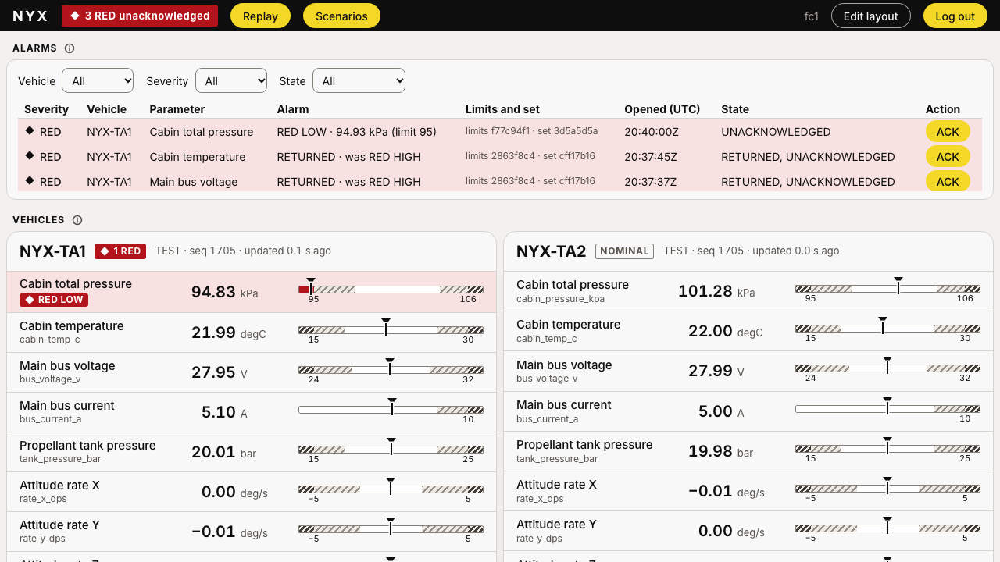

# Operator guide

One page for the person at the console. All times are UTC and end in `Z`, for example `14:03:17Z`. Text in bold is exactly what the console shows.

## Read the console

- The top bar always shows the unacknowledged alarms (for example **2 RED · 1 YELLOW unacknowledged**); click it to jump to the alarm list.
- Arrange the console your way: press **Edit layout** in the top bar, then drag a pane by its grip onto another, or use its arrow buttons; the double arrow switches it between full and half width, and its bottom-right corner sets its height (the pane beside it follows). **Done** locks the layout again; **Reset layout** brings back the default. The layout is kept in this browser only.
- Click a parameter's name, in a vehicle card or an alarm row, to show it in the chart.
- In the chart, hover to read the exact UTC time, value and the min/max at that point. Drag across the plot to zoom into that stretch; **−** / **+** or Ctrl/⌘ + scroll (a trackpad pinch) zoom out and in. **‹ Older** / **Newer ›**, Shift + scroll or a sideways swipe move back and forward in time; the range shows **HISTORY** and stops following the clock until you press **Live**. A plain scroll still scrolls the page.
- Each long list (commands, sessions, events) scrolls inside its pane and has its own **Show** (vehicle) and **Search** filter.
- One row per parameter and vehicle: name, value, then the limit gauge. A value is grey when nominal; colour, text and a glyph appear only for YELLOW or RED. A RED badge on a row that is also stale shows the last limit as "was RED LOW".
- Under a parameter's name (in place of its id, which stays in the hover text) you may see a freshness mark: **STALE** (older than 2 s), **FROZEN** (all analog values identical for 2 s or more) or **NO DATA** (no value yet). No mark means fresh.
- An alarm row says in words why it fired (for example "YELLOW - RATE FALLING -0.40 kPa/s (limit 0.15)") and shows two 8-character hash prefixes. They identify the limits file and the whole mission database that were live when it fired; quote them when you report a limit question.
- The event list shows lost frames, LOS and AOS (acquisition of signal), sequence resets and mission-db changes, newest first.

## Banners and tones
Banners follow one order, highest first: **NO LIVE CONNECTION** (this browser lost the server) > **GROUND PROCESSING DOWN** (the ground software does not process that vehicle; **GROUND PROCESSING DOWN – BROKER** on every vehicle when the data broker is down) > **LOSS OF SIGNAL** (no frame for 2 s while the ground is healthy; it clears when the vehicle's signal is acquired again) > **FROZEN** > **STALE**. While a higher banner shows, trust nothing below it: no RED can be raised.
- The loud beep sounds once per new RED alarm. A reload does not repeat it.
- The lower, slower tone sounds once when monitoring is lost (LOS, frozen data, ground processing down, no live connection). It does not repeat and needs no acknowledgement; the banner stays until the state ends. A single stale value is silent.
- **SOUND OFF** badge: audio is not running. Click it to arm the audio.

## Acknowledge an alarm
Press **ACK** on the alarm, type a note (required), confirm. The row shows **ACK PENDING** (with your name) until the ground software applies it, normally within 1 s, then ACKED. While ground processing is down it says **ACK NOT APPLIED – processing down**: the request waits and nothing is applied yet. A refused or superseded request shows the server's reason, or `ACK REJECTED` / `ACK SUPERSEDED` (someone already acknowledged it); try once more and tell the test conductor if a rejection repeats. An alarm that returned to normal before anyone acknowledged it shows **RETURNED, UNACKNOWLEDGED** until you do.
If the alarm changes while the dialog is open (it escalates, returns or clears), the dialog closes and the row says **Alarm changed – review it before acknowledging**: read the alarm again, then ACK it again. ACK is disabled while **NO LIVE CONNECTION** or **GROUND PROCESSING DOWN** is shown, because the screen may be out of date.

## Send a command
Choose the target vehicle yourself (there is no default), the command and its arguments. A hazardous command asks for confirmation: the dialog repeats vehicle, command, arguments and the hazard text, wants a reason of at least 10 characters, and enables **Confirm** only after you type the vehicle ID (for example `NYX-TA2`). The confirmation lasts 60 s. If the console says "<name> **sent the same command** N s ago" (within 2 s), do not send it again; look at the command list. After a network error it says "May have been sent - check the command list before sending again": do that first.

## When a command shows FAILED
FAILED is final; the line after it says what happened and what to do:
- **not sent – safe to retry**: it never left the ground (the broker refused it, or the send took longer than the 2 s interlock).
- **vehicle did not execute it**: the vehicle refused it; send again only after checking why.
- **vehicle executed it at** `14:03:17Z` – **do NOT resend**: it happened after the wait.
- **vehicle accepted it late**: accepted but not yet seen executing; wait and watch the parameters.
- **outcome unknown**: nothing proves either way. Check the vehicle `mode`, `last_cmd_id` and the affected parameters. Never resend a hazardous command blindly. Tell the test conductor.

## Run a test session
Sessions panel: pick the vehicle, name the session, press **Start session**. A vehicle has one active session; a second start on it is refused. **Stop** ends it for everyone. The report shows **Report pending** until the vehicle's data has reached the end of the session (usually seconds); after 30 s it is frozen anyway and marked "incomplete: n of m frames". A frozen report never changes. Use **Download CSV** for sign-off, which happens outside the tool. In a spreadsheet, a cell that begins with `'` is text we protected from being read as a formula; the apostrophe is not part of the value.
